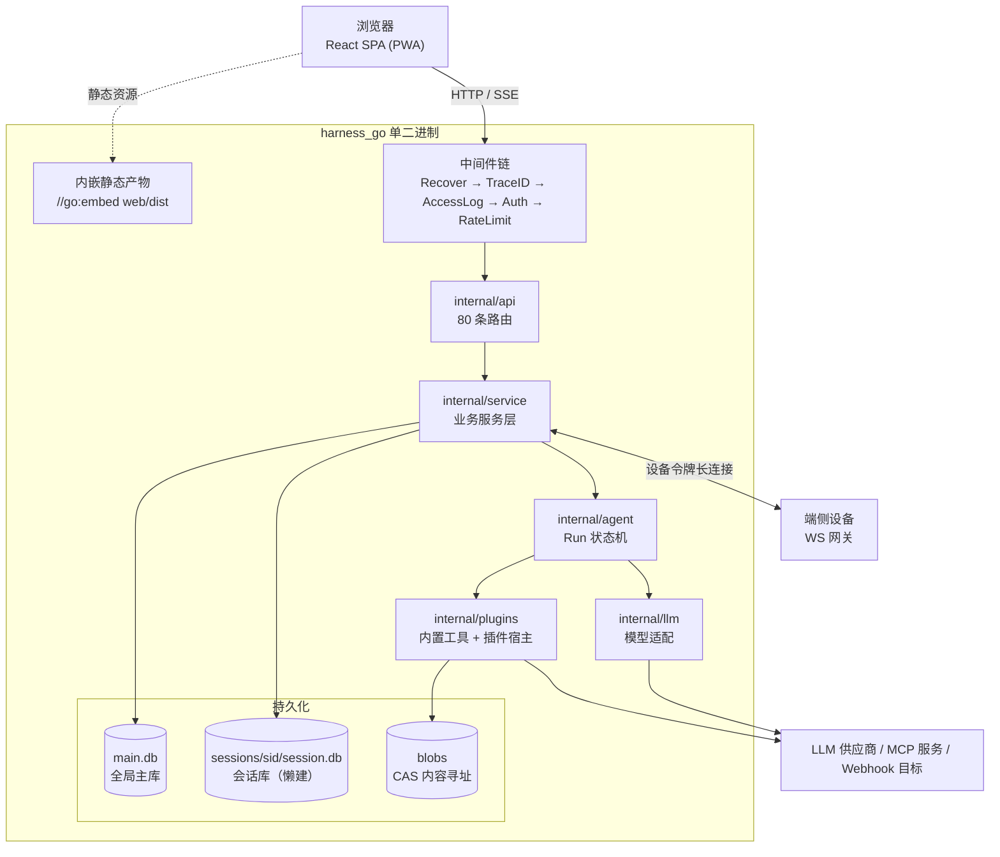

# harness_go

Web 版 AI Agent 服务端：**Go 单二进制（`//go:embed` 内嵌前端产物）+ React/Vite 前端**。
启动一个可执行文件即可获得完整的 Agent 工作台——无需安装 Go / Node 运行时。

---

## 一、项目定位与核心能力

| 能力域 | 说明 | 主要代码位置 |
| --- | --- | --- |
| 会话与流式对话 | 每会话独立 SQLite 库（懒建 + MaxOpen 限流 + 空闲驱逐），SSE 推送 Run 事件流 | `internal/service/run_service.go`、`internal/agent/` |
| Agent 状态机 | Run 生命周期、审批中断、预算/租约闸门、终态一致性屏障 | `internal/agent/engine.go` |
| 内置工具生态 | 文件读写、命令执行、浏览器、网页抓取、图像、技能、SOP、子 Agent、长任务等 | `internal/plugins/`、`pkg/toolapi` |
| 插件 / 市场 | 插件包安装、回滚、启停、健康检查 | `internal/plugins/`、`internal/market/` |
| MCP 接入 | stdio / http / sse 三种传输，服务注册、重载、启停、健康探针 | `internal/mcp/` |
| 多端协同 | 设备配对码、设备令牌、端侧 WS 网关、端侧工具执行面 | `internal/device/`、`cmd/fake-runner` |
| 回滚与快照 | 消息级回滚、会话快照、文件 CAS 去重 | `internal/snapshot/`、`internal/service/rollback_service.go` |
| 检索与记忆 | 长期记忆、检索索引、上下文压缩与工具筛选 | `internal/memory/`、`internal/retrieval/`、`internal/service/tool_selector.go` |
| 可观测 | `/healthz`、访问日志、TraceID、Token 统计、预算闸门 | `internal/observ/`、`internal/service/budget_gate.go` |
| 内置 Webhook | 事件外发，支持启停与测试投递 | `internal/service/webhook_service.go` |

> 完整功能真假三层判定（能用 / 后端有前端无 / 已规划未开始）见 `docs/功能现状与推进计划.md`，
> 本 README 只陈述**当前已落地**的能力，不罗列规划项。

---

## 二、技术栈

**后端**

| 项 | 值 |
| --- | --- |
| 语言 | Go 1.26（module `harness-go`） |
| HTTP | 标准库 `net/http` + ServeMux（Go 1.22+ 路径参数），无 Web 框架 |
| 数据库 | `modernc.org/sqlite`（**纯 Go 实现，无 CGO**） |
| WebSocket | `github.com/coder/websocket` |
| MCP | `github.com/modelcontextprotocol/go-sdk` |
| 配置 | `gopkg.in/yaml.v3` |
| 鉴权 | `golang.org/x/crypto`（口令哈希 + 会话令牌 + SSO） |

**前端**（`web/`）

| 项 | 值 |
| --- | --- |
| 框架 | React 18 + TypeScript 5.6 |
| 构建 | Vite 5（`build` = `tsc -b && vite build`） |
| 样式 | Tailwind CSS 3（暗/亮双主题，CSS 变量驱动） |
| 状态 | zustand 4（按域拆 store） |
| 其他 | lucide-react（图标）、@tanstack/react-virtual（长列表虚拟化）、PWA（`manifest.webmanifest` + `sw.js`） |

---

## 三、快速开始

### 3.1 用分发包（无运行时依赖）

`packaging/` 是完整可运行分发包，解开即可用（详见 `packaging/README.txt`）：

```powershell
# Windows：双击 start.cmd
# Linux / macOS：
chmod +x ./harness-go ./start.sh && ./start.sh
```

启动后浏览器打开 <http://127.0.0.1:5611>。

**首次登录**：首启自动创建管理员并生成随机口令写入 `data/initial_password`
（第一行用户名、第二行口令，权限 0600，仅生成一次）。登录后请立即在「设置 → 账户」改口令。

### 3.2 源码开发

```powershell
# 后端（默认监听 127.0.0.1:5611；等价于 .\run.cmd --dev）
go run ./cmd/harness-go

# 前端（默认即直连真实后端；npm run dev 与 dev:real 等价）
cd web
npm install
npm run dev          # vite dev server，端口 5612
npm run dev:real     # 同上（加载 .env.real → VITE_API_MODE=real，显式写法保留）
```

`vite.config.ts` 的 dev proxy 把 `/api`、`/healthz` 转发到后端，避免跨端口 CORS 与 Cookie 丢失；
后端地址可用环境变量覆盖，如 `HARNESS_BACKEND=http://127.0.0.1:9000 npm run dev:real`。

> 想看早期纯前端原型（数据全来自 `demo/src/mock`、不连后端）：`.\demo\run.cmd`（端口 5610）。

### 3.3 一键构建单二进制

```powershell
make build-all       # 等价于：cd web && npm ci && npm run build；再 go build
# Windows 无 make 时：
go build -trimpath -ldflags "-s -w" -o bin/harness-go.exe ./cmd/harness-go
```

> ⚠️ `web/dist/.gitkeep` 必须入库：`//go:embed all:dist` 在编译期要求目录存在。
> 未构建前端时二进制仍可启动，`/` 返回「前端未构建」提示页。
> 也提供了 `run.cmd` / `run.sh`（支持 `--dev` / `--port` / `--data` / `--config` / `--open` /
> `--no-build` / `--rebuild` / `--dry-run` / `--no-health` / `--no-web-rebuild` 等参数，
> 详见第四章；注意 `--web` 已迁移到前端脚本，传它会直接报错退出）。

---

## 四、脚本一览：前后端已分家

脚本按**前后端职责**分放两个目录，后端脚本在根目录，前端脚本在 `web/`；
早期原型 `demo/` 自带独立启动脚本，与正式前端完全隔离：

| 用途 | 后端（根目录） | 前端（`web/`） | 原型（`demo/`） |
| --- | --- | --- | --- |
| 启动 | `./run.sh`（`run.cmd`）— 只起后端，默认 `127.0.0.1:5611` | `./web/run.sh`（`web\run.cmd`）— vite dev server，5612，HMR | `./demo/run.sh`（`demo\run.cmd`）— vite dev，5610，纯前端不连后端 |
| 构建 | `./build.sh`（`build.cmd`）— 本机单二进制 → `bin/` | `./web/build.sh`（`web\build.cmd`）— `tsc -b && vite build` → `web/dist/` | `demo/run.sh --build`（或 `cd demo && npm run build`）→ `demo/dist/` |
| 打包 | `./package.sh`（`package.cmd`）— 多平台 → `dist/` + SHA256（+NSIS） | —（前端产物由打包脚本委托 `web/build.sh` 生成） | —（原型不参与发版） |

**端口三分法**（互不撞号，勿随意改）：

| 端口 | 归属 |
| --- | --- |
| `5610` | `demo/` 原型（纯前端，数据全部来自 `demo/src/mock`） |
| `5611` | 后端 harness-go（`run.sh` / 单二进制） |
| `5612` | `web/` 前端 dev server |

公共逻辑抽到 `scripts/lib/common.sh`（版本信息 / LDFLAGS / 前端产物新鲜度 / 委托构建）与
`scripts/win/bash.cmd`（Git Bash 定位 + UTF-8 代码页），所有 `.cmd` 均为瘦包装。

**常用参数**

| 脚本 | 参数 |
| --- | --- |
| `run.sh` | `--dev`（go run 模式）· `--port` · `--data` · `--config` · `--open` · `--no-build` · `--rebuild` · `--dry-run` · `--no-health` · `--no-web-rebuild` |
| `web/run.sh` | `--port` · `--real`（默认即真实，显式写法保留）· `--backend <url>` · `--open` · `--install` · `--dry-run` |
| `demo/run.sh` | `--port` · `--build` · `--preview`（零依赖 `serve.cjs` 托管 `demo/dist`）· `--open` · `--install` · `--dry-run` |
| `build.sh` | `--web`（先构建前端）· `--skip-web`（复用已有产物，只编译后端）· `--debug` |
| `package.sh` | `--targets "windows/amd64,linux/arm64"`（默认三平台）· `--web` / `--no-web` · `--nsis` · `--debug` |

### 4.1 `build.sh` 与 `package.sh` 不重复

| | `build.sh` | `package.sh` |
| --- | --- | --- |
| 平台 | 仅本机 | 多平台交叉编译（默认 `windows/amd64` + `linux/amd64` + `darwin/arm64`） |
| 耗时 | 秒级 | 分钟级 |
| 产物 | `bin/harness-go[.exe]` | `dist/<pkg>/` + `.zip`/`.tar.gz` + `SHA256SUMS.txt`（+ NSIS 安装包） |
| 用途 | 日常编译、`run.sh` 启动 | 发版交付 |

二者是「日常 × 发版」的关系，**合并会把日常构建拖进发版耗时**，故保留两个入口；重复的
版本信息、LDFLAGS、前端构建已收敛到公共库，不会再各自漂移。

### 4.2 前后端热更新（必须开两个终端）

`web/dist` 经 `//go:embed` 在**编译期**打进二进制，Go 侧不感知其变化，因此：

- **没有**单条命令同时热启动前后端，需两个终端：

```powershell
# 终端 A：后端（5611；go run 不是热重载，改 Go 代码需 Ctrl+C 重跑）
.\run.cmd --dev --port 5611

# 终端 B：前端 HMR（5612，/api 与 /healthz 经 proxy 转给 5611）
.\web\run.cmd              # 默认直连真实后端（已是 real 模式）
.\web\run.cmd --real       # 与上一行等价，显式写法保留
```

- 后端端口必须与 `web/vite.config.ts` 的 proxy 默认 target 一致（5611），否则用
  `.\web\run.cmd --backend http://127.0.0.1:9000` 显式对齐。
- 想看早期纯前端原型（与后端无关）另开终端跑 `.\demo\run.cmd`（5610）。
- 只跑 `./run.sh`（单二进制或 `--dev`）时，脚本仅在「前端源码比 `web/dist` 新」时
  **重建一次**，属于冷更新；`--no-web-rebuild` 可跳过。

---

## 五、目录结构

```
harness_go/
├── cmd/
│   ├── harness-go/        # 主程序：config → 装配 → router → http.Server
│   ├── fake-mcp/          # 测试用 MCP fixture（stdio/http/sse + 坏包场景）
│   └── fake-runner/       # 测试用端侧 Runner（配对 / 重连 / 能力上报）
├── internal/
│   ├── api/               # 路由、中间件（Auth/RateLimit/TraceID/AccessLog/Recover）、各 handler
│   ├── agent/             # Run 状态机引擎（唯一终态收口点）
│   ├── service/           # 业务服务层（会话/Run/回滚/预算/租赁/设备/MCP/市场/Webhook…）
│   ├── store/             # 持久化（主库 + 会话库、迁移、CAS blob）
│   ├── plugins/           # 内置工具实现（fs/command/browser/webfetch/image/skill/sop/subagent/todo/plan…）
│   ├── tools/             # 工具调用编排与危险动作判定
│   ├── pluginkit/         # 插件宿主与生命周期
│   ├── mcp/               # MCP 客户端与传输
│   ├── device/            # 多端协同：配对、令牌、WS 网关、端侧执行面
│   ├── llm/               # 模型供应商适配
│   ├── memory/ retrieval/ prompt/ tokenizer/   # 记忆、检索、提示词、分词
│   ├── snapshot/          # 快照与回滚
│   ├── auth/ secret/ approval/ apperr/ observ/ model/ config/
│   └── events/            # 事件总线与 SSE 发布
├── pkg/toolapi/           # 对外稳定的工具 API 契约
├── web/                   # React 前端（embed.go 内嵌 dist）
├── api/openapi.yaml       # OpenAPI 契约
├── docs/                  # 架构 / 协议 / 存储 / 计划 / 避坑清单
├── dev/                   # e2e 与响应式验证脚本（PowerShell）
├── packaging/             # 可分发单二进制分发包
├── config.example.yaml    # 全量配置示例（每项均等于内置默认值）
└── Makefile               # build / web / build-all / lint / vet / test / check / check-eol
```

前端 `web/src` 结构：

```
web/src/
├── App.tsx            # 启动静默探测 /auth/me → 未登录渲染 LoginPage，已登录渲染 AppShell
├── layout/            # AppShell / Sidebar / TopBar / useBreakpoint
├── features/
│   ├── auth/ chat/ devices/ market/ plugins/ projects/ scheduled/ settings/ advanced/
├── components/        # ModeBadge / RealModeNotice / MarkdownLite / DiffView / ToolCard / VirtualList…
├── lib/               # api.ts（real/mock 双轨）· apiTypes.ts · sse.ts · pwa.ts · toolDiff.ts
├── stores/            # zustand 分域 store
└── mock/              # 演示数据基线
```

---

## 六、架构总览



### 6.1 中间件链（外 → 内）

`Recover → TraceID → AccessLog → Auth → RateLimit(20, 40) → Handler`

免鉴权白名单（`internal/api/router.go:10-17`）：`/api/v1/auth/login`、`/api/v1/auth/sso`、
`/api/v1/devices/pair`、`/api/v1/devices/ws`
（端侧无用户令牌，配对码本身即凭据：一次性 + TTL 120s + 失败限流；设备 WS 由**设备令牌**在升级前独立鉴权）。

### 6.2 数据分层（`data/`）

```
data/main.db                    跨会话共享主库（用户 / 会话摘要 / 厂商 / 设置 / 设备 / 检索 / 市场）
data/sessions/<sid>/session.db  每会话独立库（消息 / Run / 工具事件 / 快照锚点 / 任务）
data/sessions/<sid>/blobs/      会话级 CAS（附件 / 产物 / 大工具输出）
data/snapshots/blobs/           全局 CAS（文件快照，跨会话去重）
data/app.log                    日志（GET /api/v1/logs 尾行读取）
data/initial_password           首启随机口令（0600，仅一次）
```

跨库操作**不做事务**，以「同主库单条 UPDATE + 回调」或最终一致收敛；
会话库惰性建库/迁移 + MaxOpen 限流 + 空闲驱逐，启动时**不会**全量扫描 `data/sessions`。
详见 `docs/数据存储方案.md`。

### 6.3 终态一致性铁律

`internal/agent/engine.go` 收尾顺序固定，**勿重排**：

```
transition(final) → Summary.AddTokensAndStatus → publishStatus(final) → Events.CloseRun
```

先持久化、后发通知：终态事件与 SSE 关闭是对外一致性屏障，任何在其之后才落的持久化都会让客户端回查读到旧值。

---

## 七、HTTP 接口概览

共注册 **80 条路由**（`internal/api/router.go`），其中 `/api/v1/**` 71 条，按业务域分布：

| 业务域 | 条数 | 说明 |
| --- | --- | --- |
| `sessions` | 21 | 会话 CRUD、消息、Run 与 SSE 事件流、回滚、快照、导出、归档 |
| `mcp` | 10 | MCP 服务注册 / 更新 / 重载 / 启停 / 健康 |
| `providers` | 7 | 模型供应商配置 |
| `webhooks` | 6 | 列表 / 创建 / 删除 / 启停 / 测试 |
| `packages` | 6 | 插件包安装 / 卸载 / 回滚 / 启停 |
| `auth` | 5 | 登录 / SSO / me / 登出 / 改密 |
| `devices` | 5 | 配对码 / 配对 / 列表 / 吊销 / WS 网关 |
| `settings` | 3 | 全局设置读写 |
| `tools` | 3 | 工具清单与调用 |
| `data` | 2 | 全量备份 / 恢复（owner 专用） |
| `logs` / `stats` / `artifacts` | 各 1 | 日志尾读 / 统计 / 制品下载 |

非 `/api/v1` 路由：`GET /{$}`（SPA 入口 + SSO 免登拦截）、`GET /login`、静态资源
（`/assets/`、`/icons/`、`/manifest.webmanifest`、`/sw.js`）、`GET /healthz`、
以及 OpenAI 兼容端点 `GET /v1/models`、`POST /v1/chat/completions`。

契约细节（请求/响应体、SSE 事件类型、插件协议）以 `docs/protocols.md` 与 `api/openapi.yaml` 为准。

---

## 八、前端数据模式（REAL / DEMO）：先看这个

前端存在两类"假数据"，必须分清：

1. **走开关的假**：`api = apiMode === 'real' ? realApi : mockApi`；
2. **绕过开关的假**：个别组件直接 `import from '../mock/*'`，real 模式下仍是演示数据
   —— 这类面板在 REAL 模式下会显示**黄色提示条**明示降级（`web/src/components/RealModeNotice.tsx`）。

### 8.1 `resolveApiMode()` 的三段默认分支

唯一实现在 `web/src/lib/api.ts:77-90`，优先级从高到低：

| 优先级 | 来源 | 说明 |
| --- | --- | --- |
| 1 | `VITE_API_MODE`（构建期注入） | 取值 `real` / `mock`，CI 与预览用 |
| 2 | `localStorage['harness.apiMode']` | 运行期手动切换（顶栏角标可一键切换） |
| 3 | 默认 | **开发态 `mock`**（可离线调 UI）/ **构建产物 `real`**（内嵌产物直连本机后端） |

### 8.2 三种切换方式

| 方式 | 做法 | 适用 |
| --- | --- | --- |
| 界面切换 | 点顶栏 🟢REAL / 🟡DEMO 角标 → 选目标模式（写 localStorage 后整页重载） | 日常辨别真假 |
| 开发态跑真实数据 | `cd web; npm run dev:real`（加载 `.env.real`，注入 `VITE_API_MODE=real`） | 验证接线是否真通 |
| 手动兜底 | 控制台 `localStorage.setItem('harness.apiMode','real')` 后刷新 | 调试 |

> 顶栏角标是**任何页面都能一眼可辨**的模式事实来源；顶栏 SSE 状态胶囊读的是
> `web/src/lib/sse.ts` 的真实状态机（连接 / 退避 / 补同步），无订阅时显示「未订阅」，不含任何编造指标。

---

## 九、配置

配置优先级（高 → 低）：**命令行 flag > 环境变量 `HARNESS_*` > `data/config.yaml` > 内置默认值**。

```powershell
mkdir -p data && cp config.example.yaml data/config.yaml   # 方式一：默认加载路径
./bin/harness-go -config ./config.example.yaml             # 方式二：显式指定
$env:HARNESS_CONFIG = './my.yaml'; ./bin/harness-go         # 方式三：环境变量
```

`config.example.yaml` 中**每一项均等于内置默认值**，即不写配置文件时的实际行为。配置段：

| 段 | 作用 |
| --- | --- |
| `server` | 监听地址（默认仅绑回环 127.0.0.1）、读写超时 |
| `deployment` | 部署形态 `local` / `server` / `cloud`，决定内置工具开关、stdio MCP 是否可用、鉴权强度 |
| `data` | 数据目录（主库 / 会话库 / blob / 日志 / 初始口令） |
| `auth` | 口令策略、会话令牌 TTL、SSO（`plain` / `signed`） |
| `storage` `tools` `devices` `budget` `mcp` `log` | 存储配额、工具开关、设备离线判定、预算、MCP、日志级别 |

> 🚨 **铁律：不做静默兜底。** 任一项写错（非法枚举、必须 >0 写成 0、
> `dynamic_min_top_k > dynamic_top_k`、`offline_after_s <= heartbeat_s` 等）都会在**启动时硬报错退出**，
> 而不是悄悄改成默认值继续跑。看到「config: xxx 非法」请回 `config.example.yaml` 核对字段。

> ⚠️ `server.write_timeout_s` **必须为 0 或足够大**：SSE 长连接会被写超时直接掐断，
> 表现为「流式回复跑到一半就断」。默认 0 = 不限制。

---

## 十、质量门禁（改完必须全跑）

```powershell
# 后端
gofmt -l .                 # 期望无输出
go vet ./...
go test ./... -count=1     # ⚠️ Windows 本地易超 120s 被截断，建议分包跑

# 前端（两者必须同时过！）
cd web
npx tsc -b
npm run build
```

> ⚠️ **门禁盲区**：`web/tsconfig.json` 的 `include` 仅含 `src`，`vite.config.ts` 不在 tsc 编译范围，
> 其语法错误只在 vite build 的 esbuild 阶段暴露 → **只跑 `tsc -b` 会漏**。
> 另：`tsconfig.node.json` 为 `composite` 项目，**不得设 `noEmit: true`**（会报 `TS6310`），
> 正确写法是 `emitDeclarationOnly` + `declaration` + `outDir: ./node_modules/.tmp/node-types`。

**补充验证**

| 目标 | 命令 |
| --- | --- |
| 端到端 | `dev/e2e-*.ps1`（a10 / b2b4 / c / c2 / c3 / c4 / g / p1 / resolver，共 9 个） |
| 响应式 | `powershell -ExecutionPolicy Bypass -File dev/run-responsive.ps1`（360 / 768 / 1440 三档） |
| 换行符 | `make check-eol`（Windows 下不要依赖 make，可用 PowerShell 等价校验） |
| 静态检查 | `make lint`（golangci-lint v2，含 depguard 分层规则） |

**本机环境注意**：默认 `CGO_ENABLED=0` → **禁止引入 CGO 依赖**；`test-race` 仅在 CI 且
`CGO_ENABLED=1` 下跑。`run_command` 底层是 Windows PowerShell（不支持 `&&`、`dir /B`、`where`）。
严禁按进程名通配杀进程，只能对自身派生的具体 PID 定向终止。

历史踩坑与详细口径见 `docs/工程避坑清单.md`。

---

## 十一、文档索引

| 文档 | 用途 |
| --- | --- |
| `docs/功能现状与推进计划.md` | **功能真假三层判定**（能用 / 后端有前端无 / 已规划未开始）+ 后续推进计划 |
| `docs/需求说明文档.md` | 原始需求与边界定义 |
| `docs/架构设计文档.md` | 总体架构与客户端状态机 |
| `docs/开发实施计划.md` | 路线图 A~G + P1 的 WBS 与验收口径 |
| `docs/protocols.md` | HTTP / SSE / 插件协议契约 |
| `docs/数据存储方案.md` | 双库布局、CAS、迁移与驱逐策略 |
| `docs/基础服务设计.md` | 服务层切分与依赖方向 |
| `docs/插件体系设计.md` | 插件宿主、生命周期、`pkg/toolapi` 契约 |
| `docs/MCP接入设计.md` | MCP 传输、注册与健康探针 |
| `docs/多端协同架构可行性方案.md` | 设备配对、WS 网关、端侧执行面 |
| `docs/系统内置工具可安装性与多端协同.md` | 内置工具的可安装性判定 |
| `docs/基础功能边界与插件化可行性评估.md` | 能力边界与插件化取舍 |
| `docs/阶段D剩余功能缺口清单.md` | 阶段 D 遗留缺口 |
| `docs/工程避坑清单.md` | 历史踩坑与门禁口径 |

---

## 十二、关联项目

| 项目 | 定位 | 关系 |
| --- | --- | --- |
| `harness_go`（本仓库） | Web 版 AI Agent 服务端 | — |
| `harness_mini` | 桌面版 AI Agent 工具 | 同族产品，跨目录引用其代码时以其目录约定与约束为准 |
