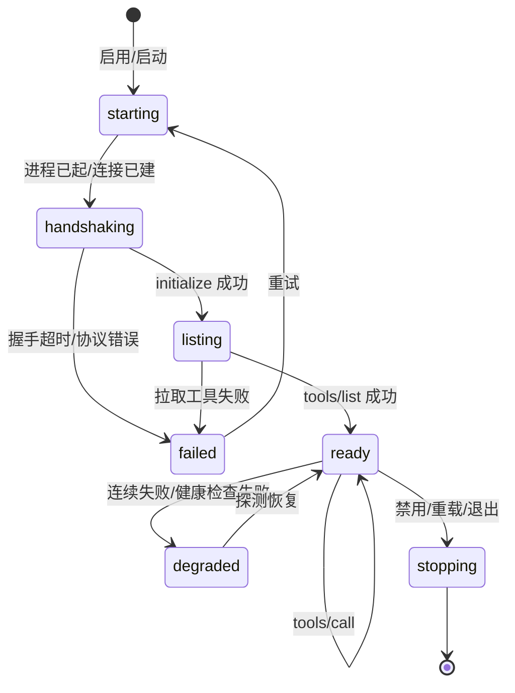

# harness_go MCP 接入设计

| 项目 | 内容 |
| --- | --- |
| 文档版本 | v1.0 |
| 上游依据 | `docs/基础服务设计.md`（S11 插件与 MCP 管理）、`docs/插件体系设计.md`（统一 Tool 契约） |
| 覆盖范围 | MCP 三传输、配置模型、连接生命周期、工具映射、健康与熔断、失败隔离、管理 API、安全边界 |
| 日期 | 2026-09-13 |

> 定位：**MCP 是"外部插件"的一种传输实现，不是独立体系。** MCP 工具最终被包装成统一的 `Tool` 注册进同一个注册表，走同一套审批与注入规则。

---

## 1. 设计目标

| # | 目标 | 验收标准 |
| --- | --- | --- |
| M1 | 三种传输可用 | stdio / HTTP+SSE / Streamable HTTP 均能连通并拉到工具清单 |
| M2 | 单个 Server 故障隔离 | 一个 Server 崩溃/超时，其他 Server 与会话不受影响 |
| M3 | 配置可运维 | 联通测试返回工具清单与可读错误；支持热重载 |
| M4 | 工具与内置同构 | 审批、截断、超时、注入过滤与内置插件完全一致 |
| M5 | 部署形态安全 | `cloud` 形态禁止 `stdio`（不允许起子进程） |
| M6 | 可观测 | 每个 Server 有状态、最近错误、调用次数与失败率 |

---

## 2. 传输层设计

### 2.1 三种传输对比

| 传输 | 适用场景 | 连接方式 | 生命周期 | 阶段 |
| --- | --- | --- | --- | --- |
| `stdio` | 本地工具（文件系统、数据库、CLI 封装） | 内核启动子进程，stdin/stdout 换行分隔 JSON-RPC | 随内核进程；崩溃需重启 | M2 |
| `HTTP+SSE`（旧版） | 已有 SSE 服务 | `GET /sse` 收事件 + `POST /messages` 发送 | HTTP 长连接 | M2 |
| `Streamable HTTP`（新版） | 远程/多租户 Server | 单端点 `POST`，响应为 JSON 或 SSE 流；支持 `Mcp-Session-Id` | 无状态或会话态 | M2 |

### 2.2 实现选型

**使用官方 `github.com/modelcontextprotocol/go-sdk`（v1.7.0+，支持 MCP 规范 2026-07-28）**，不自研 JSON-RPC：

- `mcp` 包提供 client/server 构造与传输实现；
- `jsonrpc` 包用于自定义 transport；
- `auth` / `oauthex` 包为 OAuth 预留（P2）。

仅当 SDK 不满足需求（如需注入自定义 `Mcp-Session-Id` 处理）时，用 `jsonrpc` 包自建 transport，**不手写协议解析**。

### 2.3 传输层关键约束

| 约束 | 说明 |
| --- | --- |
| 握手 | `initialize`（协商 protocolVersion + capabilities）→ `notifications/initialized`，超时 10s |
| 进程 | `stdio` 子进程必须设置工作目录、限制 env（仅传入配置项 + 必要 PATH）、stderr 单独收集为日志（不混入协议流） |
| 取消 | 工具调用超时后发送 `notifications/cancelled`，再等待 2s，仍未结束则 kill 进程组 |
| 编码 | 严格 UTF-8；stdout 中任何非 JSON 行视为协议错误（记日志并跳过，不崩溃） |
| 背压 | 单 Server 并发调用上限（默认 4），超出排队 |

---

## 3. 配置模型

### 3.1 数据结构

```go
type ServerConfig struct {
    ID            string            `json:"id"`
    Name          string            `json:"name"`
    Transport     Transport         `json:"transport"`      // stdio | sse | http
    // stdio
    Command       string            `json:"command,omitempty"`
    Args          []string          `json:"args,omitempty"`
    Env           map[string]string `json:"env,omitempty"`  // 加密存储
    Cwd           string            `json:"cwd,omitempty"`
    // 远程
    URL           string            `json:"url,omitempty"`
    Headers       map[string]string `json:"headers,omitempty"` // 加密存储
    // 通用
    Enabled       bool              `json:"enabled"`
    TimeoutMS     int               `json:"timeout_ms"`      // 默认 120000
    MaxOutput     int               `json:"max_output"`      // 默认 32768
    DefaultRisk   Risk              `json:"default_risk"`    // 默认 write
    AllowTools    []string          `json:"allow_tools,omitempty"`   // 白名单（空=全部）
    DenyTools     []string          `json:"deny_tools,omitempty"`
    HealthInterval int              `json:"health_interval_s"` // 默认 60，0=关闭
    CreatedAt     time.Time         `json:"created_at"`
}
```

### 3.2 存储与加密

- 存 `mcp_servers` 表；`env` 与 `headers` 用与 Provider 密钥相同的 AES-256-GCM 加密。
- 读取时解密到内存，**日志与 API 响应一律脱敏**（只回 `env_keys` 列表，不回值）。
- 导入/导出配置时，密钥字段需用户显式勾选"包含密钥"。

### 3.3 部署形态约束

| 形态 | stdio | 远程（SSE/HTTP） |
| --- | --- | --- |
| `local` | ✅ | ✅ |
| `server` | ✅（需显式开启 `allow_stdio`） | ✅ |
| `cloud` | ❌ 禁止（不允许起子进程） | ✅ |

---

## 4. 连接生命周期



### 4.1 启动流程

```
读取 enabled 配置
  → 并发启动（每个 Server 独立 goroutine + ctx，互不阻塞）
  → 建立传输 → initialize（10s） → tools/list（分页拉全）
  → 工具包装为 Tool（命名空间 + 风险映射）→ 注册到 Registry
  → 状态 ready，emit plugins.changed
  → 任一 Server 失败：仅该 Server 标 failed，记录可读原因，不影响其他
```

### 4.2 变更通知

- 订阅 `notifications/tools/list_changed` → 重新 `tools/list` → 差异注册/注销 → emit `tools.changed`。
- 差异计算：按 `namespace + name` 比对，新增/移除/描述变更分别记录。

### 4.3 重载

```
Reload(serverID):
  1. 用新配置建立新连接并完成握手（失败则保留旧连接，返回错误）
  2. 新连接 tools/list 成功
  3. 原子替换：注销旧工具 → 注册新工具 → 关闭旧连接
  4. emit tools.changed（生效边界：下一个 Run）
```

### 4.4 停止

```
Disable/Stop(serverID):
  1. 注销该 Server 全部工具（正在执行的调用允许完成，持有 Tool 引用）
  2. 发送关闭通知 → 等待 2s → 未退出则 kill 进程组
  3. 状态 disabled，emit plugins.changed
```

---

## 5. 工具映射与命名空间

| 项 | 规则 |
| --- | --- |
| 工具名 | `mcp__<serverKey>__<toolName>`，`serverKey` 由 `name` 规范化（小写、非字母数字转 `_`、截断 24 字符） |
| 描述 | `[MCP:<name>] <原始描述>`，超 200 字符截断（进上下文成本控制） |
| Schema | 原样透传 `inputSchema`；缺失或非法时用 `{"type":"object","properties":{}}` 并告警 |
| 风险 | 默认 `write`；`AllowTools` 中显式标注的只读工具可设 `readonly`（需用户在详情页确认） |
| 超时 | `TimeoutMS`（默认 120s），单工具可被 `Spec.Timeout` 覆盖 |
| 输出 | `content[]` 中 `text` 拼接；`image`/`resource` 落 CAS 并返回引用；总长超 `MaxOutput` 截断 |
| 错误 | `isError=true` 时按**工具错误**返回（不中断 Run，模型可自我纠正） |

**命名冲突**：与内置工具同名时自动加命名空间前缀，不覆盖内置（内置优先）。

---

## 6. 健康检查与熔断

| 机制 | 设计 |
| --- | --- |
| 被动健康 | 每次 `tools/call` 记录成功/失败/耗时；连续失败 ≥ 3 → `degraded` |
| 主动健康 | `health_interval_s > 0` 时定时 `tools/list`（轻量）或 `ping`（若支持）；连续 2 次失败 → `degraded` |
| 熔断 | `degraded` 期间工具不再注入（立即生效）；冷却 60s 后探测，成功则恢复 `ready` |
| 传输层重建 | `stdio` 进程退出 → 自动重启一次（指数退避 1s/2s/4s，最多 3 次），仍失败则 `failed` |
| 观测 | 每 Server 暴露 `state / last_error / calls / failures / p95_ms` |

**不重试**：工具调用超时不自动重试（可能有副作用），由模型决定是否重试。

---

## 7. 失败隔离与错误归一

| 失败类型 | 归一错误码 | 返回给模型 | 对 Server 状态影响 |
| --- | --- | --- | --- |
| 连接/握手失败 | `MCP_CONNECT_FAILED` | 工具不可用 + 原因 | `failed` |
| 工具调用超时 | `MCP_TIMEOUT` | "调用超时，可尝试重试或改用其他方式" | 计一次失败 |
| 工具返回 isError | `MCP_TOOL_ERROR` | 原始错误文本（截断） | 计一次失败 |
| 进程崩溃 | `MCP_PROCESS_EXIT` | "服务已退出" | `degraded` + 重启 |
| 协议解析错误 | `MCP_PROTOCOL_ERROR` | "服务返回了非法响应" | 计一次失败 |
| 输出超限 | — | 截断内容 + 提示 | 正常 |

**关键约束**：所有 MCP 错误都作为**工具结果**回传模型（`role=tool`），**不中断 Run**；只有连接级故障才把该 Server 全部工具移出注入集合。

---

## 8. 与内置插件的统一

| 维度 | 统一方式 |
| --- | --- |
| 注册 | 包装为 `Tool` 实现（`McpToolWrapper`），与内置插件走同一 `Registry.Register` |
| 审批 | 走同一 `Approver`；默认风险 `write`；`danger` 需逐次确认 |
| 截断 | 内核在调度层统一执行 `MaxOutput` |
| 注入 | 同一过滤链（enabled ∩ available ∩ 会话白名单 ∩ 工具上限） |
| 生效边界 | 新增/移除工具 → 下一个 Run 生效（保护前缀缓存） |
| 审计 | 同一 `tool_events` 表，`namespace=mcp:<server>` |
| UI | 同一"插件/工具"页面，MCP Server 作为一类来源 |

---

## 9. 管理 API

| 方法 | 路径 | 说明 |
| --- | --- | --- |
| GET | `/api/v1/mcp/servers` | 列表（密钥脱敏，含状态与统计） |
| POST | `/api/v1/mcp/servers` | 新增 |
| PUT | `/api/v1/mcp/servers/{id}` | 更新（变更后需显式 reload 才生效） |
| DELETE | `/api/v1/mcp/servers/{id}` | 删除（先注销工具） |
| POST | `/api/v1/mcp/servers/{id}/test` | 联通测试：建连 → 握手 → tools/list → 返回清单与耗时 |
| POST | `/api/v1/mcp/servers/{id}/reload` | 热重载（原子替换） |
| POST | `/api/v1/mcp/servers/{id}/enable` / `disable` | 启停 |
| GET | `/api/v1/mcp/servers/{id}/health` | 健康详情 |

联通测试要求：返回**可读失败原因**（命令不存在、超时、协议错误、鉴权失败、工具清单为空分别给出不同提示），并清理临时进程。

---

## 10. 安全边界

| 风险 | 对策 |
| --- | --- |
| stdio 起任意命令 | 仅 `local`/`server` 形态允许；`server` 需显式 `allow_stdio`；命令白名单（可选）；工作目录限制 |
| 密钥泄漏 | env/headers 加密存储；API 只返回键名；日志脱敏；导出需显式勾选 |
| 工具描述注入 | 描述进上下文前统一加 `[MCP:<name>]` 前缀并截断；UI 标注"外部来源" |
| 工具结果注入（Prompt Injection） | 结果视为不可信：截断、标注来源、不执行其中的"指令"；高危写操作仍需审批 |
| 出网 | 远程 Server 域名需在出网白名单（`server`/`cloud` 形态强制） |
| OAuth | 预留（官方 SDK `auth`/`oauthex`），P2 实现 |

---

## 11. 与桌面版实现的差异

| 项 | 桌面版 harness_mini | web 版 |
| --- | --- | --- |
| 传输 | 以 `command/args/env` 配置为主（stdio 形态） | 三传输（stdio / SSE / Streamable HTTP） |
| 管理 | 全局 `McpManager` 单例，`start_server` 注册工具 | 服务 S11 管理，支持原子重载与状态持久化 |
| 命名空间 | `mcp__<serverName>__<tool>` | 同左 + 名称规范化（避免非法字符） |
| 隔离 | 单 Server 失败记日志 | 显式状态机 + 熔断 + 立即从注入集合移除 |
| 安全 | env 加密 | 同左 + API 脱敏 + 出网白名单 + 部署形态约束 |
| 可观测 | 无统计 | 每 Server 调用数/失败率/P95 |

---

## 12. 阶段与验收

| 阶段 | 交付 |
| --- | --- |
| M2 | 三传输客户端、配置 CRUD、联通测试、工具注册、启停、基础健康 |
| M3 | `tools/list_changed` 热更新、熔断与自动重启、统计面板、HTTP 插件协议 |
| M4 | OAuth、工具白名单精细化、按会话授权 |

**验收清单**

- [ ] 三种传输各接一个真实 Server，均能拉到工具并在对话中调用成功
- [ ] 断开网络/杀掉 Server 进程，断言工具立即从注入集合移除、其他会话正常
- [ ] 联通测试对"命令不存在 / 超时 / 鉴权失败 / 空工具清单"给出不同可读提示
- [ ] `env` 与 `headers` 在 API 响应与日志中均为脱敏
- [ ] `cloud` 形态下配置 stdio 被拒绝并给出原因
- [ ] 连续 3 次工具失败后转 `degraded`，冷却后自动恢复
- [ ] 工具输出 1MB 时注入模型 ≤ MaxOutput，完整内容落库可查
