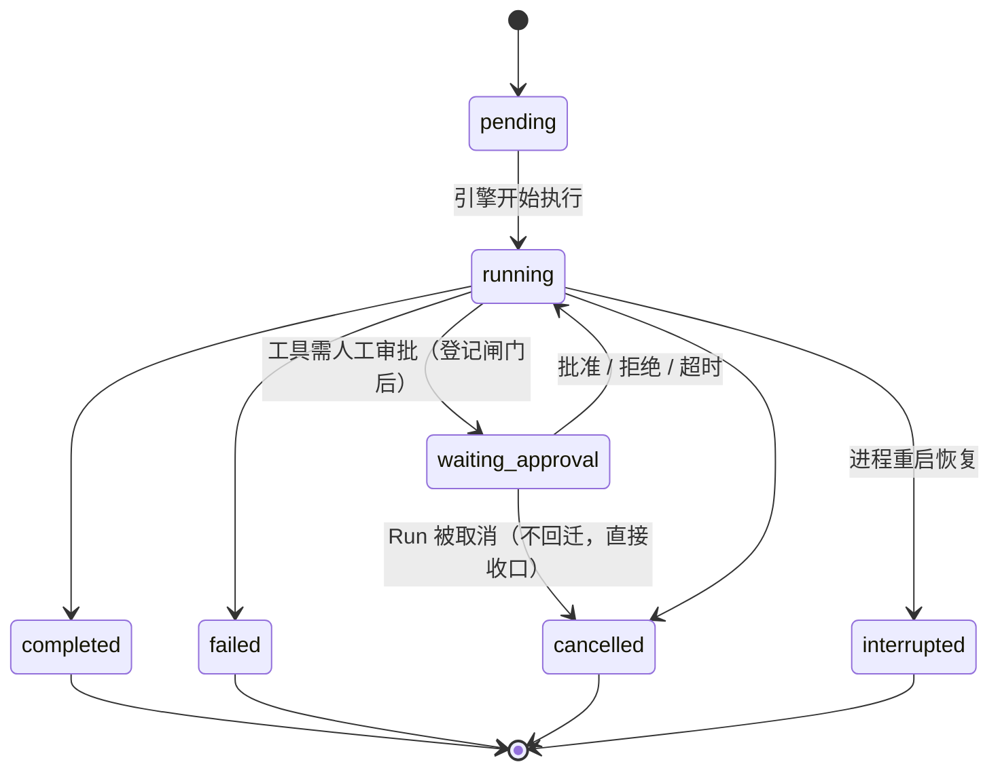

# Run 生命周期单一真相约定

> 本文记录 **Run 生命周期与前端收口** 的六条唯一性原则，以及它们对应的历史缺陷。
> 修改相关代码前请先读完——本文的每一条都对应一次实测事故，回退任意一条都会让旧缺陷复现。
>
> 六条原则：① 真相唯一 ② 状态机唯一 ③ 收口唯一 ④ 订阅唯一 ⑤ 凭据唯一 ⑥ 双通道隔离

---

## 0. 为什么需要这份文档

同一类缺陷曾以不同面貌复发三次：

| 时间 | 表象 | 当时的"修复" | 结局 |
| --- | --- | --- | --- |
| 第一次 | 任何 Run 失败都表现为「对话突然停止」 | 只修了 `error` 分支的收口 | 另两处收口仍未收口，同型缺陷继续存在 |
| 第二次 | `MaxSteps` 用尽后界面静默停住 | 补 `MaxSteps` 上限判定 | 收口依旧是三份拷贝 |
| 第三次 | 刷新页面后永久「运行中 + 转圈」 | 加 `resumeRun` 恢复链路 | 它接在后端**永不会进入**的状态上 |

共同根因不是某个分支写错，而是**同一件事有多处独立实现**：状态迁移、收口、订阅装配、审批凭据。
所以本文的约定全部是「收敛到唯一一处」，而非「在这里再补一个判断」。

---

## 1. 真相唯一：`session.db.runs.status` 是唯一真相

- Run 的生命周期真相**只**存在于会话库 `runs.status`。
- 主库 `sessions.last_run_status` 是**投影**，必须跟随真相，**不得反过来当真相用**。

### 投影必须全程跟随

`Start()` 创建 Run 后立即回写主库 `last_run_status=pending`（`run_service.go`），
终态时由 `SummaryWriter.AddTokensAndStatus` 回写终态。

**回退后果（实测）**：投影只在终态写 → Run 运行期间主库仍挂着上一轮的 `completed` →

1. `RecoverInterrupted` 按主库筛选会话 → **漏扫** → 进程重启后卡死的 `running` Run 永远不会被置 `interrupted`；
2. 前端会话列表的「运行中」徽标判据同为 `last_run_status` → 永不亮起。

---

## 2. 状态机唯一：审批等待**必须**落 `waiting_approval`

### 完整往返



### 铁律

- `engine.go` 的审批分支必须先 `transition(waiting_approval)` **再** `publish(approval.request)`；
  闸门解除后必须回到 `running` 再继续执行。
- **迁移失败必须硬失败**（`FinishToolEvent(error)` + 回灌模型），不得静默降级回旧行为。

### 回退后果（实测）

引擎曾只 `publish` + `Gate.Await`，从不迁移状态，一次性打穿三处下游：

1. `DecideApproval` 硬校验 `run.Status == waiting_approval` → **用户点「允许」永远 409**
   （`app.log` 中 09:57、10:39 两次 decide 均为 409）；
2. `GET /active-run` 的 `status` 永不为 `waiting_approval` → 前端「刷新后重建审批条」成了**永不执行的死代码**；
3. 跨端/审计看到的是 `running`，无法区分「在跑」与「在等人」。

> 取消路径刻意**不回迁** `running`：让状态停在 `waiting_approval`，由上层收口为 `cancelled`
> （`state.go` 允许该边）。这样避免与取消语义打架。

---

## 3. 收口唯一：前端只有 `settleRun()` 一处

`web/src/stores/chatStore.ts` 的 `settleRun(runStatus, opts)` 是**所有** Run 终结路径的唯一出口，
统一负责：

1. 结算当前流式消息（停转圈 + 记耗时 + 写 usage）；
2. 复位全局运行态（`streaming` / `runStatus` / `reasoning` / `approval`）；
3. 清模块级指针（`streamingMsgId` / `currentRunId` / `currentRunSessionId` / `handle` / `mockHandle`）；
4. `useSse.detachRun()`（顶栏不残留「已连接」假象）；
5. 若有排队输入则续跑下一条。

调用点：流式 `done`、流式 `error`、`startRun` 的 `.catch`、`attachToRun` 的 resync-终态分支。

**禁止**在别处再写一份「置空 + detachRun」。历史上正是三份拷贝导致修一处漏两处。

---

## 4. 订阅唯一：前端只有 `attachToRun()` 一处

`attachToRun({sessionId, runId, fromSeq, onEvent})` 是唯一的 SSE 装配点：

- `startRun`：POST 后订阅新建 Run（`fromSeq` 缺省 = 从头补发，不能漏首屏事件）；
- `resumeRun`：查 `GET /active-run` 后接回仍在跑的 Run（`fromSeq: -1` = 只要新事件，
  因为 DB 快照已给出全文，补发历史 delta 会把正文重复追加一遍）。

### resync 语义：只做「对齐 + 二选一」，绝不猜状态

```
收到 resync
  → ① reloadMessages（以 DB 快照对齐，delta 只是预览）
  → ② GET /runs/{rid} 查真实状态
       ├─ 已终态 → settleRun(status)   // 彻底收口
       └─ 未终态 → handle.reconnect()  // 服务端断过流，必须重连才收得到后续事件
```

`SseClient` 收到 `resync` 后**不自动重连**是刻意的：对已终态的 Run 重连只会拿到
「事件源已关闭」，形成重连风暴。是否重连必须由上层依据真实状态决定。

**回退后果（实测）**：旧版 `resync` 只 `cleanup()` 不重连，而上层只 `reloadMessages`，
于是服务端一旦因慢消费者断开，前端就**永久失聪**——后续 `approval.request`、终态事件全部收不到，
`streaming` 也无人收口 → 「永远转圈」。

---

## 5. 凭据唯一：审批决策只认 `approval.id`

`chatStore.respond()` 的 real 分支直接调 `api.decideApproval(sessionId, runId, ap.id, ...)`，
**不依赖任何事件闭包捕获的状态**。

**回退后果（实测）**：旧版走 `handle.resume()`，而 `approvalId` 是 `attachRun` 闭包里的局部变量，
只在收到 `approval.request` 事件时赋值。刷新恢复路径用 `fromSeq:-1` 不补发历史 → 该变量永远为 `''`
→ `resume()` 首行 `if (!approvalId) return` 静默返回 →
**恢复出来的审批条是「能看见、点不动」的假控件**。

---

## 6. 双通道隔离：`handle` 与 `mockHandle` 分开

`handle` 只承载 real 通道（`RunHandle`：`runId` / `stop` / `reconnect`），
`mockHandle` 单独承载演示流（`MockRunHandle`：`stop` / `resume`）。

两者曾混成一个联合类型 `RunHandle | MockRunHandle`，导致：

- mock 侧缺 `reconnect`、real 侧缺 `resume` 时编译器无法定位；
- 只能在每个调用点写 `apiMode === 'mock'` 分支，职责混乱。

分开后类型系统会强制两条通道各自完整。

---

## 7. 接口契约变化（本轮）

| 项 | 变化 | 原因 |
| --- | --- | --- |
| `RunHandle.resume` | **移除** | 决策改由 `decideApproval` 承担，避免闭包凭据缺陷 |
| `RunHandle.reconnect` | **新增** | resync 且 Run 未终态时重连 |
| `ApiClient.decideApproval` | **新增（公开）** | 联合"事件到达"与"刷新恢复"两条路径的唯一入口 |
| `approval.request` payload | 新增 `run_id`、`args` | 前端要显示「放行哪个 Run 的什么参数」；恢复时靠 `run_id` 决定提交目标 |

> `args` 在 `approval.request` 中是 **JSON 字符串**（与 `tool.started` 的对象形状不同）。
> 前端由 `parseArgsField()` 集中归一，避免各消费点各写一套 `typeof` 判断（旧版直接当对象取值 → 恒为空）。

---

## 8. 自检清单（改相关代码时逐条过）

- [ ] 引擎任何"阻塞等待"分支是否都有对应的状态迁移？迁移失败是否硬失败？
- [ ] 新增终结路径是否复用了 `settleRun`，而不是复制一段收口逻辑？
- [ ] 新增订阅路径是否走 `attachToRun`？
- [ ] 审批决策是否只凭 `approval.id`？
- [ ] 主库投影是否随真相同步（启动写 pending、终态写终态）？
- [ ] `go test ./...` 与 `cd web && npm run build` 是否全绿？

对应回归测试：`internal/agent/engine_approval_state_test.go`、
`internal/service/run_projection_test.go`、`internal/api/integration_test.go`（`TestActiveRunEndpoint`）。

---

## 9. 手工验证入口（与本文强相关）

验证审批链路必须能登录进 UI。统一约定见 `docs/工程避坑清单.md` **H6**：

```
http://127.0.0.1:5611/?user_name=admin&pwd=<data/initial_password 中的口令>
```

要点：**必须用 `127.0.0.1`，禁用 `localhost`**（Cookie 为 host-only，两个 host 不共享登录态，
表现为「登录成功→刷新变未登录→点发送静默无反应」）。
本仓库实测已用该入口完整走通：`waiting_approval` 落库 → 刷新后审批条重现 → 点「允许一次」
→ `decide` 返回 **200**（旧版恒 409）→ Run 跑到 `completed`。
