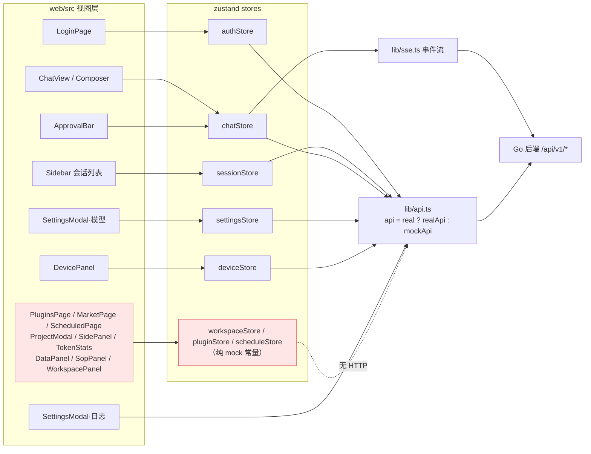

# 功能现状与推进计划

> **本文档解决的问题**：前端一部分是写死的 demo、一部分是真实功能，现状难以分辨「哪些能用、哪些不能用」。
> 本文档给出三层判定（✅ 能用 / ⚠️ 后端有前端没有 / ⏳ 已规划未开始）+ 后续开发调试计划。
>
> **取证口径**：三路并行只读盘点（后端路由实装度 / 前端 UI 可见度 / 规划文档对照）+ 主进程实测复跑门禁。
> 所有结论均带 `文件:行号` 证据，可逐条回查。**盘点过程未修改任何源码或既有文档。**

---

## 0. 一页纸结论

| 层 | 结论 | 量级 |
| --- | --- | --- |
| **后端** | 76 条路由**全部真实实现**，零空壳、零假数据、零 TODO；引擎 13 项核心能力全部可用 | 100% 可用 |
| **前端 · 能用** | 聊天主链路全通：登录 → 会话 → 发消息 → SSE 流式 → 工具审批 → 停止 → 引导 → 消息回滚 | 约 40 个功能点 |
| **前端 · 不能用** | 假数据 100% 来自前端，与后端无关；分 A 类（可接线）/ B 类（无页面）/ C 类（无后端能力） | 26 处 |
| **已规划未开始** | 路线图 A~G + P1 **61/61 人日 = 100% 收官**，剩余 5 个 Tier 层次 | Tier-1~Tier-5 |

**一句话**：**后端没有任何一块是假的；你看到的假数据 100% 来自前端未接线。**

---

## 1. 先搞清楚：怎么判断真假（这是最关键的一节）

### 1.1 全局开关 `apiMode`

唯一开关在 `web/src/lib/api.ts:61-75`：

```ts
export function resolveApiMode(): ApiMode {
  const fromEnv = env?.VITE_API_MODE                       // ① 构建期注入优先
  if (fromEnv === 'real' || fromEnv === 'mock') return fromEnv
  const stored = localStorage.getItem('harness.apiMode')   // ② 运行期手动切换
  if (stored === 'real' || stored === 'mock') return stored
  return env?.DEV === true || env?.DEV === 'true' ? 'mock' : 'real'  // ③ dev=mock / 生产=real
}
export const apiMode: ApiMode = resolveApiMode()           // :75 模块加载期一次性求值
```

出口：`export const api: ApiClient = apiMode === 'real' ? realApi : mockApi`（`api.ts:1000`）

| 场景 | 生效模式 | 用户看到什么 |
| --- | --- | --- |
| `npm run build` 后的单二进制部署（普通用户） | **real** | **真数据** |
| `npm run dev`（开发者） | **mock** | 全套 demo 假数据 |
| `localStorage.setItem('harness.apiMode','mock')` | mock | 强制回 demo 基线 |
| `VITE_API_MODE=real/mock` 构建 | 强制指定 | — |

> ⚠️ 切换模式**需刷新页面**（模块加载期一次性求值）。

### 1.2 关键陷阱：有一类假数据**绕过开关**

组件直接 `import from '../../mock/...'` 的文件，**不走 `api`**，因此**即使 real 模式也永远显示假数据**。全量 `web/src` grep 得到 **14 个文件**（这是"分不清真假"的根因）：

```
features/advanced/SidePanel.tsx:9          features/plugins/PluginsPage.tsx:9
features/settings/ModelSettingsSection.tsx:9   features/settings/SopPanel.tsx:1
features/settings/StatsLogsPanel.tsx:3     features/settings/ToolsPanel.tsx:1
lib/api.ts:14-16  lib/context.ts:1         stores/chatStore.ts:5-6
stores/pluginStore.ts:7                    stores/scheduleStore.ts:3
stores/sessionStore.ts:7                   stores/settingsStore.ts:3
stores/workspaceStore.ts:10
```

> 注意：`lib/api.ts` / `lib/context.ts` / `stores/chatStore.ts` / `settingsStore.ts` / `sessionStore.ts` 的引用属**正常桩**（内部私有，real 模式不走），**不得改动**。真正要处理的是其余 9 个。

---

## 2. ✅ 第一层：能用的功能（现在就能点）

### 2.1 后端 76 条路由全景（全部真实可用）

**判定标准**：handler 函数体直接调用真实 `service/*` 层（非 503 守卫分支），且该 service 在 `main.go` 无条件装配或在默认配置下装配。

| # | 业务域 | 条数 | 路由 | 装配证据 |
| --- | --- | --- | --- | --- |
| 1 | 认证 | 5 | `POST /auth/login`、`POST /auth/sso`、`GET /auth/me`、`POST /auth/logout`、`POST /auth/password` | `router.go:40-44`，`main.go:305-308` |
| 2 | 会话 | 8 | `GET/POST /sessions`、`GET/PATCH/DELETE /sessions/{sid}`、`GET .../messages`、`POST .../archive`、`POST .../unarchive` | `router.go:47-55`，`handler.go:59-167` |
| 3 | Run | 7 | `POST .../runs`、`GET .../runs/{rid}`、`POST .../stop`、`POST .../guidance`、`GET .../events`(SSE)、`GET .../tool-events`、`POST .../approvals/{aid}/decide` | `router.go:77-85`，`handler.go:179-307` |
| 4 | 快照回滚 | 5 | `POST .../rollback`、`GET .../rollbacks`、`POST .../rollbacks/{rid}/reapply`、`GET .../snapshots`、`GET .../lease` | `router.go:69-74`，`rollback_handler.go`，`main.go:402-406` |
| 5 | 厂商配置 | 7 | `GET/POST /providers`、`PATCH/DELETE /providers/{pid}`、`POST .../test`、`GET .../models`、`GET .../secret` | `router.go:91-98`，`main.go:434-437` |
| 6 | 设置/统计/日志 | 5 | `GET/PATCH /settings`、`GET /stats`、`GET /logs`、`GET /settings/maintenance` | `router.go:88,99-102` |
| 7 | 工具 | 3 | `GET /tools`、`GET /tools/injection`、`PATCH /tools/tiers` | `router.go:105-107`，`main.go:430-431` |
| 8 | MCP | 10 | `GET/POST /mcp/servers`、`POST /mcp/test`、`GET/PUT/DELETE /mcp/servers/{id}`、`POST .../reload`、`POST .../enable`、`POST .../disable`、`GET .../health` | `router.go:110-119`，`main.go:206-226` |
| 9 | 插件包 | 6 | `GET /packages`、`POST /packages/install`、`DELETE /packages/{id}`、`POST .../rollback`、`POST .../enable`、`POST .../disable` | `router.go:121-126`，`main.go:226-234` |
| 10 | 设备 | 5 | `POST /devices/pair-codes`、`POST /devices/pair`、`GET /devices`、`DELETE /devices/{did}`、`GET /devices/ws` | `router.go:129-134`，`main.go:443-452` |
| 11 | Webhook | 6 | `GET/POST /webhooks`、`DELETE /{id}`、`POST .../enable`、`POST .../disable`、`POST .../test` | `router.go:57-62`，`main.go:409-416` |
| 12 | OpenAI 兼容 | 2 | `GET /v1/models`、`POST /v1/chat/completions` | `router.go:65-66`，`main.go:417-422` |
| 13 | 静态/SPA/健康 | 7 | `GET /{$}`、`/assets/`、`/icons/`、`/manifest.webmanifest`、`/sw.js`、`/login`、`/healthz` | `router.go:27-37` |

**合计 76 条**，与 `internal/api/router.go:27-134` 注册总数一致。

### 2.2 关于 503 的真相（重要，避免误判）

全项目只有 **2 个开关**能人为造出 503：

| 开关 | 位置 | 默认值 | 打掉的路由 |
| --- | --- | --- | --- |
| `mcp.enabled` | `config.example.yaml:175` | **`true`** | `false` 时打掉 16 条（MCP 10 + 包 6） |
| `devices.enabled` | `config.example.yaml:136` | **`true`** | `false` 时打掉设备 WS + REST 业务层拒绝 |

其余（Rollback / Webhook / OpenAI / Tools）**无条件装配**。

> **结论：默认配置下 76 条路由一条都不会 503。这是"未启用"，不是"未实现"。**

### 2.3 后端引擎 13 项核心能力（全部真实可用）

| 能力 | 证据 |
| --- | --- |
| 多轮 ReAct 工具调用（`MaxSteps` 默认 20） | `internal/agent/engine.go:228,490,85-87` |
| 全局并发闸门 + per-session 串行（并发默认 8） | `:61-62,82-84` |
| 审批闸门（Gate，5min 超时=拒绝） | `:41,79` |
| 审批绑定执行端设备 | `:737,748` |
| 访问模式实时生效（confirm/full，运行中切换立即生效） | `:478` |
| 预算五级降级（超限报 `budget_exhausted`，不静默截断） | `:255-257,666` |
| 记忆召回 L0/L1 常驻 + L2/L3 置尾 | `:112-116,263-264` |
| 运行中引导（轮次边界回灌） | `:128-131,253,352` |
| 中断 Stop（收敛到 `transition(stopped)`） | `:689,698` |
| 嵌套 Run（子 Run 绕父锁） | `:117-121,718` |
| 运行态事件推送（SSE 源，收尾顺序固定） | `:693,698` |
| 跨端会话租约 epoch | `:42,729,757,766` |
| 工具注入三档（core/deferred/on_demand） | `:110-111` |

### 2.4 前端：真正接通后端的页面（✅ 可直接点）

| 页面 | 功能点 | 证据 |
| --- | --- | --- |
| **登录/认证** | 启动探测 `GET /auth/me` | `authStore.ts:158-170` |
| | 账号密码登录 `POST /auth/login`（HttpOnly Cookie） | `authStore.ts:206-215` |
| | SSO 免登 `POST /auth/sso` | `authStore.ts:180-186` |
| | 演示直通按钮（real 下自动隐藏，正确降级） | `LoginPage.tsx:19`，`authStore.ts:250-253` |
| | 修改密码 `POST /auth/password`（吊销其他会话） | `authStore.ts:262-270` |
| | 退出登录 `POST /auth/logout` | `authStore.ts:287` |
| **侧栏/会话** | 拉会话列表（空列表自动建一条） | `AppShell.tsx:46-49`，`sessionStore.ts:97-108` |
| | 新建 / 重命名 / 删除 / 归档 / 取消归档 | `sessionStore.ts:200-258` |
| | 访问模式 confirm/full 切换（引擎实时重读） | `TopBar.tsx:143-144`，`sessionStore.ts:263-265` |
| | 会话级模型选择 | `sessionStore.ts:270-271` |
| | 归档中心（计数/恢复） | `Sidebar.tsx:34` |
| **对话主区** | 发消息 `POST .../runs` + SSE 事件流 | `chatStore.ts:260-290`，`api.ts:475` |
| | 流式增量/步骤/reasoning/usage 渲染 | `chatStore.ts:188-250` |
| | 断线 resync 重拉消息快照（以 DB 为准） | `chatStore.ts:270-273`，`api.ts:110-114` |
| | 停止 `POST .../stop` | `chatStore.ts:338-359` |
| | 运行中引导 `POST .../guidance` | `chatStore.ts:408-443` |
| | 工具审批通过/拒绝 → `.../approvals/{aid}/decide` | `chatStore.ts:657`，`api.ts:704-716` |
| | 审批事件驱动 ApprovalBar | `chatStore.ts:188-190`，`api.ts:655-668` |
| | 消息历史加载 `GET .../messages` | `chatStore.ts:315-320` |
| | 消息级回滚 `POST .../rollback` | `chatStore.ts:393-399` |
| | 重新应用回滚 `POST .../rollbacks/{rid}/reapply` | `chatStore.ts:489-507` |
| | tool_calls 渲染（ToolCard 折叠/展开） | `api.ts:291-296`，`ProcessDrawer.tsx:108-110` |
| **模型设置** | 厂商列表 `GET /providers` | `settingsStore.ts:171-183` |
| | 保存厂商（增/改/删差异提交） | `settingsStore.ts:79-112,158-167,210-226` |
| | 默认模型落库 `PATCH /settings` | `settingsStore.ts:114-121,184-198` |
| | 连通性测试 `POST .../test`（所见即所测） | `ModelSettingsSection.tsx:77` |
| | 拉上游模型清单 `GET .../models` | `ModelSettingsSection.tsx:122` |
| | 眼睛图标看密钥 `GET .../secret` | `ModelSettingsSection.tsx:151,172` |
| **设备** | 设备列表 `GET /devices` | `deviceStore.ts:56`，`DevicePanel.tsx:228-231` |
| | 生成 6 位配对码 | `deviceStore.ts:72`，`DevicePanel.tsx:35` |
| | 吊销设备 | `deviceStore.ts:85`，`DevicePanel.tsx:137` |
| **日志** | 服务端日志尾行 `GET /logs?limit=500` | `StatsLogsPanel.tsx:212-218` |
| **纯前端真功能** | 主题切换 / PWA 安装 | `AppShell.tsx:51-55`，`lib/pwa.ts` |

> ✅ 补充：real 模式下 `chatStore` 初始消息为空数组（`chatStore.ts:295`），登录后经 `reloadMessages` 拉 DB，**不会**展示 mock 的 40 条假消息。

---

## 3. ⚠️ 第二层：后端有、前端没有（**这是真正该动手的地方**）

后端 76 条全绿，所以下面**没有一条是"后端缺能力"**，全部是前端没接线 / 没页面 / 没渲染。

### 3.1 A 类：可接线，但仍是写死 demo（最高性价比）

| # | 位置 | 现状 | 该接什么（后端已就绪） | 工作量 |
| --- | --- | --- | --- | --- |
| A1 | `settings/ToolsPanel.tsx:1` | 直引 `toolList`/`toolInstallInfo`，开关只写本地 settingsStore | `api.getTools()` + `patchToolTiers()`（`api.ts:894-905` 已实现） | 小 |
| A2 | `settings/StatsLogsPanel.tsx:3` | Token 区用 `tokenStats` × `RANGE_SCALE{today:0.12,7d:1,30d:2.9,all:3.4}` **乘法伪造聚合** | `api.getStats()`（`api.ts:966-968` 已实现） | 小 |
| A3 | `plugins/PluginsPage.tsx:9` | 五个 tab（内置/已安装/市场/拓展/MCP）全 mock | `/mcp/servers` + `/packages` + `/tools` | 中 |
| A4 | `stores/pluginStore.ts:7` | 整体从 `mock/data` 取（plugins/mcp/registry/skills/memories/extensions/devices） | 需先给 `ApiClient` 补 MCP 6 方法 + packages 6 方法（三件套：接口 + realApi + mockApi） | 中 |
| A5 | `settings/DataThemePanels.tsx:15-18,39,43-57` | 硬编码「18.4 MB / 126 MB / 6/42」；VACUUM 只弹 toast | `api.getMaintenance()`（`api.ts:908` 已实现） | 小 |

### 3.2 B 类：后端有、前端**完全没有页面/渲染能力**

| # | 后端能力（已就绪） | 前端缺什么 | 工作量 |
| --- | --- | --- | --- |
| B1 | `/webhooks` 全套 CRUD + test（P1 已完成，`router.go:57-62`） | **Webhook 管理页完全不存在**，`ApiClient` 也无 webhook 系列方法 | 中 |
| B2 | `/rollback` + `/rollbacks/{rid}/reapply`（S10 三层粒度） | **回滚 UI 不存在**：消息置灰样式未做、回滚/重放按钮未接（`chatStore` 已有逻辑，但 UI 无灰显） | 中 |
| B3 | `tool_events` 的 unified diff + `FileDiff` 契约 | **工具卡 diff 渲染未接**；`SidePanel.tsx:9,430` 用 `sampleDiff` 冒充 | 中大 |
| B4 | `tool.progress` 事件已在推 | **命令实时输出前端不渲染** | 小 |
| B5 | `/sessions/{sid}/snapshots`（`router.go:73`） | 未调用；SidePanel 快照面板用 mock | 小 |
| B6 | `/sessions/{sid}/lease`（`api.ts` 已实现） | UI 无入口渲染 | 小 |
| B7 | `/tools/injection`（注入明细） | 无 UI | 小 |

### 3.3 C 类：**无后端能力**，只能明示降级（严禁凭空造接口）

| # | 位置 | 现状 | 处置 |
| --- | --- | --- | --- |
| C1 | `stores/scheduleStore.ts:3,21` | 定时任务全 mock（**无后端调度器**） | 已有 `RealModeNotice`（`ScheduledPage.tsx:89`）✅ |
| C2 | `features/settings/SopPanel.tsx:1` | `agentSops` 假数据 + 本地 draft | **须补 `RealModeNotice`** |
| C3 | `features/advanced/SidePanel.tsx:9,430` | `sampleDiff` 假数据 | **须补 `RealModeNotice`** |
| C4 | `stores/workspaceStore.ts:7-10,29-33` | todos/plans/subagents/commands/snapshots 全假 | **须补 `RealModeNotice`** |
| C5 | `stores/sessionStore.ts:86,90-93` | workspaces / projects / projectLinks / approvalRules / dataGrants 全假 | **须补 `RealModeNotice`** |
| C6 | `settings/NetworkPanel.tsx:18-32` | 代理测试假成功/假失败（文案「原型模拟」） | **须补 `RealModeNotice`** |
| C7 | `chatStore.ts` CompactionBar | 智能压缩纯前端计数（75% 触发） | 明示或下线 |
| C8 | `stores/sseStore.ts:3,37-48` + `features/chat/SseStatus.tsx` | **常驻 TopBar 渲染**（`TopBar.tsx:9,82`），但指标全是硬编码假值：`lastSeq:214`、`totalSeq:218`、`reconnects:2`、`lastDrop`（43 分钟前「缓冲已满」）+ `simulateDrop` 空实现 | **最高优先级修正**：这是全局常驻的假状态栏，比面板内假数据更易误导；接真实 SSE 状态或直接移除 |

### 3.4 ⚠️ 半真：本地态，刷新即丢 / DB 未变

| 功能 | 现状 | 证据 |
| --- | --- | --- |
| 撤回消息（revertTo） | 仅本地置灰 + 回填输入框 | `chatStore.ts:463-486` |
| 删除对话（deleteFrom） | 仅本地过滤，不发后端 | `chatStore.ts:517` 起 |
| 分叉会话（fork） | 新会话真建库，历史消息仅本地复制 | `chatStore.ts:448-460` |
| 数据权限审批（kind='data'） | 只改本地项目策略 + toast，**不发后端** | `chatStore.ts:642-654` |
| 上下文窗口 ContextGauge | 从 `mock/data.providers` 解析 contextLimit，未用真实厂商配置 | `lib/context.ts:1,14-21` |

### 3.5 RealModeNotice 覆盖缺口（最严重的一致性问题）

组件语义：`apiMode === 'real'` 才渲染（`components/RealModeNotice.tsx:14`）。

**已被使用（仅 2 处）**：`MarketPage.tsx:77`、`ScheduledPage.tsx:89`

**该用却没用（按严重度）**：

| 序 | 位置 | 为何严重 |
| --- | --- | --- |
| 1 | `PluginsPage.tsx` | 五个 tab 全 mock，仅市场弹窗有提示，页面本体没有 |
| 2 | `ToolsPanel.tsx` | 后端 `/tools` 明明可用却未接，用户以为开关生效了 |
| 3 | `StatsLogsPanel.tsx` 的 TokenStatsPanel | 同文件 `LogsPanel` 已真实拉取，**反差强烈，最易误导** |
| 4 | `ProjectModal.tsx` | 关联项目/审批规则/数据权限三个 tab 假 —— **安全边界信息造假，风险最高** |
| 5 | `SidePanel.tsx` | 待办/计划/子代理/命令/快照全假 + `sampleDiff` 冒充真实文件差异 |
| 6 | `SopPanel.tsx` / `DataThemePanels.tsx` / `WorkspacePanel.tsx` / `NetworkPanel.tsx` | 同上 |

> 🚨 **额外发现（比上表更严重）**：`SseStatus` 组件**常驻渲染在 TopBar**（`TopBar.tsx:9,82`），而它读取的 `sseStore` 是纯硬编码假值（`sseStore.ts:37-48`：`reconnects:2`、`lastSeq:214`、`totalSeq:218`、`lastDrop` 永为「43 分钟前断开」）。这意味着**每一个登录后的页面顶部都在展示假的 SSE 连接状态**，且 `RealModeNotice` 机制对它无效（它是状态点不是面板）。处置：接 `lib/sse.ts` 真实状态，或从 TopBar 移除。

### 3.6 real 模式下「静默失败」的页面（体验缺陷）

| 页面 | 现象 | 根因 |
| --- | --- | --- |
| 日志面板（首次进入） | 短暂空列表；失败**静默无提示** | `StatsLogsPanel.tsx:205,212-224` `.catch` 无 toast |
| 模型设置 | 服务未起时**静默**保留空厂商列表 | `settingsStore.ts:202-204` 空 catch |

---

## 4. ⏳ 第三层：已规划、未开始

路线图 **A~G + P1 关键路径 61/61 人日 = 100% 收官**（`docs/开发实施计划.md:112-120,400`）。所谓"未开始"只剩以下 5 层：

### Tier-1：计划内回补（2 条，属"证据缺口"而非功能缺口）

| # | 事项 | 出处 |
| --- | --- | --- |
| T1-1 | **LLM 离线评测集** —— 验证 `cache_hit>60%` + 工具选择准确率 ≥ 全量注入基线。**唯一被文档点名的质量证据缺口** | `开发实施计划.md:404` |
| T1-2 | `task.dispatch` e2e 断言补进 `dev/e2e-c.ps1`（真机跑不出 dispatch） | `:405,412,183` |

### Tier-2：前端接线去 mock（4 条，后端接口**全部已就绪**）

见本文 §3.1 与 §3.2 —— 纯前端工作量。

### Tier-3：诚实边界（能力存在但显式受限，非静默失败）

| # | 事项 | 出处 |
| --- | --- | --- |
| T3-1 | image 生成/识别**缺图像模型槽位**（调用返回诚实错误） | `开发实施计划.md:249` |
| T3-2 | browser 交互操作（点击/截图），一期仅文本快照 | `:249,248` |
| T3-3 | 项目级 SOP 执行 `run_workspace_sop` | `基础功能边界…:172` |
| T3-4 | 常驻协作器 UI（工具 + `Host.Spawn()` 已备，**形态 v1 不做**） | `基础功能边界…:173` |
| T3-5 | 制品下载 API / 全量备份恢复 API | `基础功能边界…:189,191` |
| T3-6 | 快照不覆盖非 fs 插件造成的文件变更（架构性限制） | `开发实施计划.md:260` |
| T3-7 | 重启后在途长任务再检查点 | `:260` |
| T3-8 | bundle 导入的 seq 连续性校验（有意宽松） | `:260` |
| T3-9 | MCP `notifications/tools/list_changed` 热更新 / 私有 registry 拉取 | `:232` |

### Tier-4：P2 预留（一期"不做"，需产品重新立项）

CLI 客户端（F9.5）· 多用户账号权限（F10.3）· Postgres 存储驱动（F8.2）· 多模态图片输入（F3.7）· 项目约束 Markdown 注入（F6.3）· 前端嵌入接入口 · 内核钩子扩展点（OnRequest/BeforeTool）· WASM 运行时（F4.9）· MCP OAuth

### Tier-5：M8+ 整块未开工（文档明确排除在一期之外）

自建工具 L1/L2/L3 闭环 · 浏览器 localhost 桥 · 局域网直连加速 / WebRTC / mDNS · **真实桌面 Runner / 移动端 App**（当前仅 `cmd/fake-runner`）

### ❌ 非缺口：已明确关闭，**严禁派发**

临时空间（全链路）· 成长反思状态机 · 内存态断点续跑 · 全局文件树 · 编辑并重发 · 四入口合并 · 工具收敛（D5 暂缓）· decision 默认网关 · WASM（一期）· 云端账号/多租户计费 · 语音输入 · 多人协作编辑 · IDE 插件 · 离线推理 · 插件前端 UI 扩展 · 移动端承担执行 · 任意 JS/原生包 · 独立向量库（Qdrant）· SOP 渐进披露 · bge-reranker · PWA 全站预缓存

> ⚠️ **最易踩的坑**：`成长反思已下线` 与 `F 阶段 growth 插件保留`**并不矛盾** —— 下线的是「反思状态机/主动反思链路」，F 阶段只保留轻量工具 `record_growth`/`list_growths`/`apply_growth`。勿把"growth 插件存在"当成"成长反思又回来了"。

---

## 5. 数据流架构（real 模式下实际生效路径）



> **红色区域 = 永远假数据**（不走 HTTP）。绿色链路 = 真实打后端。

---

## 6. 后续开发调试计划

### 第 0 步｜先让"真假可见"（半天，**最高优先级**）

在动任何功能前，先解决"分不清真假"这个根本痛点。

| 任务 | 落点 | 验收 |
| --- | --- | --- |
| 0-1 确认 `resolveApiMode()` 默认分支并写入 README | `lib/api.ts:61-75` | 文档与代码一致 |
| 0-2 **全局模式角标**：TopBar 显示「🟢 REAL / 🟡 DEMO」+ 一键切换 | `layout/TopBar.tsx` | 任意页面一眼可辨 |
| 0-3 **修正 TopBar 的假 SSE 状态**：`SseStatus` 接 `lib/sse.ts` 真实状态，或先移除 | `TopBar.tsx:82`，`sseStore.ts:37-48` | 顶部不再显示假的「2 次重连 / 43 分钟前断开」 |
| 0-4 补 `RealModeNotice`：SopPanel / SidePanel / workspaceStore / ProjectModal / NetworkPanel / DataPanel / PluginsPage / ToolsPanel / TokenStats | 见 §3.5 | real 下无"裸奔"假数据 |
| 0-5 `dev/` 加 `npm run dev:real`，固定注入 `harness.apiMode = real` | `web/package.json` | 开发者也能看真实数据 |

### 第 1 步｜A 类 5 处去 mock（约 1 人日）

按"最小改动优先"：**A1 ToolsPanel → A2 TokenStats → A5 DataPanel → A3 PluginsPage → A4 pluginStore 补 MCP/packages 方法**

- A1/A2/A5：直接替换数据源，后端 `realApi` 方法已实现，改动集中
- A3/A4：需先补 `ApiClient` 三件套（接口声明 + realApi + mockApi），再改组件

**验收**：每改一处，real 模式下打开对应面板，浏览器 Network 应看到真实请求；`npx tsc -b` 必须过。

### 第 2 步｜补三块"后端已就绪"的 UI（2~3 人日）

优先序：**B1 Webhook 管理页 > B2 回滚 UI > B3 工具卡 diff**

- B1 Webhook：0→1 纯新增，最容易见效（后端 6 条路由全绿）
- B2 回滚 UI：`chatStore` 逻辑已备，缺灰显样式 + 按钮接线
- B3 diff 渲染：工作量最大，放最后

### 第 3 步｜修正"半真"行为（1~2 人日）

`chatStore` 的 `revertTo` / `deleteFrom` / `fork` 补服务端语义；`lib/context.ts` 改读 `settingsStore` 真实厂商表。

> ⚠️ 注意：`deleteFrom` / `revertTo` 是否可行**取决于后端有无对应端点**。经后端盘点，`/sessions/{sid}/rollback` 是"回滚到某 seq"的正向语义，但**没有"删除一段消息"的独立端点** → `deleteFrom` 属 **C 类**，只能明示降级，**严禁凭空造接口**。`revertTo` 可尝试映射到 `rollback`，需先验证语义是否等价。

### 第 4 步｜门禁加固（半天）

把 `web/vite.config.ts`、`postcss.config.js`、`tailwind.config.js` 纳入 tsc 覆盖（新建 `tsconfig.node.json`），堵住"语法错误只在 `vite build` 才暴露"的盲区。
> 历史教训：`vite.config.ts:12` 曾因 `Record<string, string | undefined>` 缺闭合 `>` 导致 esbuild 崩溃、dist 不产出，而 `tsc -b` 完全没报错。

### 第 5 步｜Tier-1 证据回补（长期，需真实 provider）

建 LLM 离线评测集（T1-1）+ `dev/e2e-c.ps1` 补 `task.dispatch` 断言（T1-2）。

### 固定验证口径（每步都跑）

```powershell
# 后端（分包跑，避免 120s 截断）
go build ./...
gofmt -l .                                   # 必须无输出
go vet ./...
go test ./internal/api ./internal/service ./internal/store -count=1

# 前端（两者必须同时过）
cd web
npx tsc -b
npm run build
```

> ⚠️ **分包跑测试**：全量 `go test ./...` 在 Windows 本地易超 120s 被截断；最慢包 `internal/api`(53s)、`market`(41s)、`mcp`(36s)，不得把截断当失败。

---

## 7. 工作量汇总与建议排期

| 阶段 | 内容 | 预估 | 依赖 |
| --- | --- | --- | --- |
| 第 0 步 | 真假可见（角标 + 修假 SSE 状态 + RealModeNotice） | 0.5~1 人日 | 无 |
| 第 1 步 | A 类 5 处去 mock | 1 人日 | 第 0 步 |
| 第 2 步 | B 类 3 块新 UI | 2~3 人日 | 第 1 步 |
| 第 3 步 | 半真行为修正 | 1~2 人日 | 需确认后端是否有对应端点 |
| 第 4 步 | 门禁加固 | 0.5 人日 | 无 |
| **合计** | | **约 5~7 人日** | |

**建议**：先做第 0 步交付 —— 完成后你能在页面上自己一眼分辨真假，后续按第 1 步顺序推进即可，不再需要靠读代码猜测。

---

## 8. 附录：文档间口径冲突（需裁决，勿据此派发）

| # | 冲突 | A 方 | B 方 | 影响 |
| --- | --- | --- | --- | --- |
| 1 | `browser` 工具归属 | `基础功能边界…:157`（D3）：不进内核，由 `@playwright/mcp` 提供 | `开发实施计划.md:238,248`：F 阶段已实装 `internal/plugins/browser` | 低（实装已存在，D3 属旧决策未回写） |
| 2 | WASM 是否在 M7 出口内 | `多端协同…:524`：M7 验收含 WASM 越权阻断 | `开发实施计划.md:233`（D14）：WASM 一期不做 | **中**：按多端文档验收会误判 E 阶段未完成 |
| 3 | 「编辑并重发」 | `需求说明文档.md:144`（F3.4 **P0**） | `基础功能边界…:188`（R1 **取消**，用户拍板） | **中**：以「用户拍板」为准 |
| 4 | 阶段编号双轨 | `需求说明文档.md` §8 用 M0~M4 | `开发实施计划.md` 用 A~G | 低（文档已自述以开发实施计划为准） |
| 5 | P1 状态旧口径 | `开发实施计划.md:120`「P1 为唯一剩余」 | `:6`（v3.2）「P1 全部完成」 | 低（以 v3.2 为准） |
| 6 | 路由条数口径 | 76 条（`mux.Handle*` 精确计数） | 79 条（含 HTTP 方法拆分/静态合并差异） | 低（不影响能力结论，建议统一为 76） |

---

*本文档基于代码快照实测生成，所有行号可按文件回查。若代码演进后行号漂移，以 `grep` 关键字重新定位为准。*
