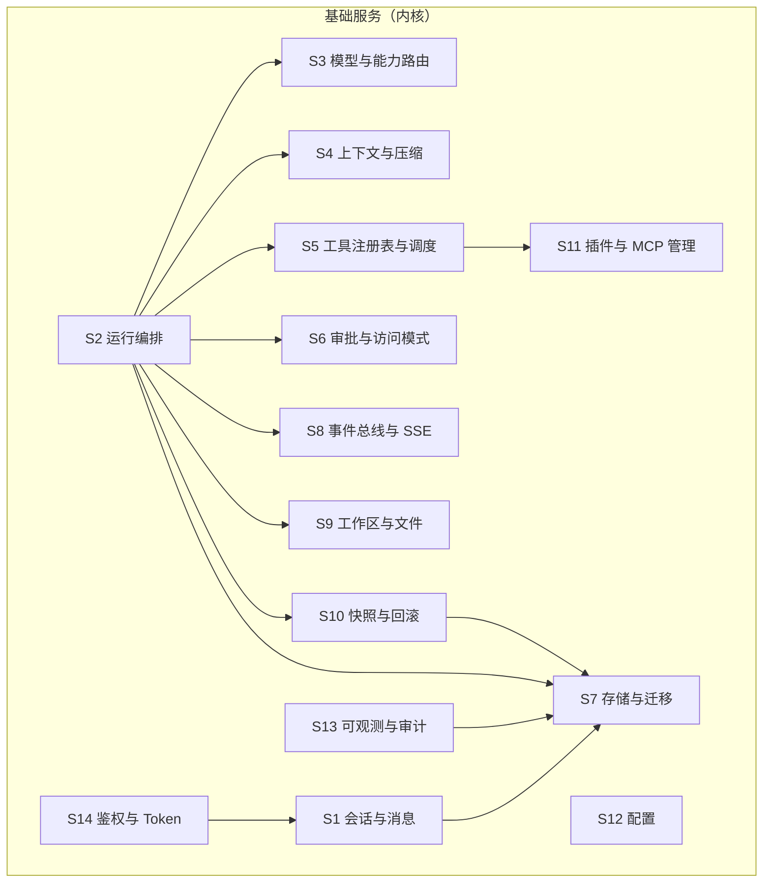

# harness_go 基础服务设计

| 项目 | 内容 |
| --- | --- |
| 文档版本 | v1.0 |
| 上游依据 | `docs/需求说明文档.md` v0.3、`docs/架构设计文档.md` v0.1 |
| 配套文档 | `docs/插件体系设计.md`、`docs/MCP接入设计.md` |
| 覆盖范围 | 桌面版 harness_mini **全部能力**的三层归属与基础服务设计（45 个 Agent 工具 + 130+ IPC 命令 / 18 个功能域） |
| 日期 | 2026-09-13 |

> 本文回答三个问题：① 桌面版有哪些能力；② 每项能力在 web 版归谁；③ 内核必须自己实现哪些服务。

---

## 1. 三层归属模型与划分判据

### 1.1 三层定义

| 层 | 定义 | 分发方式 | 可信度 | 可否禁用 |
| --- | --- | --- | --- | --- |
| **基础服务** | 没有它 Agent 就无法运行的能力 | 编译进单二进制 | 内核可信 | 否（部分可配置） |
| **内置插件** | 原子能力，走统一 Tool 契约 | 随二进制分发 | 随版本发布，默认可信 | 是 |
| **外部插件（MCP / HTTP）** | 用户或第三方提供的能力 | 进程外 / 网络 | 不可信 | 是（默认按 write 审批） |

### 1.2 划分判据（按优先级判定）

| # | 判据 | 归属 |
| --- | --- | --- |
| 1 | 是否需要读写 **Run 状态机**（迁移/中断/终态） | 基础服务 |
| 2 | 是否需要访问 **事件总线**并向订阅者广播 | 基础服务 |
| 3 | 是否必须经过 **审批闸门**才能执行（闸门本身） | 基础服务 |
| 4 | 是否需要 **跨表存储事务**（会话/消息/Run/快照） | 基础服务 |
| 5 | 是否需要持有 **会话级互斥/并发槽位** | 基础服务 |
| 6 | 是否只是「入参 → 副作用或结果」的原子能力，无状态 | 内置插件 |
| 7 | 是否需要第三方运行时/二进制（Chromium、git、Python） | 内置插件（可选，可降级）或 MCP |
| 8 | 是否为第三方生态能力（数据库、Jira、K8s、SaaS） | 外部 MCP |
| 9 | 是否纯浏览器侧（渲染、布局、虚拟列表、编辑器视图） | 前端（不进内核） |
| 10 | 桌面宿主专有（托盘、单实例、外部编辑器唤起） | 内核等价能力 或 不适用（见 §5） |

**反例约束**：`subagent` 看起来是插件，但它需要创建嵌套 Run、桥接事件、持有父 Run 状态 → 归属基础服务（能力）+ 插件（工具暴露）。`browser` 是纯原子能力 → 插件。`temp-workspace` 需要切换会话工作区根 → 基础服务（工作区服务）+ 插件（工具）。

---

## 2. 桌面版能力全景（盘点结果）

### 2.1 Agent 工具（45 个）

| 域 | 工具 |
| --- | --- |
| 文件（7） | `read_file` `list_dir` `file_outline` `write_file` `edit_file` `glob` `grep` |
| 命令（1） | `run_command` |
| Web（1） | `fetch_web_page` |
| 浏览器（6） | `browser_navigate` `browser_interact` `browser_scroll` `browser_get_debug_state` `browser_screenshot` `browser_close` |
| 任务（1） | `todo` |
| 技能与记忆（5） | `list_skills` `save_skill` `run_skill` `record_memory` `read_memory` |
| 计划（5） | `create_plan` `update_plan` `switch_plan` `read_plan` `list_plans` |
| 子 Agent / 协作（11） | `spawn_subagent` `get_subagent_status` `wait_subagents` `stop_subagent` `spawn_subprocess` `wait_subprocesses` `stop_subprocess` `resume_subprocess` `dispatch_collaborator` `wait_collaborators` `get_collaborators` |
| 多模态与决策（5） | `generate_image` `recognize_image` `judge_decision` `choice_decision` `score_decision` |
| 临时空间（6） | `temp_status` `temp_changes` `temp_diff` `temp_snapshot` `temp_restore` `temp_merge` |

### 2.2 IPC 命令（130+，归并为 18 个功能域）

| 域 | 代表命令 | 能力说明 |
| --- | --- | --- |
| 设置与模型 | `get_settings` `set_settings` `test_provider` `list_provider_models` `test_proxy_connection` | 全局配置、Provider 连通性、代理 |
| 项目 | `create_project` `set_project_constraints` `list_project_links` `set_project_plan_mode` | 项目 = 工作区，约束与关联项目 |
| 会话 | `create_session` `send_message` `get_messages` `archive_session` `fork_session_at_message` `set_session_mode` `set_session_models` | 会话全生命周期、分叉、访问模式、模型绑定 |
| 运行控制 | `stop_run` `retry_turn` `continue_turn` `edit_and_resend` `list_running_sessions` | 停止/重试/继续/编辑重发 |
| 待执行队列 | `list_queued` `guide_message` `delete_queued_message` | 运行中补充输入与引导 |
| 审批与压缩 | `respond_approval` `respond_compaction` `respond_intent_intervention` `list_session_compactions` | 审批决策、压缩确认、意图干预 |
| 子任务与协作 | `spawn_subagent` `restart_all_subagents` `create_collaborator` `report_subagent_to_parent` | 子 Agent、协作器、增量汇报 |
| 临时空间 | `alloc_temp_code` `get_temp_info` `list_temp_changes` `merge_temp_space` `clear_temp_space` | Git 沙箱、变更合并 |
| 文件与编辑器 | `inspect_path` `open_dir` `read_text_file` `save_text_file` `get_file_diff` `get_file_outline` `revert_file_hunk` `open_in_external_editor` | 路径探测、文件查看/编辑、hunk 回滚 |
| 回滚与重放 | `revert_to_message` `reapply_from_message` `revert_message_turn` `revert_tool_event` `get_turn_diff` | 消息级/轮次级/工具级撤销与重做 |
| 长任务 | `start_long_task` `pause/resume/cancel_long_task` `list_task_checkpoints` `rollback_to_checkpoint` | 长任务状态机与检查点 |
| 计划与看板 | `get_active_plan` `get_current_board` `list_workspace_plans` `update_plan_step_status` `switch_plan` | 物理计划文档 + 看板投影 |
| 技能/记忆/成长 | `list_project_skills` `save_project_skill` `list_growths` `trigger_growth_reflection` | 技能库、成长反思 |
| SOP | `get_project_sop` `set_project_sop` `run_workspace_sop` | 项目级标准作业流程 |
| 数据与运维 | `get_data_status` `set_data_dir` `optimize_database` `get_database_stats` `get_token_stats` | 数据目录、VACUUM、统计 |
| 日志与审计 | `query_tool_logs` `get_llm_request_trace` | 工具日志、LLM 请求报文追溯 |
| MCP | `list_mcp_servers` `save_mcp_server` `test_mcp_server` `reload_mcp_servers` | MCP 管理 |
| 浏览器控制（前端） | `browser_user_interact` `start_browser_recording` `save_auth_contract` `execute_browser_auth_pipeline` `distill_auth_contract` `browser_capture_screenshot` | 人工接管、录制、认证契约蒸馏 |
| 宿主专有 | `exit_app` `set_data_dir`（含重启） | 桌面窗口/托盘相关 |

---

## 3. 全功能覆盖矩阵

阶段定义：**M1** 对话内核 · **M2** 工具与 MCP · **M3** 浏览器/子 Agent/多模型能力 · **M4** 临时空间/回滚/长任务/成长与 SOP。

### 3.1 工具归属（45 项逐项）

| 桌面工具 | web 归属 | 阶段 | 说明 |
| --- | --- | --- | --- |
| `read_file` | 插件 `fs` | M2 | 带行号、大文件分页 |
| `list_dir` | 插件 `fs` | M2 | |
| `file_outline` | 插件 `fs` | M2 | 代码结构大纲（Go/TS/Python 解析器） |
| `write_file` | 插件 `fs` | M2 | 原子写 + 快照登记 |
| `edit_file` | 插件 `fs` | M2 | 精确原文替换 + diff 返回 |
| `glob` | 插件 `fs` | M2 | |
| `grep` | 插件 `fs` | M2 | 结果上限与上下文行数 |
| `run_command` | 插件 `command` | M2 | 进程组 kill、超时、流式输出 |
| `fetch_web_page` | 插件 `web-fetch` | M2 | HTML → 纯文本，域名白名单 |
| `browser_*`（6） | 插件 `browser` | M3 | 依赖外部 Chromium，`requires: chromium` |
| `todo` | 插件 `todo` | M2 | 同 Run 聚合单清单 |
| `list_skills` `save_skill` `run_skill` | 插件 `skill` | M3 | `.harness/skills/` 文件化 |
| `record_memory` `read_memory` | 插件 `memory` | M3 | `.harness/memory/` |
| `create_plan` `update_plan` `switch_plan` `read_plan` `list_plans` | 插件 `plan` | M2 | 物理计划文档 + 看板投影 |
| `spawn_subagent` `get_subagent_status` `wait_subagents` `stop_subagent` | 插件 `subagent` + 服务 S2（嵌套 Run） | M3 | 需内核支持 `parent_run_id` |
| `spawn_subprocess` `wait_subprocesses` `stop_subprocess` `resume_subprocess` | 插件 `subagent` | M3 | 复用进程管理 |
| `dispatch_collaborator` `wait_collaborators` `get_collaborators` | 插件 `collaborator` | M3 | 常驻角色会话 + 增量汇报 |
| `generate_image` `recognize_image` | 插件 `image` | M3 | 调用能力模型；图片落 CAS |
| `judge_decision` `choice_decision` `score_decision` | 插件 `decision` | M2 | 调用决策模型；无配置时优雅降级 |
| `temp_status` `temp_changes` `temp_diff` `temp_snapshot` `temp_restore` `temp_merge` | 插件 `temp-workspace` + 服务 S9 | M4 | 依赖 git；会话工作区根切换 |

### 3.2 功能域归属（18 项逐项）

| 桌面功能域 | web 归属 | 阶段 | web 形态实现 |
| --- | --- | --- | --- |
| 设置与模型 | 服务 S3 + S12 | M1 | `providers` 表 + 连通性测试 API |
| 项目（工作区即项目） | 服务 S1 + S9 | M2 | `projects` 表 + 目录绑定 |
| 会话全生命周期 | 服务 S1 | M1 | REST + 分页按轮次 |
| 运行控制 | 服务 S2 | M1 | `POST /runs/{id}/stop`、`retry`（新建 Run） |
| 待执行队列与引导 | 服务 S2 | M2 | `guidance` 接口 + 轮次边界注入 |
| 审批与访问模式 | 服务 S6 | M1 | 审批表 + 规则 + 5min 超时 |
| 上下文压缩确认 | 服务 S4 | M2 | 30s 弹性确认 → Web 端改为 SSE 事件 + 可撤销 |
| 意图对齐门禁（JEV） | 插件 `decision` + 服务 S4 | M3 | 作为"前置决策工具"可选启用，不阻塞主链路 |
| 子任务与协作 | 插件 `subagent` / `collaborator` + S2 | M3 | 嵌套 Run + 事件桥接 |
| 临时空间 | 插件 `temp-workspace` + S9 | M4 | git 沙箱 + 变更合并 |
| 文件与编辑器 | 插件 `fs` + 前端查看器 | M2 | 前端只读查看器 + diff 视图；无外部编辑器唤起 |
| 回滚与重放 | 服务 S10（快照 CAS） | M4 | 消息级/轮次级/工具级 revert & reapply |
| 长任务 | 服务 S2（任务状态机）+ 前端 | M4 | 检查点 = Run + 快照引用 |
| 计划与看板 | 插件 `plan` + 前端投影 | M2 | 纯函数投影（按 turn） |
| 技能/记忆/成长 | 插件 `skill` / `memory` / `growth` | M3 | 文件化 + 反思任务 |
| SOP | 插件 `sop` | M4 | 项目级 Markdown 流程 |
| 数据与运维 | 服务 S7 + S12 | M1 | 数据目录、VACUUM、统计 API |
| 日志与审计 | 服务 S13 | M2 | `tool_events` + `llm_requests` + trace |
| MCP 管理 | 服务 S11 + 见《MCP接入设计》 | M2 | 配置 CRUD + 联通测试 + 热重载 |
| 浏览器控制（人工接管/录制/认证契约） | 插件 `browser` | M3 | 无头 Chromium + 录制快照 + 契约蒸馏 |
| 宿主专有（托盘/退出/外部编辑器） | 见 §5 | — | 托盘→浏览器通知；退出→进程管理；外部编辑器→下载/预览 |

**覆盖结论**：45 个工具 + 18 个功能域 **100% 有归属**，无孤儿能力。

---

## 4. 基础服务清单（14 个）



### S1 会话与消息服务

| 项 | 内容 |
| --- | --- |
| 职责 | 会话 CRUD、归档、分叉、项目归属、消息 append-only 写入与按轮次分页、待执行队列 |
| 核心接口 | `CreateSession` / `ListSessions(cursor)` / `AppendMessage` / `ListTurns(sessionID, beforeTurnSeq)` / `ForkAt(messageID)` / `Enqueue` |
| 关键约束 | `messages` 只追加不改写（前缀缓存要求）；`seq` 由存储层单点分配；分页单位是轮次；软删除保留审计 |
| 依赖 | S7、S8 |
| 阶段 | M1（分叉/队列 M2） |

### S2 运行编排服务（Run Engine）

| 项 | 内容 |
| --- | --- |
| 职责 | Run 状态机、并发槽位、per-session 串行、LLM 循环、工具调度、中断/重试/引导、**嵌套 Run**（子 Agent） |
| 核心接口 | `Start(sessionID, input, opts)` / `Stop(runID)` / `Retry(turnSeq)` / `Guide(runID, msg)` / `SpawnChild(parentRunID, spec)` |
| 关键约束 | 状态迁移单点收口；delta 不落库；流式循环内禁止 DB 写；嵌套 Run 计入全局并发但**独立 ctx** |
| 依赖 | S3 S4 S5 S6 S8 S9 S10 S7 |
| 阶段 | M1（嵌套 M3） |

### S3 模型与能力路由服务

| 项 | 内容 |
| --- | --- |
| 职责 | Provider 注册、模型清单、**能力槽位路由**（chat / vision / image / decision / embedding）、连通性测试、故障降级 |
| 核心接口 | `Resolve(sessionID, capability) (ModelRef, error)` / `Chat(stream)` / `Test(providerID)` |
| 关键约束 | 会话主模型必须落具体值禁止 NULL（防串线）；能力模型支持"跟随全局"；密钥加密存储 |
| 依赖 | S7、S12 |
| 阶段 | M1（多能力 M3） |

### S4 上下文与压缩服务

| 项 | 内容 |
| --- | --- |
| 职责 | 四层不可变上下文组装、token 精确计数、工具结果瘦身、压缩触发与摘要、序列合法性校验 |
| 核心接口 | `Build(run) (ChatRequest, Budget)` / `CountChatRequest(...)` / `Compact(sessionID, range)` / `Validate(messages)` |
| 关键约束 | 静态在首、追加在中、动态在尾；历史不可改写；压缩按完整轮次原子淘汰；压缩后重算预算 |
| 依赖 | S1、S3、S5、tokenizer |
| 阶段 | M1（压缩 M2） |

### S5 工具注册表与调度服务

| 项 | 内容 |
| --- | --- |
| 职责 | 工具注册/注销、来源与命名空间、风险分级、白名单过滤、调度与超时、结果截断、调用审计 |
| 核心接口 | `Register(Tool)` / `Unregister(name)` / `List(sessionID) []Spec` / `Invoke(ctx, name, args)` |
| 关键约束 | 内置与外部工具同构；注册表读取无锁（写时复制快照）；工具清单变更 emit `tools.changed`；未启用工具不进上下文 |
| 依赖 | S6、S8、S11 |
| 阶段 | M1（动态注册 M2） |

### S6 审批与访问模式服务

| 项 | 内容 |
| --- | --- |
| 职责 | 风险级 → 会话规则 → 访问模式 → 询问用户；审批等待与超时；规则生成与删除 |
| 核心接口 | `Decide(ctx, req) (Decision, error)` / `Respond(approvalID, decision, reason)` / `Rules(sessionID)` |
| 关键约束 | 审批是唯一闸门（API/UI 均不可绕过）；超时视为拒绝并回传原因；同一审批只允许一次决策（重复 409） |
| 依赖 | S1、S8 |
| 阶段 | M1 |

### S7 存储与迁移服务

| 项 | 内容 |
| --- | --- |
| 职责 | SQLite 连接与 PRAGMA、embed 迁移、单写通道、事务封装、完整性检查、VACUUM |
| 核心接口 | 各仓储方法（由消费方定义窄接口）+ `Migrate()` / `IntegrityCheck()` / `Stats()` |
| 关键约束 | WAL + busy_timeout + foreign_keys；写串行；迁移版本表；不依赖任何上层包 |
| 依赖 | 无 |
| 阶段 | M1 |

### S8 事件总线与 SSE 服务

| 项 | 内容 |
| --- | --- |
| 职责 | 事件定义、per-Run 环形缓冲、订阅/退订、慢消费者断开、SSE 编码、Webhook 分发（P1） |
| 核心接口 | `Publish(runID, ev)` / `Subscribe(runID, fromSeq)` / `Close()` |
| 关键约束 | Publish 非阻塞；缓冲满即断开订阅；`Last-Event-ID` 未命中发 `resync`；delta 不落库 |
| 依赖 | 无 |
| 阶段 | M1（Webhook M2） |

### S9 工作区与文件服务

| 项 | 内容 |
| --- | --- |
| 职责 | 工作区根管理（含**会话级动态根**，支撑临时空间）、路径安全校验、原子写、目录探测、文件元信息 |
| 核心接口 | `Resolve(sessionID) Root` / `Guard(path) (Verdict, error)` / `WriteAtomic(path, data)` / `Stat(path)` |
| 关键约束 | Clean→Abs→最近已存在父目录 EvalSymlinks→判前缀；越界走风险升级而非硬拒；写入前登记快照 |
| 依赖 | S7、S10 |
| 阶段 | M1（动态根 M4） |

### S10 快照与回滚服务

| 项 | 内容 |
| --- | --- |
| 职责 | 文件内容 CAS 存储、写入前快照、按消息/轮次/工具事件回滚与重放、diff 计算 |
| 核心接口 | `Snapshot(path) (blobID)` / `RevertToMessage(msgID)` / `Reapply(msgID)` / `Diff(turnSeq)` |
| 关键约束 | CAS 按内容哈希去重；回滚是**物理写回**而非仅改标记；回滚点之后的消息置灰但保留；GC 按引用计数 |
| 依赖 | S7、S9 |
| 阶段 | M4 |

### S11 插件与 MCP 管理服务

| 项 | 内容 |
| --- | --- |
| 职责 | 插件清单、启用/禁用、依赖探测、健康检查、热加载、MCP 连接生命周期、工具注入 |
| 核心接口 | `List()` / `Enable(id)` / `Disable(id)` / `Reload(id)` / `Health(id)` |
| 关键约束 | 插件加载失败不影响内核；能力降级可见；工具变更广播；见《插件体系设计》《MCP接入设计》 |
| 依赖 | S5、S8、S12 |
| 阶段 | M2 |

### S12 配置服务

| 项 | 内容 |
| --- | --- |
| 职责 | 分层配置（flag/env/yaml/默认）、热更新、校验、部署形态判定 |
| 核心接口 | `Get(key)` / `Set(key, val)` / `Watch(key)` / `Mode()` |
| 关键约束 | 非法值启动即失败并给出可读原因；设置变更只广播变更 key |
| 依赖 | 无 |
| 阶段 | M1 |

### S13 可观测与审计服务

| 项 | 内容 |
| --- | --- |
| 职责 | 结构化日志、trace id、`tool_events` 审计、`llm_requests` 报文快照、token 统计、健康检查 |
| 核心接口 | `Log(ctx, fields)` / `SnapshotRequest(payload)` / `Stats(sessionID)` |
| 关键约束 | 审计表与业务表物理隔离（防止被上下文组装器消费）；日志脱敏；快照写入不阻塞 TTFT |
| 依赖 | S7 |
| 阶段 | M1（请求快照 M2） |

### S14 鉴权与 Token 服务

| 项 | 内容 |
| --- | --- |
| 职责 | 访问令牌、API Token 管理、scope 校验、CORS 白名单 |
| 核心接口 | `Authenticate(r) (Principal, error)` / `IssueToken(scope)` / `Revoke(id)` |
| 关键约束 | local 形态默认仅监听 127.0.0.1 + 首启随机令牌；Token 哈希存储；写操作最小 scope |
| 依赖 | S7 |
| 阶段 | M1 |

---

## 5. 桌面专有能力处理

| 桌面能力 | 处理方式 |
| --- | --- |
| 系统托盘 | **不适用**。web 版用浏览器通知（审批/完成提醒）+ 页面标题角标 |
| 单实例锁 | **保留在内核**：数据目录文件锁，防多实例写同一 DB |
| 外部编辑器唤起（`open_in_external_editor`） | **降级**：前端文件查看器只读预览 + 文件下载 |
| 系统文件管理器打开目录（`open_dir`） | **降级**：显示绝对路径 + 提供目录内文件列表 |
| 窗口关闭隐藏后台运行 | **替代**：服务常驻；前端关闭仅断开 SSE，Run 继续 |
| 数据目录热切换 + 重启 | **替代**：`/admin/data-dir` 需重启进程，API 返回 `restart_required` |

---

## 6. 服务依赖与启动顺序

```
S12 配置 → S7 存储(迁移/自检) → S14 鉴权 → S3 模型(解密密钥)
  → S9 工作区 → S10 快照 → S4 上下文(注册 tokenizer)
  → S6 审批 → S5 工具注册表 → S11 插件/MCP 管理(加载启用的插件)
  → S8 事件 → S1 会话 → S2 运行编排(恢复未完成 Run → interrupted)
  → API/SSE → 打印地址与令牌
```

约束：**S11 插件加载在 S5 之后、HTTP 启动之前**，且单个插件失败只标记 `degraded`，不阻断启动。

---

## 7. 阶段规划

| 阶段 | 基础服务 | 对应插件 |
| --- | --- | --- |
| **M1** | S1 S2 S3 S4 S5(静态) S6 S7 S8 S9(基础) S12 S13(日志) S14 | 无（仅对话） |
| **M2** | S5 动态注册、S11、S13 请求快照、S8 Webhook | `fs` `command` `web-fetch` `todo` `plan` `decision` + MCP |
| **M3** | S2 嵌套 Run、S3 能力路由 | `browser` `subagent` `collaborator` `skill` `memory` `growth` `image` |
| **M4** | S9 动态根、S10 快照回滚 | `temp-workspace` `long-task` `session-bundle` `sop` |

---

## 8. 架构决策记录

| ID | 决策 | 理由 |
| --- | --- | --- |
| ADR-S1 | 子 Agent 归基础服务（嵌套 Run），工具暴露归插件 | 需要父 Run 状态与事件桥接，插件无法自持 |
| ADR-S2 | 快照与回滚归基础服务 | 回滚是物理写文件，必须与工作区/存储事务一致 |
| ADR-S3 | 临时空间归"插件 + 服务（动态工作区根）" | 工具是原子操作，但切换会话根属于工作区服务 |
| ADR-S4 | 计划/记忆/技能归插件 | 纯文件读写，无状态机依赖 |
| ADR-S5 | 意图对齐门禁降级为可选插件 | 桌面版为强门禁，web 版一期不阻塞主链路，避免过度思考 |
| ADR-S6 | 浏览器自动化归插件且依赖外部 Chromium | 保持单二进制；缺失时 `degraded` 而非崩溃 |
| ADR-S7 | 桌面托盘/外部编辑器不追求 1:1 | 无对应宿主能力，降级方案已列明 |
