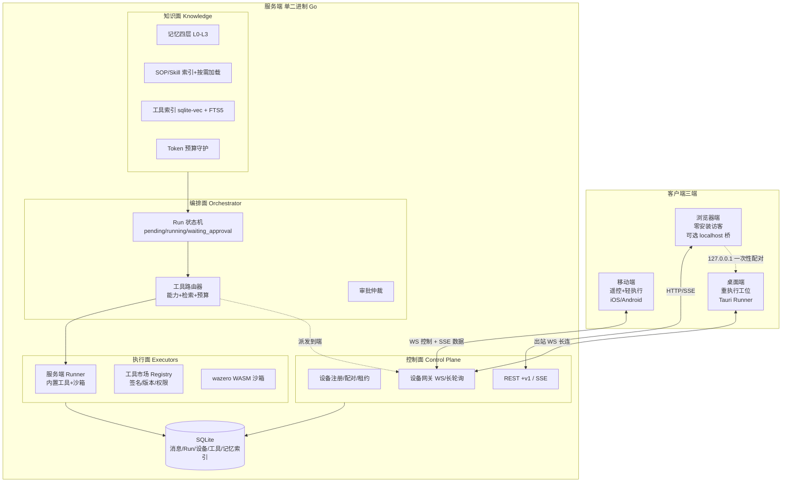
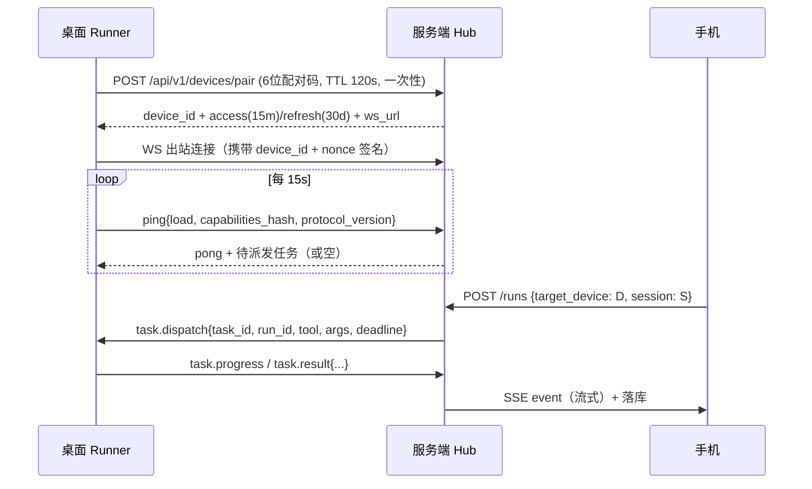

# harness_go 多端协同架构可行性方案

> 版本：v0.1（可行性讨论稿）　日期：2026-10-30
> 定位：对现有「单机单二进制 Web 版」架构的一次**范围升级评估**，不改动已定稿的 M1 内核。
> 关联文档：`docs/需求说明文档.md`、`docs/架构设计文档.md`、`docs/插件体系设计.md`、`docs/基础服务设计.md`
> 关联项目：`F:\WorkSpace\Other\harness_mini`（桌面版，Tauri 2 + Rust）

---

## 0. 结论速览

| 议题 | 结论 | 置信度 |
| --- | --- | --- |
| 三端（移动/桌面/浏览器）并存 | **可行**，但三端能力**必须分级**，不可能等价 | 高 |
| 移动端/桌面端「拉取功能 + 本地全量工作」 | **桌面端可行且已具雏形**；**移动端只能做「遥控器 + 轻执行」**，OS 沙箱决定其无法承担文件/命令类重活 | 高 |
| 服务端：基础工具 + 工具市场 + 对话自建工具 | **可行**；真正的门槛不是功能，而是**供应链安全（签名）+ 运行沙箱（WASM）** | 高 |
| Token 随记忆/工具/SOP 膨胀 | **必须治理，且是本次架构的前置条件**。不做治理，工具市场一上线就自我毒化 | 高 |
| 手机操作桌面端 / 端间互操作 | **可行**，技术路径成熟（反向长连接 + 中继）；最大风险是**移动端后台保活**与**跨端并发写** | 高 |
| 业内是否有同类架构 | **有组件级成熟先例，无单一大一统产品**。可命名为 *Hub-and-Spoke Edge Agent*（中枢-辐条边缘代理） | 中高 |

**一句话推荐**：采用 **方案 R（HALO：中枢 + 端侧 Runner，控制面/数据面分离）** 作为主方案；把 **方案 S（服务端全集中）** 实现为 R 的**降级态**（端不在线时自动回退，保证 7×24 稳定）；把 **方案 O（本地优先 + 端间直连）** 作为 R 的**演进态**（M8 之后再上，不做前置依赖）。三者不是三选一，而是**一条演进路线上的三个锚点**。

---

## 1. 需求重述与关键矛盾

### 1.1 新设定（用户诉求）

1. 客户端分三类：**移动端 / 桌面端 / 浏览器端**；移动端与桌面端可**从服务端拉取功能**，并支持**本地全量工作**（本地文件、命令、浏览自动化等）。
2. 服务端提供：**基础工具** + **市场下载工具** + **对话中自行创建工具** + **自定义工具**。
3. 必须解决：记忆 / 工具 / SOP 数量增长带来的 **token 膨胀**。
4. **端与端互操作**：手机可操作桌面端/PC 端，其他端之间也联动。

### 1.2 与现有架构基线的冲突点（必须先承认）

| 现有基线（已定稿） | 新设定要求 | 冲突性质 |
| --- | --- | --- |
| 单进程单二进制，服务端拥有全部工具执行权 | 执行权要下沉到端侧 | **架构级**：需引入「执行面」概念 |
| `tools` 注册表在服务端进程内，静态 + MCP | 工具要能从市场下载、对话中生成 | **机制级**：需工具供应链 + 沙箱运行时 |
| 前端是「薄客户端 + `//go:embed all:web/dist`」 | 三端各自独立打包、能力不同 | **构建级**：需拆 bundle 与端能力清单 |
| 会话 per-session 单写者（本地 mutex） | 多端可能同时想操作同一会话 | **语义级**：mutex 要升级为**跨端租约（lease）** |
| 系统提示词静态全量注入（SOP/记忆/项目约束一次性塞入） | 工具/SOP/记忆会持续膨胀 | **成本级**：静态注入模型不可扩展 |

> 结论：本次不是「加几个页面」，而是**在不得罪 M1 内核的前提下，给架构增加一个「执行面」和「知识面」两个新平面**。M1 的 Run 状态机、事件模型、`消息以 DB 为准` 铁律**可原样保留**——这是本次方案能低成本落地的最大依据。

### 1.3 已核实的可复用资产（决定可行性高低的关键）

对关联项目 `harness_mini` 的实测勘察（`src-tauri/src/`）：

| 资产 | 现状 | 对本方案的价值 |
| --- | --- | --- |
| `server.rs` | 已内建 axum HTTP + **WebSocket** + `/health` + daemon 模式（`daemon_info.json`、端口探测、单实例） | **桌面端 Runner 的地基已存在**，不需要从零设计 |
| `dispatch_rpc()` | 已收敛 **69 个 RPC 方法**（settings / projects / session / agent / tools / provider…），统一 `{ok,data,error}` 信封 | 端侧能力面**已经是一套 JSON-RPC 语义**，只需加协议版本与鉴权 |
| `memory.rs` / `skills.rs` / `sop.rs` / `growth.rs` | 记忆分层（静态项目记忆 + 蒸馏 digest）、技能、SOP、成长机制均已实现 | Token 治理有**真实病灶**可量化，不是纸上优化 |
| `context::build_static_system_prompt()` | 一次性注入 SOP + 项目约束 + 记忆（仅靠 `disabled_sops` 手工关） | **token 膨胀根因**，治理收益可直接测量 |
| `tools/` + `mcp/` + `protocol/`(openai_chat/openai_responses/anthropic 三协议转译) | 45 个工具、MCP 三传输、多协议适配 | 服务端工具层与 LLM 层**无需重写** |
| 前端（`demo/`, React 18 + zustand + tailwind） | 已有移动端断点骨架、PWA、SSE 客户端 | 三端可**共享组件层**，只换壳与能力开关 |

**一句话：本次改造成本的大头在「服务端多平面拆分」与「Token 治理」，端侧执行器反而有现成可复用实现。**

---

## 2. 四条诉求的逐项可行性判定

### 2.1 三端并存 + 「拉取功能」

**结论：可行（高）。** 但要先分清「拉取什么」：

| 可拉取对象 | 载体 | 说明 |
| --- | --- | --- |
| 工具（Tool） | `tool-package`（manifest + 代码） | 市场下载的主体 |
| SOP / 技能（Skill） | `SKILL.md` + 资源（渐进披露） | 体积小，天然可分发 |
| 前端功能块（UI 插件） | 远程 bundle（ESM + import map）或 WASM | **高风险**，建议只允许「官方签名 + 声明式 UI」，一期不做任意 JS |
| 端能力开关（Capability） | `capabilities.json`（服务端下发） | 决定该端呈现哪些入口 |

**关键工程约束**：端侧拉取功能 = 端侧执行不可信代码。因此**一期只做「声明式 + WASM（wazero）」两类**，任意 JS/原生二进制一律不做（详见 §5.5）。

### 2.2 「移动端/桌面端支持本地所有工作」

**结论：桌面端可行（有 Tauri 全套本地权限）；移动端必须降级（OS 沙箱硬限制）。**

移动端能力天花板（不可绕过，不是工程投入问题）：

| 能力 | iOS | Android | 结论 |
| --- | --- | --- | --- |
| 任意路径文件读写 | ❌（沙箱 + 沙盒容器） | ⚠️（需 MANAGE_EXTERNAL_STORAGE，上架受限） | 不可作为基线 |
| 子进程 / shell | ❌ | ⚠️（仅 Termux 级方案，普通 App 不可） | 不可作为基线 |
| 后台长连 | ❌（挂起，需 APNs 唤醒） | ⚠️（前台服务 + 常驻通知，耗电） | **不能作为控制链路唯一通道** |
| HTTP / 剪贴板 / 相册 / 通知 / 深链 | ✅ | ✅ | 移动端的主战场 |

→ **移动端定位：遥控器 + 轻执行**（会话、审批、订阅、通知、文件投递、HTTP 类工具）；
→ **桌面端定位：重执行工位**（文件、命令、浏览器自动化、本地模型、长任务）；
→ **浏览器端定位：零安装访客**（服务端执行；可选用「localhost 桥」借本机能力，见 §5.9）。

### 2.3 服务端：基础工具 + 市场 + 对话自建工具

**结论：功能可行（高），安全是唯一真门槛（中）。** 拆成三个独立能力，不要混为一个「插件系统」：

1. **基础工具（Built-in）**：内核携带、随版本发布、可信。保持现有最小集（read/write/edit/glob/grep/run_command/fetch/todo/plan/decision）。
2. **市场工具（Marketplace）**：第三方分发。必须解决 —— 包签名（Ed25519）、权限声明（capability）、运行沙箱（WASM/外部进程分级）、版本与回滚、离线包、私有 registry。
3. **自建工具（Self-built）**：对话中生成。必须做**分级闭环**（L1 声明式 → L2 组合式 → L3 代码式），且 L3 默认 untrusted、首次运行强制人工确认（复用现有审批通道即可）。

### 2.4 Token 治理

**结论：不是「能不能优化」，而是「不优化就活不下去」（高）。** 量化见 §6.1：
按当前「静态全量注入」模式，`SOP 12 条 + 记忆 2 份 + 项目约束 + 45 工具` ≈ **27k token 的固定开销，每轮请求都要付一次**；工具市场上架 50 个包后轻松突破 **60k**，直接吃满上下文并显著抬高成本与延迟。
治理后同一场景固定开销可压到 **≈7.5k**，且其中 **≈5.6k 是稳定前缀可走 prompt cache（计费按 10% 计）**，等效成本下降 **一个数量级**。

### 2.5 端间互操作

**结论：可行（高）。** 技术路径 = **设备注册 + 反向出站长连接 + 服务端中继 + 任务派发/结果回流**。不需要公网 IP、不需要端口映射、不需要 WebRTC 打洞（一期）。
三个必须提前定死的语义：
- **谁分配 `seq`**：仍然只有服务端（保持 `消息以 DB 为准` 铁律，端侧只产生事件）；
- **会话归属**：`session_lease`（30s 心跳续租 + epoch 递增 + revoke 通知），防双写；
- **审批归属**：审批请求可**跨端投递**（人不在电脑前，手机上批），但**必须记录审批端 device_id**（审计）。

---

## 3. 业内架构对照：是否存在同类？

### 3.1 组件级先例（均已规模化验证）

| 领域 | 代表 | 与本方案的对应关系 |
| --- | --- | --- |
| 移动端遥控本地 Agent | **Happy Coder**（开源，E2EE 中继，手机网页遥控本地 Claude Code） | 直接对标 §2.5「反向长连接 + 中继」路径，证明「手机操作桌面 Agent」可产品化 |
| 本地/云端双模执行 | **OpenAI Codex**（本地 CLI + 云沙箱）、**Cursor**（本地 IDE 工具 + 云端后台 Agent）、**GitHub Copilot coding agent**（云沙箱→PR） | 证明「执行面可切换」是主流做法，且**降级态 = 云端** |
| 标准工具协议 | **MCP**（+ 官方 Registry 预览） | 工具市场不必发明协议，可复用 MCP 生态 + manifest 扩展 |
| 工具过多 → 按需加载 | **Anthropic Tool Search Tool**（`defer_loading`）、**`context editing` / `compaction`** | 官方已把「工具定义不全量注入」做成 API 能力，是本方案 §6.2 的权威依据 |
| SOP/技能渐进披露 | **Anthropic Agent Skills**（SKILL.md：索引只放 name+description，正文按需读）；**Cursor Rules 四类**（Always / Auto-Attached / Agent-Requested / Manual） | 直接对应 §6.4「SOP 索引 + 触发式加载」 |
| 记忆分层与检索 | **Letta(MemGPT)**（core/archival 两层 + 自编辑）、**mem0**（ADD/UPDATE/DELETE 事件化记忆）、**Zep/Graphiti**（时序知识图谱） | 对应 §6.3 四层记忆 + 写入去重 |
| 本地 Hub + 多端 + 云中继 | **Home Assistant**（本地 Hub + Companion App + Nabu Casa 云中继 + 推送） | 对应「服务端中枢 + 端注册 + 推送唤醒」的成熟范式 |
| NAT 穿透 / 设备直连 | **Tailscale**、**VS Code Remote Tunnels**、**Cloudflare Tunnel** | 对应 §5.2 出站长连接与 M8 端间直连 |
| 浏览器 ↔ 本机桥 | **1Password / Figma 的 local bridge**（`127.0.0.1` + 一次性 nonce） | 对应 §5.9「浏览器端借用本机能力」 |

### 3.2 抽象：这套架构叫什么

把上述模式归一，得到本方案的模式名：

> **Hub-and-Spoke Edge Agent（中枢-辐条边缘代理）**
> = 中心编排（Hub：LLM/上下文/记忆/工具检索/审批/落库）
> + 边缘执行（Spoke：各端 Runner，自带能力清单）
> + 能力协商（Capability Negotiation）
> + 渐进披露（Progressive Disclosure，解决 token）
> + 中继与租约（Relay + Lease，解决多端与弱网）

**结论：不存在「一个开源项目全都有」的现成答案**（Claude Code 有技能与 tool search，但无工具市场；Home Assistant 有中枢/中继/推送，但没有 Agent 编排；MCP Registry 有分发，但没有执行面）。这恰是自研的合理空间：**把已被验证的 5 个模式组合起来，而不是发明新范式**。

---

## 4. 推荐架构（HALO）

### 4.1 四平面视图



### 4.2 核心不变量（改造中绝不动摇的 6 条）

1. **`seq` 与落库只发生在服务端**——端侧 Runner 只产生事件流，永不直写 DB。
2. **消息最终内容以 DB 为准**，delta 只是预览（原铁律，跨端后更重要）。
3. **一个会话同一时刻只有一个写者（lease holder）**，其余端为只读订阅。
4. **端侧一切都是不可信的**：来自 Runner 的工具结果必须标注来源、截断、不过度信任（prompt injection 防线）。
5. **执行面可缺失**：任何端掉线都必须有服务端降级路径（保证「最稳定」）。
6. **常驻上下文有硬预算**：任何新增机制（工具/SOP/记忆）都必须走索引 + 按需加载，禁止直塞系统提示。

---

## 5. 关键机制设计

### 5.1 统一工具契约 + 归属路由

在现有 Tool 契约上只加 3 个字段（向后兼容）：

```jsonc
{
  "name": "fs.read_file",
  "description": "读取工作区文件（≤120 字，禁用长句）",
  "schema": { /* JSON Schema */ },
  "risk": "read",                  // read | write | exec | high
  "executor": "desktop",           // server | desktop | mobile | browser | any
  "capabilities": ["fs.read:workspace"],  // 权限声明（市场包必填）
  "cost_tokens": 268,              // 定义本身占用（索引/预算用）
  "defer_loading": true            // 是否默认不注入（走检索）
}
```

**路由算法（确定性优先，模型不可见）**：

```
候选集 = 工具全集
  ∩ 能力可用端（capability match）
  ∩ 会话白名单（session allowlist）
  ∩ 风险策略（当前访问模式）
score = 0.45*semantic + 0.20*keyword(BM25) + 0.15*会话内使用频率 + 0.10*端RTT/在线度 + 0.10*风险低优先
注入 = 常驻集(≤8) ∪ topK(score, k=动态 4~8)
```

> 铁律：**检索结果只影响「注入哪些定义」，不影响「是否允许调用」**。若模型调用了未注入但已注册的工具，路由器仍可执行（宽进严出），避免检索漏召回直接导致任务失败。

### 5.2 设备注册、配对与反向长连接



工程要点：

| 项 | 决策 |
| --- | --- |
| 连接方向 | 端**出站**连接（NAT 穿透 0 配置），服务端不主动拨号 |
| 鉴权 | `device_id = 公钥指纹`；配对用 6 位码 + TTL；access token 短期 + refresh |
| 幂等 | `task_id`（服务端生成，端侧缓存已完成的 task_id 24h）→ 断线重派安全 |
| 离线队列 | 端不在线：任务 `pending`，TTL 默认 10min，超时 → `failed(device_offline)`，不静默卡死 |
| 弱网降级 | WS 不可用 → 长轮询（移动端后台/企业代理场景），语义同 WS |
| 推送唤醒 | 移动端不承担执行，只用 APNs/FCM 推「有任务待审批/已完成」通知，点击深链回 App |
| 协议版本 | `protocol_version` 双版本兼容窗口（服务端同时支持 N、N-1） |

### 5.3 会话会租约（跨端单写者）

```
session_lease(session_id PK, device_id, epoch, expires_at, heartbeat_at)
```

- 获取：`POST /sessions/{id}/lease`，成功返回 `epoch`；失败返回 409 + 当前持有端（前端提示「另一台设备正在输入」并提供「接管」）。
- 续租：30s 心跳；90s 无心跳自动释放。
- **接管（抢占）**：`epoch+1`，旧端收到 `lease.revoked` 事件 → 立即停止本地输入并转只读，**已提交的 delta 全部作废**（因为只有服务端 `seq` 有效）。
- 写路径铁律：端侧提交消息 → 服务端校验 lease → 分配 seq → 落库 → 广播。**任何端本地 seq 都不被承认。**

### 5.4 审批跨端仲裁

| 场景 | 策略 |
| --- | --- |
| 发起端可审批 | 默认在发起端弹审批 |
| 发起端离线（手机发起、人走开） | 审批请求推送到**该用户所有在线端**，任一处置即生效（first-wins + 幂等 approval_id） |
| 高风险（`exec`/`high`） | 强制在**执行端所在设备**确认一次（防「手机上误批桌面删库」） |
| 审计 | 每条 approval 记录 `requested_by_device` / `decided_by_device` / `decided_at` |

### 5.5 工具市场：包格式与沙箱

```
tool-package/
  tool-package.json     # name, version, publisher, entry, permissions, schema, min_protocol
  main.wasm             # L3 代码式（wazero 纯 Go 运行，无 CGO，符合单二进制约束）
  SKILL.md              # 可选：SOP 正文（渐进披露）
  LICENSE / README.md
  sig                   # Ed25519(publisher_key, sha256(package))
```

| 形态 | 运行方式 | 隔离强度 | 一期是否支持 |
| --- | --- | --- | --- |
| 声明式（HTTP/模板） | 纯配置，服务端代发请求 | 网络白名单（域名级） | ✅ |
| WASM（`wazero`） | 进程内沙箱，仅 import 显式 host 函数（fs/net/args） | 强（能力受限、无系统调用） | ✅ |
| MCP Server | 子进程（stdio）或远程 | 中（进程级 + 审批） | ✅（已有） |
| 原生二进制/任意 JS | — | 弱 | ❌ 永不做（服务端形态） |

**其他必做**：信任分级（官方 / 认证 / 社区 / 未签名）、安装即展示权限差异、可回滚、离线包、私有 registry（企业）、卸载即清索引。

### 5.6 对话自建工具的闭环（L1→L3）

| 级别 | 产出 | 生成后可立即用？ | 门槛 |
| --- | --- | --- | --- |
| L1 声明式 | JSON Schema + HTTP 模板 | ✅ 需确认一次 | 无代码，最安全，覆盖 60% 需求 |
| L2 组合式 | SOP/工作流（多个内置工具编排） | ✅ | 复用现有 plan 机制 |
| L3 代码式 | WASM（模型写 Go → tinygo 编译） | ❌ 需静态检查 + dry-run + 人工确认 | 沙箱限制 import 白名单 |

L3 的流水线（缺一步都不许注册）：**生成 → 编译 → 静态检查（禁 net 默认，需声明）→ 沙箱 dry-run（给样例输入）→ 输出审计 → 人工确认 → 注册（标记 source=generated, trusted=false）→ 首次真实调用再确认一次**。

### 5.7 端侧「功能拉取」与版本漂移

- 服务端下发 `capabilities.json`（该端应呈现的功能入口 + 所需工具包版本）；
- 端启动时对账 `capabilities_hash`，不一致 → 拉差量（工具包按版本，前端 bundle 按构建哈希）；
- **版本漂移防护**：`min_protocol` 字段，端过旧 → 服务端拒绝派发重活并在 UI 提示升级（不静默降级执行）。

### 5.8 Token 治理 → 见 §6（独立成章，因它是成败关键）

### 5.9 浏览器端「借本机能力」：localhost 桥（可选，性价比极高）

浏览器无法执行本地命令，但**可以 `fetch('http://127.0.0.1:<port>/rpc')` 访问本机 Desktop Runner**：

- Desktop Runner 监听 `127.0.0.1`（仅本机），暴露 `/bridge/pair`（一次性 nonce）+ `/bridge/rpc`；
- 浏览器端严格校验：`Origin` 白名单 + nonce（10min TTL）+ `Sec-Fetch-Site: same-site/cross-site` 检查 + 不返回敏感 header；
- 效果：用户在浏览器里也能「用本机文件/命令」，无需装桌面 App 的完整壳——这正是 1Password / Figma 的成熟做法。

---

## 6. Token 治理（本次架构的前置条件）

### 6.1 预算模型与量化（示例：50 工具 / 12 SOP / 2 份记忆 / 1 项目）

| 组成 | 现状（静态全量） | 治理后（索引 + 按需） | 手段 |
| --- | --- | --- | --- |
| 系统提示基础段 | 1.8k | 1.8k（**稳定前缀，可缓存**） | 固化顺序 |
| SOP | 12 × 350 = **4.2k** | 索引 12 × 40 = 0.5k（正文按需） | §6.4 渐进披露 |
| 项目约束 | 2.0k（全文） | 0.8k 摘要（全文按需 read） | 摘要 + 引用 |
| 记忆 | profile 3k + conv 4k = **7.0k** | L0 常驻 0.8k + top6×80 = 0.5k | §6.3 四层 + 检索 |
| 工具定义 | 50 × 320 = **16k** | 常驻 8×260 = 2.1k + top6 ≈ 1.5k | §6.2 defer_loading |
| **合计** | **≈31k** | **≈7.5k** | — |
| 其中可缓存前缀 | 0 | ≈5.6k（计费 10%） | prompt caching |
| **等效成本（相对）** | 100% | **≈13%** | — |

> 以上为量级估算（工具/SOP 单条 token 依描述长度浮动 ±30%），但**结论方向不受影响：固定开销降 4 倍，计费降一个量级**。这也是「工具市场一上线就自我毒化」的定量理由。

### 6.2 工具侧：`defer_loading` + 混合检索

1. **默认不全量注入**：常驻集 = 核心 8 个（read/write/edit/bash-todo/plan/decision/tool_search 自身），其余 `defer_loading: true`。
2. **混合检索**：`BM25(FTS5)` + 向量（`sqlite-vec`）→ **RRF 融合**（k=60）→ topK。
3. **查询构造**：`最近 3 轮用户消息 + 当前会话摘要 + 正在进行的 plan 标题`（短、稳、可复现）。
4. **命名空间分层**：`mcp__server__tool`、`market__pkg__tool`；按需先注入「命名空间索引」（每个 20 token），再注入具体定义。
5. **描述压缩规范**：≤120 字、禁示例长句、可选参数描述合并；单条定义 ≤300 token 硬约束（写进市场包校验）。
6. **减少往返**：优先「一次调用多参数」而不是让模型连调多次；对高频组合提供 `tool_search` 元工具由模型主动拉取（Tool Search Tool 同构）。

### 6.3 记忆侧：四层 + 写入去重 + 引用式注入

| 层 | 内容 | 常驻 | 加载方式 |
| --- | --- | --- | --- |
| L0 核心 | 用户偏好/硬约束/项目身份（≤800 token） | ✅ 常驻 | 直接注入（稳定前缀） |
| L1 项目 | 技术栈、约定、避坑（= 现有 `profile.md`/`conventions.md`） | ❌ | 注入 3 行摘要 + `read_memory` 按需拉全文 |
| L2 情景 | 会话/任务级结论（digest） | ❌ | 向量检索 top-k（带时间衰减） |
| L3 档案 | 全量历史事实 | ❌ | 检索 + 引用命中（`path:line`） |

**写入侧（关键，比检索更省钱）**：新增记忆先做 **ADD / UPDATE / DELETE / NOOP** 四分类（mem0 思路）——相似度 > 0.92 判 NOOP（不写）、语义冲突判 UPDATE（覆盖）、矛盾判 DELETE；**同一事实禁止重复落库**，否则历史越长、检索越吵、注入越多。
**检索打分** = `0.6*cos + 0.25*时间衰减(半衰期14d) + 0.15*重要性(使用次数/被引用次数)`，命中不足 3 条则不注入（宁缺毋滥）。

### 6.4 SOP/技能侧：渐进披露 + 触发式加载

对齐 Anthropic Skills 与 Cursor Rules：

| 类型 | 注入时机 | token |
| --- | --- | --- |
| `always`（≤2 条，铁律级） | 每轮 | 全量 |
| `auto_attach`（按文件/路径/工具匹配） | 命中条件才注入 | 全量 |
| `agent_requested`（模型判断需要） | 模型显式 `load_skill(name)` | 全量 |
| `manual` | 用户点名 | 全量 |

索引条目格式（**这是省 token 的核心，40 token 讲清「何时该读我」**）：

```markdown
- web-autonomous-test [#auto: *.tsx, web/] — 无头浏览器语义测试与异常自愈（触发：前端改动后验证）
```

### 6.5 前缀稳定 + Prompt Caching

- 固定顺序：`[工具常驻集] → [L0 记忆] → [always SOP] → [项目摘要] → [历史摘要] → [本轮动态检索结果] → [当前输入]`；
- **动态检索结果必须放在最后**（否则前缀被打断，缓存全失效）——这是最容易踩的坑；
- 指标：`cache_hit_tokens / input_tokens` 进入仪表盘，目标 > 60%。

### 6.6 上下文清理与压缩

- `context editing` 同构：超过 N 轮后**清理旧 tool_result**（保留「工具名 + 结论摘要 + 文件引用」），原生结果落库不外带；
- 大输出外置：>2k token 的工具结果 → 存 `tool_events`，上下文里只放 `path:line + 摘要 + 可再读工具`；
- 会话压缩（compaction）：达阈值用**便宜模型**生成结构化摘要（目标/已完成/待办/关键文件），替换早期消息，DB 保留原文。

### 6.7 预算守护（硬闸门）

```
每轮 request 前：
  budget = model.context_window - max_output - safety(2k)
  if estimated > budget:
     降级顺序：①省略 L2/L3 记忆 ②检索 topK 减半 ③工具常驻集降到 4 ④旧工具结果转引用 ⑤强制压缩
  if 仍超：拒绝并提示（绝不静默截断导致模型幻觉）
```

---

## 7. 开源向量检索工具的原理（为什么能省 token）

### 7.1 原理链路（与「省 token」的因果）

```
文本(工具描述/记忆/SOP) --embed--> 向量(384~1536维)
  → ANN 索引(HNSW/IVF/暴力扫描)
  → 查询: 当前上下文 --> 向量 --> 近邻 top-K
  → [可选] 混合 BM25 关键词召回 --> RRF 融合
  → [可选] cross-encoder 重排(rerank) top-5
  → 只把 top-K 的「原文定义」注入 prompt
```

省 token 只来自两件事（务必认清，否则会被夸大宣传误导）：
1. **注入量从 N 降到 K**（N=全量，K=3~8）——这是主收益，占 80%+；
2. **召回质量提升 → 少走弯路**（选错工具会导致两三轮重试，每轮都是全量上下文）——次要但真实。

向量检索**不会**压缩单条定义的 token，也**不能**替代结构化裁剪（schema 瘦身、描述压缩）。二者是乘法关系。

### 7.2 开源选型（受「单二进制 + 无 CGO」硬约束）

| 需求 | 候选 | 结论 |
| --- | --- | --- |
| 内嵌向量索引 | **`sqlite-vec`**（vec0 虚表）、`usearch`、`hnswlib`、LanceDB | **首选 `sqlite-vec`**：与现有 SQLite/WAL 同库同事务，零额外进程；工具量 <5k 暴力扫描足够 |
| 关键词召回 | **SQLite FTS5**（bm25 内建） | 首选（同库）；规模再大换 `bleve`/`tantivy` |
| 融合 | **RRF**（Reciprocal Rank Fusion, k=60） | 无需调参、无分数归一化问题，最稳 |
| Embedding | Provider 远程（`text-embedding-3-small` 等）/ 本地 ONNX 小模型（bge-small/m3, 384~1024 维） | 默认远程（已有多 provider 通道）；离线场景落本地 ONNX |
| 重排 | bge-reranker（可选） | 一期不做（工具数少时收益不明显） |

### 7.3 索引工程要点（踩坑清单）

| 坑 | 应对 |
| --- | --- |
| embedding 模型更换 → 旧向量失效 | 索引表带 `model_id` + `dim`，不匹配即后台重建（不影响在线） |
| 冷启动无向量（首次/离线） | **必须**有 BM25 兜底路径；工具检索永不「返回空」→ 回退「核心常驻集 + 最近使用 top」 |
| 工具描述高度相似（read_file vs read_many） | 描述强制包含「适用/不适用」短语；检索加 `关键词命中加权`（0.20 权重） |
| 查询过短（「跑一下」） | 查询侧拼接会话摘要与 plan 标题；过短时提高 BM25 权重 |
| 索引与实体不一致（包卸载/版本升级） | 索引写入走同一事务；卸载即删（外键 ON DELETE CASCADE） |
| 检索噪音 → 注入过多 | **硬性 topK 上限 + 分数阈值**（低于阈值宁可不注入） |

---

## 8. 三个方案与推荐

### 8.1 方案 S —「全集中」（最稳定基线）

服务端持有全部执行权 + 可选云端沙箱；端只是 UI。要「本机文件」时，由端上传/同步目录到服务端（或用户手动）。

| 维度 | 评价 |
| --- | --- |
| 稳定性 | ★★★★★（无端侧执行，无 NAT，无租约，链路最短） |
| 扩展性 | ★★★★（工具全在服务端，市场/沙箱只做一处） |
| Token | ★★★★（治理机制集中，容易统一） |
| 满足诉求 | ★★（**不满足「移动端/桌面端本地全量工作」**） |
| 开发量 | 最小（≈ 现有基线 + 工具市场） |

→ **不能单独作为答案**，但它是方案 R 的**降级态**，必须保留。

### 8.2 方案 R —「HALO 中枢 + 端侧 Runner」（推荐）

§4/§5 全部内容。控制面/编排面/知识面在服务端，执行面在端侧（Runner）+ 服务端（内置/沙箱）。

| 维度 | 评价 |
| --- | --- |
| 稳定性 | ★★★★（多一跳网络 + 租约复杂度；但「端掉线→回退服务端」可拿回 ★★★★★ 的兜底） |
| 扩展性 | ★★★★★（工具可归属任意端；市场与自建机制集中） |
| 性能 | ★★★★（本机执行 P95 远优于上传；跨网派发 RTT +50~200ms 可接受） |
| Token | ★★★★★（知识面集中，治理只做一处，端侧无需重复） |
| 满足诉求 | ★★★★★（四条全中） |
| 开发量 | 中（设备网关 + 租约 + 工具路由 + 市场沙箱；端侧 Runner 可复用 `server.rs` 69 RPC） |

**风险点与对冲**：移动端后台保活 → 移动端不做执行；跨端双写 → lease + epoch；供应链 → 签名 + WASM 白名单；版本漂移 → `min_protocol` 拒派。

### 8.3 方案 O —「本地优先 + 端间直连」（最优/长期）

在 R 之上：会话与记忆**本地副本（CRDT/事件溯源）**、局域网内**端端直连**（mDNS + 直连通道，服务端仅做冲突裁剪与中继）、**学习型工具路由**（按历史成功率自动调权）。

| 维度 | 评价 |
| --- | --- |
| 稳定性 | ★★★（CRDT 冲突、离线合并、端版本差异，调试成本高） |
| 性能/体验 | ★★★★★（局域网零延迟，离线可用） |
| Token | ★★★★★（本地预筛，只把结论上送） |
| 开发量 | 大（≥ R 的 1.8 倍） |

→ **不作为一期目标**；作为 R 的 M8+ 演进（先只做「局域网直连加速」这一小步，收益/成本比最高，CRDT 可无限期推迟）。

### 8.4 推荐结论

> **主方案 = R（HALO）；稳定兜底 = S（R 的降级态，同一份代码里的 `executor: server` 路径）；最优演进 = O（分阶段，先直连后 CRDT）。**

理由（按权重）：
1. **唯一同时满足四条诉求**的方案（S 不满足本地执行，O 过度工程）。
2. **与现有 M1 内核零冲突**：Run 状态机、per-session 串行（升级为 lease）、事件模型、`DB 为准`铁律全部保留 → 改造成本可控。
3. **端侧执行器已有 60% 现成实现**（`server.rs` + 69 RPC + daemon 模式），可行性风险最低。
4. **Token 治理集中在一处**（知识面在服务端），不会出现「三端各写一套上下文组装」的漂移（桌面版历史上正是两份副本漂移）。

---

## 9. 分期路线与验收

| 阶段 | 范围 | 验收标准（可自动断言） |
| --- | --- | --- |
| **M5 设备与 Runner** | 设备注册/配对/WS 网关/租约/任务派发；桌面 Runner 接入（复用 RPC） | 手机发起任务 → 桌面执行 → 结果回流；拔网 30s 内自动重连并收敛；双端同时输入只允许一个写者 |
| **M6 Token 治理** | 工具索引（FTS5+sqlite-vec+RRF）、记忆四层、SOP 渐进披露、prompt cache 顺序、预算闸门 | 同一场景固定开销 ≤8k token；cache_hit > 60%；工具选择准确率不低于全量注入基线（离线评测集） |
| **M7 工具市场** | 包格式/签名/信任分级/wazero 沙箱/安装卸载回滚/私有 registry | 安装未签名包被拒；WASM 工具越权访问 fs 被阻断；卸载后索引与工具列表一致 |
| **M8 自建工具 + 端间增强** | L1/L2/L3 闭环、浏览器 localhost 桥、局域网直连加速 | 对话生成 L1 工具 → 立即可用；L3 未经确认不可执行；浏览器经桥调用本机工具成功 |

---

## 10. 风险登记表

| # | 风险 | 影响 | 对冲 |
| --- | --- | --- | --- |
| 1 | 移动端后台被系统挂起 | 手机上「看着在跑」实际断连 | 移动端只做控制/通知；任务态以服务端为准；APNs 唤醒 |
| 2 | 跨端双写导致上下文错乱 | 消息重复/乱序 | `seq` 服务端独占 + lease/epoch + revoke |
| 3 | 工具市场供应链投毒 | 数据泄露/命令执行 | 签名 + WASM 能力白名单 + 信任分级 + 首次运行确认 |
| 4 | 检索漏召回 → 工具选错 | 任务失败率上升 | 宽进严出（未注入也可调）+ BM25 兜底 + 核心集常驻 |
| 5 | 端版本漂移 | 协议不兼容、诡异 bug | `min_protocol` + 双代兼容窗口 + UI 强制升级 |
| 6 | prompt cache 被打断 | 成本回归高位 | 固定前缀顺序 + 动态内容置尾 + 命中率告警 |
| 7 | 自建 L3 工具代码质量 | 死循环/超时/资源耗尽 | WASM 指令数/内存上限 + 超时 + 熔断（复用现有隔离策略） |
| 8 | 权限扩散（谁都开完全访问） | 误删/误改 | 高危逐次确认（不可永久放行）+ 设备端二次确认 |

---

## 11. 待拍板决策点

| # | 决策 | 建议 |
| --- | --- | --- |
| D1 | 移动端是否承担执行 | **否**（遥控器 + 轻执行），否则 iOS 上架与稳定性双输 |
| D2 | 工具市场一期是否支持任意 JS/原生包 | **否**，只允许「声明式 + WASM + MCP」 |
| D3 | 会话是否允许多端同时写 | **否**，单写者 + 显式接管 |
| D4 | 记忆/SOP 是否允许直塞系统提示 | **否**，一律「索引 + 按需加载 + 预算闸门」 |
| D5 | 是否引入独立向量库服务（Qdrant 等） | **否**，`sqlite-vec` + FTS5 内嵌（保持单二进制） |
| D6 | 端间直连（WebRTC/mDNS）是否进一期 | **否**，M8+（先做 localhost 桥，收益/成本比更高） |
| D7 | 服务端是否保留「全集中」执行路径 | **是**（降级兜底 + 无端场景） |
| D8 | 消息 `seq` 是否允许端侧分配 | **否**（铁律） |

---

## 12. 附：与现有文档的衔接改动清单（仅记录，不改代码）

| 文档 | 需要的增量 |
| --- | --- |
`docs/需求说明文档.md` | 新增「多端与设备协同」功能域（F11）、Token 治理非功能指标（固定开销上限、cache 命中率）
`docs/架构设计文档.md` | 新增 §4 平面拆分（控制/编排/知识/执行）、§5.3 lease 替代本地 mutex、§7 新增 4 张表（devices / capabilities / session_leases / tool_packages）
`docs/插件体系设计.md` | 新增「市场分发」章节（签名、信任分级、WASM 打包）、工具契约加 `executor`/`capabilities`/`defer_loading`
`docs/基础服务设计.md` | 覆盖矩阵补「端侧归属」列（server/desktop/mobile/browser）
