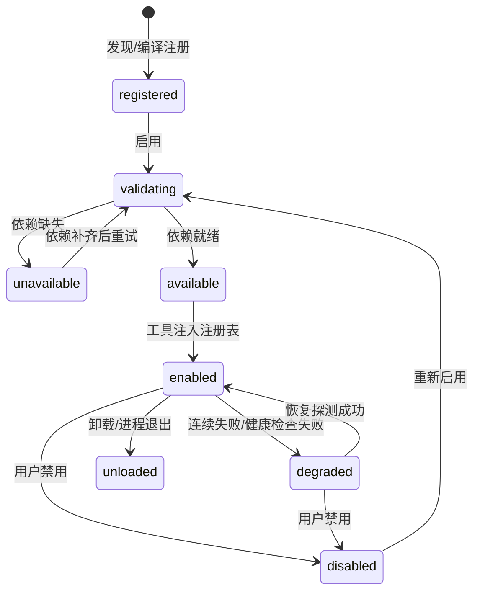

# harness_go 插件体系设计

| 项目 | 内容 |
| --- | --- |
| 文档版本 | v1.0 |
| 上游依据 | `docs/基础服务设计.md`（三层归属判据与覆盖矩阵） |
| 配套文档 | `docs/MCP接入设计.md` |
| 覆盖范围 | 插件契约、生命周期、依赖降级、隔离与权限、注册表、17 个内置插件清单、插件自举 |
| 日期 | 2026-09-13 |

> 核心原则：**内置插件与外部插件在注册表内完全同构**。内核不知道也不关心工具来自哪里，只关心它声明的 `Spec` 与风险等级。

---

## 1. 设计目标

| # | 目标 | 可验收标准 |
| --- | --- | --- |
| P1 | 新增能力不改内核主循环 | 只新增插件实现 + 注册，`agent` 包零改动 |
| P2 | 插件失败不拖垮内核 | 单个插件崩溃/超时/缺依赖时，其他插件与会话正常 |
| P3 | 能力可发现、可解释 | UI 能看到每个插件的状态与不可用原因 |
| P4 | 工具清单可控 | 未启用的工具不进模型上下文，避免 token 膨胀 |
| P5 | 与外部插件同构 | 内置插件卸载后行为与"外部插件未安装"一致 |
| P6 | 可自举 | Agent 能生成插件 → 自测 → 请求加载（人工审批） |

---

## 2. 插件形态

| 形态 | 运行位置 | 传输 | 可信度 | 隔离 | 阶段 |
| --- | --- | --- | --- | --- | --- |
| **内置插件** | 内核进程内 | Go 接口调用 | 随版本发布，可信 | 逻辑隔离（超时/熔断/recover） | A-10 骨架 / F 补齐 |
| **本地工具包**（子进程） | 独立进程 | **stdio JSON-RPC（复用 MCP 协议）** | 不可信 | **OS 进程隔离** | E |
| **MCP Server** | 独立进程 / 远程服务 | stdio / SSE / Streamable HTTP | 不可信 | 进程/网络隔离 | E |
| **HTTP 插件** | 远程服务 | HTTP + manifest 发现 | 不可信 | 网络隔离 | E |
| **WASM 插件** | 内核内沙箱 | wasm ABI | 半可信 | 沙箱 | **预留（P2，一期不做，见 §3.5）** |

选择建议（写入 UI 引导）：需要文件/命令能力的本地能力 → 内置插件；第三方工具包 → 本地工具包（子进程）或 MCP；已有内部 HTTP 服务 → HTTP 插件。

---

## 3. 统一契约

### 3.1 Tool 接口（所有形态的最终归一）

```go
// tools/tool.go
type Tool interface {
    Spec() Spec
    Invoke(ctx context.Context, args json.RawMessage) (Result, error)
}

type Spec struct {
    Name        string          // 全局唯一（外部加命名空间前缀）
    Namespace   string          // builtin | mcp:<server> | plugin:<name>
    Title       string          // UI 展示名
    Description string          // 给模型看，直接进上下文，必须精炼
    InputSchema json.RawMessage // JSON Schema
    Risk        Risk            // readonly | write | command | danger
    Tier        Tier            // **core | deferred | on_demand（决定初始注入深度，见 §3.3）**
    CostTokens  int             // 该定义自身占用（core 全量时计入预算，由 CountChatRequest 回填）
    Timeout     time.Duration   // 单次调用超时（默认 120s）
    MaxOutput   int             // 注入模型的字节上限（默认 32KB）
    Streaming   bool            // 是否支持 partial 输出
    Concurrency Concurrency     // serial（默认） | parallel
    Executor    Executor        // server | desktop | mobile | browser | any（多端归属路由）
    Requires    []Capability    // fs_read | fs_write | net | chromium | git | python
    Capabilities []string       // 细粒度权限声明（市场包必填），如 fs.read:workspace
}

type Result struct {
    Content   string          // 主文本
    Data      json.RawMessage // 结构化结果（可选，UI 用）
    Truncated bool
    Bytes     int
    Artifacts []ArtifactRef   // 生成的文件/图片，落 CAS
}
```

**约束**：
- `Description` 进模型上下文，长度上限 200 字符（超长截断并告警）——40 个工具的描述会吃掉数千 token。
- 外部工具的 `Risk` 只能声明得比内核默认更**高**，不能更低（防自我降级）。
- `MaxOutput` 由内核强制截断，插件不得绕过。

### 3.2 插件 Manifest

```jsonc
{
  "id": "fs",
  "name": "文件操作",
  "version": "1.0.0",
  "kind": "builtin",              // builtin | mcp | http | wasm
  "description": "工作区文件的读写、检索与结构大纲",
  "default_tier": "core",         // core | deferred | on_demand（插件级默认，工具可覆盖）
  "requires": ["fs_read", "fs_write"],
  "capabilities": ["fs.read:workspace", "fs.write:workspace"],
  "default_enabled": true,
  "deployment_modes": ["local", "server", "cloud"],
  "risk_ceiling": "write",        // 该插件允许声明的最高风险
  "tools": ["read_file", "list_dir", "..."],
  "config_schema": { },           // 插件自身配置的 JSON Schema（可选）
  "health_check": { "type": "probe", "timeout_ms": 2000 }
}
```

内置插件的 Manifest 以 `//go:embed` 的 `manifest.json` 形式随代码分发，启动时解析；外部插件的 Manifest 从 MCP 握手 / HTTP 发现获得。

> **Manifest 格式只有一套**：内置插件（编译期）、市场包（阶段 E）、MCP 转换、HTTP 插件全部复用上面这个结构。市场包不另立格式，避免「两套 manifest 漂移」。

### 3.3 工具分层：`Tier` 三档（回答"哪些默认加载、哪些只加载名称"）

**原 `defer_loading: bool` 废弃**，由 `tier` 枚举替代（避免双字段语义重叠）。三档语义与上下文成本：

| Tier | 中文名 | 初始注入内容 | 单条成本 | 上限 | 适用 |
| --- | --- | --- | --- | --- | --- |
| `core` | **基础工具** | **全量定义**：name + description + inputSchema | ~250–320 token | **不设硬上限**（默认推荐 8，超出仅告警） | 日常编码必用：`read_file` `write_file` `edit_file` `list_dir` `grep` `glob` `run_command` `todo` |
| `deferred` | 按需工具 | **仅名称 + 一行描述**进索引，模型需要时经检索或 `load_tool(name)` 取全量定义 | ~18 token | 不设硬上限（默认推荐 60，超出仅告警） | 中频：`plan` `web-fetch` `decision` `file_outline` |
| `on_demand` | 手动工具 | **完全不注入**（模型不可自主发现），仅 UI 可启用 | 0 | 不限 | 高风险/低频：`browser_*` `spawn_subagent` `generate_image` |

**规则**：
1. `core` 是**显式白名单**（逐条指定），不是"前 N 个"——避免工具排序变化导致注入集漂移、破坏 provider 前缀缓存。
2. **数量不设硬上限**：`tools.core_soft_limit`（默认 8）/ `tools.deferred_soft_limit`（默认 60）**只做告警**，不阻断启动。启动日志与 UI 同时显示当前 `core` 清单、条数与**总 token 成本**，由用户自行权衡（专业用户确实可能需要 15 个基础工具）。
3. **分组可手动调整**（三层覆盖，优先级由低到高）：

   | 层 | 存储位置 | 说明 |
   | --- | --- | --- |
   | ① 插件默认 | 插件 `manifest.json` 的 `default_tier` / `Spec.Tier` | 作者建议值 |
   | ② 全局设置 | 主库 `settings` 表 `tools.tiers`（JSON: `{"read_file":"core",…}`） | 用户长期偏好 |
   | ③ 会话覆盖 | 会话库 `session_settings`（同 JSON 结构） | 单个会话临时调整（如"这个会话我要做前端，把 browser 提到 core"） |

   UI：工具面板按「基础 / 按需 / 手动」三档分组，支持下拉或拖拽切换；切换后提示「将在下一轮对话生效」（保护前缀缓存，见 §8.2）。
4. 检索命中的 `deferred` 工具，本轮注入全量定义（动态段置于 prompt 末尾，不打乱前缀缓存）。
5. **宽进严出**：任何已注册工具都可被调用，`tier` 只决定"注入深度"，不决定"能否执行"（防检索漏召回直接失败）。
6. 可观测性：`GET /api/v1/tools` 返回 `tier`（有效值）+ `default_tier`（插件默认）+ `cost_tokens` + `health`；`GET /api/v1/tools/injection` 返回当前注入预算明细（core 全量成本 / deferred 索引成本 / 动态段成本）。

### 3.4 代码分离：契约 / 基础服务 / 插件目录（架构级解耦）

**目标**：基础服务只提供协议与调度，**不含任何具体工具实现**；工具与功能以独立包放在约定目录，可单独启停、单独测试、单独裁剪。参照业内成熟做法：

| 参照 | 借鉴点 |
| --- | --- |
| **OTel Collector** | `component.Host` 能力注入 + factory 注册 + 组件独立包 |
| **Caddy** | `RegisterModule` + 独立包 + Provision/Validate 生命周期 |
| **VS Code Extension** | 目录约定 + manifest 声明 + 激活条件 |
| **Terraform Provider** | 外部能力走**进程外协议**（我们对应 MCP/HTTP/WASM） |

**目录结构（定稿）**

```
pkg/toolapi/                    # ① 公开契约层：零内核依赖，可被第三方 import
  tool.go                       #   Tool / Spec / Result / Risk / Tier / Capability
  host.go                       #   Host 接口（能力注入）
  manifest.go                   #   Manifest / Factory / Register
  errors.go                     #   工具侧错误码

internal/tools/                 # ② 基础服务侧：只做协议与调度，无具体工具
  registry/                     #   注册/注销/冲突检测/白名单/tier 分组/成本统计
  router/                       #   归属路由（executor × capabilities × 风险）
  loader/                       #   deferred 索引与按需加载
  hostimpl/                     #   Host 的内核实现（把内核能力包装成受控接口）

internal/plugins/               # ③ 插件层：一个插件一个独立包（物理隔离）
  fs/          manifest.json  factory.go  read.go  write.go  edit.go  glob.go  grep.go
  command/     manifest.json  factory.go  exec.go
  web/  todo/  plan/  memory/  skill/  decision/  browser/  subagent/  image/
  mcp/  http/  wasm/            #   外部插件宿主（阶段 E）

cmd/harness-go/
  plugins.go                    # ④ 唯一装配清单：import + registry.Register(xxx.Factory)
```

**关键机制一：`Host` 能力注入（工具包不 import 内核）**

```go
// pkg/toolapi/host.go
type Host interface {
    Workspace() WorkspaceFS    // 受沙箱约束的文件访问（Clean→Abs→EvalSymlinks→前缀校验）
    Exec() Executor            // 受审批约束的命令执行（进程组 kill、超时、流式）
    LLM() LLMCaller            // 受配额约束的模型调用（decision/image/skill 用）
    Blobs() BlobStore          // CAS 读写（会话级 blob / 全局快照）
    Events() Emitter           // 进度上报（tool.progress / tool.result_partial）
    Config(pluginID string) Config
    // —— 以下三项是"基础服务保留协议、工具只做入口"的关键能力 ——
    Spawn() ChildRunner        // 嵌套 Run：subagent / collaborator 用（含递归深度与配额限制）
    Tasks() TaskManager        // 长任务状态机：long-task 用（start/pause/resume/cancel/checkpoint/rollback）
    Snapshots() SnapshotStore  // 快照引用：回滚与长任务检查点用
}

// 嵌套 Run：状态机在内核，插件只能通过它派生/等待/停止
type ChildRunner interface {
    Spawn(ctx context.Context, spec ChildSpec) (ChildHandle, error) // 受 max_depth / 并发配额约束
    Wait(ctx context.Context, ids []string, timeout time.Duration) ([]ChildResult, error)
    Status(ctx context.Context, id string) (ChildStatus, error)     // 必须返回显式终态，禁止"没在跑=成功"
    Stop(ctx context.Context, id string) error
}

// 长任务：状态机与检查点在内核（检查点 = Run + 快照引用）
type TaskManager interface {
    Start(ctx context.Context, spec TaskSpec) (TaskID, error)
    Pause/Resume/Cancel(ctx context.Context, id TaskID) error
    Checkpoint(ctx context.Context, id TaskID, note string) (CheckpointID, error)
    Rollback(ctx context.Context, id TaskID, cp CheckpointID) error
    List(ctx context.Context, sessionID string) ([]TaskState, error)
}
```

**为什么这三项必须留在内核**（对应 ADR-S1：子 Agent 归基础服务，工具暴露归插件）：
- 嵌套 Run 要动 Run 状态机、事件桥接、会话租约 → 插件自持会丢状态
- 长任务检查点要「Run + 快照引用」原子登记 → 跨会话库与 CAS
- 快照回滚是物理写文件 → 必须与工作区/存储事务一致

**因此**：`subagent` / `collaborator` / `long-task` 三个插件**只暴露工具入口**（`spawn_subagent` / `dispatch_collaborator` / `start_long_task` 等），真正的执行体在 `internal/agent`（S2）与 `internal/snapshot`（S10），通过 `Host` 暴露给插件。

- 工具实现只能拿到 `Host` 暴露的受控能力，**拿不到 `*sql.DB`、拿不到原始 `llm.Provider`**。
- `depguard` 强制：`internal/plugins/...` 与 `pkg/toolapi` **禁止** import `internal/store`、`internal/llm`、`internal/agent`、`internal/api`。
- 这样"工具能干什么"由 Host 接口一处收口，审计与沙箱不再散落在各工具里。

**关键机制二：编译期注册 + 单一装配点**

```go
// cmd/harness-go/plugins.go —— 新增插件只改这一个文件
func registerPlugins(reg *registry.Registry) {
    reg.Register(fs.Factory)        // internal/plugins/fs
    reg.Register(command.Factory)   // internal/plugins/command
    // …
}
```

- Go 编译期插件必须改 import（`plugin` 包在 Windows 支持差，不采用）——把改动收敛到**一个文件**是可行的最优解，与 OTel Collector `components.go` 同构。
- 需要**零改动**加能力时 → 走外部通道：MCP（阶段 E）/ HTTP 插件 / WASM 包。这正是"内置 vs 外部"的分界：内置追求性能与类型安全，外部追求零改动与隔离。
- 可选裁剪：`//go:build nobrowser` 等 build tag，便于出精简版二进制。

**关键机制三：插件自持生命周期**

```go
type Factory interface {
    Manifest() Manifest                    // 含 tier / requires / risk_ceiling
    New(host Host, cfg Config) (Plugin, error) // 构造时注入 Host
}
type Plugin interface {
    Start(ctx context.Context) error       // 依赖探测、连接建立（如 MCP 握手）
    Stop(ctx context.Context) error        // 释放资源
    Tools() []Tool
    Health() Health                        // ready | degraded | unavailable
}
```

对应 §4 的生命周期状态机：`registered → validating(Start) → available/degraded/unavailable`。

### 3.5 WASM 取舍分析（多端协作场景下是否必要）

**结论：一期不做 WASM，保留接口枚举与目录占位。** 第三方工具包的沙箱隔离用**子进程 + stdio JSON-RPC（复用 MCP 协议）**实现，隔离强度等同、成本低一个量级。

**五种外部形态对比**

| 方案 | 隔离强度 | 调用开销 | 跨平台 | 工程成本 | 调试 | 适用场景 |
| --- | --- | --- | --- | --- | --- | --- |
| 进程内 Go 插件（编译期） | 无 | 最低（函数调用） | ✅ | 低 | 易 | 内置可信能力 |
| **子进程 + stdio JSON-RPC** | **强（OS 进程边界）** | 中（IPC 序列化） | ✅ | **中低（复用 MCP stdio 实现）** | 中（可 attach 子进程） | **第三方工具包（首选）** |
| MCP Server | 强（进程/网络） | 中 | ✅ | 已投入 | 中 | 生态接入 |
| HTTP 插件 | 中（网络边界） | 中 | ✅ | 低 | 易 | 远程服务 |
| WASM（wazero） | 强（能力白名单 + 无系统调用） | 中高（ABI 边界） | ✅ | **高** | **难**（需自建 host function 与调试链路） | 云端多租户 |

**为什么一期不做 WASM（4 条理由）**

1. **隔离目标已被子进程满足**：WASM 的核心价值是"不可信代码不能碰宿主资源"。而 OS 进程本身就是最成熟的隔离边界——子进程崩了不影响内核，权限由 OS 管。我们已经有 MCP stdio 传输实现，复用度约 80%，**新增成本接近零**。
2. **执行面已下沉到端侧**（HALO 架构）：多端场景下，第三方工具更倾向在**用户自己的端侧 Runner** 里跑，端侧本身就是信任边界；服务端不必承担"执行他人代码"的风险。
3. **WASM 的真正刚需是「服务端多租户」**：只有"同一个服务端进程为多个互不信任的租户执行第三方代码"时，才必须 WASM（进程隔离在容器里成本高、密度低）。本项目定位是**本地单机 + 单二进制免安装分发为一等公民**，`server`/`cloud` 是兼容形态而非主战场。
4. **wazero 的工程债**：需把 fs / net / exec 全部封装为 host function + 资源限额（指令数、内存、超时）+ 错误栈映射；Go 侧 WASM 工具链成熟度一般，出问题难排查。在功能优先的阶段，这笔投入产出比低。

**保留的扩展位（将来要上不破坏契约）**
- `Manifest.kind` 枚举保留 `"wasm"`，`internal/plugins/wasm/` 目录占位（空实现，仅注释说明）。
- 工具契约（`Tool`/`Spec`/`Result`/`Host`）与形态无关，WASM 插件将来只需实现同一 `Factory` 接口 + 用 host function 实现 `Host` 的 8 个方法。
- 判定升级条件（写进文档，避免反复讨论）：**① 上线云端多租户形态，或 ② 工具市场向不可信第三方开放且要求服务端执行** —— 满足任一条件即启动 WASM 实现。

**替代落地方案（阶段 E）**
```
工具包格式：pkg.zip = manifest.json + 可执行文件（win/linux/mac 各一）+ 签名
加载流程：解压到 data/packages/<id>/<version>/ → 校验签名 → 启动子进程（stdio）
          → MCP 握手（initialize → tools/list）→ 注册工具（namespace: pkg:<id>）
隔离：OS 进程 + 审批（默认按 write）+ 出网白名单 + 工作区路径约束（由 Host 注入）
卸载：停进程 → 删目录 → 清索引
```
> 因为复用 MCP 协议，**"本地工具包"与"MCP Server"在实现上是同一套代码路径**，只差"包从哪来"（本地 zip vs 用户手配 URL）。

---

## 4. 生命周期状态机



| 状态 | 含义 | 工具是否可见 | UI 展示 |
| --- | --- | --- | --- |
| `registered` | 已发现未启用 | 否 | 灰色，可启用 |
| `validating` | 探测依赖中 | 否 | 加载中 |
| `unavailable` | 依赖缺失 | 否 | **必须显示缺什么**（如"未检测到 git"） |
| `available` | 就绪未注入 | 否 | 可启用 |
| `enabled` | 正常 | 是 | 正常 |
| `degraded` | 连续失败熔断 | 否（可配保留只读工具） | 告警 + 原因 |
| `disabled` | 用户禁用 | 否 | 灰色 |
| `unloaded` | 已卸载 | 否 | — |

**关键约束**：状态迁移必须落库（`plugin_state` 表）并 emit `plugins.changed`；`unavailable` / `degraded` **不得阻塞启动**，只记录日志与 UI 提示。

---

## 5. 依赖探测与能力降级

### 5.1 能力枚举与探测方式

| Capability | 探测方式 | 缺失后果 |
| --- | --- | --- |
| `fs_read` / `fs_write` | 数据目录/工作区可写探测 | 该插件 `unavailable` |
| `net` | 配置的出网白名单非空 + DNS 探测（可跳过） | 相关工具 `unavailable` |
| `git` | `exec.LookPath("git")` + `git --version` | ~~`temp-workspace` 不可用~~（临时空间已取消，git 仅阶段 G 快照/回滚可选使用） |
| `chromium` | 配置路径 / `exec.LookPath` / 常见安装目录探测 | `browser` 不可用，提示安装或改用 MCP |
| `python` | `exec.LookPath("python3"/"python")` | 依赖 Python 的外部插件不可用 |
| `model:<capability>` | 是否配置了 vision / image / decision 模型 | 对应工具不注入（避免模型反复调用失败） |

### 5.2 降级策略（三级）

| 级别 | 场景 | 行为 |
| --- | --- | --- |
| L1 插件级 | 依赖缺失 | 整个插件 `unavailable`，工具不注入 |
| L2 工具级 | 插件部分工具依赖缺失 | 只注入可用工具（如 `browser` 无 chromium 时 `browser_screenshot` 仍可用？否，全部不可用） |
| L3 调用级 | 运行中依赖失效（如 git 被卸载） | 返回结构化错误给模型，插件转 `degraded` |

**禁止**：依赖缺失时"假装可用"，让模型反复失败浪费 token 与步数。

---

## 6. 隔离、超时与熔断

| 机制 | 内置插件 | MCP / HTTP 插件 |
| --- | --- | --- |
| 超时 | `ctx.WithTimeout(Spec.Timeout)`，强制 | 同左 + 传输层超时 |
| panic 隔离 | 每次 `Invoke` 独立 `recover` → 转 `TOOL_PANIC` 错误 | 进程崩溃 → 标记 `degraded` |
| 并发 | `Spec.Concurrency=serial` 时同 Run 内串行 | 同左 |
| 输出上限 | 内核强制截断到 `MaxOutput`，完整内容落 `tool_events` | 同左 |
| 熔断 | 连续失败 ≥ 3 次 → `degraded`，冷却 60s 后探测恢复 | 同左 + 连接重建 |
| 资源 | 子进程组 kill、文件句柄限制 | 进程级隔离 |

**熔断计数器**按 `namespace + tool` 维度统计，避免一个工具拖垮整个插件；插件级熔断用于传输层故障。

---

## 7. 权限与审批

### 7.1 风险分级与默认策略

| Risk | 典型工具 | 默认（变更前确认） | 完全访问模式 |
| --- | --- | --- | --- |
| `readonly` | read_file / glob / grep / fetch_web_page | 自动放行 | 自动放行 |
| `write` | write_file / edit_file / 外部插件写操作 | 需审批 | 放行 |
| `command` | run_command | 需审批 | 放行 |
| `danger` | 高危命令、删除目录、`rm -rf` | **强制逐次确认** | 仍需确认（不可永久放行） |

外部插件（MCP/HTTP）**默认按 `write` 处理**，除非其 Manifest 声明 `readonly` 且用户在插件详情页显式确认"信任为只读"。

### 7.2 会话级白名单

- 插件可在会话维度启用/禁用（`session_plugin_policy`）。
- 工具注入时按 `enabled ∩ available ∩ session_allow` 过滤。
- 默认策略：`default_enabled=true` 的插件对所有会话可用；其余需显式开启。

### 7.3 审批规则

「本会话允许」生成的规则以 `tool_name + pattern` 存储（命令前缀 / 路径前缀），仅对该会话生效，可在会话设置中查看与删除。

---

## 8. 工具注入与生效边界

### 8.1 注入规则（tier 驱动）

```
候选集 = Registry.List()
          .Where(namespace 已启用)
          .Where(状态 = available | degraded→排除)
          .Where(会话白名单允许)
          .Where(risk_ceiling 允许)
          .Where(executor 能力匹配)

注入 = core 全量（显式白名单，≤8）
     ∪ deferred 索引（name + 一行描述，~18 token/条）
     ∪ 本轮检索命中的 deferred 全量定义（动态段置于 prompt 末尾）
     （on_demand 不注入，仅 UI 可见）
```

- **`core` 硬上限 8**：超限**启动失败**并列出候选，不做静默截断（§3.3 规则 2）。
- **`deferred` 索引也有上限**（默认 60 条 ≈ 1.1k token）：超出按「最近使用 + 插件默认启用序」裁剪并 emit 告警。
- **`on_demand` 不占任何上下文**，模型无法自主发现；由用户在 UI 显式启用后降级为 `deferred`。
- 成本核算：`core` 全量 + `deferred` 索引 + 动态检索结果，三段分别计入 `CountChatRequest` 的 `tools` 段明细（见需求文档 §7.5），启动日志与 `/api/v1/tools` 均可见。
- 生效边界见 §8.2（工具清单变化 → 下一个 Run 生效，保护前缀缓存）。

### 8.2 生效边界（关键）

| 事件 | 生效时机 | 原因 |
| --- | --- | --- |
| 启用/禁用插件 | **下一个 Run** | 工具清单变化会改变 prompt 前缀，破坏 provider 前缀缓存 |
| 插件热重载（工具实现变更，Spec 不变） | 立即 | 不影响上下文 |
| 插件新增工具（Spec 变化） | 下一个 Run（可选"立即生效"并提示缓存失效） | 同上 |
| 插件转 `degraded` | **立即**（下一步不再注入） | 避免模型继续调用必失败工具 |

UI 提示文案："已启用 N 个工具，将在下一轮对话生效。"

---

## 9. 注册表与并发

```go
type Registry struct {
    mu      sync.RWMutex
    tools   map[string]Tool      // name → tool
    byNS    map[string][]string  // namespace → names
    version uint64               // 每次变更自增，用于快照比对
}

// 读取路径无锁：写时复制快照，Run 开始时取一次
func (r *Registry) Snapshot(sessionID string) []Spec
```

| 机制 | 设计 |
| --- | --- |
| 注册冲突 | 同名拒绝；内置工具允许被显式覆盖（需 `override: true` 并记审计） |
| 注销 | 从 map 移除；正在执行的调用允许完成（持有 Tool 引用） |
| 热更新 | 先注册新版本 → 原子替换 map → 旧版本延迟释放 |
| 并发读 | `RWMutex` 读锁或原子快照指针；禁止在 `Invoke` 期间持有注册表锁 |
| 变更通知 | `version` 自增 + emit `tools.changed {added, removed, version}` |

---

## 10. 内置插件清单（17 个）

| 插件 | 工具数 | 依赖 | 风险上限 | 默认启用 | 阶段 |
| --- | --- | --- | --- | --- | --- |
| `fs` | 7 | fs_read, fs_write | write | 是 | M2 |
| `command` | 1 | fs_write（cwd） | danger | 是 | M2 |
| `web-fetch` | 1 | net | readonly | 是 | M2 |
| `todo` | 1 | — | readonly | 是 | M2 |
| `plan` | 5 | fs_write | write | 是 | M2 |
| `decision` | 3 | model:decision | readonly | 否 | M2 |
| `memory` | 2 | fs_write | write | 是 | M3 |
| `skill` | 3 | fs_write, fs_read | write | 是 | M3 |
| `growth` | 1（内部） | model:chat | write | 否 | M4 |
| `image` | 2 | model:vision, model:image, fs_write | write | 否 | M3 |
| `browser` | 6 | chromium, net | write | 否 | M3 |
| `subagent` | 8 | —（内核嵌套 Run） | write | 是 | M3 |
| `collaborator` | 3 | —（内核嵌套 Run） | write | 否 | M3 |
| ~~`temp-workspace`~~ | ~~6~~ | — | — | — | **已取消（2026-11）** |
| `long-task` | 3（内部） | —（内核任务状态机） | write | 是 | M4 |
| `session-bundle` | 2（内部） | fs_read, fs_write | write | 是 | M4 |
| `sop` | 2（内部） | fs_read, fs_write | write | 否 | M4 |

### 10.1 关键插件说明

**`fs`**：路径安全由服务 S9 统一守卫，插件本身不做路径判断（避免两套规则漂移）。`write_file`/`edit_file` 必须先登记快照（S10）再落盘。

**`command`**：`cwd` 固定为会话工作区根；输出流式回传（`Streaming=true`）；超时与取消统一 kill 进程组；高危模式匹配在服务 S6 完成，插件不重复实现。

**`browser`**：无头 Chromium + CDP。工具与桌面版同名同参，便于模型复用既有知识。录制/认证契约属于**前端 + 插件协作**能力（前端发起录制 → 事件写入 → 插件蒸馏契约），M3 提供基础 6 工具，录制能力 M4。

**`subagent` / `collaborator`**：工具只是"入口"，实际执行由服务 S2 的 `SpawnChild` 完成。`get_subagent_status` 必须返回显式终态（禁止用"没在跑"推断成功）。

**~~`temp-workspace`~~（已取消）**：原设计依赖 git，`temp_merge` 的冲突合并调用 `model:chat`。**2026-11 用户决策取消临时空间功能**，不做 git 沙箱、变更合并与会话级动态工作区根；工作区根固定为项目级。

**`decision`**：三个工具共享决策模型槽位；未配置模型时整插件 `unavailable`（不注入，避免模型反复调用失败）。桌面版的"意图对齐门禁"降级为可选插件，不作为主链路强门禁。

---

## 11. 插件自举（L1–L3）

| 级别 | 能力 | 人工介入 | 阶段 |
| --- | --- | --- | --- |
| **L1** | 手写插件 + 热加载（不重启内核） | 人写人审 | M2 |
| **L2** | Agent 生成插件 + 自测 + 请求加载 | 人只审批"允许加载" | M3 |
| **L3** | 自主发现缺口 → 生成 → 自测 → 加载 → 失败自动回滚 | 无人（可配通知） | P2 |

### 11.1 自举闭环（L2）

```
能力缺口（工具不存在/调用失败/用户显式要求）
  → plugin_scaffold(模板生成 manifest + 入口文件)
  → Agent 写实现（write_file / edit_file）
  → plugin_test(启动插件 → tools/list → 试跑 invoke → 断言)
  → plugin_load（admin scope + 人工审批）
  → 注册表热注册 → emit tools.changed → 下一轮可用
```

### 11.2 三个自举专用工具

| 工具 | 作用 | 风险 |
| --- | --- | --- |
| `plugin_scaffold` | 按模板生成插件骨架（内置正确 manifest 与 invoke 样板，避免协议写错） | write |
| `plugin_test` | 启动插件 + `tools/list` + 试跑一次 invoke，返回结构化结果与错误 | command |
| `plugin_load` / `plugin_rollback` | 加载 / 回滚到上一版本（走审批） | danger |

### 11.3 自举安全边界

1. 插件目录固定为 `data/plugins/<id>/`，与工作区隔离；
2. 加载需 `admin` scope + 人工审批，**不可"本会话允许"永久放行**；
3. 每次加载保留上一版本，失败自动回滚；
4. **明确禁止 Agent 自主修改 `internal/` 内核代码**（插件扩展 ≠ 自我改内核）；内核代码变更必须人工确认，即使访问模式为"完全访问"；
5. 提供 `harness-go doctor` 用于内核被改坏后的人工恢复。

---

## 12. 管理 API 与 UI 契约

| 方法 | 路径 | 说明 |
| --- | --- | --- |
| GET | `/api/v1/plugins` | 列表：id/name/kind/state/requires/tools/原因 |
| POST | `/api/v1/plugins/{id}/enable` | 启用（校验依赖） |
| POST | `/api/v1/plugins/{id}/disable` | 禁用（工具立即从下一 Run 消失） |
| POST | `/api/v1/plugins/{id}/reload` | 热重载 |
| GET | `/api/v1/plugins/{id}/health` | 健康详情（探测项、耗时、错误） |
| GET | `/api/v1/tools` | 当前注入工具清单（含 namespace、risk、来源插件） |
| POST | `/api/v1/plugins` | 注册外部插件（HTTP/WASM，M3） |
| DELETE | `/api/v1/plugins/{id}` | 卸载 |

UI 要求：
- 插件卡片显示 **状态徽标 + 不可用原因**（缺什么依赖、怎么装）；
- 启用含高危工具的插件时二次确认，并列出将注入的工具数与预计 token 成本；
- 工具清单页可按 namespace 分组，显示每个工具的最近调用次数与失败率。

---

## 13. 测试与验收

| 项 | 验收方式 |
| --- | --- |
| 插件失败隔离 | 注入 panic 插件，断言其他插件与会话正常 |
| 依赖降级 | 隐藏 git/chromium，断言插件 `unavailable` 且原因可读，启动不阻塞 |
| 熔断 | 让工具连续失败 3 次，断言转 `degraded` 且不再注入 |
| 生效边界 | 启用插件后断言当前 Run 工具清单不变、下一 Run 生效 |
| 输出截断 | 返回 1MB 结果，断言注入模型 ≤ MaxOutput、完整内容落库 |
| 注册冲突 | 注册同名工具，断言拒绝并记录审计 |
| 自举闭环 | 用 `plugin_scaffold` 生成 → `plugin_test` 通过 → `plugin_load` 后工具可用 |
| token 成本 | 40 个工具时 `CountChatRequest` 的 tools 段与实测偏差 < 2% |
