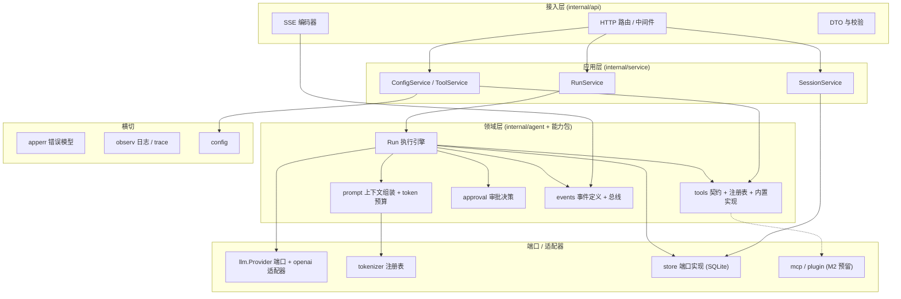
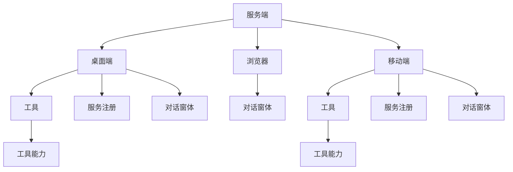
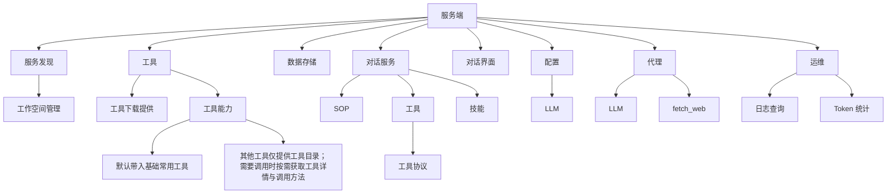
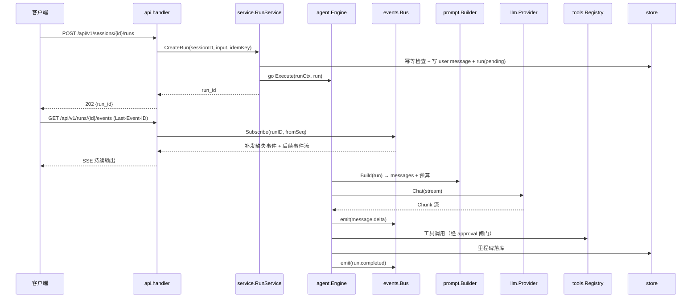
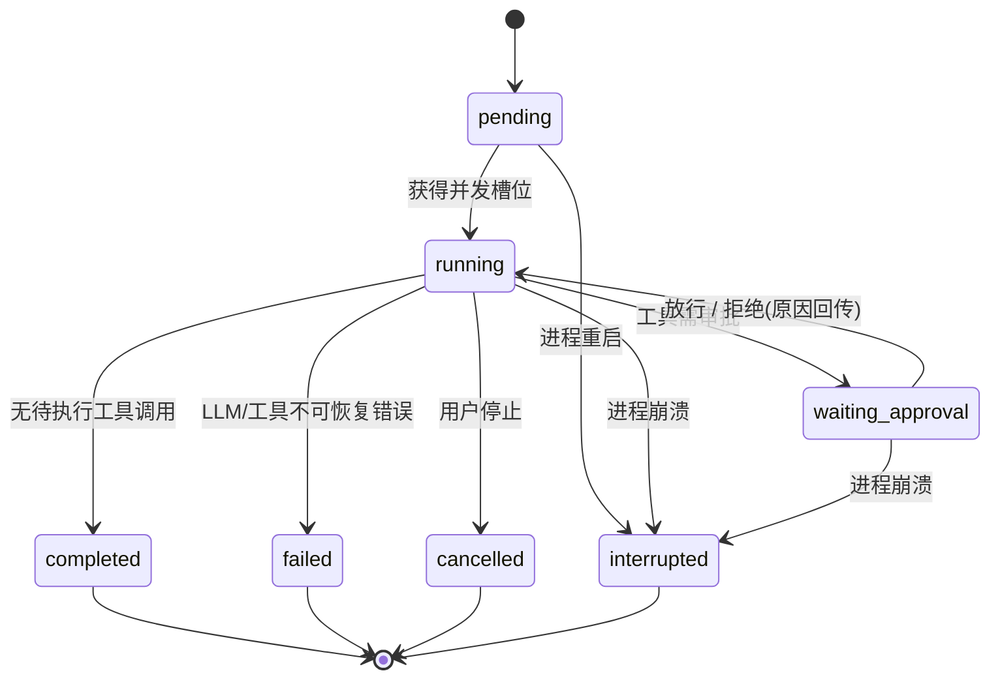

# harness_go 基础架构设计文档

| 项目 | 内容 |
| --- | --- |
| 文档版本 | v0.1（基础架构定稿，待评审） |
| 上游依据 | `docs/需求说明文档.md` v0.2 |
| 日期 | 2026-09-13 |
| 覆盖范围 | M0–M1 落地所需的骨架与契约（对话内核可跑通）；M2+（MCP/插件）只留扩展点 |
| 读者 | 实现者（前后端）、评审者 |

---

## 1. 设计目标与约束

### 1.1 架构层面的可验收目标

| # | 目标 | 验收方式 |
| --- | --- | --- |
| A1 | 内核可在无 UI 情况下被 curl 完整驱动 | 仅用 HTTP + SSE 完成一次多轮对话 |
| A2 | 单二进制启动即用，无外部运行时依赖 | 空机器上双击运行，浏览器可访问 |
| A3 | 一个 Run 的失败不影响其他会话 | 注入工具 panic / LLM 超时，其他会话不受影响 |
| A4 | 慢客户端不拖慢 Run | 模拟 0 消费的 SSE 连接，Run 仍按时完成 |
| A5 | 进程重启后状态一致 | kill -9 后重启，历史完整、未完成 Run 标记 interrupted |
| A6 | 前后端可独立开发调试 | Vite dev server + API 代理，HMR 正常 |
| A7 | 新增工具/Provider 不改内核主循环 | 只新增实现并注册，`agent` 包零改动 |

### 1.2 继承的硬约束（来自需求文档）

- 本地单机 + 单二进制分发是一等公民（形态 A）。
- 内核与界面彻底分离，浏览器只是第一个客户端。
- 一切工具皆插件：内核只内置最小工具集，其余走 MCP/插件。
- 稳定性一票否决：断流可续、失败可重试、崩溃可恢复。
- 精确 token 计数（三层模型，见需求文档 §7.5）。

### 1.3 本文不覆盖

具体工具实现细节、MCP 协议字段、插件协议细节、UI 视觉设计、多用户账号体系。上述内容在 M2+ 或独立文档中定义。

---

## 2. 架构总览

### 2.1 分层视图



### 2.2 分层职责与依赖规则

| 层 | 职责 | 允许依赖 | 明确禁止 |
| --- | --- | --- | --- |
| `api` | 协议转换、鉴权、限流、参数校验、SSE 写出 | `service`、`events`(只订阅)、`apperr`、`observ` | 直接调 `store`、直接调 `llm`/`tools` |
| `service` | 用例编排（创建会话、发起 Run、管理配置与工具清单） | `agent`、`store`、`tools`、`config` | 实现业务规则细节（应下沉到 agent/domain） |
| `agent` | Run 状态机、主循环、工具调度、中断与重试 | `prompt`、`llm`、`tools`、`approval`、`events`、`store`(窄接口)、`tokenizer` | 依赖 `api`、依赖具体 sqlite 实现 |
| `prompt` | 消息组装、裁剪、token 预算 | `tokenizer`、`tools`(仅 `Spec` 类型) | 依赖 `llm`、依赖 `store` |
| `tools` | 工具契约、注册表、内置实现 | `apperr`、标准库、子进程 | 依赖 `agent`、依赖 `approval` |
| `approval` | 风险级 → 规则 → 访问模式决策 | 标准库 | 依赖 `store`（决策入参由调用方提供） |
| `llm` | Provider 端口与各厂商适配 | 标准库、`apperr` | 依赖 `agent`/`store` |
| `store` | 持久化实现与迁移 | 标准库、sqlite driver | 依赖任何上层包 |
| `events` | 事件定义、总线、环形缓冲 | 标准库 | 依赖 `agent` |

**依赖方向单向向内**，禁止反向与跨层跳跃（`api` 不得越过 `service` 访问 `store`）。用 `golangci-lint` 的 `depguard` 固化该规则。

### 2.3 端口与接口归属（Go 惯例）

**接口在使用方包内定义窄接口**，而非集中到 `ports` 包：

- `agent` 定义它需要的 `MessageRepo` / `RunRepo` / `EventStore` 等窄接口，`store` 的具体类型实现它们。
- `agent` 定义 `Provider` 与 `Stream` 接口，`llm` 提供实现。
- `tools` 定义 `Tool` 接口，`mcp`/`plugin` 提供实现。

好处：避免"万能 ports 包"演变为 god 包，且依赖关系天然清晰。代价：接口数量略多，需在代码中保持命名一致。

### 2.4 端侧形态与服务端功能拆解（手绘补充图）

> 2.1 的分层图描述的是**代码内部依赖**；本节两张图描述的是**部署与能力拆解视角**：服务端作为单一中枢，向三种客户端形态（桌面端 / 浏览器 / 移动端）提供同等能力，各端工具均为「壳 + 可安装的工具能力」。与「系统内置工具可安装性与多端协同」中的 DeviceBar / 安装下发流程对应。

#### 2.4.1 端侧形态拆解（三端一致的客户端结构）



要点：

- **桌面端 / 移动端**结构一致：`工具（壳）` 从属于端，真正的执行体是可安装的 **工具能力**（对应内置工具下发 / `installable` manifest）。
- **服务注册**：端上把自身可提供的工具/服务注册回服务端，供服务端服务发现与调度。
- **浏览器**是纯 Web 形态，只承载对话窗体，不具备本地工具能力，复杂能力一律走服务端代理。

#### 2.4.2 服务端功能模块拆解（服务端内部职责视图）



| 模块 | 职责要点 | 与代码层对应 |
| --- | --- | --- |
| 服务发现 / 工作空间管理 | 设备端注册、工具下发目标管理、工作空间挂载 | 承接 §11 运行目录 + 「多端协同」的设备注册 |
| 工具 | 目录分发 + 按需取详情/调用方式，默认集直发 | `tools` 契约/注册表 + Token 治理「索引 + 按需加载」渐进披露 |
| 数据存储 | 会话/消息/Run/事件持久化 | `store`（SQLite，9 张表） |
| 对话服务 | SOP / 工具 / 技能编排，工具走统一协议 | `agent` + `prompt` + `approval`（SOP/技能走渐进披露四类） |
| 对话界面 | Web 前端（CSR + PWA），为浏览器端提供对话窗体 | `web/` 前端架构（§8） |
| 配置 | LLM 等基础配置管理 | `config` + `providers`（secret.key 解密） |
| 代理 | 服务端代为转发 LLM 调用与 `fetch_web` 网络访问 | `llm` 适配器 + 服务端侧网络工具（浏览器端无外联） |
| 运维 | 日志查询、Token 统计（账单口径） | `observ` + tokenizer 精确计数（§7.5） |

> 说明：该图为需求侧功能拆解，落地时二者的对应关系以右表为准；凡与 §2.1 分层视图冲突之处，以分层视图 + 依赖规则为代码实现依据。

---

## 3. 进程与并发模型

### 3.1 单进程布局

单个 OS 进程内：

| 组件 | 形态 |
| --- | --- |
| HTTP server | 1 个 `http.Server`，每连接 1 goroutine（标准库模型） |
| Run 执行 | 每 Run 1 个 goroutine + 独立 `context.Context` |
| 工具执行 | 由 Run goroutine 同步调用；命令类工具内部起子进程 |
| 事件总线 | 进程内内存实现，无跨进程依赖 |
| 后台任务 | 启动时恢复中断 Run、tokenizer 按需下载（独立 goroutine） |

不引入消息队列、Redis、独立 worker 进程——这些会破坏"单二进制"约束，且一期规模（单机 ≤50 并发）无需。

### 3.2 并发控制三原则

| 原则 | 实现 | 原因 |
| --- | --- | --- |
| **会话内串行** | 每 session 一把 `sync.Mutex`（或"活跃 Run 指针 + CAS"），同一会话同时只允许 1 个活跃 Run | 避免 `messages.seq` 竞争、避免上下文互相污染 |
| **全局并发上限** | `chan struct{}` 信号量（默认 8，可配） | 防止同时打爆 LLM 配额与内存 |
| **工具级策略** | `Spec.Concurrency`：`serial`（默认，同 Run 内顺序执行）/ `parallel`（预留） | 一期全部串行，保证事件顺序可预测 |

超出并发上限时：Run 进入 `pending` 排队（返回 202 + `run_id`），而不是拒绝请求；SSE 订阅可先建立并收到 `run.queued` 事件。

### 3.3 Run 执行模型

```go
// agent 包内部形态（示意）
func (e *Engine) Execute(ctx context.Context, run *Run) {
    defer e.finish(run)            // 统一收口：落库 + 发终态事件
    defer recoverToFailed(run)     // panic 转 failed，不拖垮进程

    ctx, cancel := context.WithCancel(ctx)
    defer cancel()
    e.registerCancel(run.ID, cancel)   // 供 POST /runs/{id}/stop

    for step := 0; step < e.maxSteps; step++ {
        if err := ctx.Err(); err != nil { return }  // 被停止
        msgs, budget := e.prompt.Build(ctx, run)
        stream := e.provider.Chat(ctx, msgs)         // 流式
        for chunk := range stream {
            e.emit(run, chunkEvent(chunk))           // 非阻塞投递
            run.appendDelta(chunk)
        }
        calls := run.pendingToolCalls()
        if len(calls) == 0 { return }                // 自然结束
        for _, c := range calls {
            if !e.approve(ctx, run, c) { continue }  // 拒绝：写回原因，继续循环
            res := e.tools.Invoke(ctx, c)
            e.emit(run, toolResultEvent(res))
        }
    }
}
```

关键点：

- **唯一状态持有者**：`Run` 结构体是状态机的唯一载体，所有迁移经 `transition()` 单点方法。
- **context 贯穿**：LLM 请求、工具执行、审批等待全部受同一 `ctx` 控制，`stop` 即整体取消。
- **panic 隔离**：Run 级 + 工具级双层 `recover`，转 `failed` 事件。
- **事件投递非阻塞**：`emit` 只写内存缓冲，永不等待网络（见 §3.4）。

### 3.4 事件分发与背压（架构核心）

```mermaid
graph LR
    AG["Run goroutine"] -->|emit(ev)| BUS["events.Bus<br/>per-Run ring buffer (500)"]
    BUS -->|push| SUB1["SSE 订阅者 A (缓冲 256)"]
    BUS -->|push| SUB2["SSE 订阅者 B (缓冲 256)"]
    BUS -->|里程碑事件| DB[("tool_events / messages / runs")]
    BUS -->|里程碑事件| WH["Webhook 分发 (P1)"]
    SUB1 -->|写失败/缓冲满| DROP["断开该订阅<br/>标记 resync_required"]
```

设计决策：

| 决策 | 内容 | 理由 |
| --- | --- | --- |
| 事件粒度 | `message.delta`（token 级）只进内存，**不落库** | 否则一次对话产生上万行 DB 写入 |
| 落库范围 | 仅里程碑：消息完成、`tool.started/result`、审批请求与决策、Run 状态变更 | 满足审计与恢复，控制写放大 |
| 订阅缓冲 | 每订阅 channel 容量 256 | 吸收网络抖动 |
| 慢消费者 | 缓冲满 → **主动关闭该订阅**，客户端重连后走 resync | Run 绝不能因客户端慢而阻塞（A4） |
| 续传 | `Last-Event-ID` 命中 ring buffer 则补发；未命中返回 `resync` 事件 + 快照指引 | delta 不可重放，但可用消息快照对齐（§5.2） |

### 3.5 优雅关闭顺序

```
SIGTERM/SIGINT
  → 停止接受新连接（server.Shutdown，超时 30s）
  → 通知所有活跃 Run 的 ctx 取消（emit run.interrupted）
  → 等待 Run goroutine 收敛（上限 30s）
  → 落库收尾（Run 终态、消息 flush）
  → 关闭 MCP 子进程（M2）
  → 关闭 DB
```

---

## 4. 模块划分与目录结构

### 4.1 定稿目录结构

> 相对需求文档 §3.4 的调整：新增 `service`（用例层，避免 api 直连 store）、`prompt`（上下文组装，独立于 agent 便于测试）、`tokenizer`、`apperr`、`observ`；`openai`/`mcp`/`plugin` 标注阶段。

```
harness_go/
  cmd/harness-go/main.go          # 组装根：配置 → DB → 依赖注入 → 路由 → 启动
  internal/
    config/                       # 配置加载、校验、默认值
    api/                          # 传输层
      router.go                   # 路由注册
      middleware/                 # recover / trace / log / auth / ratelimit
      handler/                    # session / run / approval / settings / provider / tool
      sse/                        # SSE 编码与订阅桥接
      dto/                        # 请求/响应结构
    service/                      # 用例编排
      session_service.go
      run_service.go
      config_service.go
    agent/                        # Run 执行引擎（核心）
      engine.go                   # 主循环
      run.go                      # Run 结构与状态机
      approval_gate.go            # 审批闸门
      retry.go                    # LLM 重试与降级
    prompt/                       # 上下文组装与预算
      builder.go                  # messages + system + tools → ChatRequest
      budget.go                   # token 预算与裁剪
    tokenizer/                    # 精确计数注册表
      registry.go
      tiktoken.go hf.go provider_api.go heuristic.go
    llm/                          # Provider 端口与适配器
      provider.go                 # Provider / Stream / Chunk 定义
      openai_compat.go            # OpenAI 兼容（含 SSE 解析）
      anthropic.go gemini.go      # P1
    tools/
      tool.go                     # Tool 接口、Spec、Risk
      registry.go                 # 注册/注销/冲突检测/白名单
      builtin/file.go search.go command.go todo.go web.go
      sandbox.go                  # 路径边界校验
    approval/
      engine.go                   # 风险级 → 规则 → 访问模式
      rules.go                    # 会话级规则匹配
    store/
      store.go                    # 具体类型（满足 agent 的窄接口）
      sqlite/                     # 连接、WAL、迁移
      migrations/*.sql            # embed
    events/
      event.go                    # 事件类型与 JSON 结构
      bus.go                      # 环形缓冲 + 订阅
    openai/                       # OpenAI 兼容端点（P1）
    mcp/ plugin/                  # M2
    apperr/                       # 错误模型与错误码
    observ/                       # slog、trace id、/healthz
  web/                            # 前端（见 §8）
    src/  public/  vite.config.ts  package.json
  docs/
  data/                           # 运行时生成：db、secret.key、tokenizers/
```

### 4.2 命名避坑（已识别）

| 陷阱 | 处理 |
| --- | --- |
| 包名 `context` 与标准库冲突 | 上下文组装包命名为 **`prompt`**，不叫 `context` |
| `agent` 包内大量使用 `context.Context` | 包名不与标准库冲突，可直接 `import "context"` |
| `store` 同时作为接口与实现 | `store` 包导出具体类型 `store.Store`，窄接口由 `agent` 定义，避免同名歧义 |
| `tools` 包被 `prompt` 依赖 `Spec` | `Spec` 定义在 `tools`，`prompt` 只读使用，不反向 |

### 4.3 路由与中间件选型调整

**不引入 `chi`，使用标准库 `net/http.ServeMux`（Go 1.22+ 增强路由）**：

- Go 1.22 起 `ServeMux` 原生支持 `GET /api/v1/sessions/{id}` 与 `r.PathValue("id")`，覆盖本项目全部路由需求。
- 中间件就是 `func(http.Handler) http.Handler`，手写 5 个（recover / trace / log / auth / ratelimit）约 150 行。
- 收益：零路由依赖，符合"依赖少、行为可预测"原则。

> 该调整相对需求文档 §3.1「net/http + chi」，需求文档同步更新。

中间件顺序（外→内）：

```
Recover → TraceID → AccessLog → Auth → RateLimit → Handler
```

---

## 5. 核心链路设计

### 5.1 发起 Run 的完整时序



### 5.2 事件续传语义（必须理解的设计）

**问题**：token 级 delta 不落库，因此 `Last-Event-ID` 无法像日志那样"精确重放"。

**方案**：三层对齐

| 场景 | 服务端行为 | 客户端行为 |
| --- | --- | --- |
| `fromSeq` 命中 ring buffer | 补发 `fromSeq+1` 起的缓冲事件，然后转实时 | 直接应用 delta |
| `fromSeq` 未命中（断线过久 / 服务重启） | 先发 `event: resync`，payload 含 `{run_status, last_message_seq}` | 调用 `GET /sessions/{id}/messages?after_seq=` 拉取权威快照，替换本地流式占位消息，再继续消费后续事件 |
| Run 已终态 | 直接发 `run.completed/failed` 终态事件后关闭连接 | 结束订阅 |

**铁律**：**消息最终内容以 DB 为准，流式 delta 只是"预览"**。任何重连、刷新、切设备场景，都以拉取消息快照收敛，避免出现"本地拼接文本与库内不一致"。

### 5.3 审批等待

```
Run goroutine                          HTTP 侧
   │ 需要审批 → 写 approvals(status=pending)
   │ emit approval.requested
   │ transition(waiting_approval)
   ├─ select { <-decisionCh ; <-ctx.Done() ; <-time.After(5min) }
                                          POST /approvals/{id} {decision}
                                          → 落库 + decisionCh <- d
   │ 放行 → 执行工具
   │ 拒绝 → 将拒绝原因作为 tool result 写回，继续 LLM 循环
```

- 审批超时（默认 5min）→ 视为拒绝，原因 `"审批超时"` 回传模型。
- Run 停止 → 审批等待随 `ctx` 取消。
- 决策必须落库（谁、何时、什么决策、原因），供审计与「本会话允许」规则生成。

### 5.4 中断与恢复

| 场景 | 处理 |
| --- | --- |
| 用户点停止 | cancel ctx → emit `run.interrupted` → Run 状态 `cancelled`（区分"用户取消"与"进程崩溃") |
| 进程崩溃 / 重启 | 启动时扫描 `runs.status IN ('pending','running','waiting_approval')` → 全部置 `interrupted`，`stop_reason='process_restart'` |
| 前端看到 interrupted | 展示"该次运行被中断"，提供"重试"（**新建 Run**，非恢复同一 Run） |
| 工具执行中崩溃 | 子进程随进程组一起终止（Windows 用 Job Object，Unix 用 `Setpgid` + 负 pid kill） |

**不做断点续跑**：恢复同一 Run 需要重放工具副作用，风险高收益低。一期只做"状态一致性 + 用户手动重试"。

---

## 6. 关键接口契约（骨架）

```go
// ---------- llm/provider.go（端口，由 agent 消费） ----------
type Provider interface {
    Name() string
    Caps() Caps                          // 是否支持 tool_call / 流式 / 多模态 / reasoning
    Chat(ctx context.Context, req Request) (Stream, error)
}

type Request struct {
    Model    string
    System   string
    Messages []Message
    Tools    []tools.Spec                // 与 prompt 预算共用同一结构
    Params   Params                      // temperature / max_tokens / ...
}

type Stream interface {
    Recv() (Chunk, error)                // io.EOF 表示正常结束
    Close() error
}

type Chunk struct {
    TextDelta      string
    ReasoningDelta string
    ToolCalls      []ToolCallDelta
    Usage          *Usage                // 末帧返回，精确计数来源
    FinishReason   string
}

// ---------- tools/tool.go ----------
type Tool interface {
    Spec() Spec
    Invoke(ctx context.Context, args json.RawMessage) (Result, error)
}

type Spec struct {
    Name        string          `json:"name"`
    Namespace   string          `json:"namespace"`     // builtin | mcp:<s> | plugin:<p>
    Description string          `json:"description"`
    InputSchema json.RawMessage `json:"input_schema"`
    Risk        Risk            `json:"risk"`          // readonly|write|command|danger
    Timeout     time.Duration   `json:"-"`
    MaxOutput   int             `json:"-"`
}

type Result struct {
    Content  string
    Truncated bool
    Bytes    int
}

// ---------- agent 消费的存储窄接口（由 store.Store 实现） ----------
type MessageRepo interface {
    Append(ctx context.Context, m *Message) error
    ListAfter(ctx context.Context, sessionID string, afterSeq int64, limit int) ([]Message, error)
}
type RunRepo interface {
    Create(ctx context.Context, r *Run) error
    Transition(ctx context.Context, runID string, to RunStatus, reason string) error
    ListUnfinished(ctx context.Context) ([]Run, error)
}
type ToolEventRepo interface {
    Append(ctx context.Context, e *ToolEvent) error
    UpdateResult(ctx context.Context, id string, status string, result []byte, errMsg string) error
}

// ---------- events/bus.go ----------
type Bus interface {
    Publish(runID string, ev Event)                       // 非阻塞
    Subscribe(runID string, fromSeq int64) (<-chan Event, func(), error)
    Close()
}

// ---------- agent 的审批端口（approval 包实现） ----------
type Approver interface {
    Decide(ctx context.Context, req ApprovalRequest) (Decision, error)
}
```

设计约定：

- **所有跨层调用带 `ctx`**，无例外。
- **所有 IO 返回 `error`，错误包装统一走 `apperr`**（携带业务码，见 §10.1）。
- **不定义"万能 Store 接口"**，按用例拆窄接口。

---

## 7. 数据模型

### 7.1 基础表（M1）

> **v2.2 存储方案已落定为「按会话分库」，本节 9 张表为基线，实际建表以 `docs/数据存储方案.md` 为准**：
> - **主库** `data/main.db`：`sessions`（含摘要冗余列）、`users`、`api_tokens`、`providers`、`settings`、`schema_migrations`
> - **会话库** `data/sessions/<sid>/session.db`：`messages`、`runs`、`tool_events`、`approvals`、`approval_rules`、`blobs`、`session_meta`、`schema_migrations`
> - 预埋字段：`runs.executor`/`device_id`，`tool_events.executor`/`device_id`/`source_trust`
> - 大对象走**会话级 CAS** `sessions/<sid>/blobs/<xx>/<sha256>`（单 blob ≤64MB），文件快照走全局 `snapshots/blobs/`；**禁止跨库事务与 ATTACH 联查**

```sql
-- 会话
CREATE TABLE sessions (
  id              TEXT PRIMARY KEY,
  title           TEXT NOT NULL DEFAULT '',
  workspace_path  TEXT NOT NULL DEFAULT '',   -- 空 = 纯对话
  access_mode     TEXT NOT NULL DEFAULT 'confirm', -- confirm | full
  model_ref       TEXT NOT NULL DEFAULT '',   -- provider_id/model_id
  user_id         TEXT NOT NULL DEFAULT '',   -- 多用户预留（一期恒为空）
  created_at      INTEGER NOT NULL,
  updated_at      INTEGER NOT NULL,
  archived_at     INTEGER
);

-- 消息（seq 为会话内单调递增，唯一约束保证顺序与幂等）
CREATE TABLE messages (
  id           TEXT PRIMARY KEY,
  session_id   TEXT NOT NULL REFERENCES sessions(id) ON DELETE CASCADE,
  run_id       TEXT,
  seq          INTEGER NOT NULL,
  role         TEXT NOT NULL,                -- system|user|assistant|tool
  content      TEXT,
  reasoning    TEXT,
  tool_calls   TEXT,                         -- JSON
  tool_call_id TEXT,
  token_count  INTEGER NOT NULL DEFAULT 0,   -- 精确计数缓存
  usage_json   TEXT,
  created_at   INTEGER NOT NULL,
  deleted_at   INTEGER,
  UNIQUE(session_id, seq)
);

-- 运行
CREATE TABLE runs (
  id            TEXT PRIMARY KEY,
  session_id    TEXT NOT NULL REFERENCES sessions(id) ON DELETE CASCADE,
  trigger_type  TEXT NOT NULL DEFAULT 'manual', -- manual|schedule|api（预留）
  status        TEXT NOT NULL,                  -- pending|running|waiting_approval|completed|failed|cancelled|interrupted
  stop_reason   TEXT,
  model_ref     TEXT,
  input_tokens  INTEGER NOT NULL DEFAULT 0,
  output_tokens INTEGER NOT NULL DEFAULT 0,
  cached_tokens INTEGER NOT NULL DEFAULT 0,
  is_estimated  INTEGER NOT NULL DEFAULT 0,
  error_code    TEXT,
  error_message TEXT,
  started_at    INTEGER,
  ended_at      INTEGER,
  created_at    INTEGER NOT NULL
);

-- 工具调用事件（审计 + UI 回放）
CREATE TABLE tool_events (
  id          TEXT PRIMARY KEY,
  session_id  TEXT NOT NULL,
  run_id      TEXT NOT NULL,
  message_id  TEXT,
  tool_name   TEXT NOT NULL,
  namespace   TEXT NOT NULL DEFAULT 'builtin',
  args_json   TEXT,
  result_json TEXT,
  status      TEXT NOT NULL,   -- pending|approved|denied|running|ok|error|timeout
  risk        TEXT NOT NULL,
  approved_by TEXT,
  error       TEXT,
  started_at  INTEGER,
  ended_at    INTEGER
);

-- 审批
CREATE TABLE approvals (
  id            TEXT PRIMARY KEY,
  run_id        TEXT NOT NULL,
  tool_event_id TEXT NOT NULL,
  request_json  TEXT NOT NULL,
  decision      TEXT,          -- allow_once|allow_session|deny
  reason        TEXT,
  requested_at  INTEGER NOT NULL,
  decided_at    INTEGER
);

-- 会话级审批规则（"本会话允许"产生）
CREATE TABLE approval_rules (
  id         TEXT PRIMARY KEY,
  session_id TEXT NOT NULL,
  tool_name  TEXT NOT NULL,
  pattern    TEXT NOT NULL DEFAULT '',   -- 命令前缀 / 路径前缀
  created_at INTEGER NOT NULL
);

-- 模型厂商与模型
CREATE TABLE providers (
  id         TEXT PRIMARY KEY,
  name       TEXT NOT NULL,
  base_url   TEXT NOT NULL,
  api_key_enc BLOB,                      -- AES-256-GCM
  models_json TEXT NOT NULL DEFAULT '[]',
  enabled    INTEGER NOT NULL DEFAULT 1,
  created_at INTEGER NOT NULL
);

-- API Token
CREATE TABLE api_tokens (
  id           TEXT PRIMARY KEY,
  name         TEXT NOT NULL,
  token_hash   TEXT NOT NULL,
  scope        TEXT NOT NULL DEFAULT 'write', -- read|write|admin
  last_used_at INTEGER,
  expires_at   INTEGER,
  revoked_at   INTEGER,
  created_at   INTEGER NOT NULL
);

-- 键值配置
CREATE TABLE settings (
  key        TEXT PRIMARY KEY,
  value_json TEXT NOT NULL,
  updated_at INTEGER NOT NULL
);

-- 迁移版本
CREATE TABLE schema_migrations (version INTEGER PRIMARY KEY, applied_at INTEGER NOT NULL);
```

### 7.2 Run 状态机



约束：状态迁移只能经 `Run.Transition()` 单点方法，禁止各处置位；迁移必须落库并 emit 事件。

### 7.3 SQLite 实践

| 项 | 设置 | 理由 |
| --- | --- | --- |
| 驱动 | `modernc.org/sqlite`（纯 Go） | 免 CGO，保证交叉编译与单二进制 |
| 日志模式 | `PRAGMA journal_mode=WAL` | 读写并发友好 |
| 忙等待 | `PRAGMA busy_timeout=5000` | 避免瞬时 SQLITE_BUSY |
| 外键 | `PRAGMA foreign_keys=ON` | 级联删除生效 |
| 写并发 | 写操作经单写通道串行（`SetMaxOpenConns(1)` 或写 mutex） | SQLite 单写者，显式串行避免随机失败 |
| 迁移 | `embed` 的 `NNNN_name.sql`，按版本号顺序执行，记录于 `schema_migrations` | 无外部迁移工具依赖 |
| 备份 | 启动时 `PRAGMA integrity_check`（快速模式） | 及早发现损坏 |

### 7.4 索引

```sql
CREATE INDEX idx_messages_session_seq ON messages(session_id, seq);
CREATE INDEX idx_runs_session_created ON runs(session_id, created_at DESC);
CREATE INDEX idx_runs_status ON runs(status);                 -- 启动扫描未完成 Run
CREATE INDEX idx_tool_events_run ON tool_events(run_id);
CREATE INDEX idx_sessions_updated ON sessions(updated_at DESC) WHERE archived_at IS NULL;
```

---

## 8. 前端架构

### 8.1 目录与分层

```
web/src/
  main.tsx  App.tsx
  routes/                 # 路由级页面（薄，只做组装）
    ChatPage.tsx  SessionsPage.tsx  SettingsPage.tsx
  features/               # 业务特性（内聚）
    session/              # 会话列表、项目分组
    chat/                 # 消息流、输入区、工具卡片、审批弹窗
    settings/             # 模型 / 审批 / 数据
  components/             # 通用组件（Button、Modal、Drawer、Markdown、DiffView）
  layout/                 # AppShell + 三种断点骨架
  stores/                 # zustand：sessionStore / chatStore / uiStore
  lib/
    api.ts                # REST 客户端（fetch + 统一错误）
    sse.ts                # SSE 连接管理（重连 + resync）
    tokenizerView.ts      # 只做展示格式化，不做估算（估算在后端）
  styles/                 # tailwind + CSS 变量设计令牌
```

规则：

- `routes` 不写业务逻辑；`features` 之间不互相 import（通过 stores 或 props 通信）。
- 估算/计数逻辑**只存在于后端**，前端仅格式化展示（避免桌面版两份副本漂移的问题）。

### 8.2 状态划分

| Store | 内容 | 来源 |
| --- | --- | --- |
| `sessionStore` | 会话列表、当前会话、项目分组、归档 | REST（带分页/缓存） |
| `chatStore` | 当前会话消息、流式占位消息、运行状态、审批队列 | REST 快照 + SSE 事件 reducer |
| `uiStore` | 断点、抽屉开关、主题、侧栏宽度、输入草稿 | 本地（localStorage 持久化） |

**流式渲染策略**：SSE delta 先写入 `ref` 缓冲，按 ~50ms 或每 200 字符批量提交到 store，避免逐 token `setState` 造成掉帧。

### 8.3 SSE 客户端（lib/sse.ts）

```
状态机：idle → connecting → open → (error) → backoff → connecting
       open → resync（收到 resync 事件）→ 拉快照 → 恢复
```

- 重连退避：1s → 2s → 4s → … → 30s 上限，成功后重置。
- 记录 `lastEventId`，重连时通过 `Last-Event-ID` 头传递。
- 页面 `visibilitychange` 回到前台时，若连接已断立即重连（移动端常见）。

### 8.4 响应式骨架

**按断点渲染不同骨架组件**，而非同一 DOM 用 CSS 硬压：

```tsx
// layout/AppShell.tsx（示意）
const bp = useBreakpoint();            // mobile <640 | tablet <1024 | desktop
if (bp === 'desktop') return <DesktopShell/>;   // 侧栏 + 对话 + 详情
if (bp === 'tablet')  return <TabletShell/>;    // 抽屉侧栏 + 对话
return <MobileShell/>;                          // 单栏：列表 ⇄ 对话
```

`useBreakpoint` 基于 `matchMedia`（非 resize 轮询），保证移动端性能。

### 8.5 构建与嵌入

| 项 | 方案 |
| --- | --- |
| 开发 | Vite dev server（`/api` 代理到 Go），HMR |
| 生产 | `vite build` → `web/dist` → Go `//go:embed all:web/dist` |
| base path | Vite `base` + 前端 API 用相对路径，Go 侧 `StripPrefix` |
| PWA | `vite-plugin-pwa`（M3） |
| 体积预算 | 首屏 JS ≤ 250KB gzip（mermaid/highlight 按需动态 import） |

---

## 9. 配置与启动

### 9.1 配置来源与优先级

```
命令行 flag  >  环境变量 (HARNESS_*)  >  配置文件 (config.yaml)  >  内置默认值
```

配置文件位置：数据目录 `data/config.yaml`（不存在则用默认值启动并在日志提示）。

### 9.2 基础配置项

| 键 | 默认 | 说明 |
| --- | --- | --- |
| `server.addr` | `127.0.0.1:8787` | 监听地址（`local` 形态默认仅本机） |
| `server.base_path` | `/` | 反向代理子路径 |
| `deployment.mode` | `local` | `local` / `server` / `cloud`，决定工具默认开关 |
| `data.dir` | `./data` | 数据目录（db、secret.key、tokenizers） |
| `agent.max_steps` | `30` | 单 Run 工具轮次上限 |
| `agent.max_concurrent_runs` | `8` | 全局并发槽位 |
| `agent.tool_timeout` | `120s` | 工具默认超时 |
| `agent.command_timeout` | `120s` | 命令工具超时 |
| `llm.connect_timeout` | `10s` | 连接超时 |
| `llm.first_token_timeout` | `60s` | 首 token 超时 |
| `llm.total_timeout` | `300s` | 单步总超时 |
| `approval.timeout` | `5m` | 审批等待超时（超时视为拒绝） |
| `event.buffer_size` | `500` | 每 Run 环形缓冲事件数 |
| `event.subscriber_buffer` | `256` | 每订阅 channel 容量 |
| `log.level` | `info` | `debug` / `info` / `warn` / `error` |
| `log.redact_prompt` | `true` | 日志是否脱敏 prompt |

### 9.3 启动序列

```
1. 解析 flag/env → 加载 config.yaml → 校验（非法值直接退出并打印可读原因）
2. 确保 data 目录存在与可写（不可写则报错并提示自定义路径）
3. 打开 SQLite（WAL/busy_timeout/foreign_keys）→ 执行迁移 → integrity_check
4. 加载或生成主密钥 secret.key（0600）→ 解密 providers 的 api_key
5. 初始化 tokenizer 注册表（内置 BPE 就绪，缺失的按需下载不阻塞启动）
6. 初始化 tools 注册表（按 deployment.mode 决定内置工具集合）
7. 扫描未完成 Run → 置 interrupted
8. 组装依赖（config → store → llm → tools → approval → agent → service → api）
9. 启动 HTTP server → 打印访问地址与访问令牌（local 形态）
10. 等待信号 → 优雅关闭
```

**依赖注入方式**：`main.go` 显式构造（构造器注入），不引入 DI 框架。理由：依赖图浅（<20 个组件），显式构造可读性最好。

---

## 10. 横切关注点

### 10.1 错误模型（`apperr`）

```go
type Error struct {
    Code       string // 业务码：RUN_TIMEOUT / LLM_UNAUTHORIZED / TOOL_DENIED / ...
    Message    string // 面向用户的可读信息
    HTTPStatus int    // 映射到 HTTP 状态码
    Cause      error  // 内部原因（不返回给客户端，仅日志）
}
```

| 业务码前缀 | 含义 | HTTP |
| --- | --- | --- |
| `AUTH_*` | 鉴权失败 | 401/403 |
| `RATE_*` | 限流 | 429 |
| `VALIDATION_*` | 参数非法 | 400 |
| `RUN_*` | 运行状态冲突/超时/中断 | 409/500 |
| `LLM_*` | 上游模型错误 | 502/504 |
| `TOOL_*` | 工具错误（含 denied/timeout） | 200（作为 tool result 回传模型）+ 记录 |
| `STORE_*` | 持久化失败 | 500 |

统一响应：成功 `{ "data": ... }`，失败 `{ "error": { "code", "message", "trace_id" } }`。

### 10.2 日志与 trace

- 标准库 `log/slog`（JSON handler 生产、text handler 开发）。
- `X-Harness-Trace` 请求头或自动生成，注入 `ctx`，贯穿 Run 与工具调用日志。
- 关键日志字段：`trace_id`、`session_id`、`run_id`、`tool`、`duration_ms`、`status`。
- 脱敏：`Authorization`、`api_key`、`token` 一律掩码；`log.redact_prompt=true` 时不打印 prompt 正文。

### 10.3 鉴权

| 形态 | 机制 |
| --- | --- |
| `local` | 首次启动生成随机令牌存 `data/access_token`，浏览器首次访问用查询参数换取 Cookie，之后走 Cookie |
| `local`（SSO 免登，v1.1） | `GET /?user_name=<name>&pwd=<pwd>` → 校验 `users`（argon2id）→ `Set-Cookie: hg_sess`（HttpOnly / SameSite=Lax）→ **302 到剥离凭据的干净 URL**；`auth.sso_mode`：`plain`（local 默认）/ `signed`（`sign=HMAC-SHA256(user+ts+ip)`，`|now-ts|≤60s`，server/cloud 推荐）/ `both`；查询参数在 access log 中按白名单脱敏（仅保留打码 `user_name`） |
| `server`/`cloud` | `Authorization: Bearer <token>`，`api_tokens` 表校验（哈希比对 + scope + 过期/吊销） |

scope 映射：`read`（只读查询）→ `write`（可发消息、可审批）→ `admin`（配置、Token 管理）。

> 认证主体 v1.1 扩展为 `users` 表 + `api_tokens(kind='api'|'web_session'|'sso')`；`users` 表结构见 `docs/开发实施计划.md` §3.1，本文 §7.1 表清单待补。

### 10.4 安全边界

- 文件工具：`filepath.Clean` + `Abs` + `EvalSymlinks` 后校验前缀，越界直接拒绝。
- 命令工具：工作目录锁定在 workspace；高危模式强制逐次确认。
- 子进程：Unix `Setpgid`、Windows Job Object，确保 kill 整棵树。
- CORS：默认关闭跨域，配置白名单开启。

---

## 11. 构建、部署与运行

### 11.1 构建管线

```
make build
  ├─ (cd web && npm ci && npm run build)     → web/dist
  └─ go build -trimpath -ldflags "-s -w" -o bin/harness-go ./cmd/harness-go
```

- 前端产物通过 `embed` 编入二进制（`web/embed.go`，`//go:embed all:dist`）。
- 交叉编译：`GOOS/GOARCH` 一条命令（无 CGO）。
- 开发模式：`make dev` 并行起 Vite 与 `go run`，前端代理 `/api`。

### 11.2 运行目录布局

```
<install dir>/
  harness-go[.exe]
  data/
    harness.db          # SQLite（+ -wal/-shm）
    secret.key          # 主密钥 0600
    access_token        # local 形态访问令牌
    config.yaml         # 用户配置（可选）
    tokenizers/         # 按需下载的 tokenizer.json
    logs/               # 可选：滚动日志
```

原则：数据全部落在程序目录下（便携、可整体拷贝迁移），不写用户目录（除非用户显式配置）。

### 11.3 Docker（形态 B/C）

- 多阶段构建：`node:20` 构建前端 → `golang:1.22` 编译 → `scratch`/`alpine` 运行。
- 数据卷挂载 `/data`，工作区卷挂载 `/workspace`。
- 镜像目标 ≤ 60MB。

---

## 12. 演进预留（只留结构，不实现）

| 演进项 | 已预留的结构 |
| --- | --- |
| 多用户账号 | 各表 `user_id` 列 + 鉴权中间件注入 principal；一期恒为空 |
| 定时任务 | `runs.trigger_type`；`RunService.Create` 与触发来源解耦 |
| 多 Agent 并行 | 会话为并发单元、`max_concurrent_runs` 可配；事件总线按 runID 隔离 |
| 水平扩展 | Store 接口化（可换 Postgres）；SSE 跨实例需引入 pub/sub（明确标注为"当前不支持"） |
| MCP / 插件 | `tools.Registry` 动态注册 + `Spec.Namespace`；`mcp`/`plugin` 包占位 |
| 多模态 | `Message` 增加 attachments 结构的位置已在 `prompt.Builder` 预留 |
| 存储切换 | `agent` 使用窄接口，`store` 提供实现 |
| 全功能覆盖（浏览器/子 Agent/快照回滚/长任务；**临时空间已取消**） | 能力归属与阶段见 `docs/基础服务设计.md` §3 覆盖矩阵；插件机制见 `docs/插件体系设计.md`；外部能力接入见 `docs/MCP接入设计.md` |

---

## 13. 架构决策记录（ADR 摘要）

| ID | 决策 | 备选 | 理由 |
| --- | --- | --- | --- |
| ADR-001 | 单进程单二进制 | 微服务 / 独立 worker | 本地分发是核心诉求；一期规模无需分布式 |
| ADR-002 | SSE 而非 WebSocket | WebSocket | 穿透代理友好、原生 `Last-Event-ID` 语义、实现简单；双向需求（审批/引导）走 REST 足够 |
| ADR-003 | 只存里程碑事件，delta 不落库 | 全量事件溯源 | 写放大不可接受；用"消息快照 + resync"保证一致性 |
| ADR-004 | 会话内串行 Run | 会话内并行 | 消息 seq 与上下文一致性优先；并行收益低 |
| ADR-005 | 接口在使用方包定义 | 集中 ports 包 | 避免 god 包，依赖方向自然 |
| ADR-006 | 标准库 ServeMux | chi / gin / echo | Go 1.22 路由能力足够，零依赖 |
| ADR-007 | SPA + embed，不做 SSR | SSR / Next.js | 工具型应用无需 SEO，SSR 会引入 Node 运行时破坏单二进制 |
| ADR-008 | 显式构造器注入 | DI 框架（wire/fx） | 依赖图浅，显式最可读 |
| ADR-009 | 不做 Run 断点续跑 | 恢复同一 Run | 工具副作用重放风险高；改为"标记中断 + 用户重试新建 Run" |

---

## 14. 架构级验证方式

| 目标 | 验证手段 |
| --- | --- |
| A1 无 UI 可驱动 | 集成测试：仅用 `httptest` + HTTP/SSE 完成两轮对话 |
| A2 单二进制 | CI 构建后，在干净容器内运行并 `curl /healthz` |
| A3 故障隔离 | 注入 `panic` 的 fake 工具；断言其他会话 Run 正常完成 |
| A4 慢客户端 | 建立不消费的 SSE 连接，断言 Run 在预期时间内 `completed` |
| A5 重启一致 | 测试中 kill 进程后重启，断言历史完整、Run 为 `interrupted` |
| A7 扩展无侵入 | 注册一个 fake Tool/Provider，断言 `agent` 包无改动即可用 |
| 依赖规则 | `golangci-lint` + `depguard` 规则入 CI |

---

## 15. 下一步（M0 落地清单）

1. 仓库骨架：`go.mod`、目录、`Makefile`、`golangci-lint` 配置（含 depguard）。
2. `config` + `observ` + `apperr` 三个基础包 + 单测。
3. `store`：连接、PRAGMA、迁移执行器 + 9 张表 + 仓储方法（先会话/消息/Run）。
4. `events`：事件结构、环形缓冲、订阅与背压（含单测：慢消费者不断流 Run）。
5. `llm`：`Provider`/`Stream` 定义 + OpenAI 兼容 SSE 解析（用 httptest 假服务端测试）。
6. `agent`：Run 状态机 + 主循环（无工具版）→ 打通"发消息 → 流式 → 落库"。
7. `api`：路由 + 中间件 + 会话/运行/SSE 三类 handler。
8. `web`：Vite 脚手架 + AppShell 三骨架 + 会话列表 + 对话流（接 SSE）。
9. 端到端验收：M0 出口标准（单二进制启动、浏览器完成多轮对话、刷新不丢、kill 后恢复）。

> 本文档为 M0–M1 的架构基线；M2（MCP/插件）与 M3（PWA/双端打磨）启动前，需在此基础上补充对应设计文档。
