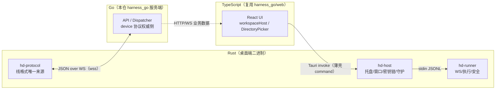
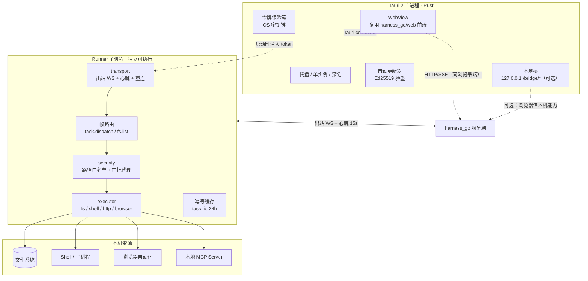
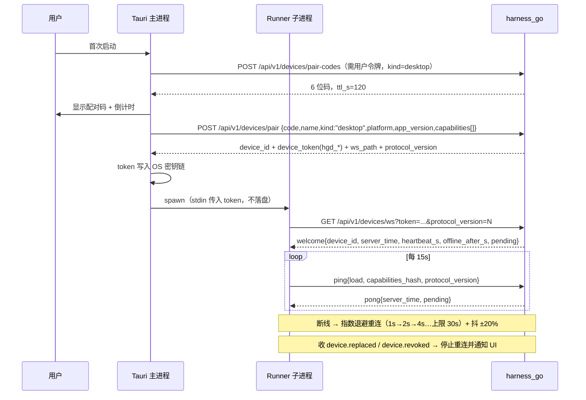
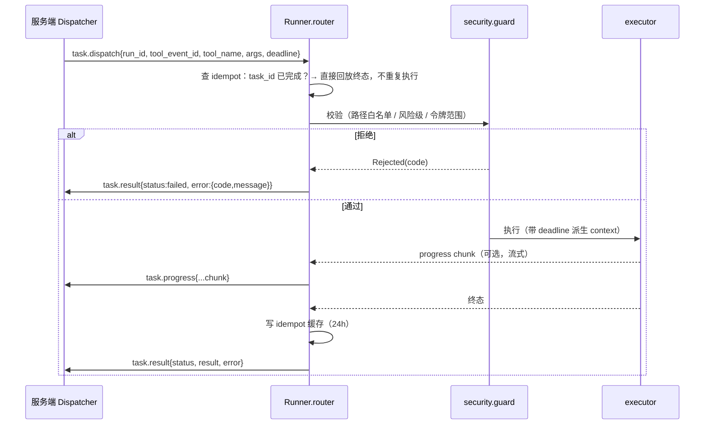
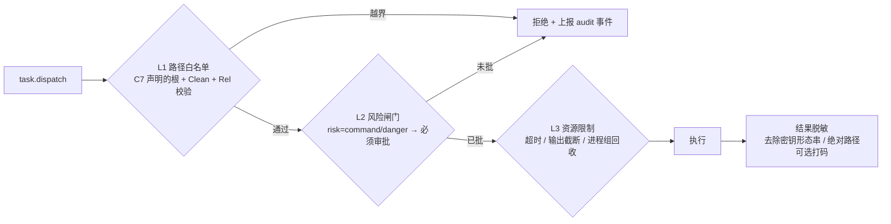
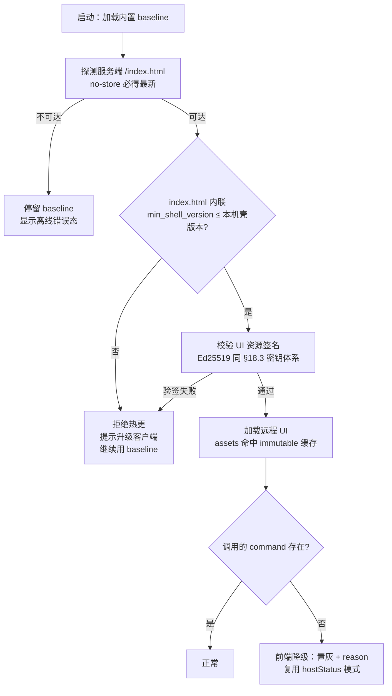

# harness_desktop 架构与功能设计

> 状态：**设计稿（未实现）**。本仓（harness_go）内不存在 `harness_desktop` 工程，本文是其开工前的权威设计基线。
> 版本：**v2.1（可开工级 + 热更定案）**。§0–§13 为架构基线（选型/拓扑/矩阵/红线）；**§14–§21 为可直接照抄开工的实施细节**——工程骨架与 Cargo 依赖、**UI 分发与热更新**、**command 兼容契约**、Rust 协议结构体、执行引擎 trait 签名、主进程↔Runner IPC、打包签名 CI、DM1 首批 PR 拆解、开工前置依赖。
> v2.1 变更摘要：新增 §14.5（内置基线 + 远程热更，解决「服务端 UI 升级需重发客户端」）、§14.6（command 向后兼容契约）；修订 §9（热更验签 + CSP + 桥的双用途拆分）、§11 DM4（热更验收项）、§12（风险 7–10）、§18.4（体积预算双口径）。
> 上游依据：`docs/多端协同架构可行性方案.md`（HALO 四平面，§4/§5）、`docs/protocols.md` §6（设备协议，C 阶段已全量实现）、`docs/工作区宿主与目录选择对接约定.md` §6（客户端最小清单 C1–C7）。
> 实现参考（**不是验收对象、不是依赖**）：关联项目 `harness_mini`（Tauri 桌面壳，其 `src-tauri/src/` 已有本地 fs 命令雏形）。

---

## 0. 一页纸结论

| 问题 | 结论 |
| --- | --- |
| 桌面端是什么 | **重执行工位**：在用户本机承担文件 / 命令 / 浏览器自动化 / 本地模型等「服务端做不了或不该做」的执行 |
| 与 harness_go 的关系 | **不嵌入、不共享进程**：`harness_desktop` 是独立进程，通过**出站 WS 长连接**注册为 `kind=desktop` 的设备，一切落库由服务端完成 |
| 技术选型 | **Tauri 2（Rust 宿主）+ WebView 复用 `harness_go/web/` 前端**；执行引擎独立成 Runner 子进程 |
| UI 分发方式 | **内置最小基线 + 远程热更**（§14.5）：服务端改 UI 时客户端**无需重新打包**；断网/服务端不可达则降级到内置基线 |
| 能否离线全量工作 | **一期不做**。二期可选「内嵌 harness_go 本地模式」（见 §8 功能矩阵末行），一期只做「离线只读缓存 + 待发队列」 |
| 最关键的 3 个不许违反 | ① 端侧永不直写 DB（不变量 1）；② 端侧工具结果恒 `untrusted`（不变量 4）；③ 设备令牌只存 OS 密钥链，任何人不得下发浏览器（§5.10 红线） |
| 落地分期 | **DM1 连接与身份 → DM2 目录宿主（C1–C7）→ DM3 重执行引擎 → DM4 体验与分发** |

---

## 1. 定位与不可动摇的红线

### 1.1 定位（源自 §5.10 与可行性方案 §2.2）

桌面端的一切设计都服务一句话：**把「只能在本机做」的能力，变成服务端 Agent 可安全调用的执行面**。

由此推出三条职责边界：

1. **执行面，不是编排面**：Run 状态机、`seq` 分配、消息落库、审批仲裁全在服务端。桌面端只产生事件流（`task.progress` / `task.result`）。
2. **宿主，不是主人**：桌面端的文件系统对服务端是「可列举、可按需读写」的资源，但**是否允许**由服务端的路径白名单 + 审批策略决定，不由端侧心情决定。
3. **可选增援，不是必需品**：桌面端掉线时，服务端必须能静默降级（不变量 5）。因此桌面端**不得**提供任何「只有装了它才能用」的核心功能。

### 1.2 红线（违反即打回，不接受「先这样后面改」）

| # | 红线 | 依据 |
| --- | --- | --- |
| R1 | 端侧**永不**直写数据库，不产生 `seq` | 可行性方案 §4.2 不变量 1 |
| R2 | 端侧上报的 `source_trust` 一律被服务端强制覆盖为 `untrusted`；桌面端**不要试图声明自己是可信的** | §4.2 不变量 4 + `docs/protocols.md` §6 C-4 铁律 |
| R3 | `device_token` 只存 OS 密钥链（Windows Credential Manager / macOS Keychain / libsecret），**明文绝不落盘、绝不进日志、绝不下发 WebView** | §5.10「设备令牌绝不能下发浏览器」 |
| R4 | 目录能力只走 `fs.list` / `fs.roots` 两个只读帧，**禁止** `os.ReadFile` 级读取（见 C5） | 工作区宿主约定 §3.3 第 1、2 条 |
| R5 | 任何执行都要受「本机路径白名单（C7 声明的根）」约束，越界直接拒绝并上报拒绝事件 | 工作区宿主约定 §4 |
| R6 | 单设备单连接：同 `device_id` 新连接接管旧连接，旧连接收 `device.replaced` 后**不得自动重连**（否则两台机器互相踢） | protocols.md §6.1 铁律 3 |

---

## 2. 技术选型论证

### 2.1 候选对比

| 维度 | Tauri 2（推荐） | Electron | 纯 Go + 系统托盘 | PWA/浏览器 |
| --- | --- | --- | --- | --- |
| 复用现有 React 前端 | ✅ 直接复用 `web/`（Vite 产物） | ✅ 同样可复用 | ❌ 要重写 UI | ✅ 但无本地权限 |
| 安装包体积 | ✅ ~10MB 级 | ❌ 100MB+ | ✅ 最小 | ✅ 零安装 |
| 本地权限（fs/shell/自动化） | ✅ 原生 Rust 侧 | ✅ 主进程 Node | ✅ 最强 | ❌ 无（需 localhost 桥兜底） |
| 自动更新 / 签名 | ✅ Tauri updater（Ed25519 + minisign） | ✅ 成熟 | ⚠️ 需自建 | — |
| 与 harness_mini 的经验复用 | ✅ 同栈（其 `src-tauri/src/` 已有 fs 命令） | ❌ 需移植 | ⚠️ 全自研 | — |
| 多窗口 / 托盘 / 单实例 | ✅ 内置 | ✅ 内置 | ⚠️ 需第三方库 | ❌ |
| 移动端复用同一套 Rust 命令 | ✅ Tauri 2 支持 mobile | ❌ | ❌ | — |

**结论：Tauri 2。** 决定性理由有两条：一是**前端零重写**（`web/` 是现成 React + zustand + tailwind，且已有移动断点骨架），二是**与 harness_mini 同栈**可复用其 Rust fs 命令经验（仅作参考，不引依赖）。

### 2.2 被否决的方案与理由

- **纯 Go Runner（`cmd/fake-runner` 的生产化）**：作为「无 UI 的 headless 执行节点」非常合适，甚至应当**同时保留**（见 §3.2 的 Runner 子进程），但它无法提供用户可点的 UI 与目录选择器，不能作为桌面端主形态。
- **Electron**：体积与内存代价换来的收益在本项目里已被 Tauri 覆盖，且 Node 主进程的攻击面更大。
- **把 harness_go 整个塞进桌面端当主进程**：会制造「两个 DB、两个 seq 源头」，直接违反不变量 1。**仅在二期离线模式下作为「本地单体模式」可选启用，且此时不连远端服务端**（见 §8 功能矩阵末行「内嵌 harness_go 本地模式」）。

### 2.3 开发语言选型（逐层定死，不留“到时候再说”）

> 结论先行：**Rust（宿主 + 执行引擎）+ TypeScript（UI）+ Go（仅服务端，不进入桌面端二进制）**。三种语言的分界线由「谁承担风险」决定，不是由喜好决定。

| 层 | 语言 | 为什么是它 | 如果换成别的会怎样 |
| --- | --- | --- | --- |
| 桌面宿主外壳 `hd-host` | **Rust**（Tauri 2） | 托盘/单实例/原生对话框/密钥链都是 Rust 侧能力，且 Tauri 强制这门语言；与 `harness_mini` 同栈可借经验 | Electron 需 Node，体积 100MB+ 且攻击面更大（§2.1） |
| **执行引擎 `hd-runner`（关键决策）** | **Rust**（同仓、跨平台原生） | ① 与宿主**同一个 workspace**，共享 `hd-protocol` 与安全闸门，不存在协议双写；② 进程组回收/Job Object、软链判定、`canonicalize` 等**安全敏感系统调用**用 Rust 的强类型与无 GC 更可控；③ 单二进制静态链接、体积 6–10MB、无运行时依赖，便于分发 | 【Go】进程组/Job Object 需 `golang.org/x/sys/windows` 手写，且要**再实现一遍协议与安全闸门**（双写漂移正是本文最大风险 §12-1）；【Node】需要打包 Node 运行时（+40MB）且 `child_process` 孙进程回收在 Windows 上更棘手 |
| UI 层 `web/` | **TypeScript + React**（复用 `harness_go/web`） | 已存在、已适配移动断点、已有 `workspaceHost.ts` 宿主抽象可零改动复用 | 重写 UI = 双份逻辑漂移（§10 红线禁止 fork） |
| 服务端 | **Go**（本仓 `harness_go`） | 既有事实，不改 | — |

#### 2.3.1 为什么 Runner 不重用本仓 Go 代码（这是最容易被挑战的一点）

表面上「Runner 用 Go 就能直接 `import harness-go/internal/device`，协议零成本对齐」非常诱人，但实际上**不可行**，原因有三条硬约束：

1. **`internal/` 语义不允许跨模块引用**：`harness-go/internal/device` 是 Go 的 internal 包，`harness_desktop` 是另一个仓/模块，**编译器层面就禁止 import**。要复用只有两条路：把协议下沉到 `pkg/device`（改动服务端公开 API 面，需评估）、或复制代码（立刻产生双写漂移）。
2. **服务端二进制无法「瘦身成客户端」**：本项目 `web/embed.go` **硬依赖** `web/dist`（见 `.harness/memory/conventions.md` 强依赖成因三条），`go build` 会把整个前端与 API 路由 embed 进二进制。桌面端只想跑一个 WS 客户端，却会拖进 20MB+ 的服务端前端产物，且 `go:embed` 失败会导致客户端编译失败。
3. **Runner 的使命是“执行面隔离”**：把同一套 Go 代码既当服务端又当端侧执行器，任何共享可变状态/全局配置都会诱使两端行为耦合，最终违反「端侧永不直写 DB」不变量（服务端有 DB，端侧有这条路就一定会被走上）。

> **反过来说**，如果将来真的需要 Go Runner（例如企业内已有 Go 工具链、或需要 headless 用 `kind=cli`），`hd-runner` 是**唯一需要重写的 crate**——它只依赖 `hd-protocol` 的线格式（JSON 契约），换语言不破坏架构。这正是 §14.2 拆分 crate 的核心价值。

#### 2.3.2 语言分工的边界（谁不许越界）



- **Rust 不写 UI 组件**（UI 一律 TS/React），**TS 不碰系统调用**（无 `invoke` 之外的本机能力），**Go 不进入桌面端二进制**。
- 唯一的跨语言契约是 **JSON 线格式**（`hd-protocol` ↔ `internal/device`），由 §15.4 黄金 fixture 门禁守护。

---

## 3. 进程拓扑与生命周期

### 3.1 拓扑图



### 3.2 为什么 Runner 必须是**独立子进程**（而不是在主进程里跑）

| 理由 | 说明 |
| --- | --- |
| 崩溃隔离 | shell/浏览器自动化最容易崩，崩了不能带走 UI |
| 权限最小化 | UI 进程只需要「画界面」，不需要 shell 权限 |
| 可 headless 复用 | 同一份 Runner 二进制可直接跑在无 GUI 的服务器上（生产化 `fake-runner`） |
| 更新粒度 | 执行引擎可单独更新，不必整包重装 |
| 调试 | 可单独 `--log-level debug` 抓包，不污染 UI 日志 |

#### 3.2.1 能否合并成单个可执行文件？（已实测，结论：不可行）

**用户诉求**是「启动时只启动一个文件」。这个诉求**已被满足**：用户只双击
`hd-host.exe`，宿主会自动拉起 `hd-runner.exe`（`daemon::locate_runner`），
第二个文件对用户透明。

曾尝试进一步合并为**单文件自派生**（`hd-host.exe --runner`，同一 exe 双模态），
在 Windows 上**实测失败**：

| 实验 | 结果 |
| --- | --- |
| 父进程用 `Stdio::piped()` 拉起 `hd-host.exe --runner` | ❌ 加载期崩溃 `0xC0000139`（STATUS_ENTRYPOINT_NOT_FOUND），**stderr 为空**（从未进入 `main()`） |
| 同一 spawn 路径拉起独立 `hd-runner.exe` | ✅ 正常进入 Runner 主循环 |
| 同一二进制以 GUI 模式启动 | ✅ 正常 |

**根因**：`hd-host` 链接了 Tauri（GUI 依赖），在有管道 stdio 的子进程上下文中
加载期初始化失败。这不是业务逻辑缺陷，改代码无法绕过。

**同时排除的干扰项**：
- 不是 PowerShell 管道限制 —— 用真实 Rust `Command` spawn 同样复现；
- 不是 `custom-protocol` 缺失 —— 那是另一个独立坑（见 §18.4），加上后 GUI 正常；
- 不是 `windows_subsystem` 设置 —— 改成 console 后仍然崩溃。

**若将来仍要单文件**，需要让 Tauri 依赖变成**运行时动态加载**（如
`libloading` + 可选 GUI 模块），代价远大于收益。当前结论：**保持两个文件，
但用户只启动一个**。

> 代码中 `RunnerLaunch::self_derived` 与 `locate_runner(allow_self=true)` 分支
> 予以保留，默认 `allow_self=false`。若未来在非 Windows 平台验证通过，可开启。

### 3.3 生命周期时序



**关键工程点**：

| 项 | 决策 |
| --- | --- |
| 令牌传递 | Tauri 从密钥链读出后经 **stdin** 写给 Runner，不走命令行参数（命令行会被 `ps` 看到） |
| 重连退避 | 指数退避 + 抖动；`device.replaced` / `device.revoked` / `device.protocol_mismatch` 属**终态**，不重连 |
| 心跳失败容忍 | 连续 3 次 `ping` 无 `pong`（45s）主动重连，不等服务端关连接 |
| 版本不匹配 | 服务端 `protocol_mismatch` → UI 弹「需升级桌面端」并禁用执行功能，**不静默降级** |
| 单实例 | Tauri 单实例插件；第二次启动只唤出已有窗口 |
| 退出 | 先 `release` 持有的租约，再关 WS，再退出（best-effort，5s 超时） |

---

## 4. 模块分层与工程结构

```
harness_desktop/
├─ src-tauri/                 # Rust 宿主
│  ├─ src/
│  │  ├─ main.rs              # 单实例 / 托盘 / 窗口
│  │  ├─ updater.rs           # Ed25519 验签 + 增量更新
│  │  ├─ vault.rs             # OS 密钥链读写
│  │  ├─ pair.rs              # 配对流程（发码、兑换、落 token）
│  │  ├─ supervisor.rs        # Runner 子进程守护（启动/重启/退出/日志转发）
│  │  ├─ bridge.rs            # 可选：127.0.0.1 localhost 桥（§5.9）
│  │  └─ cmds/                # 暴露给 WebView 的 Tauri command（薄壳）
│  └─ tauri.conf.json
├─ runner/                    # 独立执行进程（Rust 或 Go，见 §4.1）
│  ├─ transport/              # WS 客户端、信封编解码、心跳、重连、版本协商
│  ├─ router/                 # 帧路由：task.dispatch / fs.list / fs.roots / lease.*
│  ├─ executor/               # fs / shell / http / browser / mcp-local
│  ├─ security/               # 路径白名单、审批代理、结果脱敏
│  ├─ idempot/                # task_id 完成缓存（24h，落盘于 AppData）
│  └─ telemetry/              # 本地结构化日志（脱敏 + 轮转）
└─ web/                       # 与 harness_go/web 同源的前端（构建期复用）
```

### 4.1 Runner 用 Rust 还是 Go？

| 方案 | 优点 | 缺点 |
| --- | --- | --- |
| **Rust**（推荐，v2 已定案） | 与 Tauri 同栈、单工具链、单二进制静态链接、可 `rustup target` 支持移动端；与宿主共享 workspace 内的 `hd-protocol` / 安全闸门，无协议双写 | 需重新实现信封/协议（对照 `internal/device/protocol.go` 写，由 §15.4 黄金 fixture 门禁防漂移） |
| **Go**（次选，仅在企业 Go 工具链场景考虑） | 可 import **`pkg/toolapi`**（公开包）复用能力常量 | ⚠️ **不能** import `internal/device`（Go internal 语义禁止跨模块）；且 `go build` 会因 `web/embed.go` 硬依赖 `web/dist` 拖进服务端前端产物。详见 §2.3.1 |

**结论**：一期用 **Rust**（打包、更新、执行面安全均更优）。原「Go 可直接复用协议结构体」的说法**已在 v2 修正**——Go 侧只有 `pkg/toolapi`（能力常量）是公开可复用的，`internal/device` 的信封与负载**必须**在 Rust 侧重写一遍并用黄金 fixture 锁死。

若后续因团队 Go 能力更强而切换 Go Runner，`hd-runner` 是**唯一**需要重写的 crate（§14.2），协议契约与宿主守护关系不受影响。

### 4.2 模块职责与依赖方向（单向，不得反向）

```
transport ──► router ──► security ──► executor
                 │            │
                 └──────► idempot（仅 router 用）
```

- `transport` **不认识**任何具体工具，只认信封与帧类型；
- `router` 只做「帧 → 处理函数」映射，不含业务规则；
- `security` 是所有 `executor` 调用的**必经闸门**（路径白名单 + 审批判定），executor 内部**不得**再绕过它；
- `executor` 之下的平台差异（Windows/POSIX）用 trait 隔离，方便二期移植移动端。

---

## 5. 与 harness_go 的协议对接

### 5.1 复用的协议面（**不新增任何服务端契约**）

| 环节 | 端点 / 帧 | 服务端现状 |
| --- | --- | --- |
| 签发配对码 | `POST /api/v1/devices/pair-codes` | ✅ C-2 |
| 凭码配对 | `POST /api/v1/devices/pair` | ✅ C-2 |
| 长连接 | `GET /api/v1/devices/ws?token=&protocol_version=` | ✅ C-3 |
| 心跳 | `ping` / `pong`（15s，45s 判离线） | ✅ C-3 |
| 任务派发 | `task.dispatch` / `task.progress` / `task.result` | ✅ C-4 |
| 租约撤销 | `lease.revoked` | ✅ C-6 |
| 审批跨端 | 审批 REST + `RequiredDeviceID` | ✅ C-7 |
| 目录列举 | `fs.list` / `fs.list.result` / `fs.roots` | ⏳ **L1 待服务端接入**（帧格式已冻结于工作区宿主约定 §3.3） |

### 5.2 配对请求体（逐字段对齐 `capabilityInput`）

`internal/api/device_handler.go:46` 的能力上报项**只接受 `name` / `version`**，且禁止客户端指定 `device_id`。桌面端上报示例：

```json
{
  "code": "483920",
  "name": "研发主机-ThinkPad",
  "kind": "desktop",
  "platform": "windows-amd64",
  "app_version": "0.1.0",
  "capabilities": [
    { "name": "workspace.list",   "version": "1" },
    { "name": "workspace.read",   "version": "1" },
    { "name": "workspace.write",  "version": "1" },
    { "name": "process",          "version": "1" },
    { "name": "network",          "version": "1" }
  ]
}
```

> ✅ 词汇红线：合法能力标签**只有** `pkg/toolapi/spec.go:92-113` 定义的 7 个——`workspace.list` / `workspace.read` / `workspace.write` / `process` / `network` / `llm` / `device`。其中 `CapWorkspaceList`（只读目录列举，只 readdir 不读内容）已随三端设计落地定义，桌面端可直接引用。**除此之外不得自造标签**——新增能力必须先落到 `pkg/toolapi` 常量 + `docs/protocols.md` 词表 + `docs/三端功能矩阵与能力申报对齐表.md`，再进桌面端代码。

### 5.3 派发处理（对齐 C-4 铁律）



**必须照抄的四条**（`docs/protocols.md` §6 C-4）：

1. `task_id` **恒等于** `tool_event_id`；桌面端缓存已完成 `task_id` 24h，断线重派只回放不重跑。
2. **不自己发 `source_trust=trusted`**：即便结果来自本机，也按 `untrusted` 上报（服务端会强制覆盖）。
3. 未知 `task_id` 的迟到 `progress`/`result` → 服务端静默忽略，桌面端**不需要**为此做防御，但也不应乱发。
4. deadline 到期必须**主动**回 `status=timeout` / `error=device_timeout`，不许挂死。

### 5.4 租约与审批的端侧义务

| 场景 | 桌面端义务 |
| --- | --- |
| 拿到租约（本端是 holder） | 保持 30s 心跳续租；UI 显示「本机正在输入」 |
| 收 `lease.revoked` | **立即停止本地输入并转只读**，已提交的 delta 全部丢弃（因为只有服务端 `seq` 有效） |
| 高风险（`danger`）工具需审批 | 若服务端下发 `RequiredDeviceID=本机`，审批**只能在本机 UI 完成**，不得在 WebView 里「假装是别的端」批准 |
| 审批被拒 / 超时 | 不执行，回 `status=failed` + 明确错误码 |

---

## 6. 本地执行引擎

### 6.1 一期工具清单（与 `executor=server` 的内置工具严格互补）

| 工具（建议名） | 风险 | 说明 | 审批默认 |
| --- | --- | --- | --- |
| `fs.list` / `fs.roots` | readonly | 目录列举（C3/C4），**只 readdir** | 免 |
| `fs.read_file` | readonly | 读工作区文件（限白名单根、限大小） | 免 |
| `fs.write_file` | write | 写工作区文件（原子替换 + 备份） | confirm 模式需批 |
| `fs.glob` / `fs.grep` | readonly | 工作区内检索 | 免 |
| `shell.exec` | command | 执行命令（**白名单可执行 + 超时 + 输出截断**） | 必须批 |
| `http.fetch` | write | 本机出网（走本机代理/内网） | confirm 模式需批 |
| `browser.*`（择期） | command | 本机浏览器自动化 | 必须批 |

> 原则：**能在服务端做的绝不放到端侧**。桌面端只补「服务端物理上做不到」的能力，避免降级路径失效（服务端必须随时能顶替）。

### 6.2 执行安全三层



- **L1 路径白名单**：桌面端启动时声明 `roots`（默认「用户主目录 + 已打开工作区」），可在设置里增删；任何路径先 `Clean` 再 `Rel` 校验，不以 `..` 开头。
- **L2 风险闸门**：桌面端**不自己判断**要不要审批（策略在服务端），但要校验「收到 dispatch 时是否携带了有效 approval 凭据」，没有则拒绝执行——防止有人伪造服务端直连。
- **L3 资源限制**：默认超时（fs 3s / shell 60s / http 30s，可被 `deadline` 收紧不可放宽）、stdout 截断 64KB、子进程用**进程组**启动并整组回收（防 `cmd` spawn 的孙进程逃逸）。

### 6.3 幂等与副作用

- 写类工具必须**先写临时文件再原子 rename**，避免半截文件；
- `shell.exec` 天然非幂等 → `idempot` 缓存命中时**只回放结果不重跑**（这正是 C-4 缓存存在的意义）；
- 缓存文件位置：AppData（Windows）/ `~/Library/Application Support`（macOS），**不同步、不上传**。

---

## 7. 工作区宿主实现（C1–C7 逐项映射）

工作区宿主约定 §6 的 C1–C7 是**桌面端接入目录选择的门槛**，此处逐条给出落地方案与验收方式：

| # | 契约要求 | 桌面端落地 | 验收方式 |
| --- | --- | --- | --- |
| C1 | 设备配对与长连接 | `pair.rs` + `transport`；复用既有三端点，不自建 | 配对成功后 `GET /api/v1/devices` 可见 `kind=desktop, status=online` |
| C2 | 能力申报 | 配对与每次 `ping` 都带 `workspace.list`（version `1`）；`capabilities_hash` 变更即重连上报 | 服务端 `devices` 表能查到该能力；前端空间**不再置灰** |
| C3 | `fs.list` 应答 | 按约定 §3.3 帧格式返回 `DirListing`；**3 秒硬超时**；大目录截断并标 `truncated: true` | 手工派发 `fs.list` → 收到 `fs.list.result`；大目录（>5000 项）不超时 |
| C4 | `fs.roots` 应答 | Windows 返回盘符；POSIX 返回 `/`、`/Volumes`、`$HOME`；附「建议工作区根」 | 服务端 `GET /api/v1/fs/roots?host=device:<id>` 有返回 |
| C5 | 只列目录、不读内容 | 实现里**只允许** `read_dir` / `fs::read_dir` 元数据；代码评审 + clippy lint 禁止 `read`/`read_to_string` 出现在 `fs.list` 路径 | 单测：对含密文件目录列举，返回体**不含任何文件内容** |
| C6 | 路径归一与越界拒绝 | 返回 `path` 为本机绝对路径且已 `Clean`；`separator` 如实上报（Windows `\`、POSIX `/`）；到根时 `parent=null`（**不返回 `..`**）；符号链接默认不跟随 | 单测：根目录 `parent` 为 null；`..` 上跳被拒 |
| C7 | 工作区根声明 | 设置页维护 `roots` 列表（默认：主目录 + 用户显式添加）；`fs.roots` 只暴露这些根 + 其子树的「建议根」 | 修改 roots 后重连，服务端白名单同步收窄 |

### 7.1 一个必须说明的取舍：为什么 `fs.list` 不走 `task.dispatch`

`Dispatcher` 的 `TaskID`/`ToolEventID` 是**工具事件幂等键**，且 `dispatchHistory` 仅 256 条 / 5 分钟。用户连点目录会冲掉正常工具任务的缓存并污染 `tool_events` 审计。

**桌面端方案（与服务端约定一致，见工作区宿主约定 §3.4 方案 A）**：`fs.list` 复用同一 WS 通道与同一信封，但服务端以 `Ephemeral=true` 派发，**不入幂等缓存、不产生工具事件**。桌面端侧表现为「无 `tool_event_id`、无 deadline 严格约束（3s 自重超时）、不写 idempot 缓存」。若服务端最终选方案 B（独立 `PathQuery` 轻量 RPC），桌面端只需替换 `router` 的一个分支，不影响其他模块。

---

## 8. 功能矩阵（分期）

| 能力 | DM1 连接与身份 | DM2 目录宿主 | DM3 重执行引擎 | DM4 体验与分发 |
| --- | --- | --- | --- | --- |
| 配对 / 令牌保险箱 | ✅ | | | |
| 出站 WS + 心跳 + 重连退避 | ✅ | | | |
| 托盘 / 单实例 / 深链 | ✅ | | | |
| `fs.roots` / `fs.list`（C3–C7） | | ✅ | | |
| 目录选择器接入（复用 `web/` DirectoryPicker） | | ✅ | | |
| 租约持有与撤销响应 | | | ✅ | |
| `fs.read_file` / `write_file` / `glob` / `grep` | | | ✅ | |
| `shell.exec`（白名单 + 进程组回收） | | | ✅ | |
| `http.fetch`（本机网络环境） | | | ✅ | |
| 本地 MCP Server 托管 | | | ✅ | |
| 浏览器自动化 | | | ⏳ 择期 | |
| 自动更新（Ed25519 验签） | | | | ✅ |
| localhost 桥（浏览器借本机能力） | | | | ✅ 可选 |
| 离线只读缓存 + 待发队列 | | | | ✅ |
| 内嵌 harness_go 本地模式 | | | | ⏳ 二期 |

---

## 9. 安全模型

| 面 | 措施 |
| --- | --- |
| 身份 | `device_id` + `device_token(hgd_*)`；配对码 6 位、TTL 120s、一次性、防枚举（服务端已实现限流） |
| 令牌存储 | OS 密钥链；Runner 经 stdin 获取；日志与崩溃报告中**不出现** |
| 传输 | 强制 `wss://`（本地开发允许 `ws://127.0.0.1`）；证书校验不可关闭 |
| 路径 | C7 白名单 + `Clean` + `Rel` 校验；符号链接默认不跟随 |
| 命令 | 可执行白名单 + 参数模板（禁止拼接用户字符串到 shell）+ 进程组回收 |
| 结果 | 端侧一律 `untrusted`；脱敏后再上报（密钥形态串、Bearer token 打码） |
| 桥（可选，`capability bridge`） | `127.0.0.1` only + `Origin` 白名单 + 一次性 nonce（10min TTL）+ `Sec-Fetch-Site` 校验；**默认关闭**，仅用于向浏览器暴露本机能力 |
| **API 网关（必需，`api gateway`）** | 见 §14.5.6：仅反代 `/api/*` 与 `/healthz`，**不暴露任何本机能力**；绑定 `127.0.0.1` 随机端口；🟢 **与上面的 capability bridge 是两件事，不可混为一谈** |
| 更新 | Ed25519 签名 + minisign；拒绝降级（防回滚攻击） |
| **热更 UI 验签** | 远程加载的 UI 资源必须验 Ed25519 签名（复用更新同一套密钥体系），验签失败则回退内置基线，**绝不加载未验签的远程 JS**（§14.5.4） |
| **CSP（远程 UI 场景）** | 严格 CSP：`default-src 'self' <server-origin>`；`script-src` 禁 `unsafe-eval`、禁 `unsafe-inline`；`connect-src` 仅限自身与 server-origin。远程 JS 握有 `invoke` 权限，CSP 是第二道锁 |
| **远程 UI 的权限收敛** | `get_device_token` / `raw_ws_send` / `exec_shell` **永不实现**（§17.3、§14.6.4）——使远程 JS 即使被完全策反也拿不到令牌、执行不了命令 |

---

## 10. 与 harness_go 前端的复用边界

| 模块 | 复用方式 |
| --- | --- |
| `web/src/**`（React + zustand） | **直接复用**，构建期以 `harness_go/web` 为源；桌面端只**新增**一个「本机能力探测」适配层 |
| `web/src/lib/workspaceHost.ts` | 直接复用：桌面端的宿主就是 `device:<id>`，无需新增抽象 |
| `web/src/components/DirectoryPicker.tsx` | 直接复用：`host` 从 `server` 换成 `device:<id>` 即可 |
| Tauri command | **新增**薄壳：`getDeviceId()` / `openLocalPath()` / `pickLocalDirNative()`（原生对话框，作为 `fs.list` 的加速替代，最终仍要回填绝对路径） |

> ⚠️ 复用红线：桌面端**不得** fork 前端。任何需要「桌面端专属」的 UI，都以**能力开关**（`host.kind === 'desktop'`）在同一套组件里分支，避免双份代码漂移。

---

## 11. 里程碑与验收

### DM1 连接与身份
- [ ] 首启引导：配对码 → 配对 → 令牌入密钥链 → Runner 启动 → `welcome` 收到；
- [ ] 拔网 60s 后重连成功，`GET /api/v1/devices` 显示 `online`，无重复设备记录；
- [ ] 同 `device_id` 第二次连接 → 旧连接收 `device.replaced` 且**不自动重连**；
- [ ] `protocol_version` 过高/过低 → UI 提示升级并禁用执行，不静默降级。

### DM2 目录宿主
- [ ] C1–C7 全部通过（§7 表格验收方式）；
- [ ] 前端三处入口（新建项目 / 关联项目 / 数据权限范围）在 `host=device:<id>` 下可选目录；
- [ ] 设备离线 → 服务端返回 `fs.host_offline`，前端**不降级到服务端目录**；
- [ ] 连续点击目录 100 次 → `GET /api/v1/audit/tool-events` 条数**不变**（无污染）。

### DM3 重执行引擎
- [ ] 派发 → 执行 → 回流全链打通；`tool_events.executor=device` / `source_trust=untrusted` 落库正确；
- [ ] 端侧真实失败 → 服务端**不重跑本地**（验证无二次副作用）；
- [ ] deadline 超时 → `device_timeout`；进程组回收无残留子进程；
- [ ] 路径越界 / 未审批 `shell.exec` → 全部被拒并留审计。

### DM4 体验与分发
- [ ] 自动更新：签名校验失败拒绝安装；防降级生效；
- [ ] 热更 UI：服务端改 UI 后客户端**无需重新打包**即可跟随；`min_shell_version` 不足时拒绝热更并提示升级；
- [ ] 远程 UI 验签失败 → 回退内置基线（**绝不加载未验签 JS**）；
- [ ] `ui_update_policy=pinned` → 完全不联网取 UI，功能完整度按口径②验收；
- [ ] 服务端不可达 → 内置基线可打开并显示明确的离线错误态（非白屏）；
- [ ] 离线只读缓存可查看历史对话；恢复后待发队列按序重放；
- [ ] 安装包体积 ≤ 20MB（主安装包口径，见 §18.4 口径①）。

---

## 12. 风险与已知限制

| # | 风险 | 影响 | 对冲 |
| --- | --- | --- | --- |
| 1 | 协议双写漂移（Rust 侧结构体 vs Go 侧） | 帧解析失败、静默丢任务 | 黄金 JSON fixture 单测 + 版本协商 `CompatibleVersion` |
| 2 | 服务端 L1 未接入（`fs.list` 帧尚无对端） | DM2 无法联调 | 先用 `cmd/fake-runner` 或 dev 脚本本地回环验证帧格式 |
| 3 | 用户误以为「装了桌面端才完整」 | 与服务端降级路径冲突 | UI 明示「可随时断开，功能自动回到服务端执行」 |
| 4 | localhost 桥成为攻击面 | 本机其他程序调用 | 默认**关闭**，开启需用户显式确认 + Origin 白名单 + nonce |
| 5 | macOS 沙箱与公证 | 分发受阻 | 一期先发 Windows/Linux；macOS 走 Developer ID + notarize |
| 6 | Windows 路径大小写/长路径/UNC | `Clean`/`Rel` 判断异常 | 统一 `canonicalize` 后比对；长路径前缀 `\\?\` 专门单测 |
| **7** | **二期 L2（内嵌 harness_go）与 ≤20MB 验收线冲突** | 若把服务端 exe（约 23MB）打进主包，直接突破体积线；二期还得推翻预算预期 | L2 作为**可选组件下载**（「本地引擎包」），不并入主安装包；见 §18.4 |
| **8** | **远程热更 UI 握有 `invoke` 权限** | 服务端被攻破/中间人注入 → 恶意 JS 获得本机能力 | ① 验签（Ed25519）+ CSP 双锁；② 三条高危 command 永不实现（§14.6.4）；③ `ui_update_policy=pinned` 可完全关闭热更 |
| **9** | **能力漂移：远程 UI 调用旧壳没有的 command** | 页面崩溃/白屏 | `min_shell_version` 闸门拒绝热更 + `tauriBridge.call()` 统一降级置灰（§14.5.4、§14.6） |
| **10** | **离线误解：用户以为装了桌面端就能断网用** | 断网后"能打开但全是错误"，体验落差 | UI 明确告知能力边界；提供 L1 只读缓存（DM4）；文案禁用"离线可用"表述 |

---

## 13. 交叉引用

- 三端能力归属与申报对齐 → `docs/三端功能矩阵与能力申报对齐表.md`
- 移动端（遥控器 + 轻执行）→ `docs/移动端架构与功能设计.md`
- HALO 四平面与核心不变量 → `docs/多端协同架构可行性方案.md` §4
- 设备协议（配对/WS/派发/租约/审批）→ `docs/protocols.md` §6
- 工作区宿主契约与 C1–C7 → `docs/工作区宿主与目录选择对接约定.md` §3.3 / §6
- 工具契约与能力标签词汇 → `docs/protocols.md` §1.1、`pkg/toolapi/spec.go:93`

---

## 14. 工程骨架与工具链（可开工版）

> §4 给了概念分层，本节给**真实目录与真实 crate**。开工第一件事就是按此建仓，后续 PR 不再讨论"放哪里"。

### 14.1 仓库结构（monorepo，一个仓五个 crate）

```
harness_desktop/
├─ Cargo.toml                     # workspace（[[bin]] 在 crates 内）
├─ rust-toolchain.toml            # 锁 1.79+，避免 CI/本地工具链漂移
├─ crates/
│  ├─ hd-protocol/                # 【纯协议】无 IO、无 async runtime，可被单测与 fixture 复用
│  │  ├─ src/lib.rs
│  │  ├─ src/envelope.rs          # Envelope + MessageType（逐字段对齐 Go）
│  │  ├─ src/payload.rs           # Hello/Welcome/Ping/Pong/Error/Task*/LeaseRevoked
│  │  ├─ src/fscmd.rs             # fs.roots / fs.list / *.result（对应 §3.3 冻结帧）
│  │  ├─ src/error_code.rs        # device.* / fs.* 错误码常量（字符串唯一来源）
│  │  └─ tests/golden_fixtures.rs # 反序列化 Go 生成的黄金 JSON
│  ├─ hd-core/                    # 【领域逻辑】security / idempot / executor traits
│  │  ├─ src/security/guard.rs    # 路径白名单三道闸 + 风险级校验
│  │  ├─ src/security/redact.rs   # 结果脱敏
│  │  ├─ src/idempot/store.rs     # task_id 完成缓存（24h，落 AppData）
│  │  ├─ src/executor/mod.rs      # trait Executor / ExecCtx / ExecError
│  │  └─ src/executor/{fs,shell,http,search}.rs
│  ├─ hd-runner/                  # 【可执行】Runner 二进制（无 GUI、无 Tauri 依赖）
│  │  ├─ src/main.rs              # 启动、读 stdin 令牌、连 WS、跑事件循环
│  │  ├─ src/transport/ws.rs      # tokio-tungstenite 客户端 + 重连退避
│  │  ├─ src/transport/heartbeat.rs
│  │  └─ src/router.rs            # 帧 → handler 映射
│  ├─ hd-host/                    # 【Tauri 主进程】
│  │  ├─ src/main.rs              # 单实例 / 托盘 / 窗口
│  │  ├─ src/vault.rs             # keyring 读写 device_token
│  │  ├─ src/pair.rs              # 配对码 → 兑换 → 落保险箱
│  │  ├─ src/supervisor.rs        # Runner 子进程守护
│  │  ├─ src/updater.rs
│  │  └─ src/cmds/               # 暴露 WebView 的薄壳 command
│  └─ hd-testkit/                 # 【测试】假服务端（本地 WS 回环，替代未落地的 L1）
├─ web/                           # 构建期从 harness_go/web 同步（见 14.4）
├─ scripts/{sync-web.ps1,sync-web.sh,sign.sh}
└─ .github/workflows/{ci.yml,release.yml}
```

### 14.2 为什么必须拆成 4 个 crate

| 拆法 | 理由 |
| --- | --- |
| `hd-protocol` 独立 | **唯一**允许出现协议字段名的地方；它不依赖 tokio/tokio-tungstenite，因此黄金 fixture 单测可以 `cargo test -p hd-protocol` 秒级跑完（CI 首要门禁） |
| `hd-core` 不含 network | 让 `shell.exec` 的进程组回收、路径白名单能在**无网络**环境下单测（安全逻辑必须可离线验证） |
| `hd-runner` 不含 Tauri | 保证 Runner 可在 headless 服务器/CI 上跑，也是「切换 Go Runner」时唯一需要重写的包（§4.1 结论的前提） |
| `hd-host` 不含执行逻辑 | Tauri 主进程只做「壳 + 密钥 + 守护」，被攻破也拿不到执行面 |

### 14.3 依赖清单（版本为下限，开工时 `cargo add` 锁定当前 patch）

```toml
# hd-protocol/Cargo.toml —— 刻意极简，禁止加网络/OS 依赖
serde = { version = "1", features = ["derive"] }
serde_json = "1"
thiserror = "1"

# hd-core
tokio = { version = "1", features = ["process", "time", "sync", "fs", "io-util"] }
globset = "0.4"        # fs.glob，服务端 pattern 语义对齐
grep-searcher = "0.1"  # fs.grep（ripgrep 内核，避免自己写正则扫描）
walkdir = "2"
regex = "1"
tempfile = "3"         # 写文件先临时再原子 rename
dirs = "5"             # AppData / 缓存目录
tracing = "0.1"
tracing-subscriber = { version = "0.3", features = ["env-filter", "json"] }
secrecy = "0.8"        # 令牌零拷贝、Debug 打码

# hd-runner
tokio-tungstenite = { version = "0.23", features = ["rustls-tls-native-roots"] }
futures-util = "0.3"
backoff = { version = "0.4", features = ["tokio"] }   # 指数退避重连
url = "2"

# hd-host（Tauri 2）
tauri = { version = "2", features = ["tray-icon", "updater"] }
tauri-plugin-single-instance = "2"
tauri-plugin-dialog = "2"
tauri-plugin-opener = "2"       # 替代 shell.open，权限更窄
tauri-plugin-updater = "2"
tauri-plugin-deep-link = "2"
keyring = "3"                   # OS 密钥链（Windows DPAPI / macOS Keychain / Linux Secret Service）
reqwest = { version = "0.12", features = ["json", "rustls-tls"] }  # 仅配对用
```

> 🔴 **依赖红线**：`hd-protocol` 不得引入 `tokio` / `reqwest` / `keyring` / 任何 `std::fs`。协议包一旦能碰 IO，就会有人把执行逻辑写进去，最终 Runner 与 Host 的边界腐烂。

### 14.4 前端复用方式（不 fork、不复制粘贴）

```powershell
# scripts/sync-web.ps1 —— CI 与本地构建前必须执行
robocopy "$PSScriptRoot\..\..\harness_go\web\src" "$PSScriptRoot\..\web\src" /MIR /XD node_modules dist
Copy-Item "$PSScriptRoot\..\..\harness_go\web\package.json" "$PSScriptRoot\..\web\" -Force
```

- `web/` 视为**只读镜像**，桌面端专属代码放 `web/src/desktop/`（sync 时 `robocopy` 不删该目录 → 用 `/XD` 排除并单独维护）。
- 更稳的做法：把桌面专属 UI 收敛到**运行时分支**（`host.kind === 'desktop'`），`web/src/desktop/` 只放 `tauriBridge.ts`（`invoke` 封装 + 能力探测）一个文件。
- 构建顺序：`sync-web` → `npm ci && npm run build` → `tauri build`（`frontendDist` 指向 `../web/dist`）。

### 14.5 UI 分发与热更新（内置基线 + 远程热更）

#### 14.5.1 问题：纯内置 UI 把发版频率绑在 UI 迭代上

若 UI 只随安装包内置（即"纯内置"），则**服务端改一行 UI → 全量客户端必须重发版**。Rust 侧（执行/宿主能力）本应稳定，UI 侧迭代频繁，两者被强行绑定是不可接受的运维负担。

#### 14.5.2 决定性事实：服务端静态服务已天然"热更新就绪"

| 资源 | 现有策略 | 代码位置 | 热更含义 |
| --- | --- | --- | --- |
| `index.html` | `Cache-Control: no-store` | `internal/api/static.go:79` | **每次都拉最新**，是版本发现的锚点 |
| `assets/index-<hash>.js` 等 | `public, max-age=31536000, immutable` | `internal/api/static.go:132` | 内容寻址，**永久缓存且新旧并发不冲突** |
| 其他（manifest 等） | `no-cache` | `internal/api/static.go:134` | 回源校验 |

> 结论：**服务端无需任何改造**，这套组合就是标准的增量发布机制——升级后客户端只重拉几 KB 的 `index.html`，hash 变化的资源才下载，旧资源全部命中缓存。

#### 14.5.3 三形态对比与结论

| 维度 | A. 纯内置（原 §14.4） | B. 纯远程（WebView 加载 `https://server/`） | **C. 内置基线 + 远程热更（✅ 定案）** |
| --- | --- | --- | --- |
| 服务端 UI 升级 | ❌ 必须重新打包 | ✅ 自动跟随 | ✅ 自动跟随 |
| 断网 / 服务端宕机 | ✅ 能打开 | ❌ 白屏 | ✅ 降级到内置基线 |
| 首屏 | ✅ 本地秒开 | ⚠️ 依赖网络 | ✅ 本地秒开（后台比对版本） |
| 跨源 / Cookie | ⚠️ 需 localhost 网关 | ❌ **服务端零 CORS + SameSite=Lax，走不通** | 同 A（需网关） |
| 安全面 | ✅ 最小 | ⚠️ 远程 JS 握有 `invoke` 权限 | ⚠️ 同 B，必须加固（§9） |
| 实现成本 | 最低 | 低 | 中 |

**定案：C。** 内置那份 dist 的定位从"最新 UI"降级为 **「最小可用基线」**：
- 只保证：能渲染、能展示连接错误态、能提示"需要更新"、能打开设置页；
- **不承诺功能完整**——若基线也要跟着迭代，就退化成 A 的老问题；
- 基线可以长期不更新（建议每季度或随 Rust 侧发版顺带刷新，无需独立发版）。

#### 14.5.4 热更流程与闸门



**`min_shell_version` 闸门**：服务端在 `index.html` 注入 `<meta name="harness-min-shell" content="1.4.0">`。客户端壳版本低于它 → **拒绝热更**并提示升级。刻意采用"拒绝"而非"尽力而为"，与 §12-1「协议版本不兼容则提示升级、不静默降级」保持同一铁律。

**`ui_update_policy` 开关**（用户/企业可配）：

| 值 | 行为 | 适用 |
| --- | --- | --- |
| `follow-server`（默认） | 每次启动比对，静默热更（diff 通常仅几 KB） | 个人/自用部署 |
| `pinned` | 永远用内置基线，完全不联网取 UI | 企业锁定版本、离线环境、安全合规 |
| `prompt` | 发现新版本时询问用户 | 保守部署 |

> ⚠️ 多环境注意：UI 版本必须跟随**当前所连服务端**，而不是"全局最新"。用户可能连不同服务端（私有部署/多环境），UI 与后端 API 形状必须配对，跨服务端串用 UI 会立刻 404。

#### 14.5.5 与既有设计的关系（三处修订）

1. **§14.5 取代 §14.4「构建顺序」的定位**：`frontendDist` 指向的内置产物仍是构建期 sync 而来，但**只在首启与 `pinned` 模式下生效**，不再是唯一 UI 来源。
2. **§9 安全模型必须新增两条**（热更验签 + CSP），见 §9 修订行。
3. **§18.4 体积预算口径变化**：主安装包含「基线 UI」，完整 UI 走网络。预算表已按此修订。

#### 14.5.6 localhost API 网关仍需保留

热更来自服务端，但**UI 的加载源**与**API 的请求源**必须同源，否则 `api.ts:433` 的 `toAbsolute`（`${location.origin}${path}`）会把请求打到本地空壳。

- 基线 / 热更 UI 均加载自 `http://127.0.0.1:<port>/`（Tauri 自定义协议或内置静态服务 + 反向代理）；
- 该 `api gateway` 把 `/api/*`、`/healthz` 反代到真实服务端，Cookie 与 Bearer 全通；
- 🔴 这与 §9 的「capability bridge」（对外提供本机能力，**可选**）是**两件事**：`api gateway` 是**必需**的，且**只反代 HTTP，不暴露任何本机能力**。命名必须区分，避免后续误以为"桥可以先不做"。

### 14.6 桌面端 command 向后兼容契约

> 热更引入了一个新风险：**远程 UI 可能调用本机壳尚未实现的 command**（能力漂移）。本节是唯一防线。

#### 14.6.1 三条铁律

1. **command 契约只加不改**：与 §15 设备协议同规格——禁止删除 command、禁止改参数/返回语义、禁止改同义名。任何破坏性变更 = 必须提升 `min_shell_version`。
2. **禁止裸 `invoke`**：前端所有 Tauri 调用必须经 `web/src/desktop/tauriBridge.ts` 统一封装，内部强制 try-catch 与存在性探测。
3. **降级而非报错**：command 不存在或不可用时，UI **如实置灰 + 给出 reason**，不得抛出未捕获异常导致白屏。

#### 14.6.2 统一封装（复用既有 `hostStatus` 模式）

```ts
// web/src/desktop/tauriBridge.ts
type CapState = { ok: true } | { ok: false; reason: string }

/** 能力探测：与 workspaceHost.hostStatus() 同一套「如实置灰」语义 */
export async function probe(cmd: string): Promise<CapState> {
  if (!('__TAURI__' in window)) return { ok: false, reason: '当前为浏览器端' }
  try {
    const r = await invoke<{ supported: string[] }>('list_commands')
    return r.supported.includes(cmd) ? { ok: true } : { ok: false, reason: `客户端版本过低（缺 ${cmd}），请升级` }
  } catch {
    return { ok: false, reason: '本机服务不可用' }
  }
}

/** 唯一允许的调用入口：不存在即降级，绝不 throw 到 UI */
export async function call<T>(cmd: string, args?: Record<string, unknown>): Promise<T | null> {
  const p = await probe(cmd)
  if (!p.ok) { console.warn('[tauri] 降级', cmd, p.reason); return null }
  try { return await invoke<T>(cmd, args) } catch (e) { console.warn('[tauri] 失败', cmd, e); return null }
}
```

> 设计意图：把 `hostStatus()` 那套「宁可置灰也不要打开后报错」的既有约定（见 `web/src/lib/workspaceHost.ts` 的 `canList/reason`）**从目录列举推广到全部桌面端能力**，不新造机制、不引入第二套心智。

#### 14.6.3 新增 command `list_commands`

`hd-host` 必须实现 `list_commands() -> { shell_version, supported: string[] }`，作为能力探测的唯一真相源。它本身**永不删除**，是兼容契约的锚点。

#### 14.6.4 高风险 command 的额外约束

即使有降级封装，§17.3 的三条「绝不存在的 command」（`get_device_token` / `raw_ws_send` / `exec_shell`）**永远不实现**——远程 UI 握有 `invoke` 权限的场景下，这条从"最佳实践"升级为**安全底线**：远程 JS 即使被完全策反，也拿不到令牌、执行不了命令。

---

## 15. Rust 侧协议结构体（逐字段对照 Go，禁止改动语义）

> 对照源：`internal/device/protocol.go`（Envelope/Payload，L95–267）、`pkg/toolapi/spec.go:92-113`（能力常量）。
> 红线：**只能追加字段**，禁止删除/改名/改类型；`#[serde(default)]` 保证旧服务端缺字段可解析。

### 15.1 信封与消息类型

```rust
// hd-protocol/src/envelope.rs
use serde::{Deserialize, Serialize};

pub const CURRENT_PROTOCOL_VERSION: i32 = 1;   // = model.DefaultDeviceProtocolVersion
pub const MIN_PROTOCOL_VERSION: i32 = 1;

#[derive(Debug, Clone, Copy, PartialEq, Eq, Serialize, Deserialize)]
pub enum MessageType {
    #[serde(rename = "hello")]           Hello,
    #[serde(rename = "welcome")]         Welcome,
    #[serde(rename = "ping")]            Ping,
    #[serde(rename = "pong")]            Pong,
    #[serde(rename = "error")]           Error,
    #[serde(rename = "task.dispatch")]   TaskDispatch,
    #[serde(rename = "task.progress")]   TaskProgress,
    #[serde(rename = "task.result")]     TaskResult,
    #[serde(rename = "lease.revoked")]   LeaseRevoked,
    // ⚠️ fs.* 帧按工作区宿主约定 §3.3 追加；落地前需服务端 L1 定稿，
    //    保持 enum 可扩展（未知 type 一律进 Unknown 分支丢弃，不 panic）
    #[serde(other)]                      Unknown,
}

#[derive(Debug, Clone, Serialize, Deserialize)]
pub struct Envelope {
    #[serde(default)] pub v: i32,                       // 缺省 0 = 未声明
    #[serde(rename = "type")] pub msg_type: MessageType,
    #[serde(default, skip_serializing_if = "String::is_empty")] pub id: String,
    #[serde(default, skip_serializing_if = "String::is_empty", rename = "run_id")] pub run_id: String,
    #[serde(default, rename = "ts")] pub ts: i64,
    #[serde(default, skip_serializing_if = "Option::is_none")] pub payload: Option<serde_json::Value>,
}
```

> `#[serde(other)]` 是**关键防御**：未来服务端新增帧类型时，旧桌面端必须丢弃而不是解析失败断连（对应 `protocol.go:86 Valid()` 的 leniency）。

### 15.2 关键负载（含 Go 侧 `omitempty` 语义映射）

```rust
// hd-protocol/src/payload.rs
#[derive(Debug, Clone, Serialize, Deserialize)]
pub struct HelloPayload {
    #[serde(default)] pub name: String,
    #[serde(default)] pub platform: String,                 // "windows-amd64" |
    #[serde(default)] pub app_version: String,
    #[serde(default)] pub capabilities_hash: String,
    #[serde(default)] pub protocol_version: i32,
    #[serde(default)] pub capabilities: Vec<Capability>,   // {name, version}
}

#[derive(Debug, Clone, Deserialize)]
pub struct WelcomePayload {
    pub device_id: String,
    pub server_time: i64,
    pub protocol_version: i32,
    pub heartbeat_s: i32,           // 端侧据此驱动心跳，**不得硬编码 15s**
    pub offline_after_s: i32,
    #[serde(default)] pub pending: i32,
    #[serde(default)] pub lease_epoch: i64,
}

#[derive(Debug, Clone, Deserialize)]
pub struct TaskDispatchPayload {
    pub tool_event_id: String,      // == task_id，幂等键
    pub run_id: String,
    pub tool_name: String,
    #[serde(default)] pub args: Option<serde_json::Value>,
    pub deadline: i64,              // 毫秒时间戳
    #[serde(default = "one")] pub attempt: i32,
}
fn one() -> i32 { 1 }
```

> ⚠️ Go 侧 `TaskDispatchPayload.TaskID` 与 `ToolEventID` **值恒等**（`protocol.go:235` 注释）。Rust 侧**只解析 `tool_event_id`**，不设独立 `task_id` 字段，从类型层杜绝二者分叉。

### 15.3 dev 模式放宽规则（开发期不连真服务端也能跑通全链）

| 规则 | 生产 | dev（`--dev` flag 或 `HD_DEV=1`） |
| --- | --- | --- |
| WS scheme | 强制 `wss://` | 允许 `ws://127.0.0.1:8787` |
| 证书校验 | 不可关闭 | 仍不可关闭（连本地无需关） |
| 配对 | 走服务端配对码 | `hd-testkit` 假服务端直接下发固定 token |
| 心跳 | 用 `welcome.heartbeat_s` | 同（假服务端下发 1s 加速测试） |

> 严禁提供 `--insecure-skip-verify`：证书校验开关一旦存在，早晚被写进用户文档。

### 15.4 黄金 fixture 门禁（防 Go/Rust 双写漂移）

```rust
// hd-protocol/tests/golden_fixtures.rs
// fixtures/*.json 由 Go 侧生成（scripts/gen-fixtures.go，用 device.MustEnvelope 序列化）
#[test]
fn welcome_matches_go_fixture() {
    let raw = include_str!("../fixtures/welcome.json");
    let env: Envelope = serde_json::from_str(raw).expect("Go 产出的 welcome 必须可解析");
    assert_eq!(env.msg_type, MessageType::Welcome);
    let p: WelcomePayload = serde_json::from_value(env.payload.unwrap()).unwrap();
    assert_eq!(p.heartbeat_s, 15);
}

// 反向：Rust 序列化结果必须能被 Go 解码（由 CI 里的 go test 断言）
#[test]
fn hello_roundtrip_is_stable() { /* serde_json::to_string → 快照比对 */ }
```

CI 顺序：`go run scripts/gen-fixtures.go`（在 harness_go 侧）→ `cargo test -p hd-protocol`。**任一侧改协议不更新 fixture，门禁直接红**。

---

## 16. 执行引擎接口（trait 设计与安全闸门的强制挂载点）

### 16.1 核心 trait

```rust
// hd-core/src/executor/mod.rs
use std::time::Duration;

/// 执行上下文：由 router 从 TaskDispatchPayload 构造，**不可由 executor 伪造**。
pub struct ExecCtx {
    pub tool_event_id: String,
    pub run_id: String,
    pub deadline: std::time::Instant,   // 已换算成本地单调时钟
    pub attempt: i32,
}

#[async_trait::async_trait]
pub trait Executor: Send + Sync {
    fn tool_name(&self) -> &'static str;
    /// 声明本工具的默认超时与最大输出；router 会用它和 deadline 取小值。
    fn limits(&self) -> Limits { Limits::default() }
    async fn execute(
        &self,
        ctx: &ExecCtx,
        args: &serde_json::Value,
        sink: &dyn ProgressSink,        // 流式 chunk 出口，默认 no-op
    ) -> Result<ExecOutput, ExecError>;
}

pub struct ExecOutput {
    pub result: serde_json::Value,
    /// 端侧恒为 Untrusted：哪怕本机产出，也按不可信上报（不变量 4）
    pub source_trust: SourceTrust,      // 恒 Untrusted，类型上不给 Trusted 变体
}
```

> **设计要点**：`SourceTrust` 枚举**只提供 `Untrusted` 一个变体**（Rust 无法构造不存在的变体）——比"约定不要设 trusted"更强的编译期保证。

### 16.2 闸门必须包裹而非内联

```rust
// hd-core/src/security/guard.rs
pub struct Guarded<E: Executor> {
    inner: E,
    policy: Policy,          // 白名单根 + 可执行白名单 + 风险映射
    audit: Arc<dyn AuditSink>,
}

#[async_trait::async_trait]
impl<E: Executor> Executor for Guarded<E> {
    fn tool_name(&self) -> &'static str { self.inner.tool_name() }
    async fn execute(&self, ctx: &ExecCtx, args: &serde_json::Value, sink: &dyn ProgressSink)
        -> Result<ExecOutput, ExecError>
    {
        // L1 路径三闸（Clean → 白名单 Rel → 软链不跟随）
        self.policy.check_paths(args)?;
        // L2 审批凭据有效性（防伪造服务端直连）
        self.policy.check_approval(args, &ctx.tool_event_id)?;
        // L3 超时/截断由 inner 的 limits() 与 sink 共同保证
        let out = self.inner.execute(ctx, args, sink).await?;
        Ok(ExecOutput { result: crate::security::redact::scrub(out.result), ..out })
    }
}
```

- `router` **只持有 `Guarded<...>`**，拿不到裸 executor → 绕过闸门在类型层面不可能（对应 §4.2「security 是必经闸门」）。
- `AuditSink` 是**本地**审计（落 AppData 环形日志），与 `tool_events` 无关——端侧永不直写 DB（不变量 1）。

### 16.3 `shell.exec` 的进程组回收（Windows 是重点）

```rust
// 关键实现要点（不是完整代码）
#[cfg(windows)]
fn spawn_in_new_group(cmd: &mut tokio::process::Command) {
    use std::os::windows::process::CommandExt;
    const CREATE_NEW_PROCESS_GROUP: u32 = 0x0000_0200;
    const CREATE_NO_WINDOW: u32 = 0x0800_0000;
    cmd.creation_flags(CREATE_NEW_PROCESS_GROUP | CREATE_NO_WINDOW);
}
// 超时/取消 → child.kill() 不够（孙进程逃逸），必须整组终止：
//   Windows: taskkill /PID <pid> /T /F 的等价 Win32 调用（TerminateJobObject 更佳）
//   POSIX  : killpg(child_pid, SIGKILL)
```

> 🔴 进程组回收是 `shell.exec` 的**安全属性**而非优化：不回收会留下僵尸 `node`/`cargo` 进程持续占用用户机器。单测方式：让命令 `spawn` 一个睡眠孙进程，断言超时后孙进程 PID 不存在。

### 16.4 `fs.list` 的端侧实现（C3–C6 逐条落地）

```rust
pub async fn list_dirs(root_whitelist: &[PathBuf], target: Option<&Path>, max: usize)
    -> Result<DirListing, ExecError>
{
    // C5：只 read_dir 拿元数据，**严禁** fs::read / read_to_string（clippy 加禁）
    // C6：canonicalize → 白名单 contains 校验 → 到根时 parent = None（绝不返回 ".."）
    // C6：不跟随软链（DirEntry::file_type()?.is_symlink() → skip）
    // C3：超过 max(=500，对齐 fs_handler.go:33 fsMaxDirs) 置 truncated=true
}
```

> `max = 500` 必须与服务端 `fs_handler.go:33 fsMaxDirs` **同值**：两端截断阈值不同会导致前端出现"服务端空间能看全、客户端空间看不全"的诡异差异。

---

## 17. 主进程 ↔ Runner 的 IPC 契约（§3.1 拓扑的落地细节）

### 17.1 通道选择

| 用途 | 通道 | 理由 |
| --- | --- | --- |
| **令牌下发** | 主进程 → Runner **stdin 首行**（一次性） | 不落磁盘、不进命令行参数（`ps` 可见）、不进环境变量（子进程可继承扩散） |
| 控制指令（重连 / 改白名单 / 优雅退出） | 子进程 stdin 后续行（JSON Lines） | 单向、简单、无端口暴露 |
| Runner 状态与日志 | Runner **stdout/stderr** → 主进程 ring buffer → WebView `invoke('runner_status')` | Runner 不监听任何端口（结构化日志走 stderr JSON） |
| 崩溃感知 | `child.wait()` + 退出码 + 退避重启（1s/2s/4s/8s，上限 30s，连续 5 次进「需用户介入」态） | — |

### 17.2 stdin 协议（JSON Lines，禁止二进制）

```jsonl
{"op":"auth","token":"hgd_xxx","ws_url":"wss://host/api/v1/devices/ws","protocol_version":1}
{"op":"reload_policy","roots":["C:\\Users\\me\\work"],"exec_allowlist":["git","node","cargo"]}
{"op":"shutdown"}
```

- **首行必须是 `auth`**，Runner 等待授权，超时 10s 未收到即退出码 `E_NO_AUTH`；
- `reload_policy` 可在运行中热更（用户改设置 → 主进程下发 → 下个 dispatch 生效）；
- 主进程崩溃时 Runner 通过 stdin EOF 自杀（**不留孤儿**），这是守护关系的关键一环。

### 17.3 前端可见的 Tauri command（薄壳清单）

| command | 作用 | 备注 |
| --- | --- | --- |
| `device_status()` | 返回 `{paired, online, device_id, app_version, protocol_ok}` | WebView 首屏探测 |
| `start_pairing(code, name)` | 校验格式并发起配对 | 不暴露 token |
| `runner_status()` | `{state, last_heartbeat_ms, restarts}` | 托盘与设置页展示 |
| `get_workspace_roots()` / `set_workspace_roots(roots)` | 读写 C7 白名单 | 触发 `reload_policy` |
| `pick_local_dir()` | **原生目录对话框**（加速替代，最终回填绝对路径） | 结果仍须经服务端 `fs.list` 校验 |
| `open_local_path(path)` | 用系统默认程序打开（仅限白名单内） | 走 `tauri-plugin-opener` |
| `check_update()` / `install_update()` | 手动检查更新 | 签名校验失败即拒绝 |

> 🔴 **绝不存在的 command**：`get_device_token()`、`raw_ws_send()`、`exec_shell()`。令牌永不出 Host 进程；执行面只能由服务端 dispatch 触发，**WebView 无法直接命令本机执行**——这是桌面端最大的提权面，必须在接口层就断掉。

---

## 18. 构建、签名与分发（CI 可照抄）

### 18.1 三个产物

| 产物 | 内容 | 签名 |
| --- | --- | --- |
| `harness-desktop-setup.exe`（NSIS） | Host + Runner + WebView 资源 | Authenticode（Windows）/ Developer ID + notarize（macOS） |
| `harness-desktop-*.AppImage/deb`（Linux） | 同上 | GPG detached |
| `latest.json` | 更新清单（版本、平台 URL、Ed25519 签名） | minisign / Ed25519 |

### 18.2 GitHub Actions 要点

```yaml
# .github/workflows/ci.yml（PR 门禁，必须全绿才可合）
jobs:
  protocol-gate:      # 最快，先跑
    - cd ../harness_go && go run ./scripts/gen-fixtures.go --out ../harness_desktop/crates/hd-protocol/fixtures
    - cd ../harness_desktop && cargo test -p hd-protocol
  lint:
    - cargo fmt --check && cargo clippy --all-targets -- -D warnings
    - 额外：grep 门禁 —— fs.list 模块内出现 `read_to_string(` 直接失败（C5 自动化）
  test:
    - cargo test --workspace
    - cargo test -p hd-testkit --test e2e_dev_server   # 假服务端跑通配对+心跳+dispatch+fs.list
  build:
    - cargo build --release -p hd-runner
    - npm ci && npm run build（web/）
    - cargo tauri build
```

> `cargo clippy -D warnings` 是**性价比最高的一道门**：进程组、`unwrap`、未使用 `await` 大多能在此拦下。

### 18.3 更新安全

- `latest.json` 内含每个平台的 `sha256` + `signature`；`tauri-plugin-updater` 内建 Ed25519 校验，**公钥硬编码在二进制**；
- **拒绝降级**：新版本 `version` 必须 `> current`，否则拒绝安装（防回滚攻击）；
- 更新前**先停 Runner**（`shutdown` op + 等退出），避免可执行文件占用导致 Windows 替换失败。

### 18.4 体积预算（按 UI 分发形态分两套口径）

> ⚠️ 口径变更（v2.1）：§14.5 定案「内置基线 + 远程热更」后，主安装包只需内置**最小基线 UI**，完整 UI 走网络。原「完整 UI 打进包」的预算口径作废。

**口径①：主安装包（DM4 验收口径）**

| 项 | 预算 |
| --- | --- |
| Host（Tauri 主进程） | ~3–6 MB |
| Runner（release + `strip` + `panic=abort` + LTO） | ~6–10 MB |
| **内置基线 UI**（仅渲染 + 错误态 + 设置页 + 更新提示） | **~0.3–0.6 MB** |
| 合计 | **目标 ≤ 16 MB**（验收线仍取 ≤20MB，留余量） |

**口径②：若选用纯内置完整 UI（`ui_update_policy=pinned` 且要完整功能）**

| 项 | 预算 |
| --- | --- |
| 上述三项 | ~9–16 MB |
| **完整 UI**（含全部页面与依赖，含 `vendor-*` 分包） | ~1.5–3 MB |
| 合计 | ~11–19 MB |

> 基线之所以能压到 <1MB：不含业务页面与大依赖，只保留路由壳、错误态、设置页；`vendor-react` 之外的分包（`vendor-state` / `vendor-icons` / `vendor-virtual`）全部剔除。这需要一份独立的 `vite.baseline.config.ts` 与入口，**不是**直接裁剪完整产物。

`Cargo.toml` 必配：

```toml
[profile.release]
opt-level = "z"; lto = true; codegen-units = 1; panic = "abort"; strip = true
```

> ⚠️ Tauri 在 Windows 复用系统 WebView2（不打包），体积可控；Linux 若需内置 WebKitGTK 会显著变大 → 一期先发 Windows，Linux 以 AppImage 分发并接受系统依赖。

> 🔴 **与二期 L2（内嵌 harness_go 本地单体）的预算冲突**：服务端 exe 实测约 23 MB（`harness-go.exe`），若内置进主包将直接突破 20MB 验收线。故 L2 必须作为**可选组件下载**（首次需要离线时提示下载「本地引擎包」），**不并入主安装包**，两档预算互不绑架。详见 §8 功能矩阵末行与 §12 风险 7。

---

## 19. DM1 首批 PR 拆解（每 PR 可独立验收）

> DM1 = 连接与身份，是**一切的地基**。按此顺序提交，每个 PR 都可单测、可回滚。

| # | PR | 范围 | 验收（可自动化） |
| --- | --- | --- | --- |
| P1 | `crates/hd-protocol` + 黄金 fixture | envelope/payload/错误码 + fixtures + `tests/golden_fixtures.rs` | `cargo test -p hd-protocol` 全绿；CI `protocol-gate` 通过 |
| P2 | `hd-runner` transport | WS 连接、`hello`/`welcome` 握手、`heartbeat_s` 驱动心跳、`ping/pong` | 对 `hd-testkit` 假服务端：收到 `welcome` → 按 1s 发 ping |
| P3 | 重连与错误帧语义 | 指数退避 1→30s；`device.replaced`/`revoked`/`protocol_mismatch` **停止重连** | 单测：注入各错误码 → 断言 `ReconnectPolicy` 决策 |
| P4 | `hd-host` 壳（单实例+托盘+窗口） | `tauri-plugin-single-instance`、托盘菜单（显示/退出/状态）、窗口最小化到托盘 | 双击二次启动不产生第二实例 |
| P5 | `vault.rs` + `pair.rs` | 配对码兑换 → token 入 keyring；仅配对请求走 reqwest | 单测（mock keyring）；手工：重启后无需重配 |
| P6 | `supervisor.rs` + stdin IPC | 拉起 Runner、首行 `auth` 下发 token、EOF 自尽、退避重启与计数 | 杀 Runner → 自动拉起；杀 Host → Runner 10s 内退出 |
| P7 | WebView 接线 | `device_status()`/`start_pairing()`/`runner_status()` + 首屏引导页 | 手工全流程：装 → 配对 → 托盘显示 online |
| P8 | dev 模式与 e2e | `--dev` 放开 `ws://127.0.0.1`、`hd-testkit` 假服务端 e2e | `cargo test -p hd-testkit` 跑通 配对→心跳→断线重连 |

> 合计约 8 个 PR；P1–P3 无 GUI，可在 CI 上全程自动化 → 建议先做 P1–P3 打通协议，再做 P4–P7 的壳与体验。

### 19.1 DM4 热更相关 PR 拆解（承接 §14.5 / §14.6）

| # | PR | 范围 | 验收 |
| --- | --- | --- | --- |
| H1 | 基线 UI 独立入口 | `vite.baseline.config.ts` + `src/baseline/main.tsx`（路由壳/错误态/设置页） | 产物 ≤0.6MB；断网启动可渲染 |
| H2 | `list_commands` + `tauriBridge` | `hd-host` 实现能力清单；前端统一封装 `probe`/`call` | 缺 command 时 UI 置灰而非崩溃 |
| H3 | UI 版本协商 | 解析 `index.html` 的 `harness-min-shell` meta；实现 `follow-server`/`pinned`/`prompt` | meta 不足 → 拒绝热更；`pinned` → 零联网请求 |
| H4 | 热更验签 | Ed25519 验远程资源（复用 §18.3 密钥）；失败回退基线 | 篡改资源 → 拒绝加载并回退 |
| H5 | 同源 API 网关 | `127.0.0.1` 随机端口反代 `/api`、`/healthz` | 桌面端登录态与 Cookie 正常；服务端零改动 |

> H1–H2 应在 DM2 之前完成（否则后续每个页面都要补降级逻辑）；H3–H5 属 DM4。

---

## 20. 开工前置依赖与阻塞项

| # | 依赖/阻塞 | 影响 | 破解方式 |
| --- | --- | --- | --- |
| 1 | **服务端 L1（`fs.list` 帧）未落地** | DM2 无法联调 | 用 `hd-testkit` 假服务端本地回环先验证帧格式；服务端落地后只换 URL |
| 2 | `fs.*` 帧格式仍在 `工作区宿主与目录选择对接约定.md §3.3`（文档级） | Rust enum 不能提前定稿 | `MessageType::Unknown` + 独立 `fscmd.rs`，帧定稿只改一个文件 |
| 3 | macOS 公证（Developer ID + notarize）需 Apple 账号 | 分发节奏 | 一期先发 Windows/Linux；macOS 排 DM4 |
| 4 | 前端 `web/` 目录同步机制 | 构建漂移 | `scripts/sync-web.*` 纳入 CI 与本地 Makefile，**禁止手工改 `web/src`** |
| 5 | 服务端是否选 `Ephemeral=true`（§7.1 方案 A） | 影响 `fs.list` 端侧幂等语义 | 端侧按「无 tool_event_id 即不写缓存」实现，两种方案都兼容 |
| **6** | **服务端需注入 `min_shell_version` meta** | 无此 meta 则客户端无法判断热更安全边界 | 客户端在 meta 缺失时**保守取当前壳版本为下限**（等价只接受与自身同代 UI）；服务端下一版补上 |
| **7** | **热更 UI 资源验签的服务端支持** | 缺签名则无法安全热更 | 一期可先只支持 `pinned` + 内置完整 UI；热更随签名流程一起在 DM4 落地 |
| **8** | **基线 UI 需独立 vite 配置与入口** | 直接裁剪完整产物不可行（依赖互锁） | 新建 `vite.baseline.config.ts` + `src/baseline/main.tsx`，只引路由壳/错误态/设置页 |

### 20.1 开工第一步（Checklist）

- [ ] 在 `D:\WorkSpace\Project\harness_desktop` 建 workspace（§14.1 骨架）+ `rust-toolchain.toml`；
- [ ] 先只写 `hd-protocol`（P1），跑通黄金 fixture 门禁 —— **在协议未对上之前不写任何 UI**；
- [ ] `hd-testkit` 假服务端骨架（本地 WS + 固定 token）作为 P2 前置；
- [ ] 建 CI 四门禁（fmt / clippy -D warnings / protocol-gate / test）；
- [ ] 确定企业/个人发版签名密钥托管方式（Windows Authenticode 证书 or 自签名 + 用户信任引导）。

---

## 21. 交叉引用（v2.1 新增）

- 工程骨架与依赖 → 本文 §14｜**UI 分发与热更新 → §14.5**｜**command 兼容契约 → §14.6**｜Rust 协议结构体 → §15｜执行引擎 trait → §16
- IPC 契约与 Tauri command 白名单 → §17｜构建签名分发与 CI → §18
- DM1 PR 拆解 → §19｜开工阻塞项 → §20
- 协议 Go 侧权威源 → `internal/device/protocol.go`、`pkg/toolapi/spec.go:92-113`
- **静态资源缓存策略（热更地基）** → `internal/api/static.go:79`（index `no-store`）、`:132`（assets `immutable`）、`:134`（其余 `no-cache`）
- **能力降级既有范式** → `web/src/lib/workspaceHost.ts` 的 `hostStatus()`（`canList` / `reason` 如实置灰）；`web/src/lib/api.ts:433` 的 `toAbsolute`（`location.origin` 决定必须同源）
- 目录宿主契约 → `docs/工作区宿主与目录选择对接约定.md` §3.3 / §6（C1–C7）
- 三端能力归属 → `docs/三端功能矩阵与能力申报对齐表.md`

