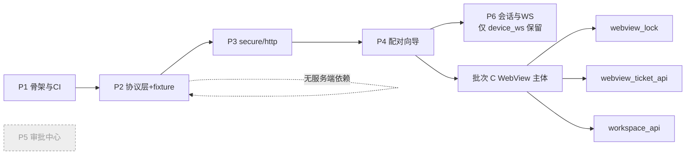

# harness_mobile 开发实施计划

> 状态：**MM1 + 批次 1 + 批次 C（架构收口主体）已完成**（2026-11）。工程位于 `F:\WorkSpace\Other\harness_mobile`，实测基线为 **`flutter analyze --fatal-infos --fatal-warnings` 零问题 + 三条红线门禁通过**；`lib/` 28 个 dart 文件、`test/` 9 个测试文件，`flutter test` 全绿（用例数以 CI 输出为准）。
> ⚠️ **2026-11 架构收口**（提交 `15767d3`）：产品定位由「遥控器 + 轻执行」改为「**纯 WebView 主体 + 原生身份链路**」，原批次 2 的投递与本地执行**整体注销**（不是待办）。凡本文中标 ~~删除线~~ 或「已注销」的条目，均为**决策留痕**，请勿按待办重新提起。
> 定位：本文是 `docs/移动端架构与功能设计.md` **v2.1** 的落地执行版——架构文档回答「为什么这样设计」，本文回答「**按什么顺序、交付什么、怎么验收**」。
> 姊妹文档：`docs/开发实施计划.md`（服务端 A~G 阶段）、`docs/桌面端架构与功能设计.md`（桌面端 DM1~DM4）。
> 版本：**v2.2（批次 C 架构收口回写）**。v1.0 为开工前基线；v2.0 补入 §3 实测完成情况与 §6 后续排期；v2.1 回写批次 1/2 交付明细；**v2.2 按提交 `15767d3` 注销批次 2、新增 §6.4.1 批次 C、核准批次 3 与批次 4 的真实状态**。

---

## 0. 本期范围锁定（Scope Lock）

### 0.1 一句话

> **本期交付 MM1（原生身份链路：配对 → 登录 → 设备 WS）与批次 C（WebView 主体）**，目标是「手机上能安全地**进入**并操作完整的 Web 工作区」，**不追求**任何端侧重执行能力；审批与会话界面一律由 Web UI 承担，原生不重做。

### 0.2 本期做什么 / 不做什么

| 类别 | 项 | 本期 | 实测状态 |
| --- | --- | --- | --- |
| ✅ 做 | Flutter 工程骨架 + CI 四道门禁 | 是 | ✅ 已完成 |
| ✅ 做 | 协议层（9 帧 + 8 错误码）与黄金 fixture 门禁 | 是 | ✅ 已完成 |
| ✅ 做 | 配对（pair-codes → pair → 令牌入 Keychain/Keystore） | 是 | ✅ 已完成 |
| ~~✅ 做~~ | ~~审批中心首屏 + 决策 + 生物识别 + `RequiredDeviceID` 拦截~~ | 否 | ❌ **已删除**（批次 C；改由 WebView 承载审批，生物识别改 App 级前置门） |
| ~~✅ 做~~ | ~~会话列表 + 消息流（只读）~~ | 否 | ❌ **已删除**（批次 C；改由 WebView 承载） |
| ✅ 做 | 设备长连接 WS（握手/心跳/退避/8 错误码分支） | 是 | ✅ 已完成 |
| ✅ 做 | WebView 全功能视图（自批次 C 起为**首屏主体**，不再只是「深水区补充」） | 是 | ✅ 已完成（批次 1） |
| ✅ 做 | App 级生物识别解锁门 + 一次性 ticket 透传 + 工作空间只读 | 是 | 🟡 代码就绪，UI 接线待收尾（§6.4.1） |
| ⛔ 不做 | **`workspace.list` 能力申报与目录浏览**（见 §1 决策记录） | 否 | — 本期定案（`workspace_api.dart` 只消费服务端列表，不申报能力） |
| ⛔ 不做 | `process` 能力（iOS 无法实现，永不做） | 否 | — 永不做 |
| ⛔ 不做 | 端侧工具真实执行（含 `task.dispatch` 白名单最小闭环） | 否 | ❌ **已注销**（批次 C 架构收口，见 §6.3） |
| ⛔ 不做 | 相册/相机投递（原批次 2-1） | 否 | ❌ **已注销**（批次 C 删除 `features/delivery`） |
| ⛔ 不做 | 推送链路（依赖服务端 B1，未开工） | 否 | ⏸ 阻塞 |
| ⛔ 不做 | 大文件分片上传（依赖服务端 B5，未开工） | 否 | ⏸ 阻塞（原投递队列已删除） |

### 0.3 本期能力申报（一次定死，不留后患）

配对请求的 `capabilities` **有且仅有**两项：

```json
"capabilities": [
  { "name": "network", "version": "1" },
  { "name": "device",  "version": "1" }
]
```

`kind` 固定为 `mobile`（平板为 `tablet`）。**不得**出现 `workspace.list` / `workspace.read` / `workspace.write` / `process` / `llm`。

---

## 1. 决策记录：本期不申报 `workspace.list`

> 本节是**决策留痕**，防止后续轮次被重新提起时重复论证。结论已由用户确认。

### 1.1 决策

**本期（及服务端 L1 就绪前）移动端不申报 `workspace.list`。**

### 1.2 依据（四条代码级事实）

| # | 事实 | 出处 |
| --- | --- | --- |
| 1 | 设备协议**不存在** `fs.list` / `fs.roots` 帧；9 个帧类型里没有任何一种能让服务端向设备索取目录列表 → C3/C4 无载体 | `internal/device/protocol.go:34-53`（`MsgFS*` 全仓零命中） |
| 2 | 服务端 `fsCheckHost()` **只判断 host 是否带 `device:` 前缀，完全不读能力标签**；`host=device:<id>` 一律返回 409 `fs.host_unsupported` | `internal/api/fs_handler.go:207-226` |
| 3 | 未找到按能力标签做派发路由的服务端函数（`HasCapability`/`RequiredCap`/`MatchCap` 均无匹配）；标签当前唯一实际消费点是前端 `hostStatus()` 置灰 | grep `internal/`；`web/src/lib/workspaceHost.ts` |
| 4 | 移动端唯一可暴露的根是 App 沙箱（`Documents`/`Library`/`Caches`），iOS 用户**无法直接投放文件进去**，目录树大概率是空的 | `docs/工作区宿主与目录选择对接约定.md:267` 限制 5 |

### 1.3 申报 vs 不申报的真实差异

| 维度 | 不申报（本期采用） | 申报 |
| --- | --- | --- |
| `GET /fs/dirs?host=device:<id>` | 409 | **同样 409**（事实 2） |
| 前端空间列表 | `canList=false` → 置灰 + reason | `canList=true` → **不置灰、可点击** |
| 用户实际体验 | 无从点，符合预期 | **点进去报 409**，预期外 |
| 诚实性 | ✅ 如实降级 | ❌ 假申报 |
| 实现成本 | 0 | C1–C7 全套（且卡在 C3/C4 无帧） |

**结论**：申报不带来任何能力，只把一个「静默置灰」变成「可点但报错」。UI 从正确降级退化为撒谎。

### 1.4 重新评估的触发条件（满足任一才重开此议题）

- [ ] 服务端完成 L1：`protocol.go` 出现 `fs.list` / `fs.roots` 帧常量，且 `fsCheckHost()` 改为真派发（不再是 409 占位）
- [ ] 产品明确要求 iOS「文件」App 深度集成（`UIFileSharingEnabled` + `LSSupportsOpeningDocumentsInPlace`），此时沙箱根才有用户真实文件
- [ ] 企业版 MDM 场景：由 MDM 下发文档到 App 沙箱，沙箱根有实际内容

> ⚠️ **三个条件未满足前，任何人重新提出申报都必须先驳回并引用本节。**

### 1.5 「把手机文件交给 Agent」的替代路径（本期满足需求）

真实场景 99% 是「一张照片 / 一个截图 / 一份 PDF」，**不需要目录树浏览**：

| 方案 | 依赖 | 本期 |
| --- | --- | --- |
| 相册/相机 → base64 内联工具参数（≤2MB） | 无（立即可用） | ✅ 做 |
| 相册/相机 → HTTP 投递 | 服务端 B5（未开工） | ⛔ 下期 |
| 剪贴板承载 | 无 | ✅ 做 |
| iOS 文件 App 集成 + `workspace.list` | 服务端 L1 + C1–C7 | ⛔ 触发条件满足后再议 |

---

## 2. 环境与工具链

| 项 | 版本 | 说明 |
| --- | --- | --- |
| Flutter | `3.24.x`（stable） | CI 固定次版本，避免漂移 |
| Dart SDK | `>=3.5.0 <4.0.0` | 用 records + sealed class 表达协议帧 |
| Kotlin | `2.0+`，`minSdk 24` | `EncryptedSharedPreferences` 与 FCM 现代 API 起点 |
| Swift | `5.9+`，iOS `14.0+` | UIKit lifecycle 足够 |
| Xcode | 16.x（CI 用 `macos-14` runner） | iOS 构建必须 macOS |
| Android SDK | `compileSdk 35` / `targetSdk 35` | 随当年 Play 要求 |

**初始化命令**（工程创建时执行一次）：

```bash
flutter create --org com.harness --project-name harness_mobile \
  --platforms=android,ios harness_mobile
```

**依赖清单**：见架构文档 §3.3（14 个直接依赖 + 5 个 dev 依赖，均已注明引入理由与「刻意不引入」的清单）。

---

## 3. MM1 详细 WBS（本期主体，6 个包）— **已全部交付**

> 顺序铁律（架构文档 §11.1.1）：**协议层必须在 UI 之前**。P1/P2 可完全离线开发，无服务端也能 CI 全绿。
> ✅ **实测结论**：P1–P6 全部完成，`flutter analyze --fatal-infos --fatal-warnings` 零问题，三条红线 grep 门禁通过。批次 C 收口后 `lib/` 28 个 dart 文件，`test/` 9 个测试文件，`flutter test` 全绿（用例数以 CI 输出为准）。
> ⚠️ **P5 / P6 已于批次 C 删除代码**（`features/approval`、`features/session`、`approval_repository`、`approval_api`/`session_api`、`sse_client`）。下表保留其验收记录仅作历史依据；其中的 R5「`device_mismatch` 锁定」已随页面消失而失效，等价约束迁移见 §6.4.1 与架构文档红线表。

| 包 | 内容 | 交付物 | 验收 | 人日 | 状态 |
| --- | --- | --- | --- | --- | --- |
| **P1 骨架与 CI** | `flutter create` 产物 + `analysis_options.yaml`（`flutter_lints` + 禁止 `print`/`dart:ffi`）+ `.github/workflows/ci.yml` 四道门禁（§4.1）+ `lib/` 目录分层骨架 | `pubspec.yaml`、`analysis_options.yaml`、`.github/workflows/ci.yml`、`lib/` 分层 | `flutter analyze --fatal-infos` 0 issue | 2 | ✅ 完成 |
| **P2 协议层 + fixture 门禁** | `lib/protocol/`：`Envelope`（v/type/id/run_id/ts/payload）+ 9 帧 Payload + 8 帧级错误码枚举 + `MessageType` 常量；`test/protocol/golden_test.dart`；`fixtures/` 9 个 JSON | `envelope.dart`、`frame_payloads.dart`、`golden_test.dart`、`capability_policy_test.dart`、9 个 fixture | ① fixture 全绿（33 用例）；② `int64` 走 `(x as num).toInt()` 有专项测试 | 3 | ✅ 完成 |
| **P3 secure/http client** | `SecureStore` 抽象 + `FlutterSecureStore`（Keychain / `EncryptedSharedPreferences`）+ `InMemorySecureStore`；`data/remote/http_client.dart`（dio：鉴权头注入、`apperr` 错误码映射、`DisallowUnknownFields` 400 友好提示） | `core/error/app_error.dart`、`data/local/secure_store.dart`、`data/remote/http_client.dart` | ① 令牌往返；② `maskToken` 打码（R3）；③ 9 种 `DioExceptionType` 穷举映射 | 4 | ✅ 完成 |
| **P4 配对向导** | `features/setup/`（服务端地址）+ `features/pairing/`（6 位码）+ `features/auth/`（登录）；`data/remote/auth_api.dart`、`device_api.dart` | `setup_page.dart`、`pairing_page.dart`、`login_page.dart`、`auth_api.dart`、`device_api.dart` | ① 请求体**仅**含 `code/name/kind/platform/app_version/capabilities[{name,version}]`（R7，有断言）；② 失败时原样透出服务端 message | 4 | ✅ 完成 |
| **P5 审批中心首屏** | `features/approval/`：首屏即审批中心；`domain/repositories/approval_repository.dart` 按会话遍历 `active-run` + `tool-events` 拼装 pending（并发上限 6）；决策调 `POST .../approvals/{aid}/decide` | `approval_center_page.dart`、`approval_repository.dart`、`approval_api.dart`、`session_api.dart` | ① 首屏为审批中心；② **R5**：`device_mismatch` → 锁定该行 + 禁按钮（有专项测试）；③ 生物识别 fail-closed（`AlwaysDeny` 断言绝不发请求）；④ `already_decided` → 静默刷新 | 6 | ❌ 交付后于批次 C 删除（首屏改 WebView） |
| **P6 会话订阅与 WS** | `data/ws/device_connection.dart`（抽象）+ `device_ws.dart`（状态机）+ `sse_client.dart`（手写解析）；`features/session/` 列表 + 消息流 | `device_ws.dart`、`sse_client.dart`、`session_list_page.dart`、`session_messages_page.dart` | ① 8 个错误码分支各有单测；② 心跳取 `heartbeat_s*0.8`（`heartbeat_s=30` → 断言 24s）；③ SSE `:` 注释帧被忽略；④ `resync` 帧触发重拉 | 6 | 🟡 **部分保留**：`device_ws.dart` 保留且仍是红线 R4 载体；`sse_client.dart` 与 `features/session/` 已删除 |

**MM1 小计：25 人日**（1 名熟手全职；未含真机联调与上架，见 §6）。

### 3.0 实施期发现的契约修正（重要，影响后续开发）

开工前核实服务端代码，修正了 3 处**会导致联调失败**的设计错误（下表为历史留痕：第 2 条涉及的审批 decision 调用已随批次 C 删除端侧审批界面，契约事实本身仍有效，接入 Web 端时同规则适用）：

| # | 原设计 | 服务端事实 | 影响 |
| --- | --- | --- | --- |
| 1 | access + refresh 双令牌 + 401 静默刷新 | **单令牌模型**，`auth_handler.go:65-84` 的 login 只返回 `{user, token}`，**无 refresh 端点** | 已改为单令牌 + 401 引导重登 |
| 2 | 审批 decision 用 `approve` / `reject` | `provider_handler.go:16-21` 只允许 `allow_once` / `allow_session` / `deny`，另需 `device_id` | 已改，写错即 400 |
| 3 | `/sessions/{sid}/active-run` 无活跃 Run 返回 404 | 返回 **200 + `run_id:""`**（`handler.go:250`） | 已做兼容，不分支 |

### 3.1 MM1 出口五道门

对齐服务端阶段 A 的「出口五道门」体例：

| # | 门 | 状态 |
| --- | --- | --- |
| 1 | **CI 全绿**：`flutter analyze --fatal-infos --fatal-warnings` + `flutter test` 全绿 | 🟡 analyze 待阶段 A 复跑；`test/` 9 文件已按新架构对齐中（用例数以 CI 输出为准，不写死） |
| 2 | **协议零漂移**：Go 侧改 JSON tag，移动端 CI 必须变红 | ✅ fixture 门禁就位（负向演练待 CI 环境） |
| 3 | **配对可用**：全新安装 → 输码 → 免配对重启 → 连 WS 收 `welcome` | ⏳ 待真机联调 |
| 4 | ~~**审批闭环**：服务端发起需审批 Run → 手机收到 → 批准 → Run 状态正确流转~~ | ❌ **已注销**：审批界面迁入 WebView，闭环改由 Web UI + 服务端共同保证，端侧不再有该出口门 |
| 4' | **WebView 入口可用**：身份齐备 → 直达 `/webview` 能加载服务端 `web/dist` 并操作（含审批） | ⏳ 待真机联调（`WebViewPage` 目前裸加载入口，票据/锁未接线） |
| 5 | **能力合同**：`capabilities` 恰为 `network`+`device` | ✅ 有断言（`api_contract_test`） |

> ⚠️ 第 3、4' 门需真实服务端 + 真机，属于「代码完成但未端到端验证」的部分，是下阶段首要风险。

### 3.2 逐包依赖关系



**可并行**：P5 与 P6 在 P4 完成后可两人并行（P5 做审批、P6 做连接与会话），战场不重叠。实际实施即按「数据层 / 连接层 / UI 层」三路并行交付。**批次 C 后 P5 整包删除，P6 只保留 `device_ws.dart` 与 `device_connection.dart`**。

---

## 4. 质量门禁（每 PR 必跑）

### 4.1 CI 四道门禁（对齐桌面端 §18.2，`protocol-gate` 排第一）

```yaml
jobs:
  protocol-gate:   # ★ 第一道，30 秒内能发现 Go/Dart 双写漂移
  lint:            # analyze + 红线 grep
  test:            # 单测 + 覆盖率
  build:           # 双端构建（需 macos-14）
```

完整 YAML 见架构文档 §12.2。**`protocol-gate` 必须排第一**——若排最后，等 10 分钟 CI 完才失败，代价太大。

### 4.2 红线 grep 门禁（三条，缺一不可）

```bash
# R3：令牌绝不进日志
! grep -rniE 'print\(.*(token|authorization)' lib/

# 禁止 FFI 绕过平台通道
! grep -rn "dart:ffi" lib/

# 能力标签词表红线：只允许 network / device（§0.3）
! grep -rnE '"(process|workspace\.(list|read|write)|llm)"' lib/
```

第三条是**本期范围锁定的自动化守护**——若有人误加 `workspace.list`，CI 直接红，无需靠 code review 记忆。

### 4.3 覆盖率门槛

| 层 | 门槛 | 理由 |
| --- | --- | --- |
| `lib/protocol/` | ≥ 90% | 纯数据层，无理由低 |
| `lib/data/`（remote/local/ws） | ≥ 80% | 业务编排与契约层（原 `lib/domain/` 已于批次 C 随审批仓储删除） |
| `lib/features/` | ≥ 50% | UI 层，靠 widget test 保关键路径 |
| 全局 | ≥ 60% | 兜底 |

### 4.4 本地自检命令（提 PR 前必跑）

```bash
flutter analyze --fatal-infos
flutter test --coverage
# fixture 同步校验（需 harness_go 同级目录）
cd ../harness_go && go run scripts/gen-fixtures.go -out ../harness_mobile/fixtures
cd ../harness_mobile && git diff --exit-code fixtures/
```

---

## 5. 服务端协同依赖排期

> ⚠️ 本节是**跨仓排期风险点**。MM1 不依赖任何服务端改动（可立即开工），但 MM2 起全部受阻。

| 服务端项 | 阻塞范围 | 需服务端交付 | 移动端对冲 |
| --- | --- | --- | --- |
| **B1 推送链路** | MM2-4 全部 | `devices` 表加 `push_token`/`push_platform`/`push_updated_at`；`POST /api/v1/devices/push-token`；`internal/push` 包（`Provider` 接口 + APNs/FCM/Noop）；Run 进 `waiting_approval`/`completed`/`failed` 时触发；配置项 `push.*` | `PushChannel` 抽象 + `FakePushChannel` 先行开发（**批次 C 后尚未建立，实为未做**） |
| **B2 审批聚合端点** | ~~MM1-P5 体验~~ | `GET /api/v1/approvals?status=pending&limit=&offset=` | 服务端仍未实现；⚠️ 但**对移动端已不构成缺口**——审批列表由 Web UI 消费，端侧不再拼装 N+1 |
| **B3 增量参数** | ~~MM2-2 resync 效率~~ | `GET /api/v1/sessions?updated_since=<ms>`；`GET /.../messages?since_seq=<n>` | 服务端仍未实现（阻塞不变）；⚠️ 移动端数据拉取已全在 Web 端，此项对原生不再适用 |
| **B5 分片上传** | ~~MM3 大文件~~ | `POST /api/v1/uploads`（init/chunk/complete 三步） | 服务端仍未实现（阻塞不变）；⚠️ 移动端投递能力随批次 C 删除，若恢复需重新设计入口 |

> **阻塞状态口径**：B1 / B3 / B5 在**服务端侧确实仍未实现**，本表保持原阻塞表述不变；其中 B3 / B5（及 B2）对移动端**当前已无实际缺口**，是因为端侧能力被注销或迁入 Web 端，而非服务端补齐了。

### 5.1 服务端 B2 的必要性说明（历史留痕，对移动端已失效）

> ⚠️ 批次 C 后审批列表由 Web UI 消费，本节 N+1 论证**不再适用于移动端**，保留仅为解释历史设计取舍。

移动端首屏审批中心若走 N+1：

```
GET /sessions              → 1 次
对每个活跃会话：
  GET /sessions/{sid}/active-run   → N 次
  GET /sessions/{sid}/runs/{rid}/tool-events → M 次（每个活跃 Run）
```

会话数 20、活跃 Run 3 时约 **24 次请求**，冷启动 2s 目标会崩。因此：

- **一期**：限制并发 6、渐进渲染（先出缓存，再补增量）、只查「本地标记为活跃」的会话；
- **必须推动服务端补 B2**，否则首屏体验上不去。

---

## 6. 后续开发计划（v2.0 新增）

### 6.1 总览与排期调整

**原计划关键路径**是 MM1 → MM2 → MM4。**实测后建议调整**：把 MM4 提到 MM2 之前。

理由：MM2 的核心价值是推送，而推送**卡在服务端 B1（完全未实现）**；MM4 完全不依赖服务端，且上架是硬性终点——越晚做，越可能在提审时才发现隐私清单/账号注销等问题需返工。

| 批次 | 内容 | 人日 | 服务端依赖 | 建议 |
| --- | --- | --- | --- | --- |
| **MM1** | 身份与审批中心 | 25 | 无 | ✅ **已完成**（其中审批中心/会话页已于批次 C 删除，身份链路保留） |
| **批次 1** | MM4 WebView 与上架 | 12 | **无** | ✅ **已完成** |
| **批次 2** | 轻执行与投递（base64 小文件） | 5 | 无 | ❌ **已注销（批次 C 架构收口：放弃本地执行与投递）** |
| ~~批次 2 余项~~ | ~~dispatch 白名单执行与回传~~ | ~~6~~ | 无 | ❌ **已注销（架构收口放弃本地执行）** |
| **批次 C** | 架构收口（WebView 主体 + 原生身份链路） | 4 | 无 | 🟡 **主体已完成**（删域 + 新增三件；锁与票据 UI 接线待收尾） |
| **批次 3** | 连接体验补全（深链、前后台恢复、诚实化） | 6 | 无 | 🟡 待开发（深链白名单已改为 `session`/`reauth`，前后台 resync 未做） |
| **批次 4** | 推送、大文件、增量同步 | 18 | **B1、B5、B3** | ⚪ 等服端就绪（投递相关部分随批次 C 一并失效） |

**当前实测基线**（2026-11，批次 C 之后）：`flutter analyze --fatal-infos --fatal-warnings` 零问题；`lib/` **28 个** dart 文件、`test/` **9 个**测试文件；`flutter test` 全绿（用例数以 CI 输出为准——阶段 A 正在同步对齐用例，不在本文写死数字）。

### 6.1.1 批次 1、2 交付明细（已完成）

| 交付物 | 文件 | 验收证据 |
| --- | --- | --- |
| WebView 全功能视图 | `features/webview/webview_page.dart` | 有版本协商与错误态，baseUrl 为空显示空态 |
| 最小 JS 桥 | `features/webview/js_bridge.dart` | **R3**：单测断言脚本不含任何凭据字段；`parseDeepLink` 覆盖 4 类 URL |
| 账号页 | `features/settings/account_page.dart` | 解绑、退出、注销降级指引（见 §6.1.2） |
| 相册投递 | ~~`features/delivery/` + `data/remote/delivery_api.dart`~~ | ❌ 已随批次 C 删除，交付记录仅作历史留痕 |
| iOS 上架材料 | `ios/Runner/PrivacyInfo.xcprivacy`、`Info.plist` | 隐私清单 + 相册/相机/FaceID/深链声明（相册/相机用途声明待批次 C 后清理，见批次 C 遗留项） |
| Android 上架材料 | `AndroidManifest.xml` | 网络/相机/生物识别权限、深链 intent-filter |
| 路由整合 | `lib/app.dart`、`core/app/app_session.dart` | 批次 C 后 `AppRoutes` 收敛为 splash/setup/pairing/login/webview/account 六条 + `secondaryPages` 放行集合，首屏铁律有测试守护 |

### 6.1.2 账号注销的降级方案（服务端缺口已确认）

**核实结论**：服务端**没有账号注销端点**——`internal/api/router.go:40-44` 只有 `login` / `sso` / `me` / `logout` / `password`，`internal/service` 无 `DeleteUser` 等方法。

**移动端降级实现**（满足苹果「App 内可注销」最低要求）：
- 「解除本机绑定」→ `AppSession.resetPairing()` + `SecureStore.clearAll()`
- 「退出登录」→ `AppSession.signOut()`
- 「注销账号」→ 明确说明**账号数据删除需在 Web 端完成**，并给出 Web 地址与复制入口

> ⚠️ **待服务端补齐**：若要完整满足审核（而非仅引导），需服务端新增 `DELETE /api/v1/auth/account`（含级联清理会话/设备/凭据）。建议列入下一轮服务端排期。

### 6.2 批次 1：MM4 WebView 与上架（12 人日）✅ 已完成

> 全部不依赖服务端；上架材料若有遗漏，越晚发现返工越贵。

| # | 任务 | 内容 | 验收 | 状态 |
| --- | --- | --- | --- | --- |
| 1-1 | WebView 全功能视图 | 加载服务端 `//go:embed web/dist` 产物，覆盖项目、工作区、工具市场等低频深水区 | App 内可打开并操作上述页面 | ✅ |
| 1-2 | 最小 JS 桥 | 只允许 WebView → 原生**单向**传递深链意图，**绝不注入 device_token**（R3） | 单测断言脚本不含任何凭据字段 | ✅ |
| 1-3 | 版本协商 | 服务端 UI 升级后 App 不白屏，版本不匹配时提示升级 | 错误态含重试与检查地址入口 | ✅ |
| 1-4 | iOS 上架材料 | Privacy Manifest、隐私政策、**账号注销入口**（苹果强制，缺则拒审） | 隐私清单已落盘；注销为降级方案（§6.1.2） | ⚠️ 部分 |
| 1-5 | Android 上架材料 | 隐私合规弹窗、分渠道打包、权限用途说明 | 权限与深链已声明 | ⚠️ 部分 |

> ⚠️ **1-4、1-5 的残留项**：隐私合规弹窗 UI、分渠道打包脚本、商店截图与文案尚未制作。这些属于**发版前**工作，需真机与商店账号，不阻塞代码开发。

### 6.3 批次 2：轻执行与投递（11 人日）— ❌ 已整体注销

> **批次 C 定案**：移动端不再承担本地执行与文件投递，2-1/2-2/2-3/2-4 全部作废（代码已于 `15767d3` 删除）。下表保留为**决策留痕**，防止后续被重新提起。

| # | 任务 | 内容 | 依赖 | 状态 |
| --- | --- | --- | --- | --- |
| 2-1 | 相册/相机 → base64 内联投递（≤2MB） | 选图 → base64 → 走工具参数交给 Agent | 无 | ❌ 已注销（代码删除） |
| 2-2 | `task.dispatch` 白名单受理 | 仅接受 `network` 类轻工具，其余回 `task_unsupported` | 无 | ❌ 已注销（架构收口放弃本地执行） |
| 2-3 | `task.result` 回传 | 强制 `source_trust=untrusted`（红线 R2） | 无 | ❌ 已注销（同上；`TaskResultPayload` 仅保留解码能力） |
| 2-4 | 投递重试队列 | 失败重试 3 次 + 手动重发；WiFi-only 大文件开关 | 无 | ❌ 已注销（随 2-1 一并删除） |

> **注销理由**：手机侧做「轻执行」需要与服务端 dispatcher 端到端联调，而业务价值远低于 Web UI 已有的能力；同时原生投递页与 Web 端文件上传重复建设。批次 C 统一改为「业务界面全在 WebView」，故整批作废。
>
> **不变的部分**：协议层 9 帧仍完整解码（黄金 fixture 仍覆盖 `task.dispatch` / `task.progress` / `task.result` 三个样本），`TaskResultPayload.sourceTrust` 仍恒为 `untrusted`（红线 R2 不因注销而放松——若将来恢复上行回传，此约束自动生效）。

### 6.4 批次 3：连接体验补完（6 人日）🟡 待开发

| # | 任务 | 内容 | 现状核准（2026-11） |
| --- | --- | --- | --- |
| 3-1 | 深链定址 | 通知点击直达会话；**先用可注入的 intent 入口验证路由，不等 B1** | 🟡 部分完成：`js_bridge.dart` 白名单已由 `approval` 改为 `session` + `reauth`，`parseDeepLink` 有测试；但 `webview_page.dart::_dispatchDeepLink` 仍引用已删的 `DeepLinkKind.approval` / `AppRoutes.sessionMessages`（当前编译不通过，属阶段 A 修复范围） |
| 3-2 | 回前台 resync 编排 | 进后台置 `stale`；回前台**先拉齐再连 WS**（顺序不能反） | ❌ 未做：`device_ws.dart` 无 `WidgetsBindingObserver` 钩子；`webview_lock.dart` 只处理锁（回前台超 `relockAfter` 重新加锁），不做数据重拉 |
| 3-3 | 连接态诚实化 UI | 后台显示「数据可能延迟」，不假装实时（红线 R4） | ❌ 未做：`DeviceWsState` 已区分 `live` / `reconnecting` / `dead` 等 6 态，但无 UI 呈现层 |

### 6.4.1 批次 C：架构收口（WebView 主体）🟡 主体已完成

> 决策日期 2026-11，提交 `15767d3`（收口）与 `4f2bfd3`（工作空间只读 API 补齐）。

**决策动因**（三条，缺一不可）：

1. **移动端不做重活**：手机不是执行面——`process` / `workspace.read/write` 永不可能申报，既然执行不了，会话列表与消息流就只是 Web 端的只读复刻；原生做一份等于长期维护两套渲染。
2. **原生审批卡片与 Web UI 重复建设**：审批卡片、会话列表、消息流在 Web 端已完整实现，原生版本还得单独处理分页、渐进渲染、N+1 拼装（原 B2 缺口）与视觉一致性，投入产出比极低。
3. **票据免密优于迁移成本**：把原生 Keychain 里的会话搬进 WebView 的 Cookie jar，最省事的做法是 ticket 一次性兑换（`#ticket=` fragment，不进 Referer / access log）；服务端未接线时可降级为 Cookie 注入，迁移成本与风险都可控。

**删除项**（`15767d3`，全部已从仓库消失）：

| 类型 | 路径 |
| --- | --- |
| 页面 | `lib/features/approval/`、`lib/features/session/`、`lib/features/delivery/` |
| 仓储 | `lib/domain/repositories/approval_repository.dart` |
| data 层 | `lib/data/remote/approval_api.dart`、`session_api.dart`、`delivery_api.dart` |
| WS 附属 | `lib/data/ws/sse_client.dart`（会话消息 SSE 订阅随之作废） |
| 路由/枚举 | `AppRoutes.{approvals,sessions,sessionMessages,delivery}`；`AppStage.approvals`；`DeepLinkKind.approval`（已换为 `reauth`） |
| 能力 | `task.dispatch` 白名单本地执行、`task.result` 上行回传、相册/相机投递 |

**新增项**：

| 新增 | 职责 | 接线状态 |
| --- | --- | --- |
| `lib/core/app/webview_lock.dart` | App 级生物识别解锁门：冷启动 / 回前台超 `relockAfter`（默认 5 分钟）/ 手动锁定；fail-closed，无跳过按钮，不动 R3 密钥链路 | ⚠️ 未接入 `providers.dart` 与根组件，`WebViewPage` 未消费 |
| `lib/data/remote/webview_ticket_api.dart` | 一次性 ticket 签发与 `#ticket=` 拼接（保留 hash 路由）；ticket 拿不到静默降级为 Cookie 注入（`WebViewCookieSink` 可注入） | ⚠️ 已挂到 `ApiServices.webviewTicket`，未被 `WebViewPage` 调用 |
| `lib/data/remote/workspace_api.dart` | 工作空间**只读**消费（`GET /api/v1/workspaces`、`/{wid}`），刻意不实现 create/patch/delete（三端职责矩阵） | ✅ 已挂到 `ApiServices.workspaces` |
| 深链 | `harness://session/<sid>` 改为进 WebView 后由 Web 内定位；新增 `harness://reauth` 用于 Cookie 失效时请求原生重签 / 重新解锁 | 🟡 白名单与解析已完成，消费侧待修 |

**遗留待办**：

1. **离线态**：WebView 主体在网络断开时只能显示 Web 自身的报错页，原生无离线缓存/离线兜底（不做 Service Worker 注入是刻意的，避免与 Web 端缓存策略打架）。
2. **票据过期**：ticket 为短时一次性凭据，过期后 Web 侧 API 将 401；端侧目前只有 `harness://reauth` 深链作为入口，尚未实现「自动重签 + 无感重载」，也无「重签失败则回原生登录」的完整闭环。
3. **WebView 内深链定位**：`harness://session/<sid>` 已不在原生路由表中，需由 Web UI 消费；当前 `webview_page.dart::_dispatchDeepLink` 仍指向已删路由（阶段 A 待修），修好后统一走 `onDeepLink` 回调注入 Web。
4. **锁与票据接线**：`WebViewLock` / `prepareAuth` 需在根组件与 `WebViewPage` 装配点接入，接线前必须先补契约测试（锁 fail-closed、ticket 不进日志）。
5. **上架材料清理**：`Info.plist` / `AndroidManifest.xml` 里的相册/相机用途声明在投递能力删除后已无对应功能，发版前应删掉（保留 FaceID 与网络）。

### 6.5 批次 4：服务端就绪后接入（18 人日）⚪ 暂不排期

| 功能 | 阻塞项 | 人日 | 移动端现状（批次 C 后核准） |
| --- | --- | --- | --- |
| 推送通知（APNs/FCM） | **B1**：`devices` 表加 `push_token`、`POST /devices/push-token`、`internal/push` 包 | 8 | 依赖仍在 `pubspec.yaml`（`firebase_messaging` / `flutter_local_notifications`），但 `lib/` 内**零引用**，`PushChannel` 抽象**尚未建立**（原计划写「已预留」，实为未做） |
| 大文件分片上传 | **B5**：`POST /api/v1/uploads`（init/chunk/complete） | 6 | ⚠️ **前提已失效**：原计划的「投递队列断点续传位图」随批次 C 删除投递能力一并作废。若将来恢复，需重新设计入口——不建议在 WebView 主体上通开原生上传 |
| 增量同步 | **B3**：`GET /sessions?updated_since=`、`/messages?since_seq=` | 4 | 原「Repository 接口已隔离」已随审批/会话仓储删除而失效；批次 C 后数据拉取全部在 Web 端，此项对原生**不再适用**，仅作服务端优化参考 |

### 6.6 优先级汇总

| 优先级 | 功能 | 依赖 | 人日 | 状态 |
| --- | --- | --- | --- | --- |
| 🔴 高 | 批次 1：MM4 WebView + 上架 | 无 | 12 | ✅ 已完成（隐私弹窗/分渠道打包仍待发版前做） |
| 🔴 高 | 批次 C：架构收口主体（删域 + 锁/票据/工作空间三件） | 无 | 4 | 🟡 主体已完成，UI 接线与契约测试待补 |
| ~~🟡 中~~ | ~~批次 2-2~2-3：dispatch 白名单执行与回传~~ | — | ~~6~~ | ❌ **已注销（架构收口放弃本地执行）** |
| 🟡 中 | 批次 3：前后台恢复 resync + 连接态诚实化 | 无 | 4 | 🔜 待开发（深链白名单已改 `session`/`reauth`，消费侧待修） |
| 🟡 中 | 批次 C 收尾：`WebViewLock` / `prepareAuth` 接入 `WebViewPage` | 无 | 2 | 🔜 待开发（接线前须补 fail-closed 与 ticket 不进日志的测试） |
| 🟡 中 | 批次 1 残留：隐私弹窗、分渠道打包、商店材料 | 商店账号 | 4 | 🔜 发版前 |
| ⚪ 待服端 | 推送通知 | **B1** | 8 | ⚪ 阻塞（`PushChannel` 未建） |
| ⚪ 待服端 | 大文件分片上传 | **B5** | 6 | ⚪ 阻塞（原投递队列已删除，需重新设计） |
| ⚪ 待服端 | 增量同步 | **B3** | 4 | ⚪ 阻塞（对原生已不适用，仅服务端优化参考） |
| ⚪ 待服端 | 账号注销端点（服务端工作量） | — | 2 | ⚪ 新增缺口 |

**当前状态**：已完成 41 人日（MM1 25 + 批次 1 12 + 批次 C 主体 4），批次 2-1 的 5 人日**作废不计**；**剩余无阻塞约 10 人日**（批次 3 的 4 + 批次 C 收尾 2 + 发版残留 4）；被服务端阻塞约 18 人日（其中推送 8 / 上传 6 / 增量 4 中有 10 人日因架构收口已实际失效）。

### 6.7 下阶段首要风险

1. **端到端未验证**：MM1 的「配对可用」「审批闭环」两道出口门需真实服务端 + 真机，目前仅代码与单测层面完成。
2. **上架材料未知项**：账号注销端点是否存在（服务端核实中）。
3. **长连接真机表现**：iOS 后台挂起、国内 Android ROM 的 FCM 到达率，模拟器无法验证。

---

## 7. 风险与对策（本期专属）

| # | 风险 | 影响 | 对策 |
| --- | --- | --- | --- |
| 1 | **R7 字段漂移**：端侧多发字段被 `DisallowUnknownFields` 拒 | 配对第一步就 400，排查耗时 | P4 用 `http_client` 透出服务端 `message`；请求体字段白名单单测 |
| 2 | **B1 未开工**导致 MM2 空转 | 排期风险 | MM1 完全无依赖先跑；推送用 Fake 通道开发 |
| 3 | ~~**B2 缺失**导致首屏 N+1 慢~~ | ~~首屏 2s 目标不达~~ | 批次 C 后移动端首屏为 WebView，N+1 风险转移至 Web 端；端侧已无此风险 |
| 4 | **误加 `workspace.list`** | 假申报、用户点报错 | §4.2 第三条 grep 门禁强制拦截；`workspace_api.dart` 只读消费不算申报 |
| 5 | 心跳硬编码 15s | 服务端调参后端侧失联 | P6 强制取 `welcome.heartbeat_s * 0.8`，单测覆盖 |
| 6 | ~~SSE `: ping` 注释帧被当事件~~ | ~~消息流出现诡异空包~~ | ❌ 风险消失：`sse_client.dart` 随批次 C 删除，端侧不再解析 SSE |
| 7 | Dart `int64` 精度（`ts`/`deadline`） | 时间解析抛 TypeError | 统一 `(x as num).toInt()`，P2 专项测试；`webview_ticket_api` 的 `expires_at` 同规则 |
| 8 | 真机推送/后台行为与模拟器不一致 | 上线才发现 | MM2 起必须有 iOS 真机 + Android 真机各 1 台的验收环境 |
| 9 | **WebView 主体单点依赖**（批次 C 新增） | Web 端挂了/升级不兼容 → 整个 App 不可用（原生无兜底页） | `WebViewPage` 保留错误态 + 重新加载；版本协商沿用批次 1；发布前必须做「Web 端发布与 App 版本兼容矩阵」验证 |
| 10 | **票据/锁接口先行未接线**（批次 C 新增） | 代码存在但 UI 未消费，容易被误当作「已具备生物识别门禁」 | 已在 §6.4.1「新增项」逐条标注接线状态；收尾时必须补 fail-closed 与 ticket 不进日志的契约测试 |

---

## 8. 环境与复现（v2.0 更新）

### 8.1 本机工具链（实测，2026-11）

| 项 | 值 |
| --- | --- |
| Flutter | **3.47.9 stable**（Dart **3.13.7**），安装于 `F:\Software\flutter`；`pubspec.yaml` 门槛仍为 `flutter >=3.24.0` / `sdk >=3.5.0` |
| JDK | **21**（`D:\Program Files\Java\jdk-21.0.8`，`JAVA_HOME` 已指向它；不再需要 JDK 17） |
| Android 构建链 | Gradle **8.7**（`android/gradle/wrapper/gradle-wrapper.properties`）+ AGP **8.6.1** + Kotlin **1.9.24**（`android/settings.gradle`），`compileSdk = 35`，Java 目标 17 |
| 调用方式 | `F:\Software\flutter\bin\flutter.bat`（**未加入 PATH 时用绝对路径**，无需重启终端） |
| 工程路径 | `F:\WorkSpace\Other\harness_mobile`（与 `harness_go` 同级） |

> 🔴 **不变量**：Gradle 8.3 及以下在 JDK 21 上会报 `Unsupported class file major version 65`；8.7 是 Flutter tool 的已知兼容上限，**不要擅自升到 8.8+**。详见 `harness_mobile/docs/环境搭建指南.md` §2。

### 8.2 一键复现当前基线

```bash
cd F:\WorkSpace\Other\harness_mobile
F:\Software\flutter\bin\flutter.bat pub get
F:\Software\flutter\bin\flutter.bat analyze --fatal-infos --fatal-warnings   # 期望：No issues found!
F:\Software\flutter\bin\flutter.bat test                                    # 期望：全绿（用例数以输出为准）
```

> ⚠️ **PowerShell 陷阱**：`flutter ... | Select-Object` 会让退出码失真（返回 1 但实际成功）。请重定向到日志文件再读取内容。

### 8.3 fixture 同步（协议漂移门禁）

```bash
cd F:\WorkSpace\Other\harness_go
go run scripts/gen-fixtures.go -out ../harness_mobile/fixtures
cd ../harness_mobile && git diff --exit-code fixtures/
```

### 8.4 开工前 Checklist（MM1 已全部完成，仅留后续项）

- [x] 创建 `harness_mobile` 工程（与 `harness_go` 同级目录）
- [x] `flutter create` 生成骨架（android/ios 脚手架已就位）
- [x] 配置 CI 四道门禁
- [x] 生成 9 个 fixture
- [x] `capabilities` 写死为 `network` + `device`（§0.3），有断言守护
- [ ] **确认服务端 B1/B2/B3/B5 是否已排期**（决定批次 4 能否启动）
- [ ] **确认服务端是否有「账号注销」端点**（iOS 上架强制要求，批次 1-4 前置）
- [ ] 准备 iOS 真机 + Android 真机各 1 台（MM1 出口门 3/4 端到端验证用）

---

## 9. 交叉引用

- 架构设计（本文的上游）→ `docs/移动端架构与功能设计.md` v2.1
- 服务端实施计划（排期对齐）→ `docs/开发实施计划.md`
- 桌面端设计（对照基准）→ `docs/桌面端架构与功能设计.md` v2.1
- 能力标签词表（唯一权威）→ `pkg/toolapi/spec.go:92-113`
- 协议线格式（唯一权威）→ `internal/device/protocol.go`
- 路由与免鉴权白名单 → `internal/api/router.go:10-17`、`:150-156`
- 宿主能力 C1–C7 与移动端限制 → `docs/工作区宿主与目录选择对接约定.md` §6、§7 限制 5
- **移动端工程本体** → `F:\WorkSpace\Other\harness_mobile`（lib **28** 文件 / test **9** 文件 / `flutter test` 全绿，用例数以 CI 输出为准）
