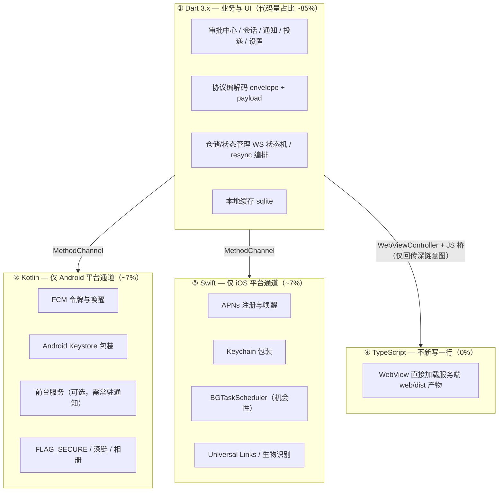
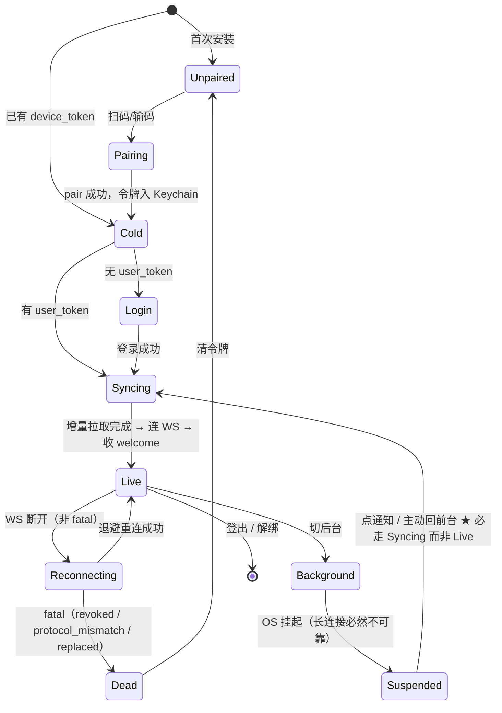
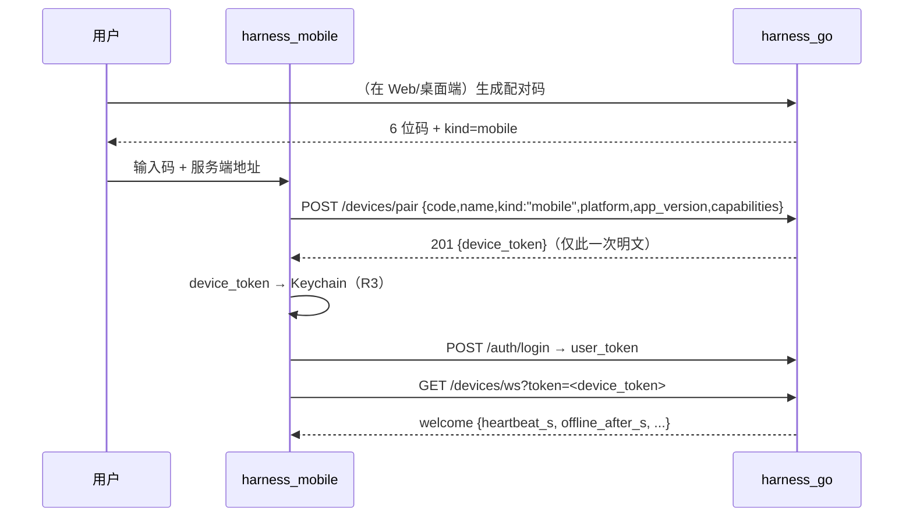
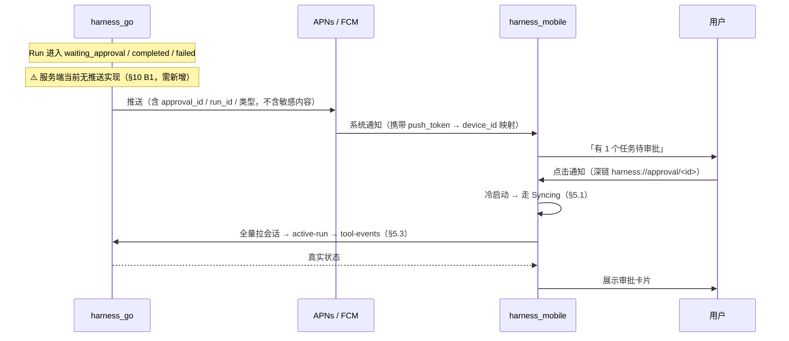

# harness_mobile 架构与功能设计

> 状态：**MM1 已实现**（2026-11）。工程位于 `D:\WorkSpace\Project\harness_mobile`，`flutter analyze` 零问题 + 117 测试全绿。本文是设计基线；**落地进度与后续排期见 `docs/移动端开发实施计划.md` v2.0**。
> 版本：**v2.1（可开工级 + 对照桌面端校准）**。v1.0 为概念稿（定位/红线/选型方向）；**v2.0 补齐可直接照抄开工的工程级细节**——开发语言逐层定死（§2.3–§2.4）、Flutter 工程骨架与 pubspec 依赖（§3）、**Dart 协议结构体与 Go 侧逐字段对照 + `DisallowUnknownFields` 陷阱**（§4）、连接状态机（§5）、**服务端 5 项真实阻塞缺口（代码级已核实）**（§10）、MM1–MM4 的 PR 拆解（§11）。
> **v2.1 变更摘要**（对照 `docs/桌面端架构与功能设计.md` v2.1 逐章比对后补齐 4 项缺口）：新增 §6.3.1 **能力申报词汇红线**（桌面端有、原移动端全文缺失，是最高频误报源）、§4.5.1 **fixture 生产的唯一正确方式**（复用已存在的 `scripts/gen-fixtures.go`，禁止手写 JSON）、§11.1.1 **为何 MM1 必须先协议后 UI**（P1–P6 可执行序 + 谁被 B1 阻塞）、**§12 构建签名与发版**（产物矩阵/CI 四道门禁/密钥纪律/推送凭证归属/上架清单）；风险表补 11–14 项。
> v2.0 同时**修正 v1.0 与代码不符的 3 处**（见 §0.2），这些错误若不修正会直接导致开工后返工。
> 上游依据：`docs/多端协同架构可行性方案.md` §2.2/§5.2、`docs/protocols.md` §6、`docs/工作区宿主与目录选择对接约定.md` §6–§7、`internal/device/protocol.go`（唯一线格式权威）、`internal/api/router.go`（路由权威）。
> 姊妹文档：`docs/桌面端架构与功能设计.md`（重执行工位，v2.1）、`docs/三端功能矩阵与能力申报对齐表.md`。

---

## 0. 一页纸结论

### 0.1 结论速览

| 问题 | 结论 |
| --- | --- |
| 移动端是什么 | **遥控器 + 轻执行**：审批、会话订阅、通知、投递、HTTP 类轻活；**不**承担文件/命令类重活 |
| 为什么不做重执行 | 不是投入问题，是 **OS 沙箱硬限制**：iOS 无法常驻进程、无法任意访问文件系统、无 shell；Android 后台保活受厂商管控不可靠 |
| 核心矛盾 | 用户要「手机上也能干活」↔ 手机 OS 不许后台常驻 → **推送唤醒 + 前台 WS + 回前台 resync** 化解 |
| **开发语言** | **Dart 3.x（Flutter）承担 100% 业务与 UI**；**Swift / Kotlin 仅写平台通道**（推送、Keychain/Keystore、生物识别、深链、相册）；**TypeScript 不新写**，WebView 直接承载服务端 `web/dist` 产物 |
| 与 harness_go 的关系 | 与桌面端一致：出站 WS 注册为 `kind=mobile` 设备，落库全在服务端；**端侧永不直写 DB** |
| 首屏 | **审批中心**（手机上单位时间价值最高的动作） |
| 三条不许违反 | ① 首屏必须是审批中心；② 后台不断言「实时」，一切以回前台 resync 为准；③ 端侧结果恒 `untrusted`，移动端 workspace 宿主只能暴露 App 沙箱根 |
| 最大风险 | **服务端尚无推送链路**（`router.go` 全文无 push/notify 路由）→ §10 列为 B1 阻塞项，必须与服务端并行开工 |
| 落地分期 | **MM1 身份与审批中心 → MM2 会话订阅与通知 → MM3 轻执行与投递 → MM4 WebView 与上架** |

### 0.2 v1.0 错误勘误（代码级核实，已在本版修正）

| # | v1.0 错误表述 | 代码事实 | 影响 |
| --- | --- | --- | --- |
| E1 | §6.2「允许抢写权（`POST /sessions/{id}/lease`）」 | `router.go:83` **只有** `GET /api/v1/sessions/{sid}/lease`，**无 POST**；服务端租约抢占经由端侧 WS 的 `lease.revoked` 帧通知，没有 HTTP 抢占接口 | 若照 v1.0 开工，MM2 会写一个 404 的调用。已改为「一期默认只读」，抢占需求列 §10 B4 |
| E2 | §7.1「`GET /approvals?status=pending`」 | **该端点不存在**。审批查询实际是 `GET /sessions/{sid}/runs/{rid}/tool-events`（`router.go:95`）+ `GET /sessions/{sid}/active-run`（`:89`）逐会话拼装 | 首屏审批中心会退化为 N+1 请求，必须新增聚合端点（§10 B2） |
| E3 | §4.1「拉 `/runs?updated_since`」 | **无任何 `updated_since` / 增量参数**（全仓 grep 只命中 SSE 的 `last_event_id`）。`GET /sessions` 无 `since` 参数 | resync 只能「全量重拉 + SSE Last-Event-ID 续传」，已按事实改写 §5.3，并把增量参数列 §10 B3 |

---

## 1. 定位与红线

### 1.1 定位推导

移动端价值不在「算力」，而在**三个独占优势**：

1. **人总是带着手机** → 审批不必守在电脑前（这是最高频、最高价值的场景）；
2. **推送是唯一能穿透「App 未运行」的通道** → 桌面端做不到「关掉还能叫你」；
3. **相机/相册/剪贴板/定位是手机独有输入** → 给 Agent 补充现场素材。

> 反面推论：**凡需要长时间占用进程、需要任意文件系统、需要 shell 的能力，移动端一律不做**，并且要**如实不申报**（见 §7.2）。

### 1.2 红线（违反即打回，不接受「先这样后面改」）

| # | 红线 | 依据 |
| --- | --- | --- |
| R1 | 端侧永不直写 DB，不产生 `seq`；一切状态以服务端为准 | 可行性方案 §4.2 不变量 1 |
| R2 | 端侧结果恒 `source_trust=untrusted`（`TaskResultPayload.source_trust`） | §4.2 不变量 4；`protocol.go:260` |
| R3 | `device_token` 只存 **Keychain / Android Keystore**，绝不入 `SharedPreferences`、绝不进日志、**绝不下发 WebView** | §5.10 令牌红线 |
| R4 | **不承诺后台实时**：后台一律视为「可能断连」，UI 不得显示「正在实时运行」 | 可行性方案 §5.2 弱网降级 |
| R5 | 高风险审批若服务端要求 `RequiredDeviceID=桌面端`，移动端**必须**提示「需在 XX 上确认」，不得就地批准 | §5.4 审批跨端仲裁 |
| R6 | workspace 宿主**只能**暴露 App 沙箱内目录，不得声称能浏览全盘；实现不了就**不申报** | 工作区宿主约定 §7 限制 5 |
| R7 | **上行请求体字段必须逐字精确**：服务端 `decodeJSON` 启用了 `DisallowUnknownFields`（`handler.go:401`），多一个字段即 400 | 本版新增，v1.0 严重遗漏 |

> R7 是 v2.0 新增的**最高频踩坑红线**。`POST /api/v1/devices/pair` 走 `decodeJSON`，请求体只允许 `code / name / kind / platform / app_version / capabilities[]`，且 `capabilities[]` 的元素**只允许** `name / version`（`device_handler.go:46-49` 注释明写「只接受 name/version」）。端侧若习惯性带上 `device_id`、`os_version`、`model` 之类的自有字段，会在配对第一步就被拒。

---

## 2. 技术选型与开发语言定死

### 2.1 框架候选对比

| 维度 | Flutter（推荐） | React Native | 原生双写 | 纯 WebView 壳 |
| --- | --- | --- | --- | --- |
| 一套代码覆盖 iOS/Android | ✅ | ✅ | ❌ | ✅ |
| 与现有 React 前端复用 | ⚠️ 用 WebView 承载 `web/dist` 全功能视图 | ✅ JS 生态相通 | ❌ | ✅ 100% 复用 |
| 推送（APNs/FCM）集成 | ✅ 成熟 | ✅ 成熟 | ✅ 最稳 | ⚠️ 依赖宿主 |
| 原生能力（相册/剪贴板/深链/生物识别） | ✅ | ✅ | ✅ | ❌ 弱 |
| 长列表性能（会话/消息流） | ✅ 优秀（`ListView.builder` 复用） | ✅ 较好 | ✅ | ⚠️ 视实现 |
| 编译/升级维护成本 | ✅ 中 | ⚠️ 依赖地狱风险 | ❌ 高 | ✅ 低 |
| 上架风险 | ✅ 低 | ✅ 低 | ✅ 低 | ❌ 苹果 4.2 最低功能条款风险 |

**结论：Flutter 原生壳 + WebView 承载全功能视图的混合架构。**

- **Flutter 原生承担**：审批中心、会话列表、消息流、通知、投递、设置 —— 高频首屏必须原生，冷启动要快、要能离线渲染缓存。
- **WebView 承载**：服务端 Web UI 的「全功能视图」（项目/工作空间/SOP/工具市场/审计等低频深水区），避免为长尾功能重复造 UI。
- **明确不选纯 WebView 壳**：iOS App Store 4.2（Minimum Functionality）会拒；且推送/相册拿不到。

### 2.2 被否决的路线与理由

| 路线 | 否决理由 |
| --- | --- |
| 移动端承担文件/命令执行 | iOS 上架与稳定性双输（可行性方案 §D1 已定案「否」）；且 `process` 能力在 iOS 上根本无法实现 |
| 自建后台常驻长连接 | iOS 必然被挂起（BGExecutionTime 上限约 30s），Android 国内 ROM 也不可靠。改为**推送唤醒 + 前台 WS** |
| 复用 harness_go 的 Go 代码进移动端 | Go 的 `internal/` 无法跨 module 引用；即便可行，gomobile 绑定体积大、崩溃排查困难、与 Flutter 生态割裂。协议是唯一契约（与桌面端 §2.3.1 同一结论） |
| 把服务端 PWA 直接打包成 App | 见 §2.1 最后一行，且无法接 APNs |
| Flutter + 自研 JS 引擎跑 React | 无意义的技术债，WebView 已足够 |

### 2.3 开发语言逐层定死（不留「到时候再说」）

四层语言，边界清晰，**任何一层都不许越界**：



#### ① Dart 3.x / Flutter 3.24+ —— 业务主体

- **SDK 约束**：`sdk: '>=3.5.0 <4.0.0'`（用 records + pattern matching + `sealed class` 表达协议帧，这几项在 Dart 3 才可用）。
- **为什么是 Dart 而非 TS**：原生壳必须能直接调平台通道、能常驻内存管理 WS 状态机、能直接写 sqlite。RN 也可做，但 §2.1 已权衡：Flutter 的编译期类型安全 + 单一工具链（`flutter analyze` / `flutter test`）对协议密集型的客户端更友好。
- **禁止**：Dart 层不得 `import 'dart:ffi'` 直连 POSIX/系统 API，不得绕过平台通道读系统文件（会被 App Store 审核问询，也破坏 R3）。

#### ② Kotlin —— Android 平台通道

- 只实现 `MethodChannel` / `EventChannel` 的被调方，**不写任何业务逻辑、不发 HTTP、不解析协议帧**。
- 必须实现的最小面：`push.getToken` / `push.onTokenRefresh`（EventChannel）、`secure.set/get/delete`（Keystore 包装；Android 上用 `EncryptedSharedPreferences` 亦可但**必须是 Keystore 加密的**）、`app.setSecureFlag`（审批页截屏防护）、`app.openUrl`（深链/外链）、`permission.request`。
- 版本：`kotlin 2.0+`，`minSdk 24`（`EncryptedSharedPreferences` 与 FCM 现代 API 起点），`targetSdk` 随当年 Play 要求。

#### ③ Swift —— iOS 平台通道

- 同上，纯被调方。最小面：`push.register`（`UNUserNotificationCenter` + APNs device token）、`secure.set/get/delete`（Keychain `kSecAttrAccessibleAfterFirstUnlockThisDeviceOnly`）、`bio.authenticate`（LocalAuthentication）、`app.openUrl`（`UIApplication.open`）。
- 版本：Swift 5.9+，iOS 14.0+（`UIKit` lifecycle 足够；无需 SwiftUI）。
- **Background Fetch 只能机会性使用**，不得把它当状态同步机制（R4）。

#### ④ TypeScript —— 0 行新增

- WebView 加载的是**服务端二进制内置的 `web/dist`**（`web/embed.go` 的 `//go:embed all:dist`），因此 `harness_mobile` 仓库里**没有** TypeScript 代码。
- 唯一需要约定的 JS 桥：**WebView 不注入 `device_token`**（R3）；仅注入一个最小对象 `window.harnessMobile = { version, openDeepLink(intent) }`，用于「WebView 内点到某会话 → 通知原生切回原生消息流」。方向是 WebView → 原生，不反向传令牌。
- 已知摩擦：服务端 Web UI 已有 `web/src/lib/workspaceHost.ts` + `components/DirectoryPicker.tsx`（目录选择已落地），移动端 WebView 内这些入口会因「无移动端宿主」而置灰——**这是正确行为**（§7.2），不是缺陷。

### 2.4 语言分工的边界（谁不许越界）

| 规则 | 说明 |
| --- | --- |
| **Dart 不碰系统调用** | 一切平台能力经 `MethodChannel`；禁止 FFI 绕过 |
| **Kotlin/Swift 不发网络、不解析协议** | 平台层只做「能力代理」，业务真源唯一在 Dart |
| **TypeScript 不碰设备令牌** | WebView 与浏览器端完全同权（用户令牌），设备令牌永不出原生层 |
| **Go 不进入移动端二进制** | 服务端是唯一权威侧；唯一的跨语言契约是 JSON 线格式（§4） |

唯一的跨语言契约是 **JSON 线格式**（Dart 结构体 ↔ `internal/device/protocol.go`），由 §4.5 的黄金 fixture 门禁守护。

---

## 3. 工程骨架

### 3.1 目录树（feature-first + 三层）

```
harness_mobile/
├── pubspec.yaml
├── analysis_options.yaml          # flutter_lints + 自定义：禁止 print/禁止 dart:ffi
├── .github/workflows/ci.yml       # analyze + test + build 双端
├── lib/
│   ├── main.dart                  # 入口：初始化 secure_store → 判登录态 → 选首屏
│   ├── app.dart                   # MaterialApp.router + 深链路由表
│   ├── core/
│   │   ├── config/app_config.dart      # baseUrl（服务端地址）、超时、版本号
│   │   ├── error/app_error.dart        # 对齐服务端 apperr：code + message
│   │   ├── error/result.dart           # sealed Result<T>：防止异常穿透到 UI
│   │   ├── logging/logger.dart         # 脱敏日志（**自动过滤 token/auth 头**）
│   │   └── time/clock.dart             # 可注入时钟（测试确定性）
│   ├── protocol/                       # ★ 与 Go 逐字段对齐的线格式层（§4）
│   │   ├── envelope.dart               # Envelope + MessageType 常量
│   │   ├── frame_payloads.dart         # hello/welcome/ping/pong/error/task.*/lease.revoked
│   │   ├── api_models.dart             # HTTP 侧 DTO（pair / run / tool_event / approval）
│   │   └── protocol_version.dart       # CurrentProtocolVersion 与服务端对齐
│   ├── data/
│   │   ├── remote/
│   │   │   ├── http_client.dart        # dio 封装：鉴权头、401 刷新、错误码映射
│   │   │   ├── device_api.dart         # pair-codes / pair / devices / revoke
│   │   │   ├── session_api.dart        # sessions / messages / runs / active-run
│   │   │   ├── approval_api.dart       # tool-events 查询 + decide
│   │   │   └── artifact_api.dart       # 分片上传/下载（§6.4）
│   │   ├── ws/
│   │   │   ├── device_ws.dart          # 出站 WS：握手/心跳/重连退避
│   │   │   └── sse_client.dart         # run 级 SSE（Last-Event-ID 续传）
│   │   └── local/
│   │       ├── db.dart                 # drift 数据库定义
│   │       ├── dao/*.dart              # 会话/消息/审批/投递队列
│   │       └── secure_store.dart       # Keychain/Keystore 的 Dart 门面
│   ├── domain/
│   │   ├── repositories/               # 仓储接口 + 实现（可注入 fake 供测试）
│   │   └── usecases/                   # 审批决策 / resync 编排 / 投递重试
│   ├── features/
│   │   ├── approval/                   # ★ 首屏：审批中心
│   │   ├── session/                    # 会话列表 + 消息流
│   │   ├── notification/               # 通知中心 + 深链落地
│   │   ├── delivery/                   # 投递（相册/文件 → 服务端）
│   │   ├── pairing/                    # 配对向导
│   │   ├── settings/                   # 服务端地址/设备管理/隐私开关
│   │   └── webview/                    # WebView 全功能视图
│   └── platform/                       # 平台通道的唯一出入口（§3.2）
│       ├── push_channel.dart
│       ├── secure_channel.dart
│       ├── bio_channel.dart
│       └── app_channel.dart
├── android/app/src/main/kotlin/...     # Kotlin 平台通道实现
├── ios/Runner/                         # Swift 平台通道实现
├── test/
│   ├── protocol/golden_test.dart       # ★ 黄金 fixture 门禁（§4.5）
│   ├── domain/resync_test.dart         # 回前台 resync 幂等/去重
│   └── fake/                           # FakeDeviceWs / FakeApi
└── fixtures/
    ├── welcome.json                    # 与 Go 侧 testdata 同源，双向校验
    ├── task_dispatch.json
    └── error_fatal.json
```

### 3.2 平台通道契约（Dart 侧唯一出入口）

```dart
// lib/platform/secure_channel.dart
abstract class SecureChannel {
  Future<void> setDeviceToken(String token);   // 只写，绝不返回给业务层以外
  Future<String?> getDeviceToken();
  Future<void> deleteDeviceToken();
  Future<void> setUserTokens({required String access, required String refresh});
  Future<({String access, String refresh})?> getUserTokens();
  Future<void> clearAll();                      // 登出/解绑
}

// lib/platform/push_channel.dart
abstract class PushChannel {
  Future<String?> getToken();                   // APNs hex / FCM token
  Stream<String> get onTokenRefresh;
  Future<bool> requestPermission();
  Stream<PushIntent> get onIntentTap;           // 深链解析结果（approval/run/session）
}
```

- **Dart 侧只认接口**，测试用 `FakeSecureChannel`（内存 map）与 `FakePushChannel`，因此 CI 无需真机即可跑通审批全链路。
- Kotlin/Swift 侧实现同名 `MethodChannel('harness/secure')` / `('harness/push')`，参数键名固定为 `camelCase`（Dart 约定），平台侧自行转成 `snake_case`。

### 3.3 pubspec 依赖清单（逐条说明理由）

```yaml
dependencies:
  flutter: {sdk: flutter}

  # —— 状态与路由 ——
  flutter_riverpod: ^2.5.1        # 编译期安全 + 无需 BuildContext，WS 状态机放 Notifier 最自然
  go_router: ^14.2.0              # 声明式路由 + 深链（harness://approval/<id>）一等公民

  # —— 网络与流 ——
  dio: ^5.7.0                     # 拦截器做鉴权头/401 刷新/错误码映射；比 http 包省一半样板
  web_socket_channel: ^3.0.1      # 出站 WS（设备长连接）
  http: ^1.2.0                    # 仅 SSE 用（dio 的 SSE 支持需额外包，http 的 StreamedResponse 更直接）

  # —— 本地存储 ——
  drift: ^2.20.0                  # sqlite 类型安全 ORM，编译期校验 SQL；比 sqflite 手写字符串可靠
  sqlite3_flutter_libs: ^0.5.24   # 提供移动端 sqlite3 原生库
  flutter_secure_storage: ^9.2.2  # Keychain / Keystore（R3 的落地件）
  path_provider: ^2.1.4           # App 沙箱目录（下载落盘 + workspace 宿主根）

  # —— 推送与通知 ——
  firebase_messaging: ^15.1.0     # Android FCM（含高优先级唤醒）
  flutter_local_notifications: ^17.2.2  # 前台通知展示 + 通知点击回调（双端统一）

  # —— 设备能力 ——
  image_picker: ^1.1.2            # 相册/相机 → 投递
  local_auth: ^2.3.0              # 高风险审批的生物识别
  permission_handler: ^11.3.1     # 权限最小化（§9）
  webview_flutter: ^4.9.0         # 全功能视图 + JS 桥
  crypto: ^3.0.5                  # 投递分片 sha256 校验
  uuid: ^4.5.0                    # 帧 id / 幂等键

dev_dependencies:
  flutter_lints: ^4.0.0
  drift_dev: ^2.20.0
  build_runner: ^2.4.12
  mocktail: ^1.0.4                # 平台通道与 API 的假实现
```

**刻意不引入的依赖**（避免后人加回来）：

| 包 | 不引入理由 |
| --- | --- |
| `flutter_foreground_task` / `workmanager` | 会诱导「后台常驻」的错误设计（违反 R4）。Android 万不得已时才用前台服务，且必须走原生 Kotlin 手写 |
| `onesignal` / 第三方推送聚合 | 多租户数据出境与合规问题；服务端尚无推送链路（§10 B1），一期直接对接 APNs/FCM |
| `sqflite` | 与 drift 功能重叠，双 ORM 必然撕裂 |
| `socket_io_client` | 服务端是原生 WS（`/api/v1/devices/ws`），非 Socket.IO |

---

## 4. 协议层：Dart 结构体与 Go 逐字段对照

线格式的唯一权威是 `internal/device/protocol.go`。本节把 Go 的 struct tag **逐个搬成 Dart**，任何字段增删必须双向同步。

### 4.1 信封 Envelope（`protocol.go:96-109`）

Go：
```go
type Envelope struct {
    V       int             `json:"v"`
    Type    MessageType     `json:"type"`
    ID      string          `json:"id,omitempty"`
    RunID   string          `json:"run_id,omitempty"`
    TS      int64           `json:"ts,omitempty"`
    Payload json.RawMessage `json:"payload,omitempty"`
}
```

Dart（`lib/protocol/envelope.dart`）：
```dart
class Envelope {
  final int v;                        // 'v' —— 服务端缺省视为「未声明」
  final String type;                  // 'type'
  final String? id;                   // 'id'
  final String? runId;                // 'run_id'（注意蛇形！）
  final int? ts;                      // 'ts'（毫秒，仅观测）
  final Map<String, dynamic>? payload; // 'payload'（按 type 二次解码）

  const Envelope({required this.v, required this.type, this.id, this.runId, this.ts, this.payload});

  factory Envelope.fromJson(Map<String, dynamic> j) => Envelope(
        v: (j['v'] as num?)?.toInt() ?? 0,
        type: j['type'] as String,
        id: j['id'] as String?,
        runId: j['run_id'] as String?,
        ts: (j['ts'] as num?)?.toInt(),
        payload: j['payload'] as Map<String, dynamic>?,
      );

  Map<String, dynamic> toJson() => {
        'v': v,
        'type': type,
        if (id != null) 'id': id,
        if (runId != null) 'run_id': runId,
        if (ts != null) 'ts': ts,
        if (payload != null) 'payload': payload,
      };
}
```

**⚠️ 三个必须遵守的编解码约定**：

1. **`int` 必须走 `(x as num).toInt()`**：Dart VM 上 JSON 整数可能被解析为 `int`，但经 `jsonDecode` 后大数可能成 `double`；服务端 `ts`/`deadline` 是 `int64` 毫秒，直接 `as int` 会在部分平台抛 `TypeError`。
2. **`omitempty` 语义**：Go 侧 `omitempty` 字段为零值时不出现。Dart **发送方向**必须用 `if (x != null)` 条件键，**不得**无条件写出 `"id": null`（虽 JSON 合法，但会让服务端 `DisallowUnknownFields` 之外的空值判断产生歧义，且日志噪音大）。
3. **`payload` 保持 `Map`，不预先强转**：服务端 `Envelope.Decode` 是「按 Type 二次解码」，端侧也应先按 `type` 分派再解析 payload，否则一次未知新帧就会整条连接报错。

### 4.2 消息类型常量（`protocol.go:34-53`）

| Go 常量 | 字符串值 | 方向 | 端侧处理 |
| --- | --- | --- | --- |
| `MsgHello` | `hello` | 端 → 服 | 连上后首帧自述（可选；缺省以配对记录为准） |
| `MsgWelcome` | `welcome` | 服 → 端 | 握手确认，**据此设定心跳节奏**（不要硬编码 15s） |
| `MsgPing` | `ping` | 端 → 服 | 周期心跳，带 `load`/`capabilities_hash`/`protocol_version` |
| `MsgPong` | `pong` | 服 → 端 | 应答，带 `pending`（待派发任务数） |
| `MsgError` | `error` | 双向 | `fatal=true` 表示随后断开，按 `code` 决定重连/升级/停用 |
| `MsgTaskDispatch` | `task.dispatch` | 服 → 端 | 任务派发（移动端仅接受白名单工具，§6.3） |
| `MsgTaskProgress` | `task.progress` | 端 → 服 | 执行进度 |
| `MsgTaskResult` | `task.result` | 端 → 服 | 终态结果（R2：`source_trust=untrusted`） |
| `MsgLeaseRevoked` | `lease.revoked` | 服 → 端 | 租约被抢，立即转只读 |

Dart：
```dart
abstract final class MessageType {
  static const hello = 'hello';
  static const welcome = 'welcome';
  static const ping = 'ping';
  static const pong = 'pong';
  static const error = 'error';
  static const taskDispatch = 'task.dispatch';
  static const taskProgress = 'task.progress';
  static const taskResult = 'task.result';
  static const leaseRevoked = 'lease.revoked';
}
```

### 4.3 帧级错误码（`protocol.go:57-74`）→ 端侧行为表

**这张表是移动端「断线是否重连」的唯一决策依据**，必须一次写对：

| code | Fatal | 端侧行为 |
| --- | --- | --- |
| `device.bad_frame` | 否 | 丢弃该帧，**保持连接**，记日志（不重连，避免风暴） |
| `device.protocol_mismatch` | 是 | **不重连**，弹「请升级 App」阻断式提示（`protocol.go:175` 明写「不得静默降级执行」） |
| `device.task_unsupported` | 否 | 标记「当前服务端未开启远端执行」，本端停止接任务，连接保留 |
| `device.replaced` | 是 | **不重连**：说明同一 device_token 在别处上线（重装/多开）。提示「本设备已在其他实例上线」 |
| `device.offline_timeout` | 是 | 心跳失效被服务端判定离线 → 指数退避重连 |
| `device.revoked` | 是 | **不重连**，清空 device_token，回配对页（设备已被用户在服务端吊销） |
| `device.server_closing` | 是 | 服务端正常退出 → 退避重连（几分钟间隔） |
| `device.write_failed` | 否 | 服务端写失败（通常端侧已断）→ 视为断连，走重连逻辑 |

```dart
enum WsFatalAction { ignore, reconnect, upgradeRequired, repairPairing, replacedElsewhere }
```

### 4.4 各帧负载 Load（`protocol.go:189-268` 逐字段）

#### WelcomePayload（`protocol.go:200-209`）—— 最重要，驱动全套节奏

```dart
class WelcomePayload {
  final String deviceId;      // device_id      必填
  final int serverTime;       // server_time    必填（毫秒）
  final int protocolVersion;  // protocol_version 必填
  final int heartbeatS;       // heartbeat_s    ★ 心跳周期必须取此值
  final int offlineAfterS;    // offline_after_s ★ 超过此值无帧则服务端判定离线
  final int pending;          // pending        待派发任务数
  final int? leaseEpoch;      // lease_epoch    omitempty
}
```

> **实现要点**：`heartbeatS` / `offlineAfterS` **不允许硬编码**。端侧心跳间隔取 `heartbeatS * 0.8`（留安全裕度），并在收到 `welcome` 前以 15s 兜底（`protocol.go:39` 注释「每 15s 一次」是服务端默认值，不是契约）。

#### 其余负载

| Go 类型 | Dart 字段（JSON 键） | 备注 |
| --- | --- | --- |
| `HelloPayload` | `name?`, `platform?`, `appVersion?(app_version)`, `capabilitiesHash?(capabilities_hash)`, `protocolVersion?(protocol_version)`, `capabilities?[{name,version}]` | 全部 `omitempty`；`capabilities` 元素**只允许** `name`/`version` |
| `PingPayload` | `load?(任意 JSON)`, `capabilitiesHash?(capabilities_hash)`, `protocolVersion?(protocol_version)` | `load` 建议传 `{battery, network, foreground}`（服务端仅观测） |
| `PongPayload` | `serverTime(server_time)`, `pending`, `protocolVersion(protocol_version)` | 全必填 |
| `ErrorPayload` | `code`, `message?`, `fatal?` | `fatal` 缺省 false |
| `TaskDispatchPayload` | `taskId(task_id)`, `runId(run_id)`, `toolEventId(tool_event_id)`, `toolName(tool_name)`, `args?(任意 JSON)`, `deadline`(毫秒), `attempt?`(>=1) | `task_id == tool_event_id`，**端侧据此做幂等**（`protocol.go:235`） |
| `TaskProgressPayload` | `taskId`, `runId`, `toolEventId`, `chunk` | 全必填；`chunk` 是字符串流式块 |
| `TaskResultPayload` | `taskId`, `runId`, `toolEventId`, `status`(success\|failed\|cancelled), `result?`, `error?`, `sourceTrust?(source_trust)` | **R2**：必须回 `source_trust: "untrusted"` |
| `LeaseRevokedPayload` | `sessionId(session_id)`, `epoch`, `reason?` | 收到即转只读 |

### 4.5 黄金 fixture 门禁（防 Dart/Go 双写漂移）

与桌面端 §15.4 同一机制，**换成 Dart 客户端消费**：

```
harness_go/internal/device/testdata/*.json   ←── 同源 ──→   harness_mobile/fixtures/*.json
```

Go 侧测试（已有）：把这些 JSON 反序列化成 struct 并回序列化，断言字节等价（守住 `omitempty`）。
Dart 侧测试（新增 `test/protocol/golden_test.dart`）：

```dart
test('welcome fixture 逐字段解析', () {
  final j = jsonDecode(File('fixtures/welcome.json').readAsStringSync());
  final env = Envelope.fromJson(j);
  final w = WelcomePayload.fromJson(env.payload!);
  expect(env.type, MessageType.welcome);
  expect(w.heartbeatS, greaterThan(0));      // 节奏值必须由服务端给出
  expect(w.offlineAfterS, greaterThan(w.heartbeatS));
});
```

**门禁规则**：Go 侧新增/修改任何 `Payload` 字段时，`internal/device/testdata/` 必须同步更新；`harness_mobile` 的 CI 拉取同源 fixture 跑 `golden_test`。**未同步即 CI 红，不允许合入**。

#### 4.5.1 fixture 生产的唯一正确方式（禁止手写 JSON）

`harness_go/scripts/gen-fixtures.go` **已经存在**（`:1` 带 `//go:build ignore`，不污染服务端构建），移动端直接复用，无需新写脚本：

```bash
# 在 D:\WorkSpace\Project\harness_go 目录下执行：
go run scripts/gen-fixtures.go -out ../harness_mobile/fixtures
```

**必须遵守的三条**（脚本头部注释 `:11-20` 已明写，此处抄给移动端）：

1. **禁止手写 fixture JSON**：手写只能验证「我以为的协议」，无法发现 Go 结构体改动后 Dart 侧漏改的问题 → 门禁意义归零。
2. **脚本内时钟固定**（`fixedTS = 1704067200000`，`gen-fixtures.go:35`）：保证重复执行产出字节一致，否则 CI 每次都有无意义 diff。
3. **文件名与 Dart 侧 `golden_test.dart` 的路径一一对应**，改名必须两侧同步。

> 该脚本当前产出 9 个帧样本：`hello` / `welcome` / `ping` / `pong` / `error` / `task.dispatch` / `task.progress` / `task.result` / `lease.revoked`（`gen-fixtures.go:47-57`）。移动端 `fixtures/` 应与之一比一对应，**不允许少文件**（少一个就等于少守一个帧）。

---

## 5. 连接模型：前台 WS + 推送唤醒 + 回前台 resync

这是移动端最核心的机制。**设计错了就会「看着在跑、其实断了」**，用户信任一次性崩塌。

### 5.1 状态机



**关键设计：回前台走 `Syncing` 而非直接 `Live`**。这是 R4 的机制落地——不信任本地缓存，先对齐再连流。

### 5.2 三条硬规则

1. **后台不显示「实时」**：进 `background` 立刻把全局 `liveness` 置为 `stale`，任何「运行中」指示器必须带「数据可能延迟」语义。这不是视觉噪音，是信任底线。
2. **回前台必先 resync 再连 WS，顺序不能反**：先 HTTP 拉齐状态，再连 WS 接增量；若先连 WS，中间的空档事件会丢。
3. **推送只做唤醒与提示，不做状态真源**：通知文案是「有任务待审批」，不是「任务已批准」。状态永远以拉取结果为准。

### 5.3 resync 的精确落地（已按服务端事实修正 E3）

服务端**没有** `updated_since` 增量参数，因此 resync 分三段执行，按代价从低到高：

```dart
Future<void> resync() async {
  // ① 会话列表：全量拉（GET /api/v1/sessions，无 since 参数）
  final sessions = await sessionApi.list();          // 量大时靠 limit/offset 分页

  // ② 活跃 Run：逐会话 GET /api/v1/sessions/{sid}/active-run
  //    ★ 只对「本地认为 running/waiting_approval」的会话查，避免 N+1 打爆
  final active = await Future.wait(
    sessions.where((s) => s.locallyActive).map((s) => runApi.activeRun(s.id)),
  );

  // ③ 待审批：对每个活跃 Run 拉 tool-events 并筛 status==pending（§10 B2 阻塞项）
  for (final run in active.nonNulls) {
    final txs = await approvalApi.toolEvents(sid: run.sid, rid: run.id);
    cache.upsertApprovals(txs.where((t) => t.status == 'pending'));
  }

  // ④ 当前打开的消息流：走 SSE + Last-Event-ID 续传（这条有原生增量支持）
  if (currentRunId != null) {
    sse.reconnect(lastEventId: cache.lastSeq(currentRunId));
  }
}
```

> **SSE 增量是唯一原生支持的增量**（`handler.go:306-366`）：`GET /api/v1/sessions/{sid}/runs/{rid}/events` 支持 `Last-Event-ID` **请求头**与 `last_event_id` **query 参数**双通道（后者为 EventSource 无法设头准备）。服务端 15s 发 `: ping` 注释帧保活，Run 终态或慢消费者时会下发 `type=resync` 帧，payload 含 `last_seq` / `close_reason` / `run_status`——**收到 `resync` 必须重拉消息快照**，不要试图续接。
>
> **移动端注意**：走 query 参数更稳（Dart 侧用 `http` 包发流式 GET 并手写 SSE 解析，因为 `EventSource` 是浏览器 API）。解析时必须忽略 `:` 开头的注释帧，否则保活 ping 会被当成事件。

### 5.4 重连退避策略

| 场景 | 策略 |
| --- | --- |
| 普通断连 | 1s → 2s → 4s → 8s → 30s 封顶，抖动 ±20%，**最多 5 次**后转 `Dead(重试中)` 并允许用户手动重连 |
| 网络切换（WiFi ↔ 4G） | 用 `connectivity` 监听立即重置退避并重连 |
| `fatal` 错误 | 按 §4.3 表分派，**不重连**（尤其 `replaced` / `revoked` / `protocol_mismatch`） |
| 后台期间 | **主动断开 WS**（省电、避免 OS 杀连接时的不确定性），不重连 |

### 5.5 保活策略的诚实声明

| 平台 | 能做到 | 做不到 |
| --- | --- | --- |
| iOS | 前台 WS；APNs 唤醒；Background Fetch（机会性，不保证） | 后台常驻 WS；定时轮询（会被限流） |
| Android | 前台 WS；FCM 高优先级唤醒；前台服务（需常驻通知，用户可见） | 国产 ROM 下的可靠后台常驻 |

> **产品口径**：移动端承诺「**重要事项会通知到你**」，不承诺「实时看到每一步」。

---

## 6. 功能设计

### 6.1 首屏：审批中心（最高优先级）

| 设计要点 | 落地要求 |
| --- | --- |
| 一屏可决策 | 卡片展示「工具名 / 参数摘要 / 风险级 / 影响范围 / 发起设备」，不要求点进详情 |
| 参数摘要脱敏 | 路径只显尾部两段；命令只显前 80 字符 + 「展开」 |
| 决策等权但防误触 | 批准/拒绝都需一次确认；高风险（`danger`）批准需**生物识别** |
| 离线可用 | 列表来自 sqlite 缓存；离线时按钮**禁用并说明原因**（不假装能批） |
| 防越权批准 | `RequiredDeviceID` 指向他端时，显示「需在 **XX** 上确认」+「通知该设备」，**禁止**就地批准（R5） |
| 幂等 | `approval_id` 幂等；收到 409 或幂等回执 → 直接刷新为已决策态（first-wins） |

**决策 API（`router.go:97`，代码级核实）**：
```
POST /api/v1/sessions/{sid}/runs/{rid}/approvals/{aid}/decide
```

**注意**：服务端**没有**跨会话的审批聚合端点（§0.2 E2 / §10 B2），MM1 需按会话遍历拼装，并把「聚合端点」推给服务端做。

### 6.2 会话订阅

- **列表**：`GET /api/v1/sessions`，按 `updated_at` 排序，显示 Run 状态徽标。
- **状态徽标取值**（`model/model.go:14-20`，必须逐字对齐）：`pending` / `running` / `waiting_approval` / `completed` / `failed` / `cancelled` / `interrupted`。
- **工具事件状态**（`model.go:85-91`）：`pending` / `approved` / `denied` / `running` / `ok` / `error` / `timeout`。「待审批」= `pending`，与服务端的 `waiting_approval` 是两个层级的概念，**不要混用**。
- **消息流**：本地 sqlite 缓存渲染 → SSE 拉增量 → 按 `seq` 合并去重。
- **只读定位**：移动端**默认非租约持有者**，只读。**v1.0 写的「POST /sessions/{id}/lease 抢写权」不存在**（§0.2 E1）；抢占需求见 §10 B4，一期不做。收到 `lease.revoked` 帧立即转只读并提示。

### 6.3 轻执行能力清单（诚实版）

| 能力 | 能否做 | 说明 |
| --- | --- | --- |
| HTTP 请求类工具 | ✅ | 主战场，走 `network` 能力 |
| 剪贴板读/写 | ✅ | 需用户可见提示（iOS 有系统粘贴提示） |
| 相册读取 → 投递给 Agent | ✅ | 走投递通道（§6.4），不直接给端侧工具 |
| 相机拍照 → 投递 | ✅ | 同上 |
| 本地通知 | ✅ | 本地通知，非推送 |
| 深链跳转 | ✅ | 通知点击 → 指定会话/审批 |
| 文件系统任意浏览 | ❌ | OS 沙箱禁止（**不要申报** `workspace.list`） |
| shell 命令 | ❌ | 平台禁止（**不要申报** `process`） |
| 长时间后台任务 | ❌ | OS 挂起 |
| 本地模型推理 | ⚠️ 择期 | 小模型可行，但功耗/发热/上架审核风险高 |

#### 6.3.1 能力申报词汇红线（v2.1 新增，对齐桌面端 §5.2）

**合法能力标签只有 7 个**，定义在 `pkg/toolapi/spec.go:92-113`，**除此之外不得自造标签**：

| 常量 | 标签值 | 移动端是否申报 | 理由 |
| --- | --- | --- | --- |
| `CapWorkspaceList` | `workspace.list` | ❌ **不申报** | 只能暴露 App 沙箱根，价值低且易误导（R6）；未申报时服务端必须回 `fs.host_unsupported`，前端正确置灰 |
| `CapWorkspaceRead` | `workspace.read` | ❌ 不申报 | 沙箱内无用户工作区 |
| `CapWorkspaceWrite` | `workspace.write` | ❌ 不申报 | 同上 |
| `CapProcess` | `process` | ❌ **严禁申报** | iOS 上根本无法实现，申报即欺骗路由层 |
| `CapNetwork` | `network` | ✅ **申报** | 主战场：HTTP 类轻工具 |
| `CapLLM` | `llm` | ❌ 不申报 | 移动端不承担模型调用 |
| `CapDevice` | `device` | ✅ **申报** | 表示本端参与端侧协同（接收审批/订阅类任务） |

**移动端配对时的 `capabilities` 数组应为且仅为**：

```json
{
  "code": "483920",
  "name": "我的 iPhone",
  "kind": "mobile",
  "platform": "ios-arm64",
  "app_version": "0.1.0",
  "capabilities": [
    { "name": "network", "version": "1" },
    { "name": "device",  "version": "1" }
  ]
}
```

> ⚠️ **三条纪律**（与桌面端 §5.2 完全一致，移动端更严）：
> 1. **不得自造标签**：新增能力必须先落到 `pkg/toolapi` 常量 + `docs/protocols.md` 词表 + `docs/三端功能矩阵与能力申报对齐表.md`，再进客户端代码。
> 2. **不得申报做不到的能力**：申报 `process` 会让服务端 Dispatcher 把 shell 任务派到手机上，端侧无法执行 → 只能回 failed，污染 Run 结果并误导用户。
> 3. **不申报 ≠ 缺陷**：`workspace.list` 未申报时前端置灰是**正确行为**（§MM4-3 明列为通过状态）。
>
> `kind` 必须用服务端已有枚举 `mobile` / `tablet`（`model/device.go:9-13`），**不要自造** `phone` / `ios`。

> 📌 **本期已定案（勿再讨论）**：`workspace.list` **不申报**。决策依据（4 条代码级事实）、申报/不申报的真实差异、以及**重新评估的 3 个触发条件**，已完整留痕于 `docs/移动端开发实施计划.md` §1。核心理由速记：设备协议**根本不存在 `fs.list`/`fs.roots` 帧**（C3/C4 无载体），且服务端 `fsCheckHost()` **不读能力标签**（`fs_handler.go:207-226`，`host=device:` 一律 409）——申报不会带来任何能力，只会把「正确置灰」变成「可点但报错」。

### 6.4 投递（最容易低估的模块）

```
端 → 服：分片上传（chunk 4MB）+ 每片 sha256 + 整体 sha256 + 断点续传（记录已传 chunk 位图）
服 → 端：下载到 App 沙箱（不写系统相册，除非用户显式「保存到相册」）
```

约束：

- 投递**不经过** WS 帧（WS 只发控制指令），走 HTTP；服务端制品入口是 `GET /api/v1/artifacts/{id}`（`router.go:166`）。
- 上传方向服务端当前**无通用分片上传端点**（已核实路由表），一期实现策略见 §10 B5：先用「base64 走工具参数」的小文件通道（≤ 2MB），大文件待服务端补齐。
- 大文件默认仅 Wi-Fi，可暂停/续传；失败重试 3 次后入人工队列。

### 6.5 设备管理

| 项 | 端点（代码级核实） |
| --- | --- |
| 生成配对码 | `POST /api/v1/devices/pair-codes`（需用户令牌） |
| 端侧配对 | `POST /api/v1/devices/pair`（**免鉴权**，配对码即凭据；TTL 120s，一次性） |
| 设备列表 | `GET /api/v1/devices` |
| 吊销设备 | `DELETE /api/v1/devices/{did}` |
| 设备长连接 | `GET /api/v1/devices/ws`（免鉴权，升级前用**设备令牌**独立鉴权） |

**配对流程（端侧视角）**：



**⚠️ 配对请求体字段必须精确**（R7）：只有 `code / name / kind / platform / app_version / capabilities[{name,version}]`。

---

## 7. 推送与通知

### 7.1 链路（含服务端缺口标注）



### 7.2 通知内容红线

- 通知体**只含**：类型（待审批/已完成/失败）、数量、设备别名；
- **不含**：工具参数、文件路径、命令内容、模型输出片段（锁屏可见 = 信息泄露）；
- 用户开启「详细预览」时才追加脱敏摘要（默认关闭）。

### 7.3 token 管理

- APNs / FCM token 与 `device_id` 绑定上报服务端（**该上报端点服务端尚未提供**，见 §10 B1）；
- token 轮换（iOS 重装、Android 清理数据）→ 每次启动比对并上报；
- 用户解绑设备 → 服务端停止推送。

---

## 8. 数据与离线

| 数据 | 存储 | 策略 |
| --- | --- | --- |
| 用户令牌 | Keychain / Keystore | access + refresh 双令牌 |
| 设备令牌 | Keychain / Keystore | **仅原生层可读，不进 WebView、不进日志** |
| 会话/消息缓存 | drift(sqlite) | 只读副本，按 `seq` 对齐，超 N 天或 N 条淘汰 |
| 审批缓存 | drift(sqlite) | 仅 `pending` 保留，已决策 7 天后清理 |
| 投递队列 | drift + 沙箱文件 | 失败重试 3 次 + 手动重发；记录 chunk 位图 |
| 日志 | 本地文件 | 脱敏 + 轮转 7 天，**不含令牌与参数明文** |
| 服务端地址 | 普通偏好（非密钥） | 支持切换多服务端（企业内网场景） |

**离线能力边界**：离线仅可「查看历史 + 排队待发消息」，**不可批准审批**（避免离线批了但服务端没收到造成认知错乱，且离线批准有安全风险）。

---

## 9. 安全与合规

| 面 | 措施 |
| --- | --- |
| 令牌 | Keychain/Keystore；WebView 与 JS 层不可见（R3） |
| 生物识别 | 高风险审批、启动解锁（可选） |
| 传输 | 强制 TLS 1.2+；可选证书 pinning（企业版） |
| 截屏防护 | Android `FLAG_SECURE`（审批页可开）；iOS 检测录屏 |
| 通知隐私 | 默认摘要级（§7.2） |
| 日志脱敏 | Logger 拦截 `token`/`authorization`/`cookie` 键，任何 URL query 里的 `token=` 一律打码 |
| 上架 | iOS：Minimum Functionality（有原生首屏 + 推送）、Privacy Manifest；Android：分渠道打包、隐私合规弹窗 |
| 权限最小化 | 相册/相机/通知按需申请，不做「全部允许」诱导 |

---

## 10. 服务端阻塞项（代码级已核实，必须与服务端并行开工）

> ⚠️ 本节是 v2.0 最重要的产出。以下 5 项均**已在 `harness_go` 代码中核实不存在**，不是猜测。移动端 MM2 及之后的工作**全部依赖 B1–B3**。

### B1【阻塞 MM2】服务端无任何推送链路

**事实**：`internal/api/router.go` 全文 grep `push|notify|notification` → **0 命中**。`internal/` 下无 APNs/FCM provider 实现，`devices` 表也无 push token 字段。

**需要服务端新增**：
1. `devices` 表加 `push_token` / `push_platform(ios|android)` / `push_updated_at`（迁移脚本）；
2. `POST /api/v1/devices/push-token`（设备令牌鉴权，端侧上报/轮换）；
3. `internal/push` 包：`Provider` 接口 + `APNsProvider` + `FCMProvider` + `NoopProvider`（默认 Noop，能力未配置时静默）；
4. 触发点：Run 进入 `waiting_approval` / `completed` / `failed` 时投递（复用现有事件总线，异步不阻塞主流程）；
5. 配置项：`push.enabled` / `push.apns.*`（key_id/team_id/bundle_id/p8 路径）/ `push.fcm.*`（service account json）。

**移动端可先行的部分**：`push_channel` 抽象接口 + Kotlin/Swift 通道实现 + token 获取与轮换逻辑，全部用 `FakePushChannel` 跑测试，等服务端端点就绪再接真。

### B2【阻塞 MM1】无跨会话待审批聚合端点

**事实**：审批只能 `GET /api/v1/sessions/{sid}/runs/{rid}/tool-events`（`router.go:95`）逐会话逐 Run 查，首屏审批中心会退化成 N+1。

**需要服务端新增**：`GET /api/v1/approvals?status=pending&limit=&offset=`，跨会话聚合返回 `{items:[{session_id, run_id, tool_event_id, tool_name, args_digest, risk, required_device_id, created_at}], total}`。

**移动端可先行**：MM1 先用 N+1 拼装（会话数通常 < 50，可接受），并在 UI 上做「正在同步审批」的渐进展示；聚合端点就绪后只需换 `ApprovalRepository` 实现。

### B3【弱阻塞 MM2】会话无增量参数

**事实**：`GET /api/v1/sessions` 无 `since` / `updated_since` 参数（全仓仅 SSE 的 `last_event_id` 是增量机制）。

**需要服务端新增**：`GET /api/v1/sessions?updated_since=<ms>` 返回增量会话；`GET /api/v1/sessions/{sid}/messages?since_seq=<n>` 返回增量消息。

**移动端对冲**：一期全量 + 分页；缓存层记录 `last_sync_at`，UI 显示「上次同步：x 分钟前」以保持诚实（R4）。

### B4【非阻塞】无租约抢占 HTTP 端点

**事实**：只有 `GET /sessions/{sid}/lease`（`router.go:83`），无 POST。抢占经由端侧 WS `lease.revoked` 帧通知，但没有「主动抢」的入口。

**决策**：**一期不做**。移动端定位只读遥控器，抢占写权需求不成立。若将来要，服务端需补 `POST /sessions/{sid}/lease` + 仲裁逻辑。

### B5【阻塞 MM3 大文件】无通用分片上传端点

**事实**：制品只有下行 `GET /api/v1/artifacts/{id}`（`router.go:166`），无 `POST /api/v1/uploads/*` 之类。

**移动端对冲**：一期用 base64 内联到工具参数（≤ 2MB，够「拍一张照给 Agent 看」）；大文件投递推迟到服务端补齐 `POST /api/v1/uploads`（init / chunk / complete 三步）。

---

## 11. 里程碑与 PR 拆解

### MM1 身份与审批中心（服务端依赖：**无**，可立即开工）

| PR | 内容 | 验收 |
| --- | --- | --- |
| MM1-1 | Flutter 工程骨架 + `analysis_options` + CI（analyze/test） | `flutter analyze` 0 issue；CI 绿 |
| MM1-2 | `protocol/` 全量结构体 + 黄金 fixture 测试（§4） | fixture 全绿；Go 侧字段改名时 CI 变红 |
| MM1-3 | `secure_channel` 双端实现 + `http_client`（鉴权/401 刷新/错误映射） | 重启后免登录 |
| MM1-4 | 配对向导（pair-codes → pair → 令牌入 Keychain） | R7：请求体字段精确，多余字段被拒有友好提示 |
| MM1-5 | **审批中心首屏** + 决策（N+1 拼装，§10 B2） | 批准后服务端 Run 状态正确流转；双端同时批只有一次生效 |
| MM1-6 | 生物识别 + 截屏防护 + `RequiredDeviceID` 拦截 | `RequiredDeviceID=桌面` 时禁止就地批准（R5） |

**验收**：首屏为审批中心；冷启动 ≤ 2s 渲染缓存列表；`RequiredDeviceID` 不匹配时不越权。

#### 11.1.1 为什么 MM1 必须先协议后 UI（对齐桌面端 §19 的 PR 排序原则）

桌面端 §19 的 PR 顺序是「协议层 → 连接层 → 执行层 → UI」，且明确 **P1 纯协议 PR 必须无任何 UI 依赖**，理由是：

| 理由 | 在移动端同样成立（甚至更强） |
| --- | --- |
| 协议层是唯一跨语言契约，错了全盘重写 | Dart 结构体错一个字段名（`run_id` vs `runId`），审批决策就永远 400 |
| 协议层**可完全自动化验收**，无需真机/模拟器 | `flutter test` 秒级反馈；而审批 UI 需要一个跑起来的服务端 + 配对 |
| 先有 protocol 才能写 Fake，才能 TDD 业务层 | 没有 `TaskDispatchPayload`，`WsNotifier` 无从测试 |
| 服务端 B1 未就绪时，只有协议层不被阻塞 | MM1-1/MM1-2 可今天开工，完全不等服务端 |

因此 **MM1-2（协议层）必须与 MM1-1（骨架）同批或紧随**，禁止先做 UI 再补协议。

**细化后的可执行顺序**：

| 序 | PR | 是否有 UI | 是否依赖真服务端 | 是否被 B1 阻塞 |
| --- | --- | --- | --- | --- |
| P1 | MM1-1 骨架 + CI | 否 | 否 | 否 |
| P2 | MM1-2 **协议层 + fixture 门禁** | 否 | 否（fixture 离线） | 否 |
| P3 | MM1-3 secure/http client | 否 | 是（登录） | 否 |
| P4 | MM1-4 配对向导 | 是 | 是（pair） | 否 |
| P5 | MM1-5 审批中心 | 是 | 是（sessions/runs） | 否 |
| P6 | MM1-6 安全加固 | 是 | 否 | 否 |

> **P1–P2 可完全离线开发并在无服务端情况下 CI 全绿**——这是应对 B1 未开工的最佳排期策略。

### MM2 会话订阅与通知（服务端依赖：**B1 必须**、B3 弱依赖 **B3**）

| PR | 内容 | 验收 |
| --- | --- | --- |
| MM2-1 | `device_ws` 连接 + 握手/心跳/退避（§5.4）+ 早期错误分支（§4.3） | 全 8 个错误码分支有单测 |
| MM2-2 | drift 缓存 + `resync()` 三段式（§5.3） | 断网重连后状态与服务端一致 |
| MM2-3 | 会话列表 + 消息流 + `sse_client`（Last-Event-ID 续传 + `resync` 帧处理） | 消息按 `seq` 无重复无缺口 |
| MM2-4 | 推送接入（依赖 B1）+ 深链 `harness://approval/<id>` | 切后台 30 分钟后点通知回前台 → resync 后状态正确（**关键验收**） |
| MM2-5 | 通知内容脱敏（§7.2） | 抓包 + 锁屏截图双重验证不含敏感内容 |

**验收**：切后台 30 分钟 → 点通知回前台 → 状态与服务端一致；通知体无敏感内容。

### MM3 轻执行与投递（服务端依赖：B5 仅大文件）

| PR | 内容 | 验收 |
| --- | --- | --- |
| MM3-1 | `task.dispatch` 白名单受理（仅 `network` 等轻工具）+ 幂等（`task_id`） | 重复派发同一 `task_id` 只执行一次 |
| MM3-2 | `task.result` 回传，强制 `source_trust=untrusted`（R2） | 服务端审计记录显示 untrusted |
| MM3-3 | 相册/相机 → base64 内联投递（≤ 2MB） | 服务端收到完整内容，sha256 一致 |
| MM3-4 | 投递队列 + 断点续传（依赖 B5 后启用大文件） | 断网中断上传，恢复后成功 |

### MM4 WebView 与上架（服务端依赖：无）

| PR | 内容 | 验收 |
| --- | --- | --- |
| MM4-1 | WebView 全功能视图 + 最小 JS 桥（**不注入 device_token**） | 抓包确认 WebView 请求无设备令牌（R3） |
| MM4-2 | 版本协商：WebView 加载的服务端产物版本不匹配时提示升级 | 服务端升级后 App 不白屏 |
| MM4-3 | **不申报** `workspace.list`（推荐一期路线，见 R6） | 前端正确置灰（**这也是通过状态**） |
| MM4-4 | 隐私清单 / 隐私弹窗 / 分渠道打包 | iOS 提审通过；Android 上架通过 |

> **MM4-3 说明**：若将来要实现 `workspace.list`，只能暴露 `path_provider` 返回的沙箱根（Documents / 缓存 / 下载到沙箱），且必须满足 `docs/工作区宿主与目录选择对接约定.md` 的 C5–C7。**实现不了就不申报——这是正确行为，不是缺陷**。

---

## 12. 构建、签名与发版（对齐桌面端 §18，CI 可照抄）

### 12.1 产物矩阵

| 产物 | 渠道 | 签名/公证 | 备注 |
| --- | --- | --- | --- |
| `app-release.aab` | Google Play 内测 → 正式 | Play App Signing（上传密钥本地保管） | 首选 AAB，Play 要求 |
| `app-universal.apk` | 企业内网分发 / 国内安卓商店 | 自有 keystore | 国内多渠道需各自打包或走 360/应用宝 |
| `Runner.ipa`（TestFlight） | App Store Connect | Apple Distribution + Provisioning Profile | 需 `ExportOptions.plist` 指定 method |
| `Runner.ipa`（Ad Hoc） | 内部测试（≤100 设备 UDID） | Ad Hoc 描述文件 | 用于免审核真机验证推送 |

### 12.2 CI 四道门禁（PR 必须全绿才可合）

对齐桌面端 §18.2 的 `protocol-gate` 优先策略——**最快、最关键的先跑**：

```yaml
# .github/workflows/ci.yml
jobs:
  protocol-gate:        # ★ 第一道：最快，先跑，防双写漂移
    runs-on: ubuntu-latest
    steps:
      - uses: actions/checkout@v4
      - uses: actions/checkout@v4
        with: { repository: '<org>/harness_go', path: harness_go }
      - name: 由 Go 权威结构体重新生成 fixture
        run: cd harness_go && go run scripts/gen-fixtures.go -out ../fixtures
      - name: 校验 fixture 与仓内一致（结构体改动未同步即失败）
        run: git diff --exit-code fixtures/
      - uses: subosito/flutter-action@v2
        with: { channel: stable, flutter-version: '3.24.x' }
      - run: flutter test test/protocol/golden_test.dart

  lint:                 # 第二道：静态检查 + 自定义词表红线
    runs-on: ubuntu-latest
    steps:
      - run: flutter analyze --fatal-infos
      - name: 红线 grep 门禁
        run: |
          # R3：令牌绝不进日志
          ! grep -rniE 'print\(.*(token|authorization)' lib/ || (echo "❌ 日志泄露令牌" && exit 1)
          # 禁止 FFI 绕过平台通道
          ! grep -rn "dart:ffi" lib/ || (echo "❌ 禁止 dart:ffi" && exit 1)
          # 能力标签词表红线：只允许 network / device
          ! grep -rnE '"(process|workspace\.(list|read|write)|llm)"' lib/ \
            || (echo "❌ 移动端误报能力标签（§6.3.1）" && exit 1)

  test:
    needs: protocol-gate
    runs-on: ubuntu-latest
    steps:
      - run: flutter test --coverage
      - name: 覆盖率门禁
        run: |
          # protocol/ 与 domain/ 必须 ≥ 80%（这两层纯逻辑，没理由低）
          flutter test --coverage
          # （用 lcov 解析，详见 scripts/check-coverage.sh）

  build:
    needs: [lint, test]
    runs-on: macos-14      # iOS 构建必须 macOS runner
    steps:
      - run: flutter build apk --release     # 占位：真实签名见 §12.3
      - run: flutter build ios --release --no-codesign
```

> **为什么 `protocol-gate` 排第一**：它是唯一能在 **30 秒内**发现「Go 侧改了字段、Dart 侧没改」的门禁。若排在最后，等 10 分钟 CI 完才失败，代价太大。

### 12.3 签名密钥管理（三条硬纪律）

| 项 | 纪律 |
| --- | --- |
| Android keystore | **绝不入库**；存 GitHub Actions Secret（base64）或公司 Vault；丢失即无法更新已发布应用 |
| iOS 证书/描述文件 | 用 `fastlane match` 集中管理（私有 repo + 加密），禁止手工导出 `.p12` 传群 |
| 明文禁令 | 密钥、`ExportOptions.plist` 中的 `teamID` 之外的敏感项、`google-services.json` 的 API key，一律走 Secret 注入 |

### 12.4 推送凭证（B1 就绪后才需要）

| 平台 | 凭证 | 存放 |
| --- | --- | --- |
| APNs | `.p8` 私钥（Key ID + Team ID） | **服务端**配置，不进 App；App 侧只需 `aps-environment` entitlement |
| FCM | `google-services.json`（含项目 API key） | 可入库（本就随 APK 分发），但 `server key` **只存服务端** |
| FCM v1 | Service Account JSON | 仅服务端 |

> **纪律**：APNs `.p8` 与 FCM Service Account 是**服务端资产**，移动端仓库不得出现。App 侧只需能拿到 device token 并上报。

### 12.5 上架必备清单

| 平台 | 必备项 | 说明 |
| --- | --- | --- |
| iOS | Privacy Manifest（`PrivacyInfo.xcprivacy`） | 声明确切使用的原因 API（如 `UserDefaults`、`FileTimestamp`） |
| iOS | 隐私政策 URL + 数据收集说明 | App 内可访问 |
| iOS | 无 ATT 弹窗（本 App 不做广告追踪） | 不引入 ATT 可简化审核 |
| iOS | Minimum Functionality 论证 | 有原生审批中心 + 原生消息流 + 推送，非纯壳（§2.1 已论证） |
| Android | 隐私合规弹窗（首启） | 国内渠道强制要求 |
| Android | 权限用途说明（相册/相机/通知） | `permission_handler` 的 `PERMISSION_*` 文案需逐条写清 |
| 双端 | 账号注销路径 | 苹果强制要求「App 内可删除账号」——移动端需提供「解绑设备 + 注销账号」入口 |

---

## 13. 风险与已知限制

| # | 风险 | 影响 | 对冲 |
| --- | --- | --- | --- |
| 1 | 后台被挂起，用户以为在跑 | 信任崩塌 | 后台 UI 明确标注「可能延迟」+ 回前台 resync（R4） |
| 2 | 推送到达率不稳（国内 Android） | 审批延迟 | 多通道（FCM + 厂商通道）+ 打开 App 即拉取 |
| 3 | 移动端误批高风险操作 | 安全事故 | `RequiredDeviceID` + 生物识别 + 参数默认脱敏（R5） |
| 4 | WebView 视图与服务端版本漂移 | 功能错乱 | 只加载服务端同版本产物；不匹配提示升级 |
| 5 | 沙箱目录被误认为「能浏览全盘」 | 用户预期落差 | UI 明示「仅 App 内文件」；如实不申报（R6） |
| 6 | 大文件投递耗流量/失败 | 体验差 | WiFi 才传 + 暂停/续传（§10 B5） |
| 7 | **R7 字段漂移**：端侧多发字段被 `DisallowUnknownFields` 拒 | 配对/请求莫名 400 | protocol 层单测覆盖请求体字段白名单；错误信息透出 `message` |
| 8 | **服务端推送未开工**（B1）→ MM2 空转 | 排期风险 | MM1 完全无依赖，先跑通；推送用 Fake 通道开发 |
| 9 | 审批 N+1 查询（B2 未补） | 首屏慢 | 限制并发 + 渐进渲染 + 推动服务端聚合端点 |
| 10 | Dart `int64` 精度（`ts`/`deadline` 毫秒） | 时间解析异常 | 统一 `(x as num).toInt()`（§4.1 约定 1） |
| 11 | **能力标签误报**（申报了做不到的能力） | 服务端把任务派给手机 → 全部 failed，污染 Run 与用户认知 | §6.3.1 词表红线 + CI grep 门禁 |
| 12 | **签名密钥丢失**（Android keystore） | 已发布应用永久无法更新 | §12.3：Secret/Vault 托管，多人备份 |
| 13 | 苹果审核要求「App 内可注销账号」 | 提审被拒 | §12.5 列入上架清单：解绑设备 + 注销账号入口 |
| 14 | 国内安卓渠道推送到达率（FCM 在国行 ROM 常被限） | 审批通知延迟 | 预留厂商通道扩展点；打开 App 即拉取（§5.3）兜底 |

---

## 14. 交叉引用

- 三端能力归属与申报对齐 → `docs/三端功能矩阵与能力申报对齐表.md`
- 桌面端（重执行工位）→ `docs/桌面端架构与功能设计.md`
- 移动端能力天花板论证 → `docs/多端协同架构可行性方案.md` §2.2、§D1
- 审批跨端仲裁 → `docs/多端协同架构可行性方案.md` §5.4
- **设备协议与帧错误码（唯一权威）** → `internal/device/protocol.go`、`docs/protocols.md` §6
- **能力标签词表（唯一权威，7 个）** → `pkg/toolapi/spec.go:92-113`；申报纪律见本文 §6.3.1
- **fixture 生成脚本（唯一正确方式）** → `harness_go/scripts/gen-fixtures.go`（用法见本文 §4.5.1）
- **路由与免鉴权白名单（唯一权威）** → `internal/api/router.go:10-17`、`:150-156`
- 移动端宿主受限与 C1–C7 → `docs/工作区宿主与目录选择对接约定.md` §6、§7 限制 5
- Run/审批状态机 → `docs/Run生命周期单一真相约定.md`、`internal/model/model.go:14-20`、`:85-91`
- **CI 与签名分发（对齐对象）** → `docs/桌面端架构与功能设计.md` §18；本文对应 §12
