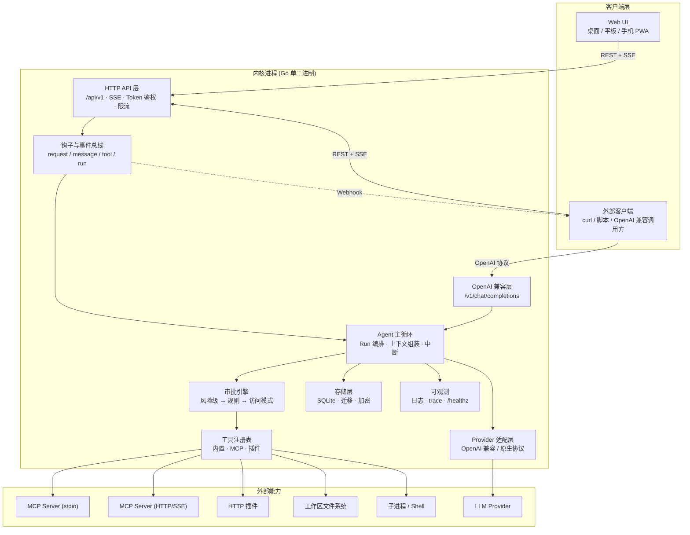
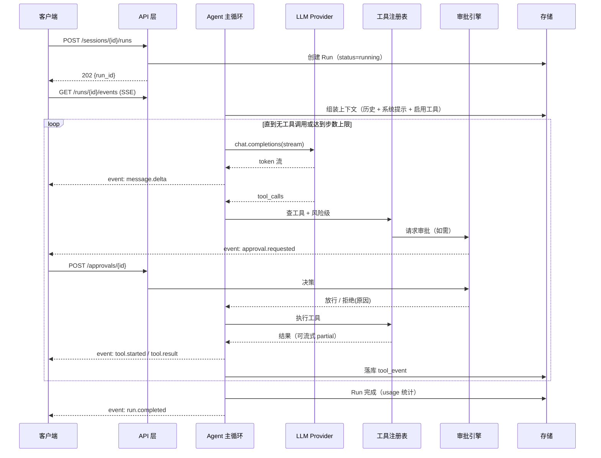

# harness_go — Web 版 AI Agent 工具 需求说明文档

| 项目 | 内容 |
| --- | --- |
| 项目名称 | harness_go（Web 版） |
| 参照产品 | harness_mini（桌面版，Tauri 2 + React + Rust） |
| 文档版本 | v0.4（范围扩展为覆盖桌面版全部功能，按 M1–M4 分期；新增 `基础服务设计.md`/`插件体系设计.md`/`MCP接入设计.md`；含 §3.1.1 选型论证、§7.5 精确 token 计数） |
| 日期 | 2026-09-13 |
| 文档状态 | 待评审 |
| 适用范围 | 全功能覆盖路线（M1 对话内核 → M2 工具与 MCP → M3 浏览器/子 Agent/多模型 → M4 快照回滚/长任务）；**临时空间功能已取消（2026-11）**；能力归属见 `基础服务设计.md`、`插件体系设计.md`、`MCP接入设计.md` |

---

## 1. 项目概述

### 1.1 背景

桌面版 `harness_mini` 已验证了「AI Agent 编码工具」的核心形态：会话绑定工作区，Agent 通过工具读写文件、执行命令、检索代码，配合审批与访问模式保证安全可控。

Web 版的目标不是把桌面窗口换成浏览器窗口，而是解决桌面版无法覆盖的三类诉求：

1. **免安装、跨设备**：换一台机器、用平板或手机，打开浏览器即可继续同一个会话。
2. **可被外部系统接入**：桌面版是封闭的本地应用；Web 版天然具备 HTTP 契约，可以被脚本、其他客户端、企业内部系统当作「Agent 服务」调用。
3. **能力可延展**：桌面版工具写死在 Rust 内核里，新增一个能力就要改内核重新发版；Web 版必须让「工具」成为可插拔的一等公民。

### 1.2 与桌面版（harness_mini）的关系与差异

| 维度 | 桌面版 harness_mini | Web 版 harness_go |
| --- | --- | --- |
| 运行环境 | Tauri 桌面进程（WebView2 + Rust） | 浏览器（UI） + 服务端进程（内核） |
| 通信方式 | Tauri IPC + 事件总线 | HTTP REST + SSE 流（可跨网络） |
| 文件/命令能力 | 直接操作本机文件系统与子进程 | 操作**服务端进程所在机器**的工作区，能力边界由部署形态决定（见 §3.2） |
| 数据存放 | 程序同级 `data\` + SQLite | 服务端数据目录 + SQLite（可切 Postgres），见 §7.1 |
| 工具来源 | 内核内置（Rust 静态注册） | 内置最小集 + **MCP Server** + **HTTP 插件**（动态注册） |
| 用户模型 | 单用户、无账号 | 单用户免登（本地/自托管）为 P0，多用户账号为 P2 预留 |
| UI 形态 | 固定三区布局、桌面优先 | 响应式：桌面三区 / 平板双栏 / 手机单栏（见 §6） |
| 离线能力 | 完全本地 | PWA 外壳 + 会话缓存（可读历史），推理必须联网 |
| 复用关系 | — | 复用其产品语义（会话/项目/审批/访问模式/计划/记忆）与前端组件思路，**后端按 Web 特性重写** |

> 明确结论：Web 版**不追求与桌面版功能 1:1 对齐**。桌面版的浏览器自动化、子 Agent 编排、临时空间、系统托盘等重能力不进一期；一期聚焦「稳定对话 + 可插拔工具 + 双端 UI」三件事。

### 1.3 核心设计原则

1. **稳定性是一票否决项**：对话链路（请求 → 流式 → 落库 → 渲染）任何环节不允许出现「静默失败」。断流可续、失败可重试、崩溃可恢复（§7.4）。
2. **内核与界面彻底分离**：Agent 运行时是独立进程、独立 API，浏览器只是它的第一个客户端。内核必须能在无 UI 情况下被 curl / 脚本驱动（这是「足量接入口」的前提）。
3. **一切工具皆插件**：内核只内置「最小必要工具集」，其余能力一律通过 MCP 或插件接入；新增能力不重新编译内核（§5）。
4. **契约先行、版本可控**：HTTP API、SSE 事件、工具 Schema 三者均为对外契约，从第一天起带版本号与兼容策略（`/api/v1`）。
5. **移动端不是缩小的桌面端**：布局、交互、性能按设备分别设计，而非同一套 DOM 靠 CSS 硬压（§6）。
6. **默认安全**：写入与命令默认需审批；路径限制在工作区内；API Token 分级授权（§7.6）。

### 1.4 名词约定

| 名词 | 含义 |
| --- | --- |
| 会话（Session） | 一次与 Agent 的完整对话上下文，可绑定一个工作区 |
| 运行（Run） | 一次用户触发到 Agent 停止的完整执行记录，含多次工具调用 |
| 内核（Core） | 服务端 Agent 运行时：LLM 调用循环 + 工具调度 + 持久化 |
| 客户端（Client） | 任何消费内核 API 的前端：本产品 Web UI、脚本、第三方客户端 |
| 工作区（Workspace） | 会话绑定的**服务端**目录，Agent 文件操作根目录 |
| 工具（Tool） | Agent 可调用的原子能力，统一 JSON Schema 描述 |
| 内置工具 | 编译进内核的最小工具集（文件/命令/搜索等） |
| MCP Server | 遵循 Model Context Protocol 的外部能力进程/服务 |
| 插件（Plugin） | 通过 HTTP manifest 声明的外部工具包（非 MCP 路线） |
| 接入口（Entrypoint） | 外部系统或扩展代码接入内核的标准通道（§4） |
| 访问模式 | 会话级安全策略：变更前确认 / 完全访问 |
| 事件（Event） | 内核向客户端推送的流式消息单元（token / 工具状态 / 错误等） |

---

## 2. 需求分析

### 2.1 用户与场景

| 用户角色 | 典型场景 |
| --- | --- |
| 开发者（个人自托管） | 在自己机器上跑一个 `harness-go` 单二进制，浏览器访问 `localhost:8787` 编码；手机上继续看进度、追加指令 |
| 团队（内网部署） | 部署在团队内网机器，多人在浏览器使用，工作区为共享代码库 |
| 外部系统集成方 | 用脚本/CI 调 HTTP API 让 Agent 执行任务；把 Web 版当作 OpenAI 兼容模型接入现有客户端 |

核心场景（一期必须跑通）：

1. **日常问答与讲解**：问代码含义、报错原因，多轮追问，历史可回溯。
2. **编码修改**：让 Agent 改文件、看 diff、拒绝不合意的改动。
3. **命令执行**：跑构建/测试/git，实时看输出，异常可终止。
4. **移动端跟进**：手机打开已安装的 PWA，查看正在运行的长任务、追加一条「引导」消息。
5. **外部接入**：一条 `curl` 创建会话并流式读取回答；或新增一个 MCP Server 后立即在对话里用上新工具。

### 2.2 三大方向的范围界定

#### 方向一：基础稳定的对话内核 + 足量接入口

**做什么（P0）**

- 多 Provider 接入：任意 OpenAI 兼容端点（自定义 Base URL / Key / 模型名），同一 Provider 可配多模型，顶栏切换。
- 流式对话：逐 token 渲染、随时停止、失败重试、编辑重发、多轮上下文、消息持久化。
- 会话管理：新建/自动标题/重命名/归档/删除、历史列表、重启后恢复、会话绑定工作区。
- 稳定性工程（详见 §7.4）：SSE 心跳与断线续传、请求幂等、超时与取消、并发上限与限流、优雅关闭、panic 恢复、结构化日志、`/healthz`、错误码规范、模型失败降级到备用 Provider。
- 接入口（详见 §4）：REST API + SSE、OpenAI 兼容端点、Webhook 事件订阅、API Token、Provider/工具/钩子/存储扩展点、反向代理 base path 支持。

**不做什么**：桌面版的浏览器自动化、子 Agent 编排、临时空间沙箱、协同编辑、多任务看板。

#### 方向二：其余工具通过插件或 MCP 实现

**做什么（P0/P1）**

- 统一的工具契约（§5.1）：名称、描述、JSON Schema、风险等级、超时、并发度、输出上限、是否流式。
- 内核只保留**最小内置工具集**（文件读/写/搜索、命令执行、todo、web 抓取），且可被配置禁用。
- MCP 客户端（P0）：支持 `stdio`、`HTTP+SSE`、`Streamable HTTP` 三种传输；服务器配置 CRUD、联通测试、工具清单预览、热重载、健康探测、命名空间隔离（`mcp__<server>__<tool>`）。
- HTTP 插件（P1）：外部服务提供 `/.well-known/harness-plugin.json` 声明工具清单，内核按需发现并注册；支持热加载与卸载。
- 工具注册表（P0）：动态注册/注销、来源标记、冲突检测、按会话/项目启用白名单。
- 权限与审批（P0）：风险分级 + 会话级规则记忆 + 访问模式；MCP/插件工具默认按「写入级」对待，需显式声明只读才自动放行。

**不做什么（一期）**：WASM 插件运行时（P2）、插件市场与在线分发（P2）、插件前端 UI 扩展点（P2）。

#### 方向三：页面支持移动端与桌面端

**做什么（P0）**

- 响应式布局矩阵（§6.1）：≥1024 桌面三区、640–1023 平板双栏（侧栏抽屉）、<640 手机单栏（会话列表与对话页互斥切换）。
- 移动端关键适配：`100dvh` 与安全区、软键盘弹起不遮挡输入框、触摸目标 ≥44px、抽屉手势、代码块横向滚动、长按复制、横屏适配、下拉刷新历史。
- 桌面端关键适配：三区固定布局、可拖拽侧栏宽度、快捷键（发送/停止/新会话/搜索）、右键菜单、多标签页会话（P1）。
- PWA（P1）：可安装到主屏、全屏运行、外壳缓存、离线可读历史会话、断线状态提示。
- 主题：深色（默认）/ 浅色 / 跟随系统，设计令牌统一。

### 2.3 功能需求清单

优先级：P0 = 一期必须；P1 = 一期尽量；P2 = 一期不做，仅预留。

| 编号 | 模块 | 功能 | 优先级 |
| --- | --- | --- | --- |
| F1.1 | 模型接入 | OpenAI 兼容 Provider（Base URL + Key + 模型名），SSE 流式解析 | P0 |
| F1.2 | 模型接入 | 多 Provider / 多模型配置与切换、连接测试 | P0 |
| F1.3 | 模型接入 | 备用 Provider 降级（主模型 5xx/超时自动切换并提示） | P1 |
| F1.4 | 模型接入 | 非 OpenAI 协议适配器（Anthropic / Gemini 原生） | P1 |
| F2.1 | 会话 | 新建、自动标题、重命名、归档、删除、恢复 | P0 |
| F2.2 | 会话 | 历史列表（按最后活动时间倒序）、搜索、分页 | P0 |
| F2.3 | 会话 | 会话绑定工作区；已保存会话工作区只读 | P0 |
| F2.4 | 会话 | 临时对话（首条消息才落库） | P1 |
| F2.5 | 会话 | 项目分组视图（工作区即项目，自动归入） | P1 |
| F2.6 | 会话 | 会话导出（Markdown / JSON） | P1 |
| F3.1 | 对话 | 流式输出、随时停止、失败重试 | P0 |
| F3.2 | 对话 | Markdown 渲染、代码高亮、一键复制、表格/列表 | P0 |
| F3.3 | 对话 | 多轮上下文、消息落库、刷新/重启不丢 | P0 |
| F3.4 | 对话 | 编辑最后一条用户消息并重发（作废其后消息） | P0 |
| F3.5 | 对话 | 运行中补充输入：待执行列表 + 「引导」立即介入 + 删除 | P1 |
| F3.6 | 对话 | 工具调用卡片（参数、状态、结果、diff、耗时） | P0 |
| F3.7 | 对话 | 图片等多模态输入 | P2 |
| F4.1 | 工具 | 工具统一契约与注册表（动态注册/注销/来源标记） | P0 |
| F4.2 | 工具 | 内置最小集：read_file / list_dir / write_file / edit_file / glob / grep / run_command | P0 |
| F4.3 | 工具 | 内置扩展：fetch_web_page、todo | P1 |
| F4.4 | MCP | MCP 客户端（stdio / HTTP+SSE / Streamable HTTP） | P0 |
| F4.5 | MCP | Server 配置 CRUD、联通测试、工具清单预览、启停、热重载 | P0 |
| F4.6 | MCP | 命名空间隔离、工具冲突检测、健康探测与失败隔离 | P1 |
| F4.7 | 插件 | HTTP 插件协议（manifest 发现 + invoke） | P1 |
| F4.8 | 插件 | 插件管理页（安装/卸载/启用/查看工具） | P1 |
| F4.9 | 插件 | WASM 插件运行时 | P2 |
| F5.1 | 审批 | 风险分级（只读/写入/命令/高危），只读自动放行 | P0 |
| F5.2 | 审批 | 允许一次 / 本会话允许 / 拒绝并说明原因（原因回传 Agent） | P0 |
| F5.3 | 审批 | 会话级规则记忆，可查看与删除 | P1 |
| F5.4 | 审批 | 会话级访问模式切换（变更前确认 / 完全访问），即时生效 | P0 |
| F5.5 | 审批 | 高危命令强制逐次确认，不可永久放行 | P0 |
| F6.1 | 上下文 | 历史消息组装、**精确 token 计数**（tokenizer 注册表 + usage 校准）与用量明细显示 | P0 |
| F6.2 | 上下文 | 超长上下文截断 / 摘要压缩 | P1 |
| F6.3 | 上下文 | 项目约束（Markdown）自动注入系统提示词 | P2 |
| F6.4 | 上下文 | Tokenizer 注册表：tiktoken / HF tokenizer.json / Provider count API / 启发式兜底，按模型名路由 | P0 |
| F6.5 | 上下文 | token 明细：system / 历史 / 工具 schema / 当前输入 四段拆分展示 | P1 |
| F7.1 | UI | 响应式布局：桌面三区 / 平板双栏 / 手机单栏 | P0 |
| F7.2 | UI | 深色/浅色/跟随系统主题 | P0 |
| F7.3 | UI | 设置面板（模型 / 审批 / 数据与存储 / 关于） | P0 |
| F7.4 | UI | 移动端软键盘与安全区适配、抽屉交互 | P0 |
| F7.5 | UI | PWA 安装、离线壳、断线提示 | P1 |
| F7.6 | UI | 桌面快捷键、侧栏拖拽、会话多标签 | P1 |
| F8.1 | 存储 | 会话/消息/工具事件/运行/配置持久化（SQLite） | P0 |
| F8.2 | 存储 | 存储驱动可切换（SQLite / Postgres） | P2 |
| F8.3 | 存储 | API Key 加密存储（主密钥来自环境变量或密钥文件） | P0 |
| F9.1 | 接入 | REST API + SSE 全量契约，带版本号 | P0 |
| F9.2 | 接入 | OpenAI 兼容端点（`/v1/chat/completions`、`/v1/models`） | P1 |
| F9.3 | 接入 | API Token 管理与分级授权（只读 / 可写 / 全权） | P0 |
| F9.4 | 接入 | Webhook 事件订阅（会话完成、工具审批请求、运行失败） | P1 |
| F9.5 | 接入 | CLI 客户端（脚本化调用） | P2 |
| F10.1 | 运维 | 健康检查、结构化日志、请求 trace id、基础指标 | P0 |
| F10.2 | 运维 | 单二进制部署 + Docker 镜像 + 反向代理 base path | P0 |
| F10.3 | 运维 | 多用户账号与权限 | P2 |

### 2.4 非功能需求

| 类别 | 要求 |
| --- | --- |
| 稳定性 | 内核 7×24 长跑不泄漏；单会话流式失败率 < 1%；断线 30s 内可自动续传；进程异常退出后重启，会话与未完成 Run 状态一致（标记为中断并可继续） |
| 性能 | 首屏可交互 ≤ 1.5s（桌面宽带）/ ≤ 2.5s（4G）；流式首 token 渲染延迟仅受模型限制，前端不做整段等待；单机支持 ≥ 50 并发流式连接；长会话（500+ 消息）列表滚动 60fps |
| 内存 | 内核空载 ≤ 120MB；50 并发流式会话 ≤ 400MB；消息列表前端虚拟化，内存不随历史线性增长 |
| 兼容性 | Chrome/Edge/Safari/Firefox 最近两个大版本；iOS Safari 16+、Android Chrome 100+；断点 360px–2560px 全区间不出现横向溢出 |
| token 计数 | 已发生的输入/输出用量与 Provider `usage` 完全一致（零偏差）；事前预算与真实值偏差：有同源 tokenizer 的模型 < 2%，无同源 tokenizer 的模型经校准后 < 5% 且必须标注 `≈` |
| 安全 | 文件工具路径限制在工作区内（含符号链接逃逸校验）；写入/命令默认审批；API Token 哈希存储、支持吊销；MCP/插件工具默认按写入级审批；日志不打印 API Key 与完整 prompt |
| 可观测 | 每次请求有 trace id；关键链路（LLM 请求、工具执行、审批等待）有耗时与结果日志；提供 `/healthz`、`/readyz` |
| 可移植 | 单二进制（Go）覆盖 Windows / Linux / macOS；Docker 镜像 ≤ 60MB（不含模型） |
| 隐私 | 数据仅存服务端数据目录；出网仅限用户配置的 LLM 端点与显式启用的插件/MCP |

### 2.5 分期边界（防范围蔓延）

**能力目标已扩展为"覆盖桌面版全部功能"**（45 个 Agent 工具 + 18 个功能域），按 M1–M4 分期落地，逐项归属见 `docs/基础服务设计.md` §3 覆盖矩阵：

| 阶段 | 范围 |
| --- | --- |
| M1 | 对话内核：会话/消息、Run、模型、上下文与 token、审批、存储、事件、SSE |
| M2 | 工具与 MCP：fs / command / web-fetch / todo / plan / decision + MCP 三传输 |
| M3 | 浏览器自动化、子 Agent 与协作器、技能/记忆/成长、图片与多模态能力模型 |
| M4 | 快照回滚与重放、长任务检查点、会话打包、SOP（**临时空间已取消**） |

**仍然不做（无对应价值或超出产品定位）**：云端账号与多租户计费、插件市场与在线分发、插件前端 UI 扩展、WASM 插件运行时（预留）、语音输入、多人协作编辑、IDE 插件、离线推理。

---

## 3. 总体技术方案

### 3.1 技术选型

| 层 | 选型 | 理由 |
| --- | --- | --- |
| 内核 | **Go 1.22+** | 单二进制部署、内存占用低、goroutine 天然适配 SSE 长连接与高并发、交叉编译简单；与工作区名 `harness_go` 一致 |
| HTTP 框架 | **标准库 `net/http.ServeMux`（Go 1.22+ 增强路由）** | 零路由依赖；Go 1.22 起原生支持 `GET /path/{id}` 与 `PathValue`，覆盖全部路由需求；中间件即 `func(http.Handler) http.Handler`。详见架构文档 §4.3 |
| 存储 | SQLite（`modernc.org/sqlite`，纯 Go 无 CGO）+ 迁移脚本 | 免 CGO 便于交叉编译；后续可切 Postgres（P2） |
| 前端 | **React 18 + TypeScript + Vite** | 与桌面版一致，组件思路可直接迁移 |
| 状态管理 | Zustand | 与桌面版一致，轻量 |
| 样式 | Tailwind CSS + CSS 变量设计令牌 | 响应式与主题切换成本最低 |
| 渲染 | react-markdown + remark-gfm + rehype-highlight + mermaid | 与桌面版一致 |
| PWA | `vite-plugin-pwa` | 安装、离线壳、更新提示 |
| 协议 | HTTP/1.1 + SSE（P1 可选 WebSocket 通道） | SSE 穿透代理友好、天然断线续传（`Last-Event-ID`） |
| 分词计数 | `github.com/pkoukk/tiktoken-go`（OpenAI 系）+ `github.com/sugarme/tokenizer`（HF `tokenizer.json`） | **均为纯 Go，不引入 CGO**，保持一条命令交叉编译与单二进制 |

#### 3.1.1 选型论证（结论与前提）

**结论：Go + React 为推荐方案，但结论依赖一个前提——「本地单机 + 单二进制免安装分发」是一等公民（§3.2 形态 A）。若该前提被取消（仅以 Docker 分发），应重新评估为 TypeScript 全栈。**

业内语言分布（同类工具参照）：

| 形态 | 代表 | 内核语言 | 规律 |
| --- | --- | --- | --- |
| IDE 插件 | Cline / Roo Code / Continue | TypeScript | 被宿主生态锁定 |
| 自托管平台 | OpenHands / Dify / Langflow / Open WebUI | Python + React/Svelte/Next | AI 生态优先，Docker 分发 |
| Web 全栈 | Lobe Chat / Bolt.diy | TypeScript | 前后端同语言、迭代最快 |
| CLI / TUI Agent | **Crush（Charm）** / Claude Code | **Go** / TS | 单二进制、跨平台、低内存 |
| 本地运行时 | **Ollama / LocalAI / dify-sandbox** | **Go** | 单文件分发 + 强并发 |
| 桌面 Agent | Goose / Zed | Rust + Electron | 性能与系统集成 |

加权对比（权重按本产品三大方向设定：分发运维 18%、稳定性并发 18%、工具/子进程 15%、开发效率 15%、生态 14%、内存体积 10%、长期维护 10%）：

| 方案 | 加权得分 | 关键优势 | 关键短板 |
| --- | --- | --- | --- |
| **Go + React** | **4.46** | 单二进制、低内存、goroutine/连接、进程组管理 | AI 生态需自建薄层、编译型迭代稍慢 |
| TS 全栈（Hono/Fastify + React） | 4.16 | MCP/LLM SDK 最成熟、前后端同语言、迭代最快 | 单二进制分发不稳（Bun compile）、内存高 |
| Rust + axum + React | 4.13 | 二进制最小、内存最低、可复用桌面版工具实现 | 开发效率低、编译慢；复用需重写 Tauri IPC 层 |
| Python（FastAPI）+ React | 3.54 | AI 生态最强（LiteLLM/tiktoken/向量库） | 分发重（需运行时或大体积打包）、并发易踩阻塞坑 |

**Go 最优的核心论证**：方向二（工具插件化 + MCP）已在架构上把「AI 生态」从内核剥离——需要复杂 AI 能力（向量检索、多模态、文档解析、本地模型）时，用 Python/TS 写成 MCP Server 或 HTTP 插件接入；内核只需承担 HTTP/SSE 收发、JSON-RPC 子进程管理、文件与命令执行、SQLite 持久化四件事，而这恰是 Go 的标准库强项。**生态短板被架构解耦消解后，内核语言的选择只需看工程属性（分发、并发、内存、故障隔离）。**

**已知代价与对策**：LLM 流式客户端需自写（约 200–300 行，换取不依赖第三方 SDK 版本变动）；token 计数依赖纯 Go 库（见 §7.5）；编译等待用 `air` + Vite HMR 抵消；无 SSR 对本产品无影响（工具型应用，无需 SEO，CSR + PWA 更契合单二进制）。

**改变选型的决策条件**：① 放弃单二进制、仅 Docker 分发 → 改 TS 全栈；② 团队无 Go 经验 → 改 TS 全栈（熟练度权重高于架构理想）；③ 以「最大化复用桌面版内核」为首要目标 → 评估 Rust + axum，但需先确认 `agent.rs`/`commands.rs` 与 Tauri 的耦合度（`#[tauri::command]`、事件 emit、State 管理需整体重写，可复用部分主要是 `tools/file.rs`、`search.rs`、`llm.rs`、`store.rs`）。

### 3.2 部署形态

内核能力（尤其文件与命令）的边界完全由部署形态决定，必须在一期就定义清楚：

| 形态 | 场景 | 文件/命令能力 | 一期 |
| --- | --- | --- | --- |
| A. 本地单机 | 用户在自己机器运行 `harness-go`，浏览器访问 `127.0.0.1:8787` | 完整（可操作本机工作区） | **P0 主形态** |
| B. 内网自托管 | 部署在团队服务器，多人浏览器访问 | 完整（操作服务器上的工作区目录） | P0 支持（单用户鉴权，多用户 P2） |
| C. 公网云托管 | 托管给第三方用户 | 受限：默认禁用命令执行，文件仅限沙箱目录 | P1 兼容（能力开关） |

设计约束：内核启动时通过配置声明 `deployment.mode`（`local` / `server` / `cloud`），据此决定默认启用哪些内置工具、是否允许 `stdio` 型 MCP（云托管下禁止起子进程）。

### 3.3 系统架构



分层职责（与桌面版「核心与界面分离」原则一致）：

- **API 层**：只做协议转换（HTTP ⇄ 内部事件）、鉴权、限流、参数校验，不含业务逻辑。
- **Agent 主循环**：唯一持有 Run 状态的地方；LLM 调用与工具执行在此串行编排，事件向外发。
- **工具注册表**：所有工具来源的统一入口，内置与外部工具在注册表内完全同构。
- **审批引擎**：工具执行前的唯一闸门，UI 与 API 都不得绕过。

### 3.4 目录结构（规划）

```
harness_go/
  cmd/harness-go/main.go        # 入口：配置加载、服务启动、优雅关闭
  internal/
    api/            # HTTP 路由、SSE 编码、中间件（鉴权/限流/trace）
    openai/         # OpenAI 兼容端点适配
    agent/          # Run 主循环、上下文组装、中断与重试
    llm/            # Provider 适配器（openai-compatible / anthropic / gemini）
    tools/          # 工具契约、注册表、内置工具实现
    mcp/            # MCP 客户端（stdio / sse / streamable http）、生命周期
    plugin/         # HTTP 插件发现与调用
    approval/       # 风险分级与审批决策
    store/          # SQLite 存储、迁移、加密
    events/         # 事件定义与总线、Webhook 分发
    config/         # 配置与默认值
  web/                          # 前端（React + Vite + Tailwind）
    src/components/ src/pages/ src/stores/ src/lib/
  docs/                         # 需求与设计文档（本文件）
  data/                         # 运行时数据（会话库、密钥、工作区索引）
```

---

## 4. 接入口设计（方向一核心）

「足量接入口」定义为 **9 个稳定通道**，一期至少交付 1–7。

### 4.1 接入口全景

| # | 接入口 | 用途 | 一期 |
| --- | --- | --- | --- |
| 1 | REST API `/api/v1` | 会话/消息/工具/配置的完整程序化操作 | P0 |
| 2 | SSE 流 `/api/v1/runs/{id}/events` | 流式消费 token、工具状态、审批请求 | P0 |
| 3 | API Token 分级鉴权 | 外部系统接入的凭证与权限边界 | P0 |
| 4 | OpenAI 兼容端点 | 现有 AI 客户端/工具链零改造接入 | P1 |
| 5 | Webhook 订阅 | 被动事件通知（完成、失败、待审批） | P1 |
| 6 | Provider 适配器接口 | 新增模型厂商只写一个适配器 | P0（接口）/P1（第二种协议） |
| 7 | 工具接入口（MCP/插件） | 新增能力不重编内核 | P0 |
| 8 | 钩子（Hook）机制 | 在请求/消息/工具/运行前后插入自定义逻辑 | P1 |
| 9 | 存储驱动接口 | SQLite → Postgres 等切换 | P2 |

### 4.2 REST API + SSE（契约草案）

| 方法 | 路径 | 说明 |
| --- | --- | --- |
| GET | `/api/v1/health` `/api/v1/ready` | 存活 / 就绪 |
| GET/POST | `/api/v1/sessions` | 列表（分页/搜索）/ 创建 |
| GET/PATCH/DELETE | `/api/v1/sessions/{id}` | 详情 / 重命名归档 / 删除 |
| GET | `/api/v1/sessions/{id}/messages` | 消息历史（游标分页） |
| POST | `/api/v1/sessions/{id}/runs` | 发起一次运行（发送用户消息） |
| GET | `/api/v1/runs/{id}/events` | **SSE 订阅运行事件**（支持 `Last-Event-ID` 续传） |
| POST | `/api/v1/runs/{id}/stop` | 停止运行 |
| POST | `/api/v1/runs/{id}/guidance` | 运行中引导消息 |
| POST | `/api/v1/approvals/{id}` | 审批决策（allow_once / allow_session / deny） |
| GET/PUT | `/api/v1/settings` | 运行参数、访问模式默认值 |
| GET/POST/PUT/DELETE | `/api/v1/providers` | 模型厂商与模型配置 |
| GET/POST/PUT/DELETE | `/api/v1/mcp/servers` | MCP 服务器管理 |
| POST | `/api/v1/mcp/servers/{id}/test` | 联通测试并返回工具清单 |
| GET | `/api/v1/tools` | 当前注册工具清单（含来源与风险级） |
| GET/POST/DELETE | `/api/v1/tokens` | API Token 管理 |

约定：统一响应包裹 `{ "data": ..., "error": null }`；错误体 `{ "code": "RUN_TIMEOUT", "message": "...", "trace_id": "..." }`；所有写操作支持 `Idempotency-Key`。

### 4.3 OpenAI 兼容端点（P1）

暴露 `/v1/models` 与 `/v1/chat/completions`（支持 `stream: true`），使 Cherry Studio、Open WebUI、各类 SDK 可直接把本产品当作「一个模型」使用，内部映射到一个隐藏会话。价值：零成本获得大量现成客户端与工具链接入能力。

### 4.4 Webhook 事件订阅（P1）

配置 `url` + `secret`（HMAC 签名）+ 事件白名单。一期事件：`run.completed`、`run.failed`、`run.interrupted`、`approval.requested`、`tool.failed`。失败重试 3 次（指数退避），超时 5s，不阻塞主链路。

### 4.5 前端嵌入接入口（P1）

- 路由支持 `base path`（部署在 `/agent/` 子路径下可用）。
- 主题令牌以 CSS 变量暴露，宿主可覆写。
- 单页嵌入：通过 iframe 传入 `?session=<id>&embed=1` 隐藏外层导航。

### 4.6 内核扩展点

| 扩展点 | 契约 | 一期 |
| --- | --- | --- |
| Provider | 实现 `Chat(ctx, req) (<-chan Chunk, error)` 接口 + 能力声明（是否支持工具调用/流式/多模态） | P0 |
| 工具 | `Tool` 接口 + JSON Schema 描述（§5.1） | P0 |
| 钩子 | `OnRequest` / `OnMessage` / `BeforeTool` / `AfterTool` / `OnRunEnd`，可返回改写或阻断 | P1 |
| 存储 | `Store` 接口（会话/消息/事件/配置），默认 SQLite 实现 | P2 |

---

## 5. 工具插件化与 MCP（方向二）

### 5.1 工具统一契约

所有工具（内置 / MCP / 插件）在注册表内同构，字段：

```jsonc
{
  "name": "read_file",              // 全局唯一，外部工具加命名空间前缀
  "namespace": "builtin",           // builtin | mcp:<server> | plugin:<name>
  "description": "读取文件内容",      // 给模型看的描述，进 system 上下文
  "input_schema": { "type": "object", "properties": { }, "required": [] },
  "risk": "readonly",               // readonly | write | command | danger
  "timeout_ms": 120000,
  "concurrency": "serial",          // serial | parallel
  "max_output_bytes": 32768,        // 超出截断（全文仍入库）
  "streaming": false,               // 是否支持 partial 输出
  "enabled_by_default": true
}
```

约定：**能力由工具描述声明，风险由工具描述声明，但最终是否放行由审批引擎裁决**（外部工具的自述风险只允许「更高」不能被自行降级）。

### 5.2 内置最小工具集（P0）

| 工具 | 风险 | 说明 |
| --- | --- | --- |
| `read_file` / `list_dir` / `file_outline` | readonly | 带行号读取、目录列举、结构大纲 |
| `glob` / `grep` | readonly | 文件名与内容检索，结果上限控制 |
| `write_file` / `edit_file` | write | 返回 diff 供 UI 展示 |
| `run_command` | command / danger | 工作区 cwd、超时、可终止、输出流式回传 |
| `fetch_web_page` | readonly | 抓取网页转纯文本（P1） |
| `todo` | readonly | 任务清单（P1） |

原则：内置工具保持「最小可用」，任何带强平台依赖的能力（浏览器、图像、知识库）走 MCP/插件。

### 5.3 MCP 接入（P0）

| 项 | 要求 |
| --- | --- |
| 传输 | `stdio`（本地子进程）、`HTTP+SSE`、`Streamable HTTP` |
| 配置 | `id / name / transport / command+args+env 或 url+headers / enabled` |
| 生命周期 | 启动即加载已启用 Server；支持启动/停止/热重载；单个 Server 崩溃不影响其它工具与会话 |
| 工具映射 | `mcp__<server>__<tool>`，description 前缀带 server 名避免歧义 |
| 发现 | 连接后 `tools/list` 拉取并注册；支持 `tools/list_changed` 通知刷新 |
| 测试 | 配置页一键联通测试，返回工具清单与耗时，失败给出可读原因 |
| 安全 | `stdio` 型仅在 `local` / `server` 部署形态允许；`env` 中的密钥加密存储、日志脱敏 |
| 失败隔离 | 单工具调用超时/报错返回结构化错误给模型（可自我纠正），不中断 Run |

### 5.4 HTTP 插件接入（P1）

插件 = 一个 HTTP 服务，提供 `GET /.well-known/harness-plugin.json`：

```jsonc
{
  "name": "my-plugin",
  "version": "1.0.0",
  "tools": [
    { "name": "query_db", "description": "...", "input_schema": {}, "risk": "readonly",
      "invoke": { "method": "POST", "path": "/invoke/query_db" } }
  ]
}
```

内核负责发现、注册、调用（带 `X-Harness-Trace` 与超时）、结果归一化。插件与 MCP 的差异：插件是「纯 HTTP 无状态」，适合企业内已有服务快速暴露能力；MCP 是「标准协议」，生态兼容性更好。

### 5.5 注册表与生命周期

- 注册：`Register(tool)` → 冲突检测（同名拒绝，除内置优先覆盖需显式声明）。
- 查询：按会话/项目启用白名单过滤后注入模型上下文（**只注入启用工具，控制 token 消耗**）。
- 注销：Server 停止或插件卸载时原子移除，正在执行的调用允许完成。
- 观测：每次调用记录来源、耗时、结果大小、是否被审批拦截。

### 5.6 权限与审批

| 风险级 | 默认策略 |
| --- | --- |
| readonly | 自动放行（可在设置中改为逐次确认） |
| write | 需审批（变更前确认模式下） |
| command | 需审批 |
| danger | 强制逐次确认，不可永久放行 |

审批选项：**允许一次 / 本会话允许（生成规则）/ 拒绝并填写原因（原因回传模型）**。规则与会话绑定，可查看与删除。访问模式（变更前确认 / 完全访问）为会话级，切换即时生效，新会话继承上一条。

---

## 6. 双端 UI 设计（方向三）

### 6.1 断点与布局矩阵

| 断点 | 布局 | 侧栏 | 输入区 | 主要交互 |
| --- | --- | --- | --- | --- |
| `< 640px` 手机 | 单栏 | 抽屉（左滑/按钮唤出，覆盖式） | 底部固定，安全区内边距 | 会话列表 ⇄ 对话页互斥切换；底部工具栏收起次要操作 |
| `640–1023px` 平板 | 双栏 | 抽屉或折叠图标栏 | 底部固定 | 可同时看到会话列表与对话 |
| `≥ 1024px` 桌面 | 三区（侧栏 / 对话 / 输入） | 常驻，宽度可拖拽 | 对话区底部 | 快捷键、右键菜单、悬浮工具条 |
| `≥ 1600px` 宽屏 | 三区 + 右侧详情栏（工具详情/diff） | 常驻 | 同上 | 变更对比并排展示 |

### 6.2 移动端要点

1. **视口**：`height: 100dvh` 处理移动浏览器地址栏收缩；`env(safe-area-inset-*)` 处理刘海与手势条。
2. **软键盘**：聚焦输入框时使用 `visualViewport` 修正可视高度，输入框与最新消息保持可见，禁止整页跳动。
3. **触摸目标** ≥ 44×44px；按钮间距 ≥ 8px；避免依赖 hover 的操作（悬停操作改为长按菜单）。
4. **代码块**：横向滚动不撑破布局，附「复制」按钮；表格超宽时横向滚动。
5. **消息流**：上滑加载更早消息（游标分页），自动贴底滚动仅在用户位于底部时生效（避免打断阅读）。
6. **抽屉**：左边缘滑动唤出会话列表；返回键优先关闭抽屉/弹窗。
7. **性能**：虚拟列表；流式渲染按 ~50ms 批量合并刷新；长会话不一次性挂载全部消息。
8. **PWA**：`manifest` + 应用图标 + 独立窗口；离线壳展示历史会话（只读）与「当前离线」提示。

### 6.3 桌面端要点

- 三区常驻、侧栏宽度可拖拽并记忆；对话区最大宽度限制（可读性）。
- 快捷键：`Enter` 发送 / `Shift+Enter` 换行 / `Esc` 停止 / `Ctrl(Cmd)+N` 新会话 / `Ctrl+K` 会话搜索 / `Ctrl+,` 设置。
- 工具卡片可展开查看完整参数与结果，diff 支持「统一视图 / 并排对比」。
- 右键菜单：消息（复制/引用/编辑重发）、会话（重命名/归档/导出）。
- 多标签会话（P1）：同时打开多个会话，切换不打断后台运行。

### 6.4 主题与设计令牌

深色为默认，浅色与「跟随系统」可选。令牌集中定义（背景/面板/边框/文本三级/强调色/成功警告错误/代码块/圆角/间距/阴影），双端与双主题共用一套变量，避免样式分叉。

### 6.5 前端稳定性

- 流式渲染异常（组件抛错）局部降级：单条消息渲染失败显示「原文 + 重试」，不白屏（参照桌面版 React Hook 崩溃治理经验）。
- SSE 断线自动重连（指数退避 1s→2s→4s→…上限 30s），重连后按 `Last-Event-ID` 补齐缺失事件。
- 乐观更新 + 服务端确认：用户消息立即上屏，落库失败给出可重试提示。

---

## 7. 核心机制设计

### 7.1 数据模型（SQLite 草案）

```sql
sessions(id, title, workspace_path, project_id, access_mode, model_ref,
         status, created_at, updated_at, archived_at)
messages(id, session_id, role, content, content_type, token_count,
         run_id, seq, created_at, deleted_at)
tool_events(id, session_id, run_id, message_id, tool_name, namespace,
            args_json, result_json, status, risk, approved_by,
            started_at, ended_at, error)
runs(id, session_id, trigger_type, status, stop_reason,
     model_ref, input_tokens, output_tokens, started_at, ended_at)
approvals(id, run_id, tool_event_id, request_json, decision,
          reason, decided_at)
providers(id, name, base_url, api_key_enc, models_json, enabled, created_at)
mcp_servers(id, name, transport, command, args_json, env_enc, url,
            headers_enc, enabled, last_status, created_at)
plugins(id, name, endpoint, manifest_json, enabled, created_at)
api_tokens(id, name, token_hash, scope, last_used_at, created_at, revoked_at)
settings(key, value_json, updated_at)
```

要点：`runs` 独立成表（为后续定时任务、多任务协调预留）；`tool_events` 记录完整参数与结果（审计与回放）；消息用 `seq` 保证顺序与幂等；软删除（`deleted_at`）支持撤销与导出。

### 7.2 对话主循环（Run）



关键约束：

- **步数上限**：单 Run 工具调用轮次上限（默认 30，可配），防死循环。
- **中断**：`context.CancelFunc` 贯穿 LLM 请求与工具执行；`run_command` 额外 kill 进程树。
- **运行中引导**：引导消息在轮次边界注入（不打断正在生成的 token），未引导消息在当前 Run 结束后依次执行。
- **幂等**：同一 `Idempotency-Key` 的 `POST /runs` 不重复创建。

### 7.3 SSE 事件协议

```
event: message.delta      data: {"seq":12,"text":"..."}
event: reasoning.delta    data: {"text":"..."}          // 思考模型
event: tool.started       data: {"tool":"read_file","args":{...},"risk":"readonly"}
event: tool.partial       data: {"text":"..."}          // 命令输出实时回显
event: tool.result        data: {"status":"ok","preview":"...","bytes":1234}
event: approval.requested data: {"id":"...","tool":"write_file","risk":"write"}
event: run.completed      data: {"usage":{"in":123,"out":456}}
event: run.failed         data: {"code":"LLM_TIMEOUT","message":"..."}
event: heartbeat          data: {"ts":1700000000}       // 15s 一次
```

每个事件带 `id`（递增 seq）用于 `Last-Event-ID` 续传；服务端保留最近 N 个事件（默认 500）在内存 + 落库关键事件，重连续传从库/缓冲补齐。

### 7.4 稳定性工程（一票否决项的具体落地）

| 风险 | 对策 |
| --- | --- |
| SSE 断流 | 15s 心跳；客户端指数退避重连；`Last-Event-ID` 续传；续传失败降级为「拉取完整消息 + 继续订阅」 |
| LLM 超时/5xx | 连接超时 10s、首 token 超时 60s、总超时 300s；自动重试 1 次（幂等请求），失败可切备用 Provider |
| 工具卡死 | 每工具独立超时（默认 120s）；命令执行 kill 进程树；并发工具数上限 |
| 进程崩溃 | Run 状态机持久化；重启时将 `running` 标记为 `interrupted`，前端提示「可继续/重试」 |
| 并发过载 | 全局与单 Token 限流；超出返回 429 + `Retry-After` |
| panic | 每个 Run、每个工具调用、每个 HTTP handler 独立 recover，转结构化错误事件，不拖垮进程 |
| 优雅关闭 | 收到 SIGTERM 停止接收新 Run，等待进行中 Run ≤ 30s，落库后退出 |
| 存储异常 | 写入失败重试；库损坏时启动自检并提示备份路径 |
| 不可观测 | 全链路 trace id（`X-Harness-Trace`）；`/healthz` 检查进程与库；`/readyz` 检查 Provider 可达性 |

### 7.5 上下文与 token 管理（精确计数）

- 组装顺序：系统提示（产品约束 + 工具说明） → 历史消息（近 N 轮完整 + 更早摘要） → 当前用户输入。
- 超限策略：优先裁剪工具结果（保留摘要 + 落库全文），再摘要历史（P1），最后才拒绝请求并提示。
- 工具结果上限 32KB 注入模型，完整内容存库供 UI 查看。

#### 7.5.1 精确 token 计数的三层模型

「精确」分三层，缺一层就会与账单产生 5–15% 偏差，必须组合实现：

| 层 | 目标 | 实现 |
| --- | --- | --- |
| ① 文本 token | 单段文本的 token 数 | 本地 tokenizer，与模型同源 |
| ② 请求结构开销 | role 包裹、消息分隔、`tools` JSON Schema 占用 | 按模型 chat 模板加固定开销（OpenAI 系每条消息 +3、末尾 +3；`tools` 全额计入） |
| ③ 事后真实用量 | 账单级 `prompt_tokens` / `completion_tokens` | 响应 `usage`（流式需 `stream_options: {"include_usage": true}`）回填 |

计数入口统一为 `CountChatRequest(model, system, messages, tools) → {prompt_tokens, breakdown}`，`breakdown` 返回 **system / history / tools / 当前输入** 四段明细（F6.5）。

#### 7.5.2 Tokenizer 注册表（`internal/tokenizer`）

按模型名路由到具体实现，配置驱动、可扩展：

| 实现 | 覆盖模型 | 依赖 | 精度 |
| --- | --- | --- | --- |
| `tiktoken` | GPT-4o/4.1/o 系列（`o200k_base`）、GPT-3.5/4（`cl100k_base`） | `github.com/pkoukk/tiktoken-go`（纯 Go） | 与 OpenAI 官方一致 |
| `hf` | Qwen / DeepSeek / Llama / GLM / Kimi（提供 `tokenizer.json` 者） | `github.com/sugarme/tokenizer`（纯 Go，BPE/WordPiece/Unigram） | 与模型同源，精确 |
| `provider_api` | Claude（`/v1/messages/count_tokens`）、Gemini（`models.countTokens`） | HTTP 调用（官方免费接口） | 官方权威 |
| `heuristic` | 自建/未知模型 | 字符系数（中英混合按 1 token ≈ 1.6 字符校准） | 估算，UI 必须标注 `≈` |

约束：**只选纯 Go 实现**（`daulet/tokenizers` 等 Rust binding 需 CGO，破坏单二进制交叉编译，不采用）。

#### 7.5.3 精度边界与诚实展示

| 项 | 能否精确 | 处理 |
| --- | --- | --- |
| 文本 token（同源 tokenizer 存在） | 精确 | 直接展示 |
| OpenAI 系 chat 结构开销 | 精确（模板固定） | 计入 prompt 预算 |
| Claude / Gemini | 精确（官方 count API） | 调用计数接口 |
| 未知/自建模型模板开销 | 不可精确 | 标注 `≈`，靠 §7.5.4 偏差系数收敛 |
| 多模态图片折算 | 不可精确 | 按官方公式估算并标注 `≈` |
| 已发生的输入/输出用量 | 精确（来自 `usage`） | 以 usage 覆盖本地值 |

UI 铁律：**已发生用量显示精确值，未发生预算显示 `≈` 估算值**，两者视觉上必须可区分。

#### 7.5.4 校准与性能

- **偏差校准**：每次 Run 记录 `actual / estimated`，按模型维护滚动系数，自动修正后续预算；即使某模型 tokenizer 缺失，误差也会快速收敛到 < 2%。
- **消息级缓存**：token 数随消息落库（`messages.token_count`），仅在消息内容变更时重算，请求时只做加法，避免每轮重算全量历史。
- **大文本**：增量编码 + 按内容 hash 做 LRU 缓存；> 1MB 内容走采样估算并标注。
- **流式输出**：增量累加编码估算，`run.completed` 时以 `usage` 覆盖为精确值。
- **打包策略**：`o200k_base`（约 4MB）、`cl100k_base`（约 1.7MB）随二进制 `embed` 内置；其余 `tokenizer.json` 放 `data/tokenizers/`，首次联网按需下载、离线可用，失败降级 `heuristic` 并提示。

#### 7.5.5 与桌面版实现的差异（移植清单 + 必须修正项）

桌面版（harness_mini）的 token 机制为「纯启发式估算 + 真实 usage 回填」两层，无 tokenizer：`estimate_tokens(s) = CJK×0.7 + ASCII/4`（`models.rs:1448`），`parse_llm_usage` 做多厂商 usage 归一化。web 版在此基础上补齐第①层。

**直接移植（成熟且验证过）**

| 项 | 桌面版位置 | 说明 |
| --- | --- | --- |
| 多厂商 usage 字段归一 | `models.rs:1491` `parse_llm_usage` | 输入/输出/缓存/推理四类字段的全别名兼容 |
| Anthropic 缓存语义修正 | `models.rs:1544` | 原生 `input_tokens` 不含 `cache_read_input_tokens`，`raw < cached` 时 `prompt = raw + cached` |
| 估算/实测标记 | `is_estimated` 贯穿后端→DB→前端 | 与 §7.5.3「UI 铁律」一致 |
| 上下文占用锚点算法 | `ContextUsageGauge.tsx:79-137` | 以「最后一条有 promptTokens 的 assistant」为锚点 + 后续增量估算，避免缓存命中时高估 |
| 压缩阈值 | `agent.rs:2818` | 估算总量达上限 75% 触发压缩 |

**必须修正（桌面版已知缺陷，不得继承）**

| 缺陷 | 桌面版表现 | web 版修正 |
| --- | --- | --- |
| 无同源 tokenizer | CJK 固定 ×0.7，对 `cl100k_base` 系统性低估 | 走 §7.5.2 注册表；`heuristic` 仅兜底且系数按语料细分（中文 1.0–1.2、代码 3.2、散文 4.0） |
| ASCII 一律 4 字符/token | 代码、JSON 低估 15–30% | 代码类内容单独系数 |
| **`tools` JSON Schema 未计入预算** | schema 经 `payload.tools` 独立传参（`protocol/openai_chat.rs:45`），而 `est_in` 仅从 system prompt 起累加，40+ 工具约 3–6k token 被漏算，压缩触发偏晚 | `CountChatRequest` 将 tools 全额计入 |
| chat 模板开销未计 | 每条消息 role 包裹 +3~4 未计 | 按模型模板加固定开销 |
| 前端重复实现估算函数 | `ContextUsageGauge.tsx` 与 `ProjectSettingsModal.tsx` 各一份同口径副本，易漂移 | 估算只在后端一处，前端消费 `breakdown` |

### 7.6 鉴权与安全

| 项 | 设计 |
| --- | --- |
| 本地账号 | 单用户（`users` 表，argon2id 哈希）；首启按 `HARNESS_USER`/`HARNESS_PWD` 引导创建，缺省 `admin` + 随机口令写入 `data/initial_password`（0600），禁止出厂弱口令 |
| **单点登录免登入口** | 访问 `/?user_name=<name>&pwd=<pwd>` 自动进主页面免登录（供 AI 调试与内网门户跳转）。服务端在 SPA 入口拦截校验 → `Set-Cookie: hg_sess`(HttpOnly) → **302 到不含凭据的干净 URL**；凭据不落日志（query 白名单脱敏）、`Referrer-Policy: no-referrer`、独立限流 5 次/分钟/IP、失败统一 401 不区分原因（防枚举）；`server`/`cloud` 形态默认关闭，改用 `signed`（HMAC + ts 防重放）模式。详见 `docs/开发实施计划.md` §3.1 |
| 本地形态 | 默认仅监听 `127.0.0.1`；首次启动生成随机访问令牌，写入本地配置文件并在启动日志提示 |
| 内网/云形态 | Bearer Token（`/api/v1/tokens` 管理），scope：`read` / `write` / `admin`；哈希存储、可吊销、可设过期 |
| 模型密钥 | AES-256-GCM 加密存库，主密钥来自环境变量 `HARNESS_MASTER_KEY` 或数据目录密钥文件（权限 0600） |
| 路径安全 | 所有文件工具入参先做 `Clean + Abs`，再校验是否在工作区内（解析符号链接后校验），越界直接拒绝 |
| 命令安全 | 高危模式（`rm -rf /`、`format`、`mkfs`、`shutdown` 等）强制逐次确认且不可永久放行 |
| 日志脱敏 | API Key、Token、`Authorization` 头一律脱敏；prompt 默认不落日志（可开关，用于排障） |
| CORS | 默认仅允许同源；跨域需在设置中显式配置白名单 |

---

## 8. 里程碑

| 阶段 | 交付内容 | 出口标准 |
| --- | --- | --- |
| M0 骨架 | Go 内核 + React 前端脚手架、配置加载、SQLite 迁移、`/healthz`、SSE 通道打通（回显假数据） | `harness-go` 单二进制启动，浏览器能看到流式「打字机」效果 |
| M1 对话内核 | Provider 接入、会话/消息持久化、Run 主循环、停止/重试/编辑重发、会话列表 | 可完成真实多轮对话，刷新与重启不丢数据 |
| M2 工具与 MCP | 工具契约与注册表、内置工具集、审批引擎、MCP 客户端与管理页 | 新增一个 MCP Server 后对话中可直接使用其工具，写入需审批 |
| M3 双端打磨 | 响应式布局矩阵、移动端键盘/安全区、主题、PWA、性能优化 | 手机与桌面双端核心流程可用，无横向溢出，长会话流畅 |
| M4 接入口完备 | OpenAI 兼容端点、Webhook、插件协议、钩子、文档 | 外部脚本与第三方客户端可无改造接入 |

依赖顺序：M0 → M1 → M2 → M3 可并行 M4 的契约设计；M4 实现依赖 M1 稳定。

---

## 9. 风险与对策

| 风险 | 影响 | 对策 |
| --- | --- | --- |
| Web 形态下「编码能力」受部署限制，用户预期落差 | 高 | 文档与 UI 明确当前部署形态的能力边界；本地形态为一等公民，首屏引导优先推荐本地启动 |
| MCP 生态实现差异（各 Server 对 `Streamable HTTP` 支持不一） | 中 | 三种传输全支持 + 配置页联通测试给出可读错误；工具调用失败不中断 Run |
| 移动端浏览器软键盘与滚动行为碎片化（iOS Safari） | 中 | `visualViewport` 方案 + 真机验证清单；关键交互提供降级路径 |
| 流式 + 工具调用 + 审批交织导致状态机复杂 | 高 | Run 状态机显式建模（pending/running/waiting_approval/interrupted/completed/failed），状态迁移单点收口 |
| 工具数量增长导致上下文膨胀 | 中 | 工具按会话白名单注入；工具描述精简 + 结果截断 |
| 插件安全（任意 HTTP 服务可注册工具） | 高 | 默认仅允许配置中显式加入的插件；默认按 write 风险审批；出网域名白名单（P1） |

---

## 10. 验收清单（一期）

1. 本地启动单二进制，浏览器打开即可对话，无需任何外部依赖（除模型 API）。
2. 多轮对话流式输出正常，中途刷新页面可继续接收；杀掉内核重启后历史完整，未完成 Run 标记为中断。
3. 配置两个 Provider 与多个模型，顶栏可切换，连接测试可用。
4. Agent 能读写文件（展示 diff）、执行命令（实时输出）、搜索代码；写入与命令触发审批，可拒绝并回传原因。
5. 会话级「本会话允许」规则生效且仅作用于该会话；访问模式切换即时生效。
6. 新增一个 MCP Server（至少 stdio 与 HTTP 各一），联通测试通过，对话中成功调用其工具；停用后工具立即从清单消失。
7. 手机（360px 宽）上完成：打开会话、发送消息、看流式输出、展开工具卡片、切换会话；软键盘不遮挡输入框；无横向溢出。
8. 桌面（1440px）上完成三区布局操作、侧栏拖拽、快捷键发送与停止。
9. `curl` 通过 API Token 创建会话并流式读取回答；错误码与 `trace_id` 可读。
10. 连续 50 轮对话 + 20 次工具调用后，内存无持续增长，SSE 无静默断连。

---

## 11. 待确认决策点

| # | 决策点 | 建议默认值 | 影响 |
| --- | --- | --- | --- |
| 1 | 内核语言 | Go（与工作区名一致，单二进制低内存） | 全项目技术栈 |
| 2 | 一期主部署形态 | 本地单机（localhost）为主，内网自托管兼容 | 内置工具默认开关、鉴权强度 |
| 3 | 是否一期就做多用户账号 | 不做，仅单用户 Token | 数据模型是否加 `user_id` |
| 4 | MCP `stdio` 是否必须 | 必须（本地形态核心诉求） | 云托管形态需能力开关 |
| 5 | 移动端是否 PWA | 是（安装 + 离线壳） | 前端构建配置 |
| 6 | OpenAI 兼容端点优先级 | P1（价值高但非阻塞） | 里程碑排期 |
| 7 | 是否保留「项目/工作区即项目」概念 | 保留（与桌面版语义一致） | 侧栏信息架构 |
| 8 | tokenizer 分发策略 | 常用 BPE 内置 `embed`（+5.7MB），其余按需下载到 `data/tokenizers/` | 二进制体积 vs 离线精度 |
| 9 | 是否调用 Provider 计数 API | 是（Claude / Gemini 官方免费接口） | 多一次网络往返，换取官方精度 |

---

> 下一步：本文件评审通过后，再据此拆解 `.harness/plans/` 下的实施计划（M0–M4 分阶段），并按阶段落代码。
